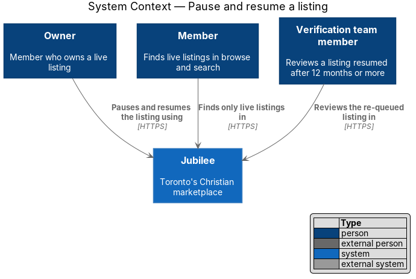
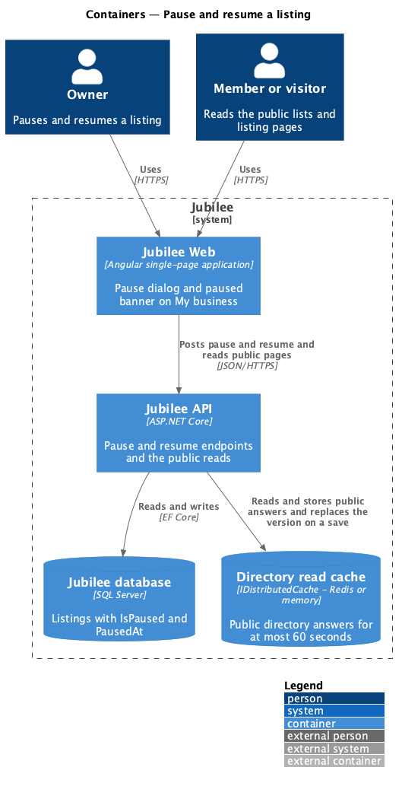
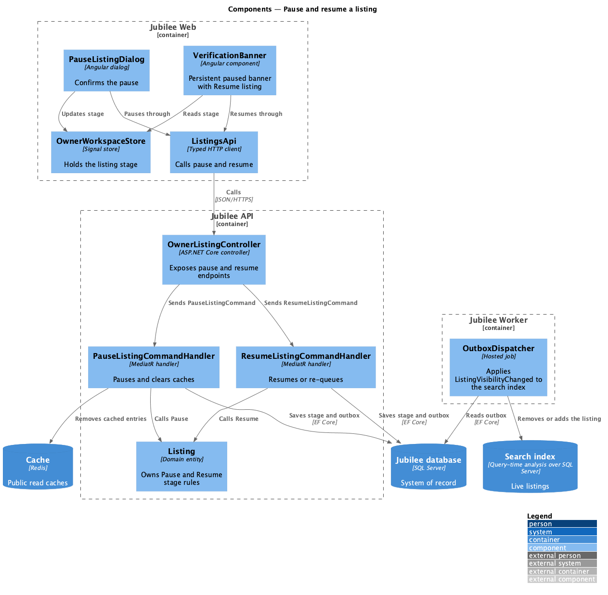
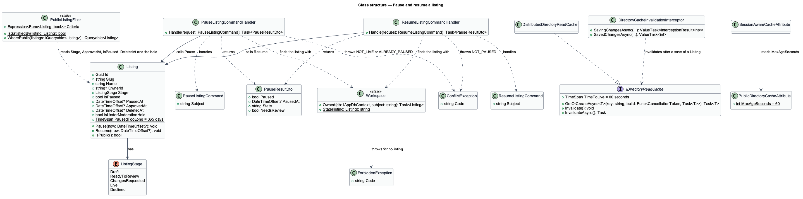
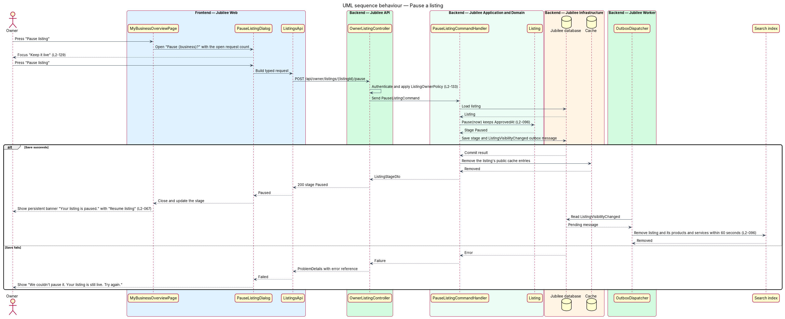
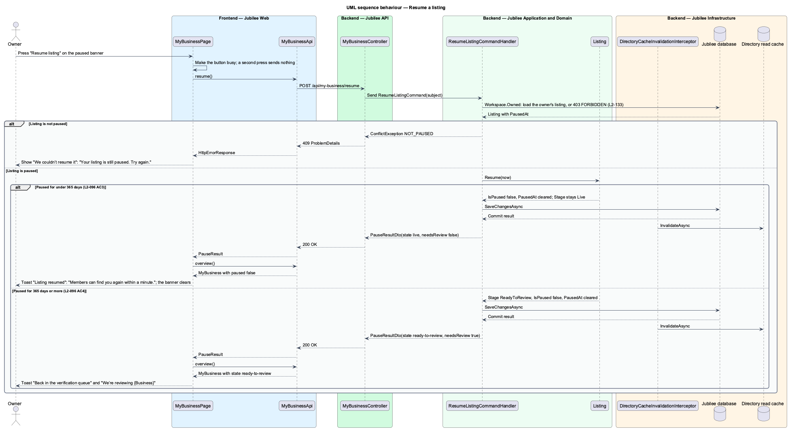

# Pause and resume a listing

## Overview

Jubilee is Toronto's Christian marketplace: a directory of verified
Christian-owned businesses. A *live* listing is one that the verification team
approved and that members can find in browse, category pages and search. This
feature lets the owner take a live listing out of public view for a while and
bring it back.

*Pausing* — hiding of a live listing from all public lists at the owner's request
— is not a deletion and not a loss of verification. Open requests and
conversations continue while the listing is paused, and the owner keeps the
verified status. While paused, the listing's URL returns 404 to everyone except
the owner and the verification team, who see a preview with its status.

*Resuming* makes the listing public again. A listing paused for under 12 months
returns without new verification. A listing paused for 12 months or more goes
back to the verification queue and is reviewed again before it is public.

Both changes reach public lists within 60 seconds. The owner starts a pause from
"Pause listing" on My business at `/my-business` and resumes from the persistent
banner that My business shows while the listing is paused.

## Description

The feature is a vertical slice from the pause dialog in `Jubilee Web` to
`Jubilee database` and the directory read cache. The names below are the names
in the code. ADR 0003 decides the cache, ADR 0023 the pause, and ADR 0052 the
proof of the 60-second bound.

- **`PauseListingDialog`** — Angular CDK dialog
  (`frontend/projects/jubilee/src/app/dialogs/pause-listing`) in a `jb-dialog`
  frame (`DialogFrame`), opened by `MyBusinessPage` with `PauseListingData`: the
  business name and the count of new requests. It is titled "Pause {business}?"
  with "Your listing is hidden from browse and search until you resume it. Your
  {n} open requests and your messages stay. You keep your verified status.",
  "Keep it live" (default focus, `L2-129`) and "Pause listing". While the
  request is in flight both buttons are disabled and "Pause listing" is busy. A
  failure shows the alert "We couldn’t pause it" with "Your listing is still
  live. Try again." and the button reads "Try again" (`L2-128`). On success the
  dialog closes with `PauseResult`.
- **`MyBusinessPage`** — hosts "Pause listing" in the "Your listing" card while
  the listing is not paused. After a pause it shows the success toast "Listing
  paused" with "It’s hidden from browse and search until you resume it." and
  reads the overview again.
- **Paused banner** — a `jb-alert` with `banner` at the top of `MyBusinessPage`
  while `MyBusiness.paused` is true: "Your listing is paused. It’s hidden from
  browse and search until you resume it." with "Resume listing" and no dismiss
  button (`L2-067` AC1). The banner is on My business only. The other workspace
  pages say so in the header: "Verified · paused, not public", with "Preview
  listing" in place of "View public listing".
- **Resume** — "Resume listing" calls `MyBusinessApi.resume`; the button is busy
  and a second press sends nothing. On success the page reads the overview
  again and shows the toast "Listing resumed" with "Members can find you again
  within a minute.", or, when `PauseResult.needsReview` is true, the info toast
  "Back in the verification queue" with "It was paused for a year, so we check
  it again before it’s public." A failure shows the alert "We couldn’t resume
  it" with "Your listing is still paused. Try again."
- **`MyBusinessApi`** — service contract behind the `MY_BUSINESS_API` injection
  token, implemented by `HttpMyBusinessApi`. `pause` calls
  `POST /api/my-business/pause` and `resume` calls
  `POST /api/my-business/resume`; both answer `PauseResult`. Neither names a
  listing: the API acts on the business the workspace shows.
- **`MyBusinessController`** — ASP.NET Core controller in `Jubilee.Api` at
  `api/my-business`. It reads the subject of the session cookie and sends
  `PauseListingCommand` and `ResumeListingCommand` through MediatR.
- **`Workspace.Owned`** — finds the listing the owner works on (the one chosen
  last in the switcher, else the live one, else the oldest). A caller who owns
  nothing receives HTTP 403 with code `FORBIDDEN` (`L2-133` AC3). There is no
  authorization policy class.
- **`PauseListingCommand`** and **`PauseListingCommandHandler`** — MediatR
  handler in `Jubilee.Application` (`OwnerWorkspace/OwnerWorkspace.cs`). A
  listing that is not live returns HTTP 409 with code `NOT_LIVE`; one already
  paused returns HTTP 409 with code `ALREADY_PAUSED`. Otherwise the handler
  calls `Listing.Pause(now)`, saves, and returns `PauseResultDto`.
- **`ResumeListingCommand`** and **`ResumeListingCommandHandler`** — a listing
  that is not paused returns HTTP 409 with code `NOT_PAUSED`. Otherwise the
  handler calls `Listing.Resume(now)`, saves, and returns `PauseResultDto` with
  `NeedsReview` true when the stage is no longer `Live`.
- **`PauseResultDto`** — `Paused`, `PausedAt`, `State` (the workspace state from
  `Workspace.State`, for example `paused`, `live` or `ready-to-review`) and
  `NeedsReview`.
- **`Listing`** — domain entity. A pause is not a stage: `Pause` sets `IsPaused`
  and records `PausedAt`, and leaves `Stage` at `Live` and `ApprovedAt`
  untouched, so the verified status is kept. `Resume` clears both. When the
  listing was paused for `Listing.PausedTooLong` (365 days) or more, `Resume`
  first moves `Stage` to `ReadyToReview`, which places the listing back with the
  verification team (`L2-096` AC4).
- **`PublicListingFilter`** — the one definition of a public listing: stage
  `Live`, approved, not paused, not deleted and not under a moderation hold
  (`L2-028`). Every public read applies it with `WherePublic`: welcome, browse,
  category lists and counts, the listing page, its related businesses, product
  pages and `DatabaseSearchIndex`. A paused listing is therefore absent from
  each read that is built after the pause, with no change to its requests or
  conversations. Search analyses the database at query time (ADR 0011), so
  there is no index to update and no outbox message for a pause.
- **Listing URL** — `GetListingPageQueryHandler` answers a paused listing with
  HTTP 404 `listing_not_found` to a visitor or another member. The owner and
  the verification team receive the page uncached, as a preview with its status
  (`L2-028` AC3, `L2-219`).
- **`IDirectoryReadCache`** and **`DistributedDirectoryReadCache`** (ADR 0003)
  — read cache for the public directory answers over `IDistributedCache`: Redis
  when `ConnectionStrings:Redis` is set, memory otherwise. An entry lives for at
  most `IDirectoryReadCache.TimeToLive`, 60 seconds, by the injected clock.
  Entries are keyed under a version; `Invalidate` replaces the version, which
  orphans every entry at once.
- **`DirectoryCacheInvalidationInterceptor`** — EF Core `SaveChangesInterceptor`
  in `Jubilee.Infrastructure`. After a save that added, changed or removed a
  `Listing`, `ListingPhoto`, `Product`, `Service` or `FeaturedSlot` it
  invalidates the cache. The save of a pause or a resume is such a save, so the
  next request shows the change; the handlers do not touch the cache
  themselves. If the invalidation fails, the entries expire within 60 seconds.
- **`PublicDirectoryCacheAttribute`** and **`SessionAwareCacheAttribute`** —
  result filters in `Jubilee.Api`. The directory and category reads answer
  `Cache-Control: public, max-age=60`. The listing and product pages answer the
  same to a visitor, varied by the cookie, and `private, no-store` to a
  signed-in caller. `SearchController` answers `private, no-store`. No copy held
  by a browser or a CDN is older than 60 seconds.

The 60-second bound of `L2-096` AC2 and AC3 and `L2-028` AC2 is proven by
`PauseBoundTests` (`backend/tests/Jubilee.Api.Tests`, ADR 0052) through the
owner's own endpoints:

- `L2_096_AC2_a_listing_its_owner_pauses_is_gone_from_every_public_page_on_the_next_request`
  — after `POST /api/my-business/pause`, welcome, browse home, the category list
  (plain and filtered), its count, search and the related businesses of a
  neighbour no longer hold the listing; its URL is 404 to a visitor and 200 to
  the owner.
- `L2_096_AC3_a_listing_its_owner_resumes_is_back_on_every_public_page_on_the_next_request`
  — after `POST /api/my-business/resume` each of those reads holds it again.
- `L2_028_AC2_a_pause_the_api_is_not_told_of_reaches_every_public_page_within_sixty_seconds`
  — a pause written behind the application is served from the cache for no
  longer than 60 seconds.
- `L2_096_AC2_no_public_read_may_be_kept_by_a_cache_for_more_than_sixty_seconds`
  — each public read carries `no-store` or a `max-age` of at most 60 seconds,
  and search is never stored.

`DirectoryCacheTests` proves the cached reads themselves, and
`OwnerWorkspaceTests` the rules of the two commands, among them
`L2_096_a_listing_paused_for_a_year_goes_back_to_verification_when_resumed` and
`L2_096_pausing_twice_is_refused_as_is_resuming_a_listing_that_runs`. The
Playwright behaviour specs are under "pause and resume (L2-096)" in
`e2e/tests/my-business.spec.ts`.

## Requirements

The feature realizes the following level-2 (L2) requirements. Each L2
requirement refines a level-1 (L1) requirement, cited by identifier.

| L2 ID | Refines (L1) | Requirement |
|-------|--------------|-------------|
| `L2-096` | `L1-013` | The system shall let the owner pause a live listing after a confirmation; the listing shall leave all public lists within 60 seconds and its URL shall return 404 to others, while open requests and conversations continue. A resumed listing shall be public again within 60 seconds without new verification if it was paused for under 12 months, and shall go back to the verification queue if it was paused for 12 months or more. |
| `L2-028` | `L1-003` | Browse, category, search, featured and related lists shall show only listings that are verified and not paused, deleted or under a moderation hold; a listing paused by its owner shall be absent within 60 seconds. A non-public listing's URL shall show the not-found page with HTTP 404, except that the owner and the verification team see a preview with its status. |
| `L2-156` | `L1-021` | Responses of the public directory and category pages shall be cached for up to 60 seconds; when the API saves a change to a listing, the cached responses shall be removed and the next response the API builds shall show the change; a copy held by another process, a CDN or a browser shall be at most 60 seconds old. |
| `L2-067` | `L1-010` | A condition that needs the user's action, such as a paused listing, shall show a persistent banner with no dismiss button on the relevant pages until it clears. |
| `L2-129` | `L1-018` | An action that unpublishes shall be confirmed in a dialog that states the consequence with real counts and names and focuses the safe choice by default. |
| `L2-128` | `L1-018` | A failed dialog submission shall show an error alert at the top of the dialog that says what did not happen, and the primary button shall read "Try again" for confirmations. |
| `L2-133` | `L1-019` | The server shall check ownership of the listing before doing anything and shall return 403 to an owner API call for a listing the caller does not own. |

## Diagrams

### System context

The owner pauses and resumes through Jubilee. Members and visitors stop finding
the listing, and a `Verification team member` reviews a listing that is resumed
after 12 months or more.

### Containers

`Jubilee API` changes the listing in `Jubilee database` and drops the entries of
the directory read cache. Public reads are built from the database through the
cache, and search reads the database at query time.

### Components

`PauseListingDialog` and the banner of `MyBusinessPage` call
`MyBusinessController` through `MyBusinessApi`. The two handlers delegate to
`Listing`; `DirectoryCacheInvalidationInterceptor` drops the cached reads on the
save, and every public read applies `PublicListingFilter`.

### Class structure

`Listing` holds `Stage`, `IsPaused`, `PausedAt` and `ApprovedAt`; `Pause` and
`Resume` own the rule. `PublicListingFilter` reads them, and
`IDirectoryReadCache` bounds how long a built answer is served.

### Behaviour — pause a listing

The owner confirms in the dialog, the handler saves the pause, and the save
drops the cached reads, so the next public request no longer holds the listing
(`L2-096` AC2).

### Behaviour — resume a listing

`Listing.Resume` chooses between staying `Live` and going back to
`ReadyToReview` from the length of the pause.

