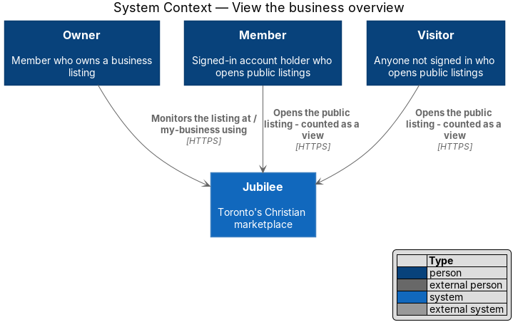
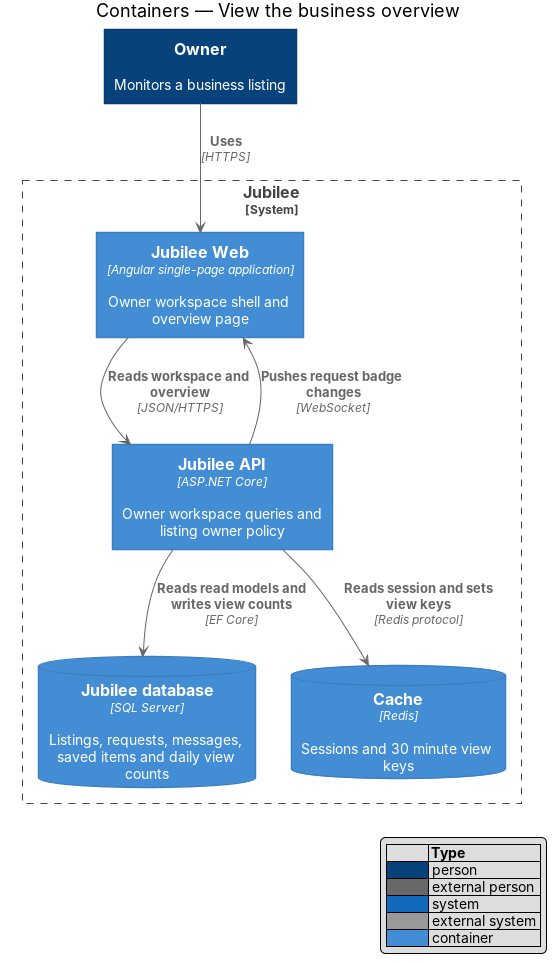
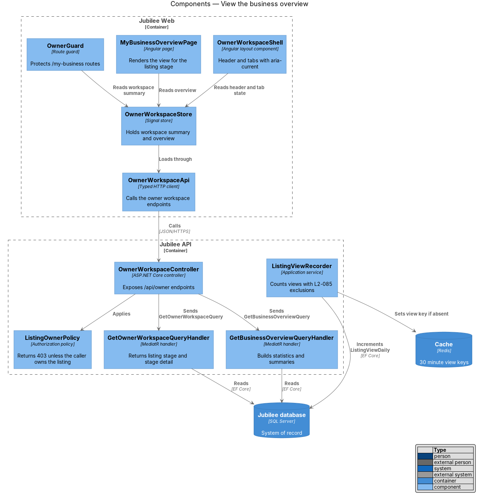
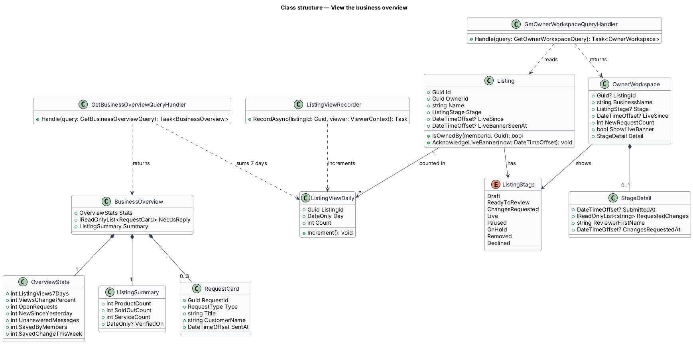
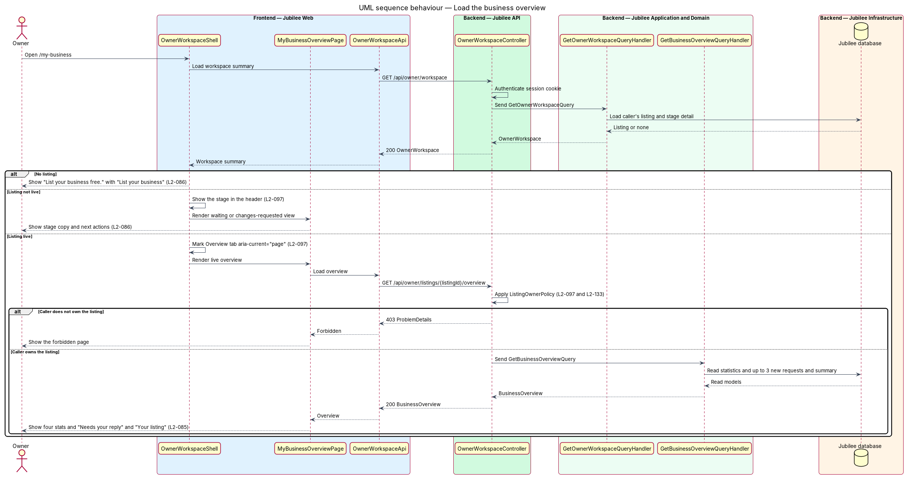
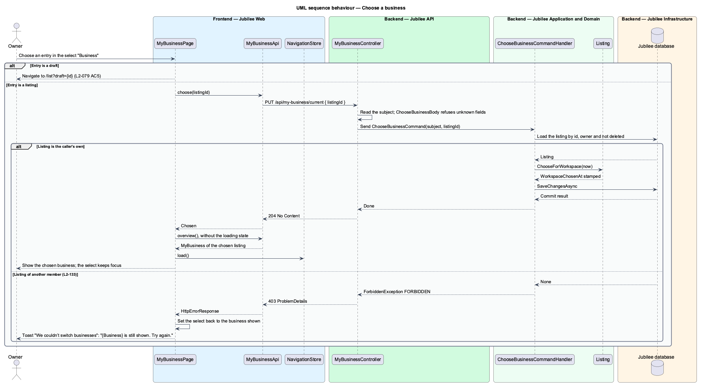
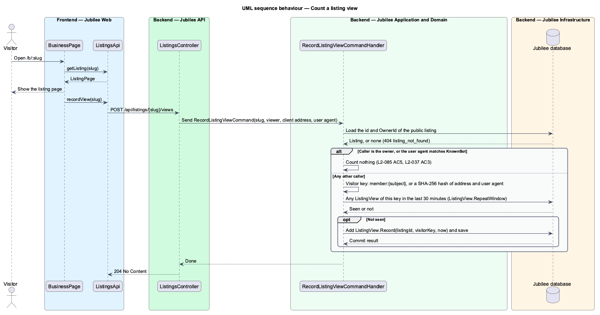

# View the business overview

## Overview

Jubilee is Toronto's Christian marketplace: a directory of verified
Christian-owned businesses. An *owner* is a member who owns one or more business
listings. The *owner workspace* is the set of pages under `/my-business` where an
owner monitors and manages a listing. This feature covers the workspace's first
page, My business at `/my-business`, the switcher between an owner's businesses,
and the access rule that protects every workspace route.

The overview changes with the *listing stage* — position of a listing in the path
from draft to public. A member with no listing sees an invitation to list a
business. A submitted listing shows that the verification team is reviewing it. A
listing with changes the verification team requested shows what the owner can
do next. A live listing shows four statistics, the new requests that wait for a
reply, and a summary of products, services and the verification status.

A *listing view* is one counted opening of the public listing page. The count
excludes repeat views by the same visitor within 30 minutes, the owner's own
views and known bots, so that the statistic reflects distinct interest.

*Saved by members* — number of different members who hold the business or one of
its products on their saved list. Its weekly change is how many of those members
first saved it in the last 7 days.

The *switcher* — select labelled "Business" at the top of My business. It names
each of the owner's listings with its stage and each draft not yet submitted.
The business chosen there is the one every page of the workspace shows from then
on.

The workspace header and its five tabs ("Overview", "Listing", "Products",
"Services", "Requests {n}") are described here because every other
owner-workspace feature renders under them.

## Description

The feature is a vertical slice from `MyBusinessPage` in `Jubilee Web` to
`Jubilee database`. The names below are the names in the code; the parts decided
in ADR 0052 are marked with it.

- **`MyBusinessPage`** — Angular page at `/my-business`
  (`frontend/projects/jubilee/src/app/pages/my-business`), a container of `jb-*`
  components. It reads `MyBusiness` once through `MyBusinessApi.overview` and
  renders by `state`: `none` shows the invitation; `ready-to-review`,
  `changes-requested` and `declined` show an alert, "Verification progress" and
  the card "How members see you"; a listing with `stats` shows the live overview.
  A failed load shows "We couldn’t load your business" with the reference of the
  answer, or `JB-BIZ-503` when the answer carries none (`L2-118`), "Try again"
  and "Back to browse". An answer of HTTP 403 navigates to `/forbidden`
  (`L2-097` AC1).
- **`WorkspaceHeader`** (`jb-workspace-header`) — component of the `components`
  library that every workspace page places at its top. It shows the business
  name, the subtitle the API words (for example "Verified · live since June
  2026"), "View public listing" for a live listing that is not paused and
  "Preview listing" otherwise, and the `jb-tabs` navigation "My business
  sections". Each tab is a router link; `Tabs` marks the current one with
  `aria-current="page"` (`L2-097` AC2). The "Requests" tab carries
  `MyBusiness.newRequests` as a count labelled "{n} open" when it is above zero
  (`L2-065` AC2).
- **Statistics** — four `jb-stat` in a `jb-stat-grid`: "Listing views, 7 days"
  with "↑ {n}% on last week" (or "↓", "Same as last week", "First views this
  week", "No views yet"), "Open requests" with "{n} new since yesterday" or
  "None new since yesterday", "Unanswered messages" with "Reply within a day to
  keep your badge", and "Saved by members" with "↑ {n} this week" or "None new
  this week" (`L2-085` AC2 and AC6).
- **"Needs your reply"** — at most 3 new requests, newest first, each with
  "Decline" and "Confirm", and the link "All requests" to
  `/my-business/requests`. The buttons open `DeclineRequestDialog` and
  `ConfirmRequestDialog`, which belong to the request handling features. With
  no new request the section shows "You’re all caught up".
- **"Your listing"** — card with the product count and "{n} sold out", the
  service count, "Verification" with "Verified {Mon YYYY}", the away period,
  "Manage" links to `/my-business/products` and `/my-business/services`, and
  "Pause listing", which belongs to
  [Pause and resume a listing](../pause-listing/README.md).
- **Banners** — a `jb-alert` with `banner`. A paused listing shows the persistent
  banner of the `pause-listing` feature. A listing approved in the last 7 days
  (`MyBusiness.justApproved`, `Workspace.JustApprovedFor`) shows the success
  banner "{Business} is verified and live. Members can find you in {category}."
  (`MyBusiness.categoryName`, for example "Shops") with "View listing" and "Dismiss";
  the dismissal is held in the page only.
- **The switcher** (ADR 0052, `L2-079` AC4 and AC5) — a native `select` with
  `jb-select` and the label "Business", shown when `MyBusiness.businesses` has
  more than one entry. Each option reads "{name} · {stageLabel}" and the
  business shown is selected. "List another business" links to
  `/list?draft=new` for every owner with a listing. Choosing a listing calls
  `MyBusinessApi.choose`, then reads the overview again and reloads
  `NavigationStore`; choosing a draft navigates to `/list?draft={id}`. The
  select is never disabled or redrawn, so it keeps focus. A failed switch sets
  the select back to the business shown and raises the danger toast "We couldn’t
  switch businesses" with "{Business} is still shown. Try again." The other
  workspace pages follow the choice without showing the select.
- **`memberGuard`** — route guard on every `/my-business` route. It sends a
  visitor to `/sign-in` with `returnUrl`. There is no owner guard: ownership is
  decided by the API, and each workspace page navigates to `/forbidden` on HTTP
  403.
- **`MyBusinessApi`** — service contract behind the `MY_BUSINESS_API` injection
  token, implemented by `HttpMyBusinessApi`
  (`frontend/projects/api/src/lib/api/my-business-api.ts`). `overview` calls
  `GET /api/my-business` and `choose` calls `PUT /api/my-business/current` with
  `{ listingId }`. The view models `MyBusiness`, `BusinessStats`,
  `BusinessStat`, `BusinessOption`, `NeedsReply` and `BusinessSummary` are in
  `models/my-business.ts`.
- **`MyBusinessController`** — ASP.NET Core controller in `Jubilee.Api` at
  `api/my-business`. It reads the subject of the session cookie and sends
  `GetMyBusinessQuery` and `ChooseBusinessCommand` through MediatR.
  `ChooseBusinessBody` is marked `JsonUnmappedMemberHandling.Disallow`: a body
  with any other field returns HTTP 400 (`L2-133` AC4). `Choose` answers HTTP
  204.
- **`GetMyBusinessQuery`** and **`GetMyBusinessQueryHandler`** — MediatR query
  in `Jubilee.Application` (`OwnerWorkspace/OwnerWorkspace.cs`). The handler
  reads the caller's listings with `Workspace.OwnedBy` and picks the one to show
  with `Workspace.Current`. A caller who owns nothing receives `MyBusinessDto`
  with `State` `none`, HTTP 200. For a live listing it builds
  `MyBusinessStatsDto` and `MyBusinessSummaryDto`; for a listing in
  `ChangesRequested` or `Declined` it adds `OwnerVerificationDto` from
  `GetOwnerVerificationQuery`. `NeedsReply` holds the 3 newest requests of
  status `New`, and `NewRequests` their total.
- **`MyBusinessDto`** — answer of the overview: `State` (`none`, `draft`,
  `ready-to-review`, `changes-requested`, `live`, `paused` or `declined`), the
  listing's name, slug, tagline and category, `Subtitle`, `Paused`, `PausedAt`,
  `JustApproved`, `NewRequests`, `Stats`, `NeedsReply`, `Summary`,
  `Verification`, `AwayUntil` and `Businesses`.
- **`MyBusinessStatsDto`** and **`StatDto`** — `Views` and `Saved` are `StatDto`
  (`Value`, `Change`); `OpenRequests`, `NewSinceYesterday` and
  `UnansweredMessages` are counts. `Views.Value` counts the `ListingView` rows of
  the last 7 days and `Views.Change` is that count less the count of the 7 days
  before; the page turns it into a percentage. `UnansweredMessages` counts the
  listing's conversations the owner has not muted and has not read since the
  last message.
- **Saved by members** (ADR 0052, `L2-085` AC6) — `SavedByMembers` in the
  handler reads the `SavedItem` rows of kind `Business` for the listing and of
  kind `Product` for its products, groups them by `MemberSubject` and takes each
  member's earliest `SavedAt`. `Saved.Value` is the number of members and
  `Saved.Change` is how many of those earliest saves fall in the last 7 days. A
  removed save leaves no row, so the change is never below zero and a fall is
  not shown. The answer is a count and names no member (`L2-041` AC6).
- **`BusinessOptionDto`** — one entry of the switcher: `Id`, `Name`, `Kind`
  (`listing` or `draft`), `StageLabel` and `Current`. The handler lists the
  owner's listings oldest first with `Workspace.StageLabel` ("Live", "Paused",
  "Pending verification", "Changes requested", "Declined" or "Draft"), then each
  `ListingDraft` of the owner as "Draft"; a draft without a name reads "Untitled
  business".
- **`ChooseBusinessCommand`** and **`ChooseBusinessCommandHandler`** (ADR 0052)
  — the handler loads the listing by `ListingId` and the caller's subject. A
  listing the caller does not own, or one that is deleted, throws
  `ForbiddenException`, HTTP 403 with code `FORBIDDEN`, and nothing changes. It
  calls `Listing.ChooseForWorkspace`, which stamps `Listing.WorkspaceChosenAt`.
  The choice is kept on the server, so it holds on every later visit.
- **`Workspace`** — internal static class with the rules the workspace shares.
  `Current` returns the listing with the latest `WorkspaceChosenAt`, else the
  live listing, else the oldest. `Find` and `Owned` apply it for every endpoint
  of `MyBusinessController`; `Owned` throws `ForbiddenException` for a caller
  who owns nothing (`L2-097` AC1, `L2-133` AC3). `IncomingRules.Owned` uses the
  same rule for the Products, Services and Requests endpoints when no listing is
  named. `State` maps the stage and the pause to the wire value and `Subtitle`
  words the line under the business name: "Verified · live since {Month YYYY}",
  "Verified · paused, not public", "Pending verification · submitted {when}",
  "Changes requested · not public yet", "Declined · not public" or "Draft · not
  submitted yet" (`L2-097` AC3).
- **`RecordListingViewCommand`** and **`RecordListingViewCommandHandler`** —
  count a listing view (`Listings/RecordListingViewCommand.cs`). `BusinessPage`
  calls `ListingsApi.recordView` after the listing page loads, which posts to
  `POST /api/listings/{slug}/views` on `ListingsController`. The handler returns
  without counting when the caller's subject is the listing's `OwnerId` or the
  user agent matches the `KnownBot` pattern (`bot`, `crawl`, `spider`, `slurp`,
  `facebookexternalhit`, `bingpreview`). The visitor key is `member:{subject}`
  for a member and a SHA-256 hash of the client address and user agent for a
  visitor; no address is stored. A `ListingView` with the same key inside
  `ListingView.RepeatWindow` (30 minutes) is the same view; otherwise the
  handler adds one row.
- **`ListingView`** — domain entity holding `ListingId`, `VisitorKey` and
  `ViewedAt`, one row per counted view. The statistic counts rows by time; there
  is no daily aggregate and no cache key.

The invitation reads "List your business free" with "Tell members what you
offer, submit it for verification, and you’re live once we approve it. It takes
about ten minutes.", "List your business" (to `/list`) and "How verification
works" (to `/help`). The pending view is an alert headed "We’re reviewing
{Business}" with "You submitted it {when}. We review and publish within two
business days." and no action. The changes-requested view is headed "{n}
changes needed before we can publish" (the number in words, "One change needed"
for one) and shows the reviewer's message, "{Reviewer first name} from the
verification team, {date}" and "Edit listing", which links to
`/my-business/listing`.

The integration tests are in `OwnerWorkspaceTests`
(`backend/tests/Jubilee.Api.Tests`), among them
`L2_085_AC6_saved_by_members_counts_each_member_once_with_those_who_first_saved_this_week`,
`L2_079_AC5_choosing_another_business_moves_the_whole_workspace_to_it_until_the_owner_chooses_again`
and `L2_079_AC5_a_listing_of_another_member_cannot_be_chosen_and_nothing_changes`.
The Playwright behaviour specs are in `e2e/tests/my-business.spec.ts` with the
page object `e2e/pages/my-business.page.ts`.

## Requirements

The feature realizes the following level-2 (L2) requirements. Each L2
requirement refines a level-1 (L1) requirement, cited by identifier.

| L2 ID | Refines (L1) | Requirement |
|-------|--------------|-------------|
| `L2-085` | `L1-013` | The system shall provide `/my-business` as the owner's workspace for a live listing, with the header, the tabs "Overview", "Listing", "Products", "Services" and "Requests {n}", four stats, up to 3 new requests under "Needs your reply" and the "Your listing" summary. Listing views shall exclude repeat views by the same visitor within 30 minutes, the owner's own views and known bots. "Saved by members" shall be the number of different members who have the business or one of its products on their saved list, with the weekly change as how many of them first saved it in the last 7 days: "↑ 4 this week", or "None new this week". |
| `L2-086` | `L1-013` | Before a listing is live, `/my-business` shall show the invitation to list a business, "We're reviewing {Business}" with no action, or the requested changes with "Edit listing", according to the listing's stage. After approval it shall show the success banner "{Business} is verified and live. Members can find you in {category}." with "View listing". |
| `L2-079` | `L1-011` | For an owner with more than one listing, or a draft besides a listing, the switcher shall be a select labelled "Business" that names each listing with its stage and each draft not yet submitted, with the listing shown selected, and "List another business" beside it. When the owner chooses another listing, My business, Listing, Products, Services and Requests shall show that listing from then on, on this and every later visit, until the owner chooses again. Naming a listing of another member shall be refused with HTTP 403 and nothing changes. A failed switch shall raise the toast "We couldn’t switch businesses". |
| `L2-097` | `L1-013` | The system shall return HTTP 403 and show the forbidden page for any `/my-business/*` route or owner API requested by a member who does not own the listing. The active tab shall be marked `aria-current="page"`, and a listing that is not live shall show its stage in the header instead of "Verified · live since". |
| `L2-133` | `L1-019` | The server shall check the caller's role and ownership of the specific object on every API endpoint before doing anything, and shall return 403 when an owner API is called for a listing the caller does not own. |
| `L2-065` | `L1-010` | The "Requests" tab of the owner workspace shall carry the number of `new` requests. |
| `L2-037` | `L1-005` | When the owner views their own listing, no listing view shall be counted in their statistics. |
| `L2-041` | `L1-006` | "Saved by members" shall count unique members, without revealing who. |
| `L2-118` | `L1-016` | Every load-error state shall show a reference the user can quote to support; the overview uses `JB-BIZ-503`. |

## Diagrams

### System context

The owner works with Jubilee alone for this feature. Visitors and members appear
because their openings of the public listing page feed the view statistic.

### Containers

`Jubilee Web` reads the overview from `Jubilee API` and sends the owner's choice
of business to it. `Jubilee API` reads `Jubilee database` and writes one
`ListingView` row per counted view.

### Components

`MyBusinessPage` composes `WorkspaceHeader` and calls `MyBusinessController`
through `MyBusinessApi`. Both handlers of the overview use `Workspace` to find
the owner's listing. `RecordListingViewCommandHandler` is the only writer of
`ListingView`.

### Class structure

`MyBusinessDto` carries the state that selects the view, `MyBusinessStatsDto`
with its two `StatDto`, the `NeedsReplyDto` rows, `MyBusinessSummaryDto` and the
`BusinessOptionDto` entries of the switcher. `Listing.WorkspaceChosenAt` holds
the owner's choice and `ListingView` holds the counted views.

### Behaviour — load the overview

`MyBusinessPage` makes one request. A member with no listing sees the
invitation, a listing that is not live shows where it stands, and only a live
listing carries the statistics. An answer of HTTP 403 shows the forbidden page.

### Behaviour — choose a business

The owner's choice is stamped on the listing, and the next read of the overview
shows the chosen business (`L2-079` AC5). A listing of another member is refused
with HTTP 403, and a failed switch puts the select back.

### Behaviour — count a listing view

`BusinessPage` reports each opening of a public listing page.
`RecordListingViewCommandHandler` applies the three exclusions of `L2-085` AC5
before it adds a `ListingView`.

