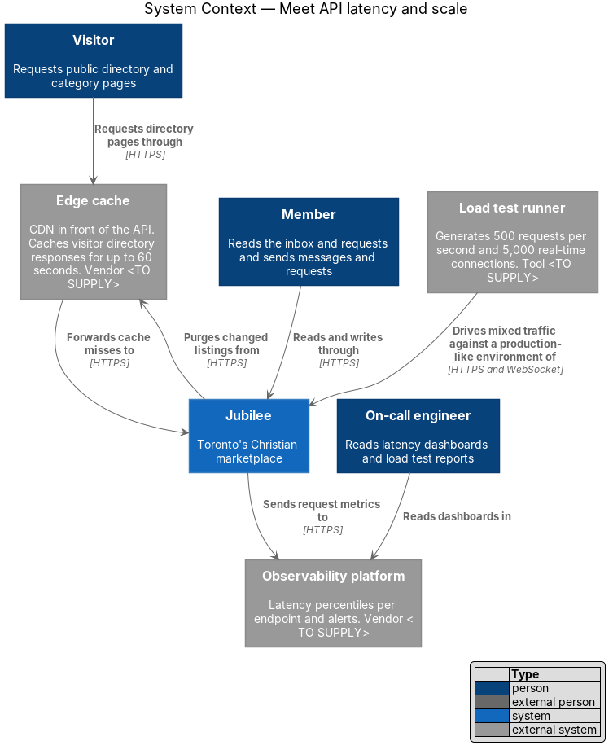
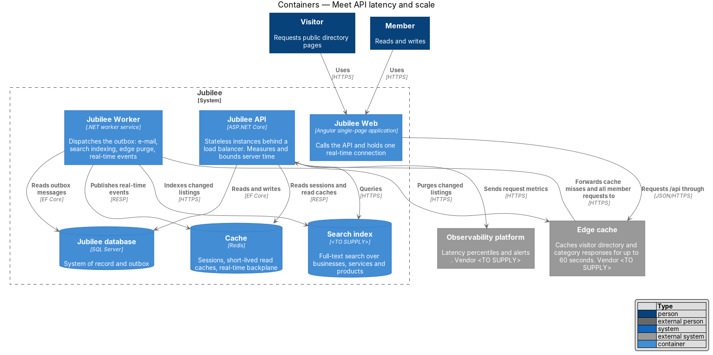
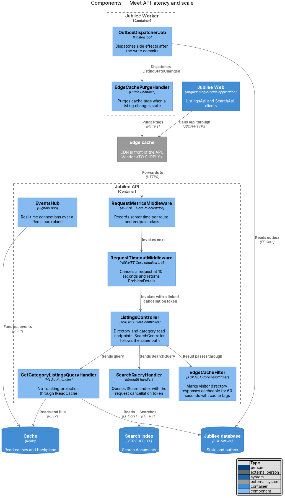
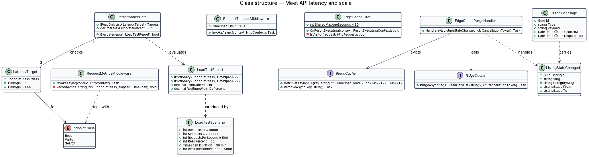
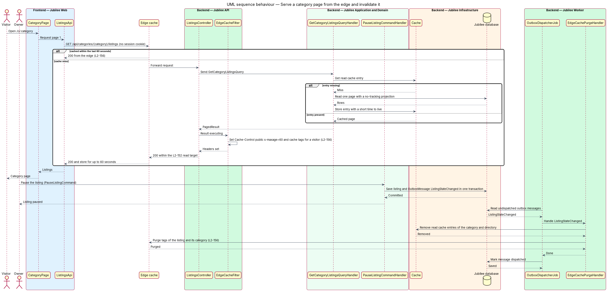
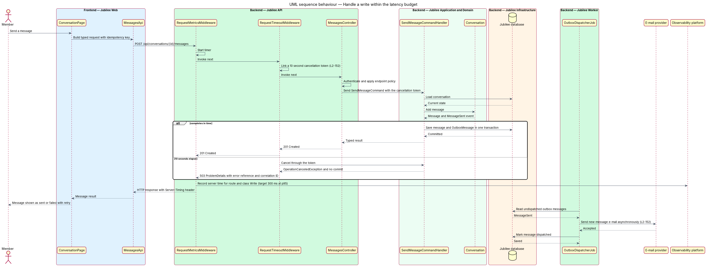
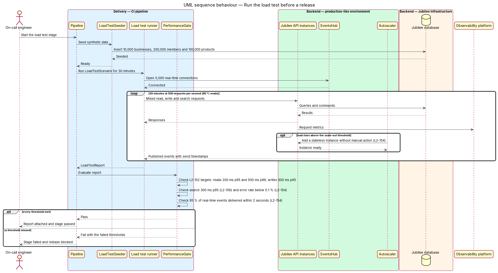

# Meet API latency and scale

## Overview

Jubilee is Toronto's Christian marketplace: a directory of verified
Christian-owned businesses that members browse, search, message and send
requests to. The directory is expected to grow beyond its launch size to
thousands of businesses and members. This feature is the set of mechanisms in
`Jubilee API`, `Jubilee Worker` and the delivery pipeline that keep server
response times inside fixed targets as the directory and its traffic grow, and
that prove it before a release.

The feature uses these terms:

- **server time** — interval between `Jubilee API` receiving a request and writing the last byte of its response, excluding network transfer
- **read endpoint** — endpoint that returns directory, category, listing, product, inbox or request data without changing state
- **write endpoint** — endpoint that sends a message, sends a request, confirms a request or saves an item
- **edge cache** — CDN layer in front of `Jubilee API` that stores a response and serves it to later callers without reaching the API
- **side effect** — work caused by a write that the caller does not wait for: e-mail, notifications, search indexing, edge purge and real-time events
- **stateless app server** — API instance that holds no session or connection state of its own, so that any instance can serve any request

The targets are: read endpoints at most `200 ms` at the 95th percentile and
`500 ms` at the 99th; write endpoints at most `300 ms` at the 95th percentile;
search at most `300 ms` at the 95th percentile; no request longer than `10 s`.
Browser-side budgets, bundle sizes and image delivery belong to the sibling
feature `meet-page-budgets`.

## Description

The slice adds two middleware components and one result filter to
`Jubilee.Api`, one outbox handler to `Jubilee.Worker`, and a load test stage to
the CI pipeline. It relies on the transactional outbox that every write handler
uses.

- **`RequestMetricsMiddleware`** — ASP.NET Core middleware placed after
  `CorrelationIdMiddleware`. It times each request, classifies the route as
  `Read`, `Write` or `Search` (`EndpointClass`), and records the server time per
  route template in the `Observability platform`. It adds a `Server-Timing`
  response header. The platform computes the 95th and 99th percentiles and
  raises the latency alert of `L2-176`.
- **`RequestTimeoutMiddleware`** — ASP.NET Core middleware that links a
  `10 s` limit to the request `CancellationToken`. Controllers, handlers,
  `JubileeDbContext` queries and `ISearchIndex` calls receive that token. At
  `10 s` the middleware cancels the request, no unit of work commits, and the
  response is a `503` `ProblemDetails` with the error reference and correlation
  ID of `L2-118`. `EventsHub` connections are excluded.
- **Read query handlers** — MediatR query handlers such as
  `GetCategoryListingsQueryHandler`. Each one reads with a no-tracking EF Core
  projection that selects only the returned columns, pages through
  `PageRequest` (at most `50` rows), and is backed by an index for its filter
  and sort. Index definitions are `<TO SUPPLY>`.
- **`IReadCache`** — application service over `Cache` (Redis). Directory and
  category handlers call `GetOrSetAsync` with a time to live of `<TO SUPPLY>`;
  a failure of `Cache` falls through to the database (`L2-181`).
- **`EdgeCacheFilter`** — ASP.NET Core result filter on
  `GET /api/directory` and `GET /api/categories/{category}/listings`. For a
  request without a session cookie it sets `Cache-Control: public, s-maxage=60`
  and a cache-tag header naming the category and each listing (header name
  `<TO SUPPLY>`). For a signed-in request it sets `Cache-Control: private, no-store`.
- **`ListingStateChanged`** — domain event raised when a `Listing` changes
  `ListingStage` (for example on approval, pause or resume). The write handler
  stores it as an `OutboxMessage` in the same transaction as the state change.
- **`EdgeCachePurgeHandler`** — outbox handler in `Jubilee Worker`. On
  `ListingStateChanged` it removes the matching `IReadCache` entries and calls
  `IEdgeCache.PurgeAsync` with the listing and category tags, so the edge cache
  does not serve the earlier state for the rest of its `60 s`.
- **`OutboxDispatcherJob`** — hosted job in `Jubilee Worker` that dispatches
  each `OutboxMessage` after the write commits. E-mail sending, notifications,
  search indexing and real-time events run here, outside the `300 ms` write
  target.
- **`SearchQueryHandler`** — MediatR handler for `GET /api/search?q=`. It
  queries `ISearchIndex` (product `<TO SUPPLY>`) and returns grouped results.
  The index is sized for `10,000` listings and `100,000` products.
- **`EventsHub` backplane** — the SignalR hub shares a Redis backplane in
  `Cache`, so an event published on any API instance reaches a connection held
  by any other instance.
- **Stateless `Jubilee API` instances** — `Session` data, rate-limit counters
  and `IdempotencyRecord` entries live in `Cache`, not in instance memory. A
  load balancer spreads requests, and an autoscaling rule adds instances
  without manual action; the rule metric and thresholds are `<TO SUPPLY>`.
- **`LoadTestScenario`** — definition of the release load test: `10,000`
  businesses, `200,000` members, `500` requests per second of mixed traffic
  with `80 %` reads, for `30 minutes`, plus `5,000` concurrent real-time
  connections. `LoadTestSeeder` creates the synthetic data in a production-like
  environment that holds no real personal data. The load test tool is `<TO SUPPLY>`.
- **`PerformanceGate`** — pipeline step that evaluates the `LoadTestReport`
  against each `LatencyTarget`, an error rate below `0.1 %`, and delivery of
  `95 %` of real-time events within `2 seconds`. A missed threshold fails the
  stage.

## Requirements

The feature realizes the following level-2 (L2) requirements. Each L2
requirement refines a level-1 (L1) requirement, cited by identifier.

| L2 ID | Refines (L1) | Requirement |
|-------|--------------|-------------|
| `L2-152` | `L1-021` | Server time of read endpoints (directory, category, listing, product, inbox, requests) shall be at most 200 ms at the 95th percentile and at most 500 ms at the 99th. Server time of write endpoints (send message, send request, confirm, save) shall be at most 300 ms at the 95th percentile, with e-mail sending and other side effects run asynchronously, and any endpoint that would exceed 10 seconds shall be cancelled and return an error. |
| `L2-154` | `L1-021` | A 30-minute load test of 10,000 businesses, 200,000 members and 500 requests per second of mixed traffic (80 % reads) against a production-like environment shall meet the latency targets of `L2-152` with an error rate below 0.1 %. With 5,000 concurrent real-time connections, 95 % of published events shall be delivered within 2 seconds, and the application tier shall scale horizontally without manual intervention when traffic doubles. |
| `L2-156` | `L1-021` | With 10,000 listings and 100,000 products, a search shall return results in at most 300 ms at the 95th percentile. Responses for the public directory and category pages requested by visitors shall be cached at the edge for up to 60 seconds and invalidated when a listing changes state. |
| `L2-070` | `L1-010` | A notification, message or request event for a signed-in user shall reach the open page within 2 seconds at the 95th percentile over a persistent connection. |
| `L2-118` | `L1-016` | Each load-error state shall show a reference that the user can quote to support. |

## Diagrams

### System context

Visitors reach the public directory through the edge cache, and members read
and write through Jubilee directly. Jubilee purges changed listings from the
edge cache and sends request metrics to the `Observability platform`. A load
test runner drives a production-like environment before a release.

### Containers

`Jubilee API` runs as stateless instances that read `Jubilee database`, `Cache`
and `Search index`. `Jubilee Worker` dispatches the outbox, which includes
search indexing, real-time events and edge purges.

### Components

Each request passes `RequestMetricsMiddleware` and `RequestTimeoutMiddleware`
before its controller. `EdgeCacheFilter` marks visitor directory responses as
cacheable, and `EdgeCachePurgeHandler` in `Jubilee Worker` purges them when a
listing changes state.

### Class structure

`PerformanceGate` checks three `LatencyTarget` values, one per `EndpointClass`,
against a `LoadTestReport`. `EdgeCachePurgeHandler` handles
`ListingStateChanged`, which an `OutboxMessage` carries, and calls `IEdgeCache`
and `IReadCache`.

### Behaviour — serve a category page from the edge and invalidate it

A visitor request is answered by the edge cache when a copy under `60 s` old
exists; otherwise the handler reads through `IReadCache` and `EdgeCacheFilter`
marks the response cacheable. When an owner pauses a listing, the outbox
carries `ListingStateChanged` to `EdgeCachePurgeHandler`, which purges both
caches.

### Behaviour — handle a write within the latency budget

The handler commits the message and its `OutboxMessage` in one transaction and
returns; `OutboxDispatcherJob` sends the e-mail afterwards. When `10 s` elapse,
`RequestTimeoutMiddleware` cancels the request and returns a `503`
`ProblemDetails`. `RequestMetricsMiddleware` records the server time in both
cases.

### Behaviour — run the load test before a release

The pipeline seeds synthetic data, runs `LoadTestScenario` for `30 minutes`
with `5,000` real-time connections, and passes the `LoadTestReport` to
`PerformanceGate`. A missed threshold fails the stage and blocks the release.

