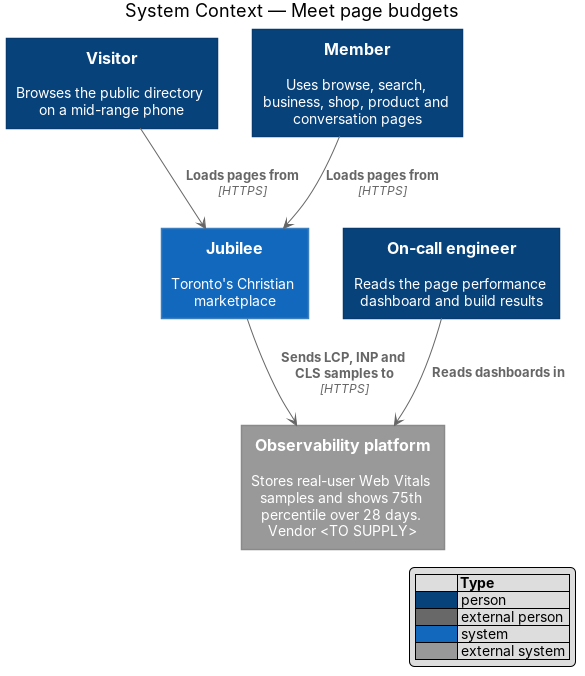
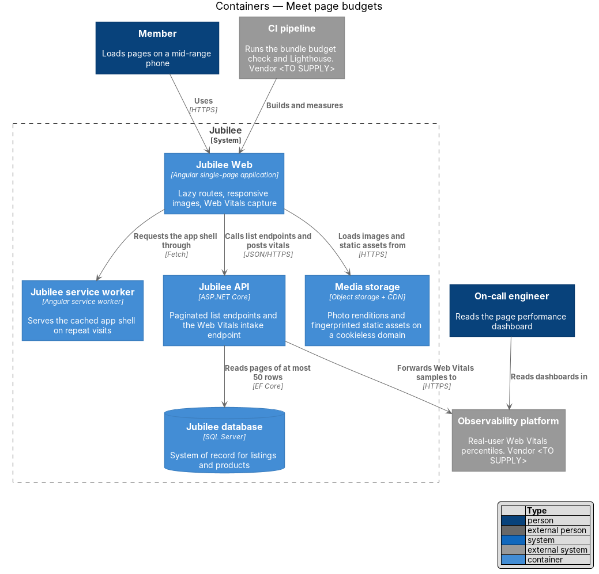
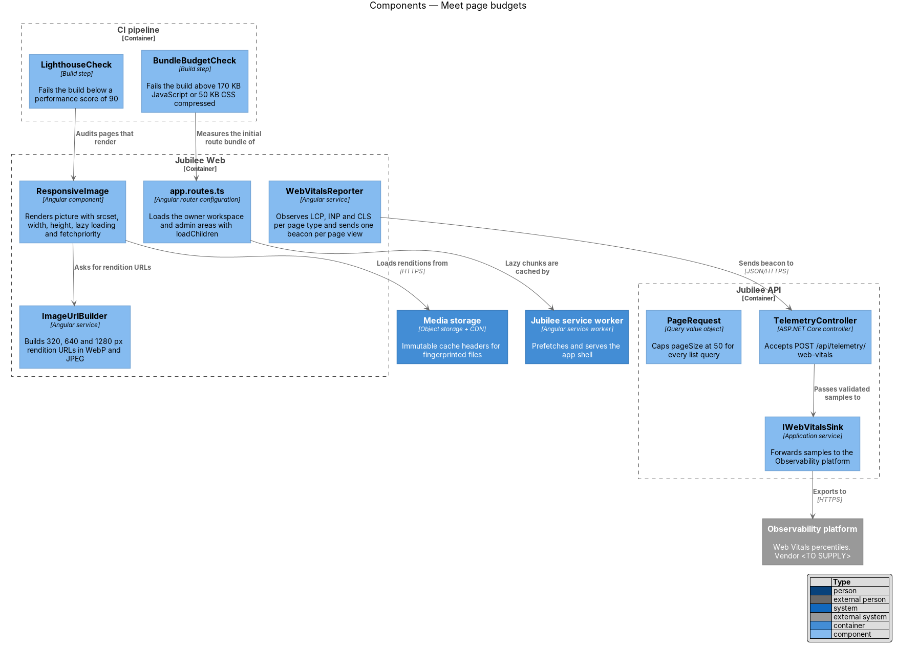
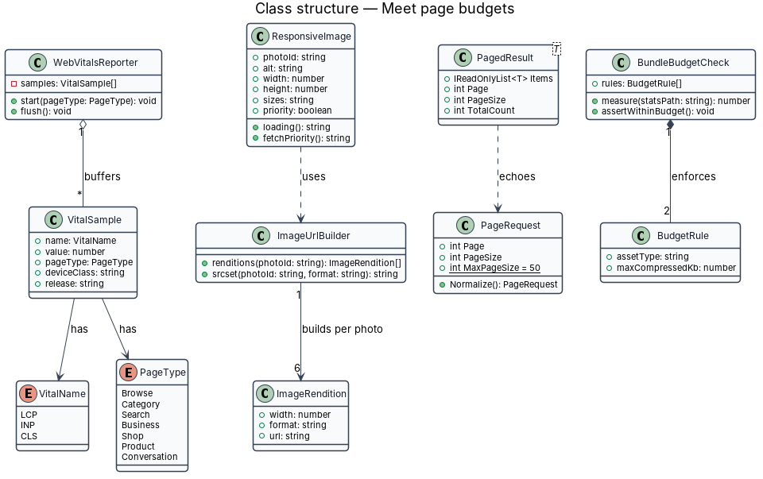
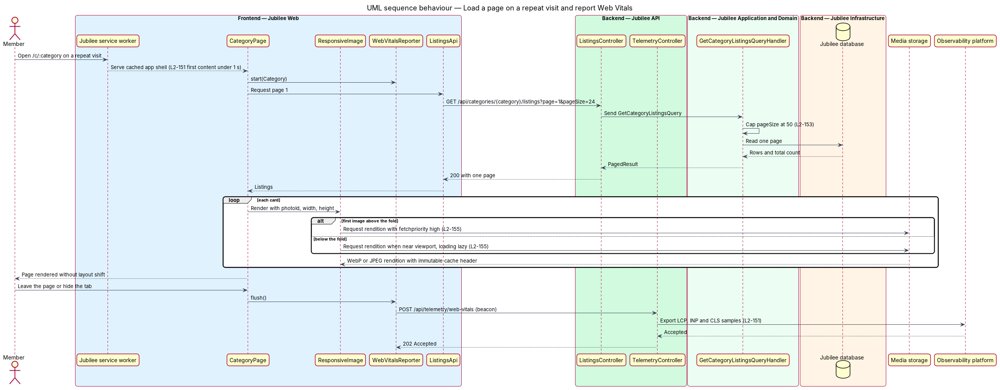
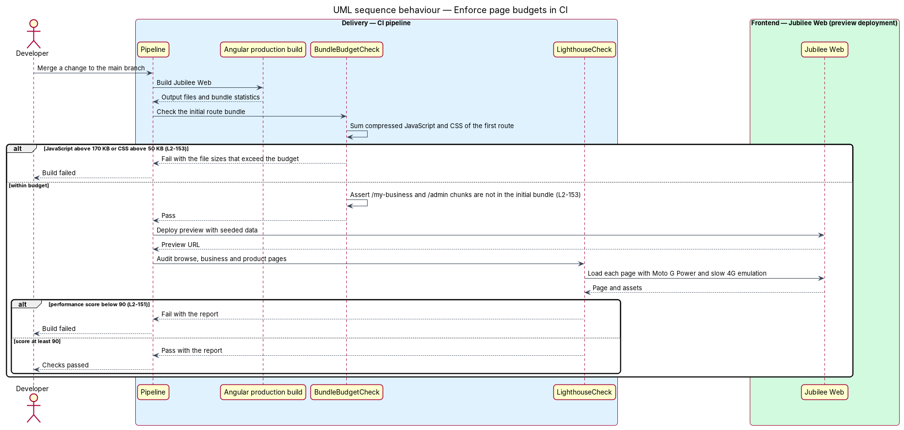

# Meet page budgets

## Overview

Jubilee is Toronto's Christian marketplace: a directory of
Christian-owned businesses that members browse, message and send requests to.
Most visits arrive on mid-range phones over mobile networks, so each page shall
load and respond within fixed limits. This feature is the set of frontend,
delivery and API mechanisms that keep pages inside those limits and that fail a
build or raise a measurement when a limit is passed.

Three kinds of limit apply: limits measured on real devices, limits measured on
the built application, and rules applied to each image. The feature uses these terms:

- **Web Vitals** — browser-reported measures of page experience: Largest Contentful Paint (LCP), Interaction to Next Paint (INP) and Cumulative Layout Shift (CLS)
- **real-user monitoring** — collection of Web Vitals from the browsers of actual visitors, aggregated at the 75th percentile on mobile over 28 days
- **payload budget** — upper bound on the compressed bytes transferred for the first route: 170 KB of JavaScript and 50 KB of CSS
- **app shell** — static HTML, CSS and JavaScript that draw the frame of the application before any data arrives
- **rendition** — resized copy of an uploaded photo; `L2-088` produces renditions 320, 640 and 1280 px wide in WebP and JPEG

The feature has no screen of its own. It adds a small number of shared parts to
`Jubilee Web`, one intake endpoint and one paging rule to `Jubilee API`, and two
checks to the CI pipeline. API response times, load tests and edge caching of
directory responses belong to the sibling feature `meet-api-latency-and-scale`.

## Description

The slice runs from the build pipeline through the browser to the
`Observability platform`.

- **`WebVitalsReporter`** — Angular service in `Jubilee Web`. It observes LCP,
  INP and CLS with `PerformanceObserver` on the browse, category, search,
  business, shop, product and conversation pages. It tags each `VitalSample`
  with the `PageType`, the device class and the release version, and it carries
  no member identifier. It sends one batch per page view with
  `navigator.sendBeacon` when the page is hidden.
- **`TelemetryController`** — ASP.NET Core controller in `Jubilee API`. It
  accepts `POST /api/telemetry/web-vitals`, validates the batch, applies
  `RateLimitMiddleware`, and returns `202 Accepted`. It passes the samples to
  `IWebVitalsSink`.
- **`IWebVitalsSink`** — application service whose infrastructure adapter
  exports the samples to the `Observability platform` (vendor `<TO SUPPLY>`).
  The platform dashboard shows the 75th percentile on mobile over 28 days per
  `PageType` against the targets: LCP at most `2.5 s`, INP at most `200 ms`,
  CLS at most `0.1`.
- **`LighthouseCheck`** — CI step. It runs Lighthouse with mobile emulation
  (Moto G Power, slow 4G) against the browse, business and product pages of a
  preview deployment. A performance score below `90` on any of the three pages
  fails the build.
- **`BundleBudgetCheck`** — CI step that runs after the Angular production
  build. It reads the bundle statistics, sums the compressed size of the
  JavaScript and of the CSS that the first route transfers, and fails the build
  above `170 KB` or `50 KB`. The compression algorithm used for measurement is
  `<TO SUPPLY>`. It also asserts that no owner workspace or admin chunk is part
  of the initial bundle.
- **`app.routes.ts`** — Angular router configuration. Routes beyond the first
  are lazy-loaded: the owner workspace under `/my-business` loads through
  `loadChildren`, guarded by `OwnerGuard`. The staff screens are not in the app
  but in the admin application (`admin/run-admin-application`).
- **`Jubilee service worker`** — Angular service worker. Its `ngsw-config.json`
  declares the app shell as a prefetched asset group, so a repeat visit serves
  the shell from cache and first content renders in under `1 s`.
- **`ResponsiveImage`** — Angular component used for each listing and product
  photo. It renders a `picture` element with a WebP `source` and a JPEG `img`
  fallback, each with a `srcset` of the `320w`, `640w` and `1280w` renditions,
  explicit `width` and `height`, and `loading="lazy"`. When its `priority` input
  is set, it renders `loading="eager"` and `fetchpriority="high"`; each page
  sets `priority` on the largest image above the fold only.
- **`ImageUrlBuilder`** — Angular service that builds rendition URLs on the
  cookieless `Media storage` domain from a photo identifier, a width and a
  format.
- **`Media storage`** — object storage behind a CDN. It serves photo renditions
  and the fingerprinted static assets of the Angular build with
  `Cache-Control: public, max-age=<TO SUPPLY>, immutable`. `index.html` and
  `ngsw.json` are not fingerprinted and are served with `Cache-Control: no-cache`.
- **`PageRequest`** — query value object shared by every list query in
  `Jubilee.Application`. `MaxPageSize` is `50`; `Normalize()` reduces a larger
  `pageSize` to `50` and a missing one to the endpoint default.
- **`PagedResult<T>`** — response envelope of every list endpoint. It carries
  `Items`, `Page`, `PageSize` and `TotalCount`, so no endpoint returns an
  unbounded collection.

## Requirements

The feature realizes the following level-2 (L2) requirements. Each L2
requirement refines a level-1 (L1) requirement, cited by identifier.

| L2 ID | Refines (L1) | Requirement |
|-------|--------------|-------------|
| `L2-151` | `L1-021` | Real-user monitoring at the 75th percentile on mobile over 28 days shall show Largest Contentful Paint at most 2.5 s, Interaction to Next Paint at most 200 ms and Cumulative Layout Shift at most 0.1 on browse, category, search, business, shop, product and conversation pages. A Lighthouse mobile run in CI on browse, business and product pages shall score at least 90, and a repeat visit shall serve the app shell from cache and render first content in under 1 s. |
| `L2-153` | `L1-021` | The JavaScript transferred for the first route shall be at most 170 KB compressed and the CSS at most 50 KB compressed, and the build shall fail when a budget is exceeded. Routes beyond the first shall be lazy-loaded, and list APIs shall paginate with a maximum page size of 50. |
| `L2-155` | `L1-021` | Each listing or product image shall use `srcset` with the renditions of `L2-088`, WebP or AVIF with JPEG fallback, explicit width and height, and `loading="lazy"` below the fold; the largest image above the fold shall use `fetchpriority="high"`. Static assets and images shall come from a CDN with immutable cache headers for fingerprinted files. |
| `L2-088` | `L1-013` | The system shall strip metadata from each uploaded photo and shall produce resized renditions at 320, 640 and 1280 px wide in WebP and JPEG. |

## Diagrams

### System context

Visitors and members load pages from Jubilee. Jubilee sends anonymous Web Vitals
samples to the `Observability platform`, where the on-call engineer reads the
percentiles.

### Containers

`Jubilee Web` receives its app shell from the `Jubilee service worker`, its data
from `Jubilee API` and its images and static assets from `Media storage`. The CI
pipeline builds and measures `Jubilee Web` before each deployment.

### Components

Inside `Jubilee Web`, `ResponsiveImage` and `ImageUrlBuilder` produce the image
markup, `WebVitalsReporter` sends samples to `TelemetryController`, and
`app.routes.ts` defines the lazy routes. `BundleBudgetCheck` and
`LighthouseCheck` sit in the CI pipeline.

### Class structure

`WebVitalsReporter` buffers `VitalSample` values. `ResponsiveImage` depends on
`ImageUrlBuilder`, which builds six `ImageRendition` values per photo (three
widths in two formats). `PagedResult<T>` echoes the normalized `PageRequest`,
and `BundleBudgetCheck` owns two `BudgetRule` values.

### Behaviour — load a page on a repeat visit and report Web Vitals

The `Jubilee service worker` serves the cached app shell, the list query returns
one capped page, and `ResponsiveImage` prioritises the first image and defers
the rest. When the page is hidden, `WebVitalsReporter` sends one beacon that
`TelemetryController` forwards to the `Observability platform`.

### Behaviour — enforce page budgets in CI

`BundleBudgetCheck` fails the build when the first route exceeds `170 KB` of
JavaScript or `50 KB` of CSS. `LighthouseCheck` then audits a preview deployment
and fails the build below a score of `90`.

