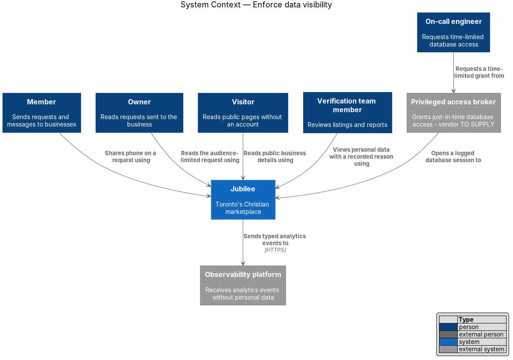
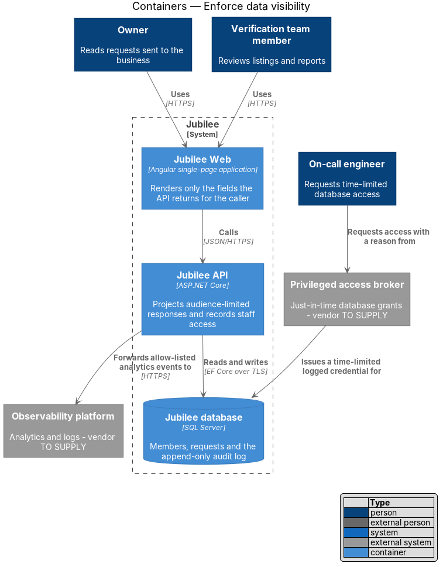
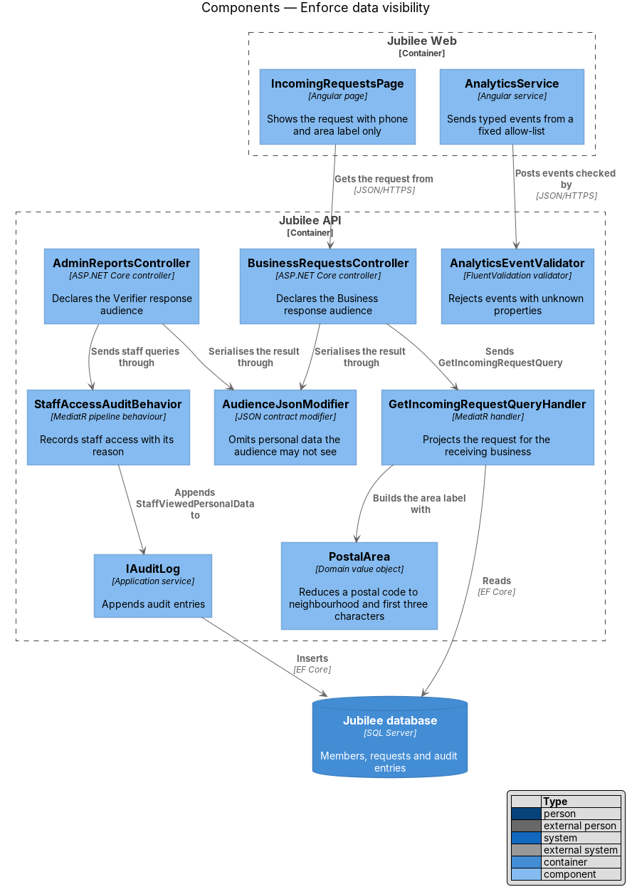
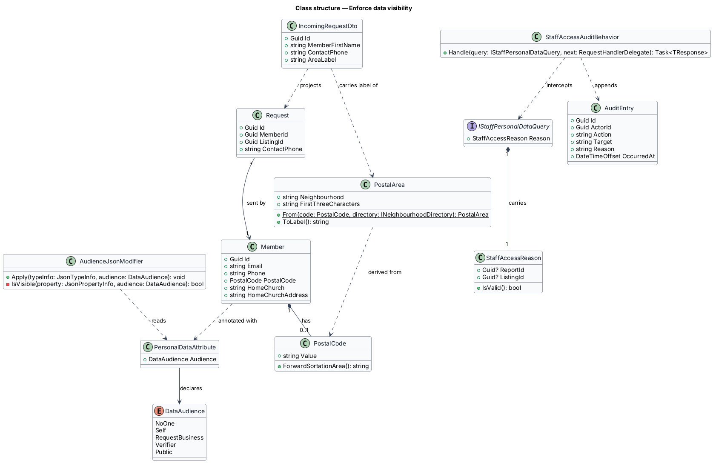
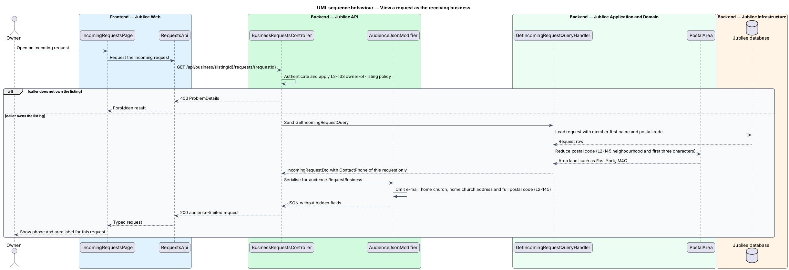
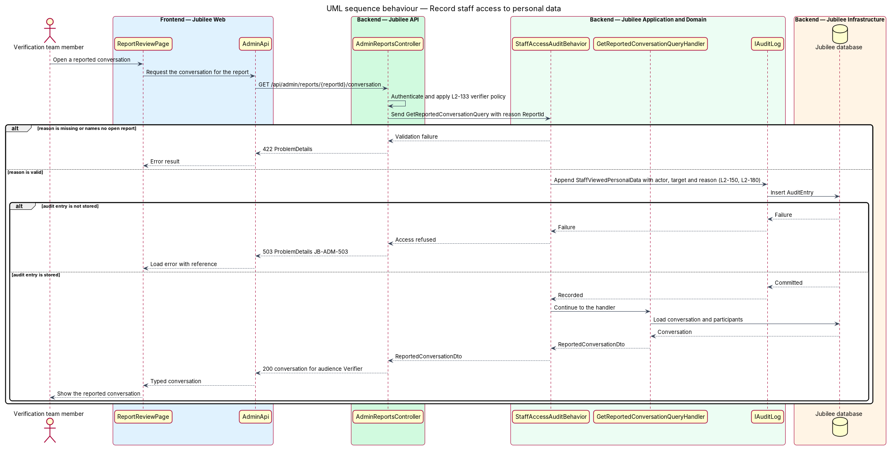

# Enforce data visibility

## Overview

Jubilee is Toronto's Christian marketplace. Members browse verified businesses,
send requests and exchange messages; owners answer them; the verification team
reviews listings and reports. Each of these people sees a different part of a
member's personal data, and most see none of it. This feature is the set of
mechanisms that decide, on the server, which personal field reaches which
reader, and that record each occasion on which staff look at personal data.

The design uses four local terms.

- **personal data** — field that identifies or describes a member: name,
  e-mail address, phone, postal code, home church, home church address, message
  content
- **audience** — class of reader a response is built for: the member
  themselves, the business that received a request, a verifier, or the public
- **area label** — neighbourhood plus the first three characters of a postal
  code, for example "East York, M4C"
- **access reason** — report ID or listing ID that justifies a verifier's view
  of personal data

The visibility rules of `L2-145` are fixed. A member's home church and home
church address are shown to no one, the verification team included, and feed
recommendations only. A member's phone reaches one business,
on the one request that carried it. A member's e-mail address never reaches a
business. A postal code reaches a business only as an area label. Public pages
and the public API carry no member personal data other than the business
details an owner chose to publish.

`L2-150` adds the rules for staff and for measurement. A verifier's view of a
member's personal data or of a reported conversation is written to the audit
log with its access reason. Engineers hold no standing access to production
databases. Analytics carry no names, e-mail addresses, phone numbers or message
content, and the application loads no third-party advertising tracker.

## Description

The slice is cross-cutting. It adds a classification on domain fields, a
serialisation guard in `Jubilee API`, audience-specific read models, an audit
behaviour for staff queries, and an allow-list for analytics.

- **`PersonalDataAttribute`** — annotation on a domain or DTO property that
  names the widest `DataAudience` allowed to read it. `Member.HomeChurch`
  and `Member.HomeChurchAddress` carry `NoOne`; `Member.Email` and `Member.PostalCode` carry `Self`;
  `Request.ContactPhone` carries `RequestBusiness`.
- **`DataAudience`** — enumeration of readers: `NoOne`, `Self`,
  `RequestBusiness`, `Verifier`, `Public`.
- **`AudienceJsonModifier`** — `System.Text.Json` contract modifier registered
  in `Jubilee.Api`. Each controller action declares its response audience; the
  modifier omits every annotated property that audience may not read. The
  modifier is a second line of defence behind the read models, so a field added
  to a DTO by mistake does not leave the server.
- **`Request.ContactPhone`** — copy of the member's phone taken when the
  request is sent. The business reads this copy on that request only; the
  `Member.Phone` field is never projected into a business-facing response.
- **`IncomingRequestDto`** — read model returned by
  `GET /api/business/{listingId}/requests/{requestId}`. It carries the member's
  first name, `ContactPhone` and `AreaLabel`. It has no e-mail, home church, home church
  address or full postal code property.
- **`PostalArea`** — value object built from a `PostalCode` and the
  `INeighbourhoodDirectory` lookup. `ToLabel()` returns the area label. The
  source of the neighbourhood table is `<TO SUPPLY>`.
- **`RecommendationService`** — the only application service that reads
  `Member.HomeChurch` and `Member.HomeChurchAddress`. It ranks recommendations
  and returns listing identifiers only. Using the address for distance is
  deferred (ADR 0041).
- **Public read models** — DTOs in the `Jubilee.Application.Public` namespace
  (`PublicListingDto`, `PublicProductDto`) built from `Listing` fields the
  owner publishes. They hold no reference to `Member`.
- **`PublicContractTests`** — automated tests that call each anonymous
  endpoint and fail when a response contains a property annotated with
  `PersonalDataAttribute`, and an architecture test that fails when a type in
  `Jubilee.Application.Public` references `Member`.
- **`IStaffPersonalDataQuery`** — marker interface for queries that return a
  member's personal data or a reported conversation to staff, such as
  `GetListingReviewQuery` and `GetReportedConversationQuery`. Each carries a
  `StaffAccessReason` holding a `ReportId` or a `ListingId`.
- **`StaffAccessAuditBehavior`** — MediatR pipeline behaviour. It validates the
  access reason, appends an `AuditEntry` with action `StaffViewedPersonalData`,
  the actor, the target and the reason through `IAuditLog`, and only then calls
  the handler. When the entry is not stored, the query fails with 503 and the
  reference `JB-ADM-503`; no personal data is returned.
- **`Privileged access broker`** — external service (vendor `<TO SUPPLY>`)
  through which an `On-call engineer` obtains a database credential. Each grant
  is requested with a reason, expires after `<TO SUPPLY>` and is logged. The
  database accepts no standing engineer login.
- **`AnalyticsService`** and **`AnalyticsEventValidator`** — the Angular
  service sends typed events (event name, route template, viewport class) to
  `POST /api/analytics/events`. The validator accepts only the properties of the
  typed allow-list and rejects free text, so names, e-mail addresses, phone
  numbers and message content cannot enter an event. The Content Security
  Policy of `Jubilee Web` allows scripts and connections to Jubilee origins
  only, which excludes third-party advertising trackers.

## Requirements

The feature realizes the following level-2 (L2) requirements. Each L2
requirement refines a level-1 (L1) requirement, cited by identifier.

| L2 ID | Refines (L1) | Requirement |
|-------|--------------|-------------|
| `L2-145` | `L1-020` | The system shall show a member's home church and home church address to no one and use them only for recommendations, shall show a member's phone only to the business that received a request and only on that request, shall never show a member's e-mail address to a business, and shall show businesses at most the neighbourhood and first three characters of a postal code. Public pages and public APIs shall contain no member personal data other than an owner's chosen public business details. |
| `L2-150` | `L1-020` | The system shall record in the audit log, with the reason (report ID or listing ID), each verifier view of a member's personal data or a reported conversation. Engineer access to production databases shall be just-in-time, time-limited and logged, and analytics shall contain no names, e-mails, phone numbers or message content and shall use no third-party advertising trackers. |
| `L2-133` | `L1-019` | The server shall check the caller's role and ownership of the specific object on every API endpoint before doing anything, and no check shall rely on the client hiding a control. |
| `L2-180` | `L1-025` | The system shall store an append-only audit record of actor, action, target, time, before and after values, and reason for each sensitive action, including staff access to personal data. |

## Diagrams

### System context

Members, owners, visitors and verifiers each read Jubilee through a different
audience. An on-call engineer reaches the database only through the privileged
access broker, and analytics leave Jubilee without personal data.

### Containers

`Jubilee API` projects audience-limited responses for `Jubilee Web` and writes
staff access to the audit log in the `Jubilee database`. The broker issues the
only engineer credentials the database accepts.

### Components

Controllers declare a response audience and serialise through
`AudienceJsonModifier`. Staff queries pass through `StaffAccessAuditBehavior`,
which appends to `IAuditLog` before the handler runs.

### Class structure

`PersonalDataAttribute` binds a property to a `DataAudience`.
`IncomingRequestDto` projects a `Request` and a `PostalArea`, and
`StaffAccessAuditBehavior` turns each `IStaffPersonalDataQuery` into an
`AuditEntry`.

### Behaviour — view a request as the receiving business

The owner-of-listing policy runs first. The handler returns the phone copied
onto the request and an area label, and the modifier removes any field outside
the `RequestBusiness` audience.

### Behaviour — record staff access to personal data

The behaviour stores the audit entry before the handler loads the conversation.
A failed audit write refuses the access with `JB-ADM-503`.

