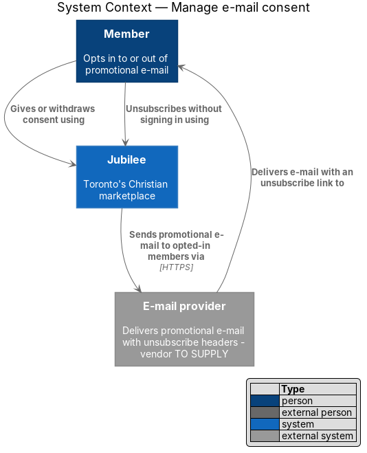
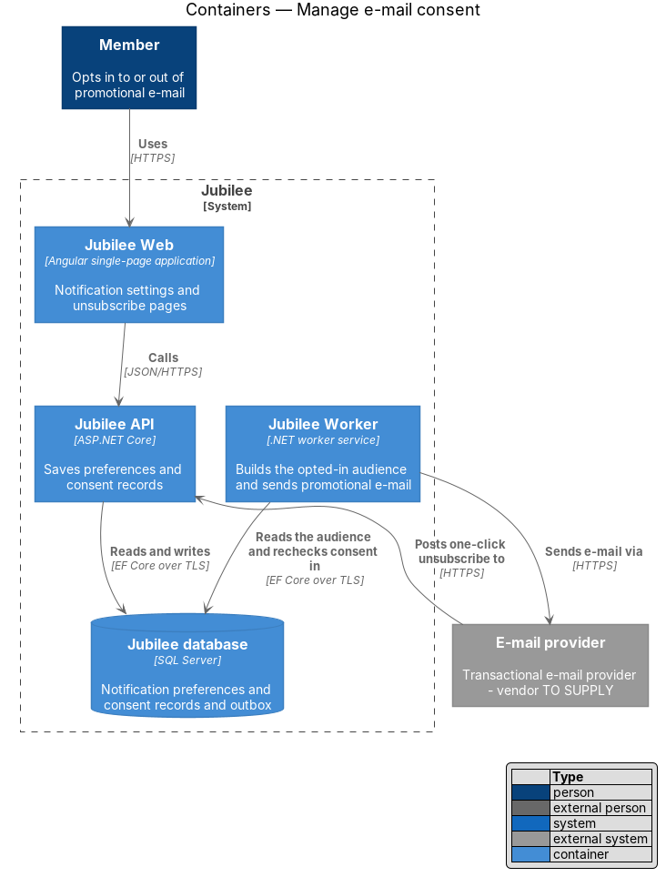
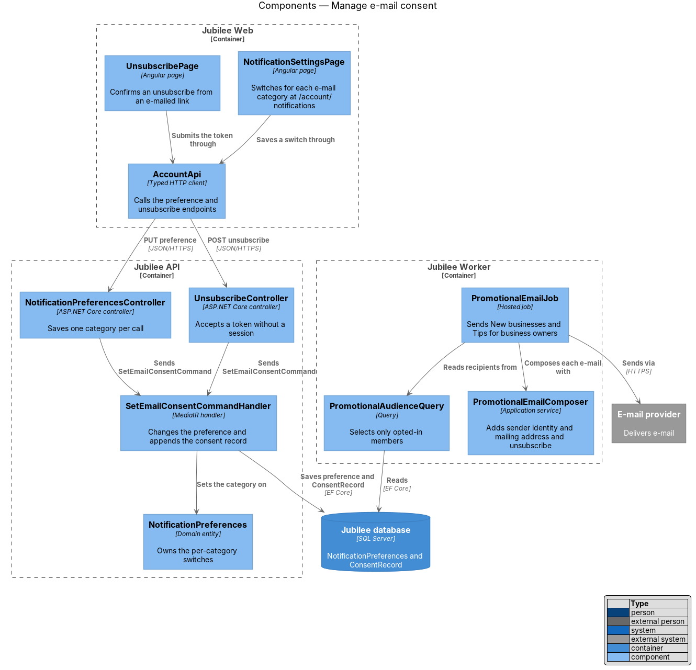
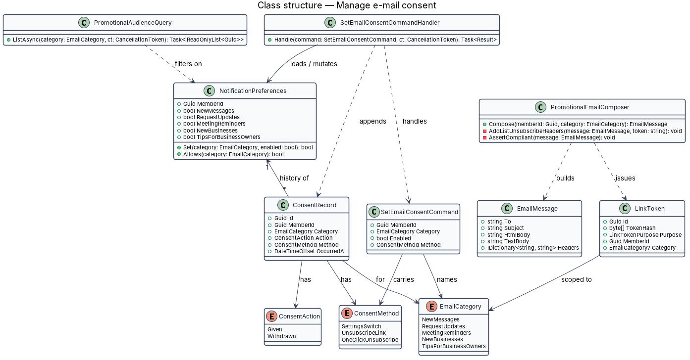
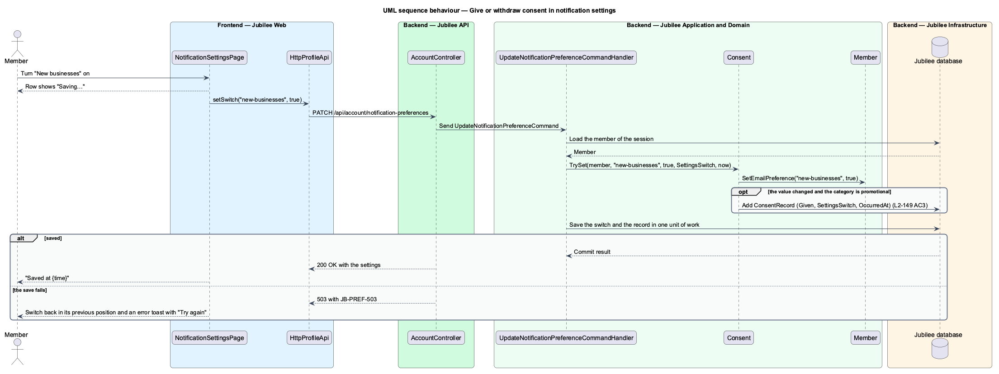
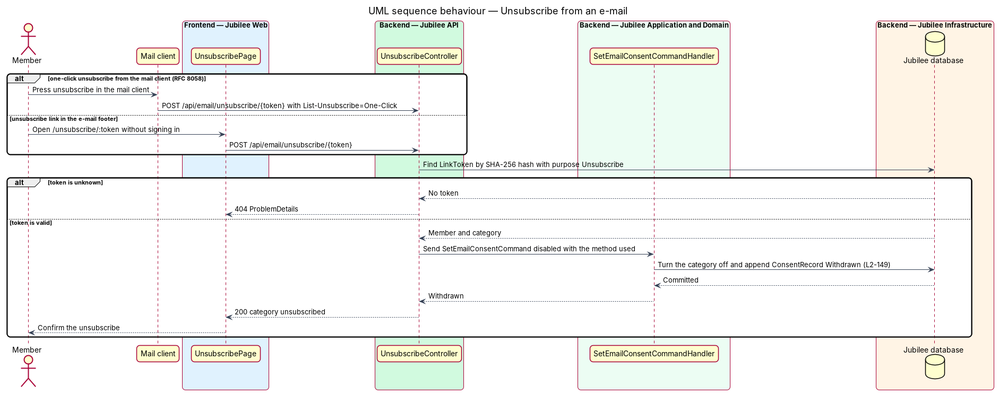
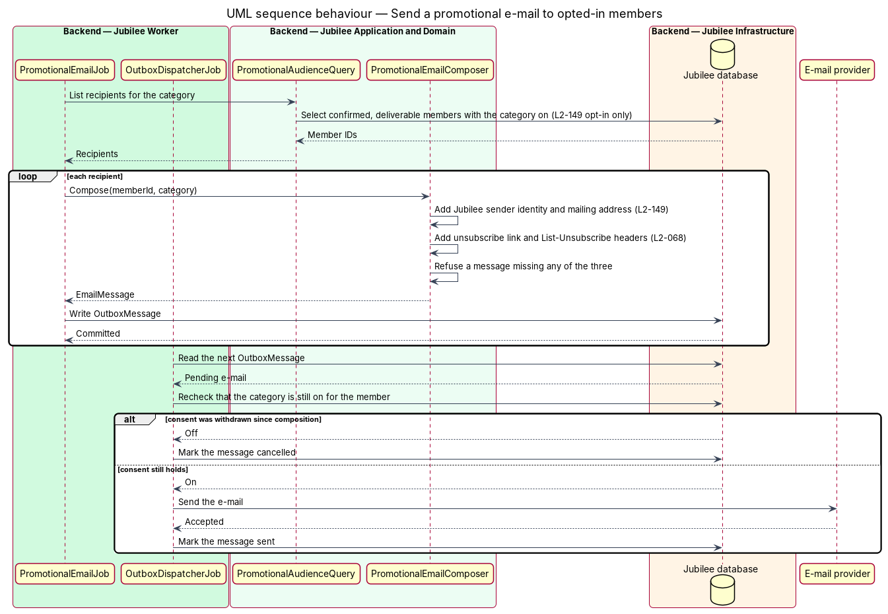

# Manage e-mail consent

## Overview

Jubilee sends two kinds of e-mail. Transactional and security e-mail (a
confirmation link, a request update, a meeting reminder) follows from
something the member did. Promotional e-mail advertises the marketplace
itself. Canada's Anti-Spam Legislation (CASL) allows promotional e-mail only
with the recipient's consent and sets rules for its content. This feature
holds the consent, proves it, and applies it at the moment each promotional
e-mail leaves.

The design uses four local terms.

- **promotional e-mail** — commercial message in one of two categories, "New
  businesses" and "Tips for business owners"
- **consent** — a member's opt-in to one promotional category, given by
  turning its switch on
- **consent record** — append-only entry stating that consent was given or
  withdrawn, with the time and the method
- **one-click unsubscribe** — withdrawal sent by the mail client itself
  through the `List-Unsubscribe` headers of RFC 8058, with no sign-in

`L2-149` sets three rules. Promotional e-mail goes only to members who opted
in, identifies Jubilee with a mailing address, and includes an unsubscribe.
An unsubscribe takes effect within 2 business days, with a target of
immediately. The time and method of each consent given or withdrawn are
recorded. Both promotional categories are off for a new account, so consent
is always an explicit act of the member.

## Description

The slice runs from the notification settings page to the e-mail provider. It
shares `NotificationPreferences` with the notification settings feature
(`L2-016`) and adds the consent history, the unsubscribe endpoint and the
checks on outgoing promotional e-mail.

- **`NotificationSettingsPage`** — Angular page at `/account/notifications`.
  Each switch saves on its own through `AccountApi`; the row shows "Saving…"
  and then "Saved at {time}". A failed save returns the switch to its previous
  position and shows an error toast with "Try again".
- **`EmailCategory`** — enumeration of the five categories. `NewBusinesses`
  and `TipsForBusinessOwners` are promotional and default to off.
- **`NotificationPreferencesController`** — exposes
  `PUT /api/account/notification-preferences/{category}` for the signed-in
  member. A storage failure returns 503 with the reference `JB-PREF-503`.
- **`SetEmailConsentCommand`** and **`SetEmailConsentCommandHandler`** — the
  command names the member, the category, the new value and the
  `ConsentMethod`. The handler loads `NotificationPreferences`, calls
  `Set(category, enabled)`, and, when the value changed, appends a
  `ConsentRecord`. The preference and the record commit in one unit of work,
  so no consent change exists without its record.
- **`ConsentRecord`** — entity with `MemberId`, `Category`, `ConsentAction`
  (`Given`, `Withdrawn`), `ConsentMethod` (`SettingsSwitch`,
  `UnsubscribeLink`, `OneClickUnsubscribe`) and `OccurredAt` from `IClock`.
  The application exposes no update or delete for it. Its retention period is
  `<TO SUPPLY>`.
- **`UnsubscribeController`** — exposes `POST /api/email/unsubscribe/{token}`
  without a session and without a CSRF token, because the token is the
  credential. It accepts the RFC 8058 body `List-Unsubscribe=One-Click` from a
  mail client and the same call from `UnsubscribePage`. It turns off the one
  category the token names. Repeating the call leaves the category off and
  adds no second record.
- **`LinkToken`** with purpose `Unsubscribe` — token bound to one member and
  one category, generated with at least 128 bits of randomness and stored as a
  SHA-256 hash. Its expiry is `<TO SUPPLY>`.
- **`UnsubscribePage`** — Angular page at `/unsubscribe/:token`, reached from
  the link in the e-mail footer. It posts the token, removes it from the
  address bar and confirms the result. Its copy is `<TO SUPPLY>`.
- **`PromotionalEmailJob`** — hosted job in `Jubilee Worker` that prepares a
  promotional mailing. Its schedule is `<TO SUPPLY>`.
- **`PromotionalAudienceQuery`** — selects members whose e-mail address is
  confirmed and deliverable and whose `NotificationPreferences` has the
  category on. No other source feeds the audience.
- **`PromotionalEmailComposer`** — builds each `EmailMessage` from the
  category template. It adds the Jubilee sender name and mailing address
  (`<TO SUPPLY>`), the unsubscribe link, and the headers `List-Unsubscribe`
  and `List-Unsubscribe-Post: List-Unsubscribe=One-Click`. It refuses to
  return a message that lacks any of the three.
- **`OutboxDispatcherJob`** — rechecks the member's preference immediately
  before handing each promotional message to `IEmailSender`, and cancels the
  message when the category is off. A withdrawal therefore takes effect for
  every message not yet handed to the `E-mail provider`, which is inside the
  limit of 2 business days.

## Requirements

The feature realizes the following level-2 (L2) requirements. Each L2
requirement refines a level-1 (L1) requirement, cited by identifier.

| L2 ID | Refines (L1) | Requirement |
|-------|--------------|-------------|
| `L2-149` | `L1-020` | The system shall send promotional e-mails ("New businesses", "Tips for business owners") only to members who opted in, and each shall identify Jubilee with a mailing address and include an unsubscribe, as Canada's Anti-Spam Legislation (CASL) requires. An unsubscribe shall take effect within 2 business days (target: immediately), and the system shall record the time and method each time consent is given or withdrawn. |
| `L2-016` | `L1-002` | The system shall let a member choose at `/account/notifications` which e-mails they get and how often, shall save each switch on its own as soon as it changes, and shall create new accounts with "New businesses" and "Tips for business owners" off. |
| `L2-068` | `L1-010` | Every non-security e-mail shall carry a one-click unsubscribe link (RFC 8058 `List-Unsubscribe` headers) that turns off that category without signing in. |

## Diagrams

### System context

A member gives or withdraws consent in Jubilee, and may withdraw it straight
from an e-mail. Jubilee sends promotional e-mail through the e-mail provider
to opted-in members only.

### Containers

`Jubilee API` stores preferences and consent records in the
`Jubilee database`. `Jubilee Worker` reads the opted-in audience, rechecks
consent, and sends through the `E-mail provider`.

### Components

Both controllers send the same `SetEmailConsentCommand`, so every change of
consent passes through one handler. In the worker, `PromotionalAudienceQuery`
and `PromotionalEmailComposer` apply the CASL rules to outgoing mail.

### Class structure

`SetEmailConsentCommandHandler` mutates `NotificationPreferences` and appends a
`ConsentRecord` carrying a `ConsentAction` and a `ConsentMethod`. A `LinkToken`
scopes an unsubscribe to one `EmailCategory`.

### Behaviour — give or withdraw consent in notification settings

The switch saves on its own. The handler writes the preference and the consent
record together; a failure returns the switch to its previous position.

### Behaviour — unsubscribe from an e-mail

The mail client or the unsubscribe page posts the token. The controller
resolves the member and category from the token hash and records the
withdrawal with the method used.

### Behaviour — send a promotional e-mail to opted-in members

The audience query admits opted-in members only, the composer adds the CASL
content, and the dispatcher rechecks consent before each send.

