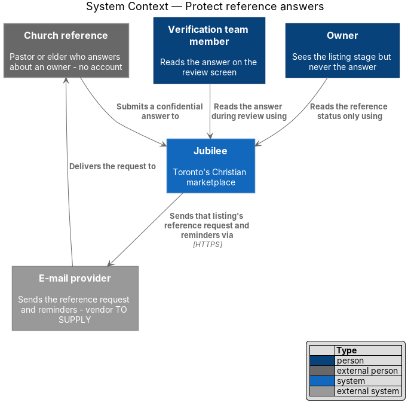
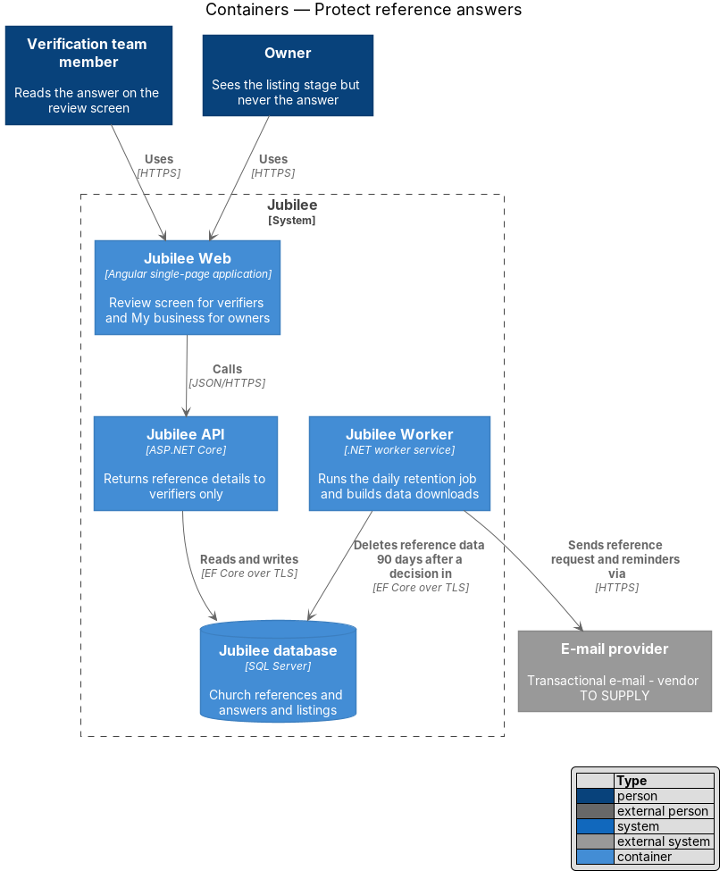
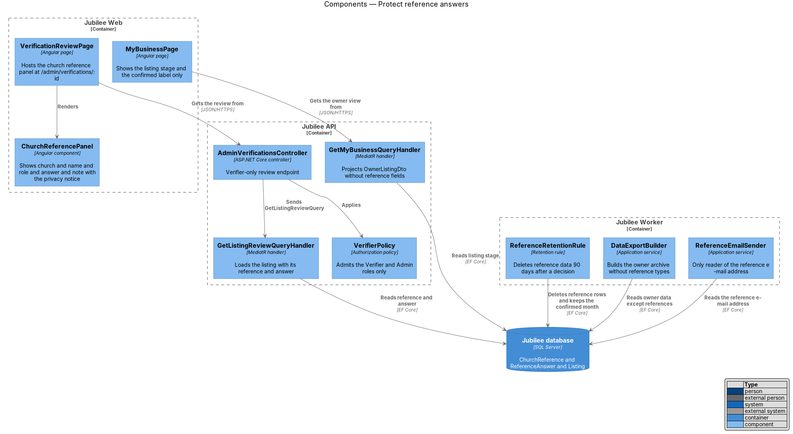
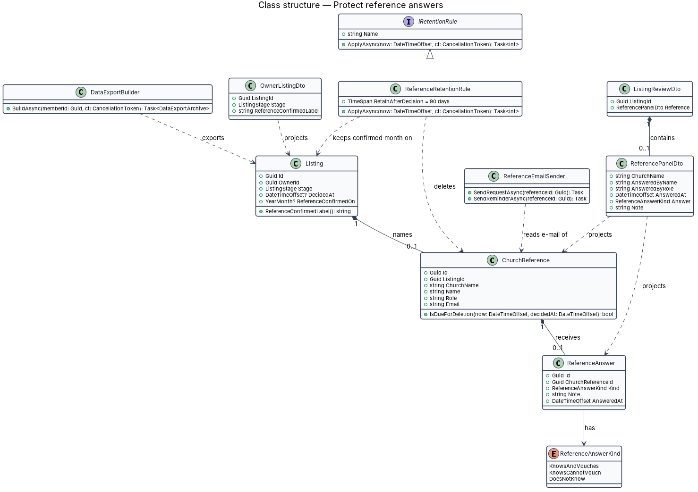
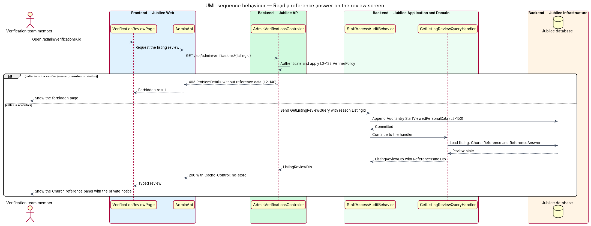
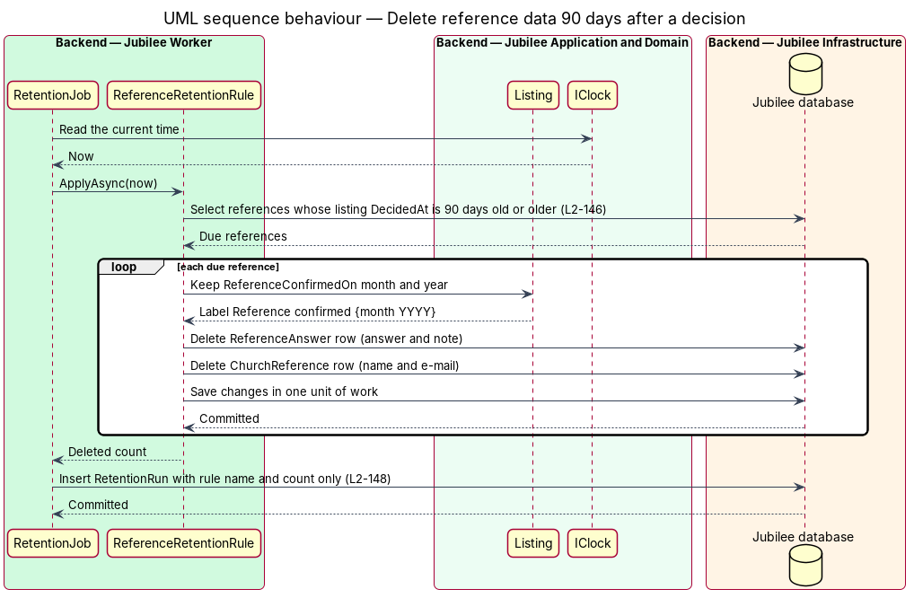

# Protect reference answers

## Overview

Jubilee publishes a business only after a person from the owner's church
answers for the owner. An owner names a pastor or elder when listing a
business; Jubilee e-mails that person a link to a short form; the answer and
an optional note go to the verification team. People answer candidly only when
the answer stays private, so this feature keeps the answer confidential and
deletes it once it has served its purpose.

The design uses four local terms.

- **church reference** — pastor or elder named by an owner, identified by
  name, role, church and e-mail address, who holds no Jubilee account
- **reference answer** — one of three responses the church reference chooses
  on the form, with an optional free-text note
- **verification decision** — approval or decline of a listing by a
  verification team member
- **confirmed label** — text "Reference confirmed {month YYYY}" that remains
  on a listing after the reference data is deleted

`L2-146` sets three rules. The answer, name, role and note are visible only to
verifiers through the review screen at `/admin/verifications/:id`; the owner,
other members and the public never see them, and the owner's data download
leaves them out. 90 days after a verification decision the answer, note, name
and e-mail address are permanently deleted, leaving only the confirmed label.
The e-mail address is used only to send that listing's reference request and
reminders and is never added to a mailing list.

## Description

The slice confines reference data to one verifier-only read path, one e-mail
sender and one retention rule.

- **`ChurchReference`** — domain entity holding `ChurchName`, `Name`, `Role`
  and `Email` for one `Listing`. `IsDueForDeletion(now, decidedAt)` returns
  true when 90 days have passed since the verification decision.
- **`ReferenceAnswer`** — domain entity holding the `ReferenceAnswerKind`, the
  `Note` and `AnsweredAt`. `ReferenceAnswerKind` has the values
  `KnowsAndVouches`, `KnowsCannotVouch` and `DoesNotKnow`.
- **`AdminVerificationsController`** — exposes
  `GET /api/admin/verifications/{listingId}` under `VerifierPolicy`, which
  admits the `Verifier` and `Admin` roles. Every other caller receives 403 and
  no reference data. The response carries `Cache-Control: no-store`.
- **`GetListingReviewQueryHandler`** — the only query handler that loads
  `ChurchReference` and `ReferenceAnswer`. It returns `ListingReviewDto` with a
  `ReferencePanelDto`. The query implements `IStaffPersonalDataQuery`, so
  `StaffAccessAuditBehavior` records the view with the listing ID as reason.
- **`ChurchReferencePanel`** — Angular component on `VerificationReviewPage`.
  It shows the church, the name, role and time of the answer, the answer and
  the note, under the notice "Private. Never shown to the owner or the public;
  deleted 90 days after a decision."
- **`OwnerListingDto`** — read model for `MyBusinessPage` and the owner's
  banners. It carries the listing stage and `ReferenceConfirmedLabel` and has
  no property for the answer, the note, or the reference's name and e-mail
  address.
- **`DataExportBuilder`** — builds the JSON archive of the owner's data
  download from an explicit export model (`ListingExportSection`,
  `ProductExportSection`, `ServiceExportSection`, `RequestExportSection`).
  The export model contains no reference type.
- **`ReferenceConfidentialityTests`** — architecture tests that fail when a
  type outside the verification review query, `ReferenceEmailSender` and
  `ReferenceRetentionRule` references `ChurchReference` or `ReferenceAnswer`,
  and endpoint tests proving that an owner, a member and a visitor each receive
  403 from the review endpoint.
- **`ReferenceRetentionRule`** — `IRetentionRule` run daily by `RetentionJob`
  in `Jubilee Worker`. It selects references whose listing `DecidedAt` is 90
  days old or older, deletes the `ReferenceAnswer` and `ChurchReference` rows,
  and keeps `Listing.ReferenceConfirmedOn` (month and year). The rule returns
  the number of references deleted; the job logs the count only.
- **`Listing.ReferenceConfirmedOn`** — month and year in which the reference
  confirmed the owner. `ReferenceConfirmedLabel()` formats it as the confirmed
  label. It is the only reference fact that outlives the 90 days.
- **`ReferenceEmailSender`** — the only component that reads
  `ChurchReference.Email`. It sends the reference request and its reminders for
  that listing as transactional e-mail through `IEmailSender`. The promotional
  audience is built from `Member` and `NotificationPreferences` alone, so a
  reference address cannot enter a mailing list.
- **Log redaction** — the structured logger excludes the `Note`, the answer
  and full e-mail addresses from log lines. The period after which deleted
  reference data leaves encrypted backups is 35 days, the life of a backup (ADR 0019).

## Requirements

The feature realizes the following level-2 (L2) requirements. Each L2
requirement refines a level-1 (L1) requirement, cited by identifier.

| L2 ID | Refines (L1) | Requirement |
|-------|--------------|-------------|
| `L2-146` | `L1-020` | The system shall make a reference's answer, name, role and note visible only to verifiers through the review screen, never to the owner, other members or the public, and shall exclude them from the owner's data download. The system shall permanently delete the reference's answer, note, name and e-mail 90 days after a verification decision, leaving only "Reference confirmed {month YYYY}" on the listing, and shall use the reference's e-mail only to send that listing's reference request and reminders. |
| `L2-133` | `L1-019` | The server shall check the caller's role and ownership of the specific object on every API endpoint before doing anything, and no check shall rely on the client hiding a control. |
| `L2-150` | `L1-020` | The system shall record in the audit log, with the reason (report ID or listing ID), each verifier view of a member's personal data or a reported conversation. |
| `L2-018` | `L1-002` | The system shall e-mail a member, within 24 hours of a request, a link to a machine-readable (JSON) archive of their data; an owner's archive shall also contain the listing, products, services and requests sent to the business, but never the church reference's private answer. |
| `L2-182` | `L1-025` | Each scheduled job, including retention deletions, shall be idempotent, shall run at most once per schedule across instances, and shall record its last success. |

## Diagrams

### System context

The church reference answers through an e-mailed link. Verifiers read the
answer; owners see only the outcome. The e-mail provider carries the reference
request and its reminders and nothing else to that address.

### Containers

`Jubilee API` returns reference details to verifiers only. `Jubilee Worker`
deletes them from the `Jubilee database` 90 days after a decision and sends the
reference e-mails.

### Components

One controller and one handler read reference data, behind `VerifierPolicy`.
The owner's handler, the data export and the retention rule each touch the
database without exposing the answer.

### Class structure

`ChurchReference` and `ReferenceAnswer` hang off a `Listing`.
`ReferencePanelDto` is the only projection of them; `OwnerListingDto` projects
the `Listing` alone, and `ReferenceRetentionRule` implements `IRetentionRule`.

### Behaviour — read a reference answer on the review screen

`VerifierPolicy` refuses every caller who is not a verifier before any
reference data is loaded. For a verifier, the audit entry is stored first and
the review is returned uncached.

### Behaviour — delete reference data 90 days after a decision

The daily `RetentionJob` runs `ReferenceRetentionRule`, which deletes the answer
and reference rows, keeps the confirmed month on the listing, and reports a
count.

