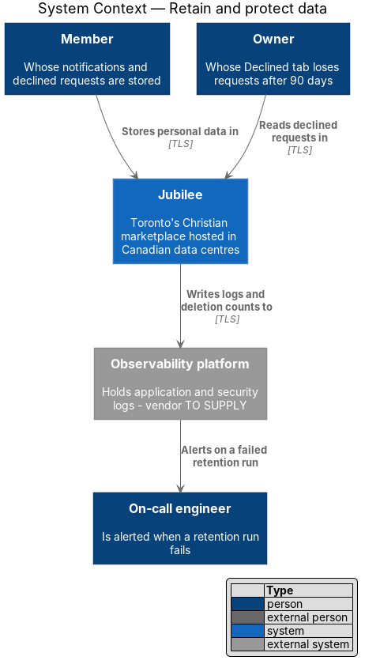
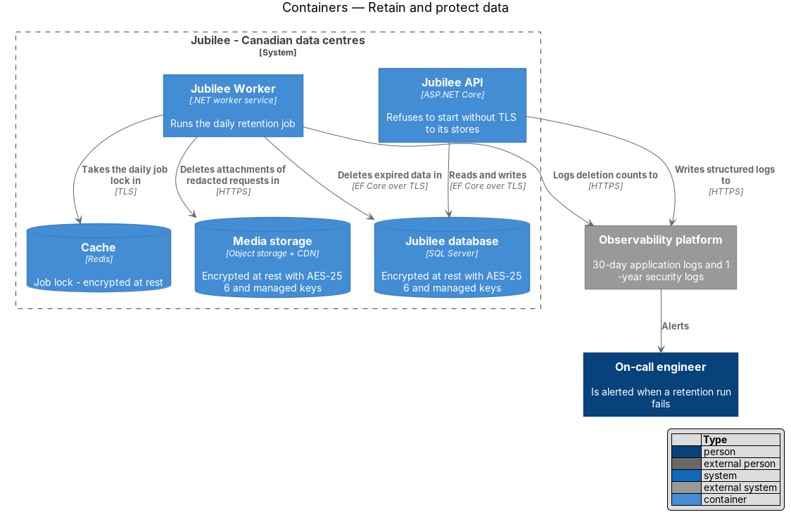
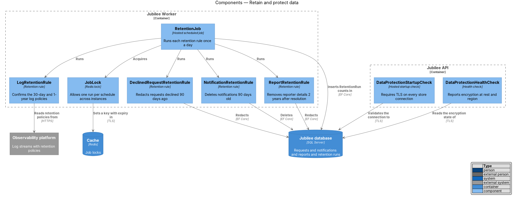
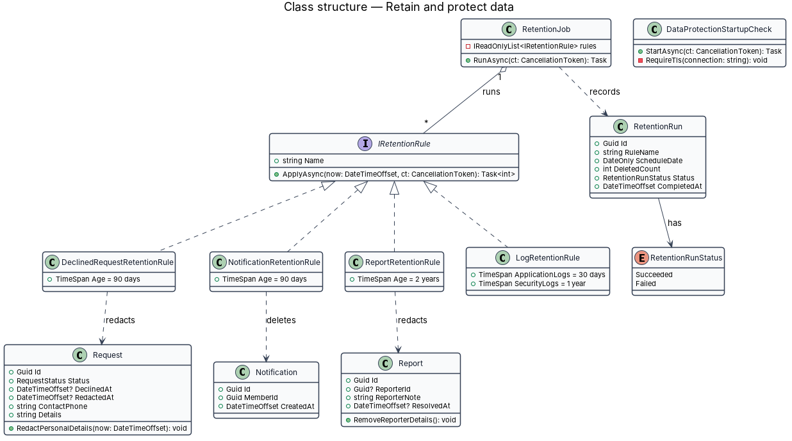
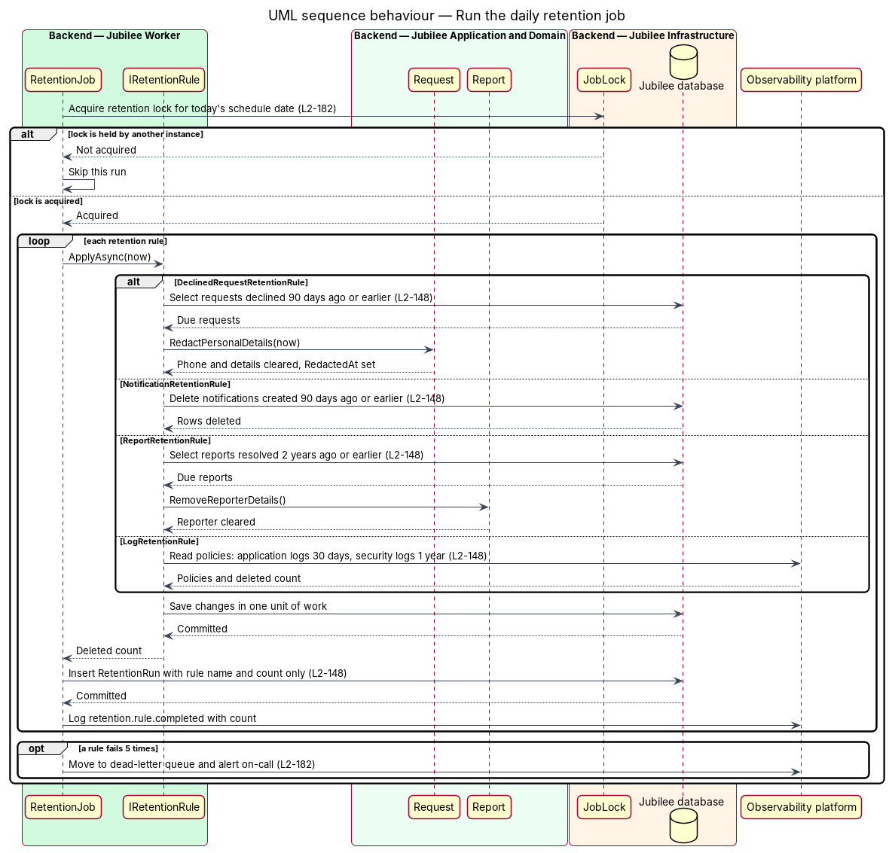
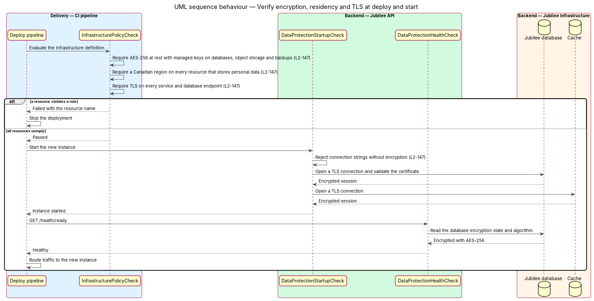

# Retain and protect data

## Overview

Jubilee holds personal data for members, owners and church references:
profiles, requests, messages, notifications and reports. Canadian privacy law
(PIPEDA) and `L1-020` expect that data to be protected where it rests and
where it travels, kept in Canada, and removed once its purpose has ended. This
feature covers both halves: the storage protections of `L2-147` and the
retention schedule of `L2-148`.

The design uses four local terms.

- **encryption at rest** — encryption of stored bytes in databases, object
  storage and backups, here AES-256 with keys managed by the hosting provider
- **data residency** — constraint that personal data is stored in Canadian
  data centres
- **retention rule** — pairing of a data category with the age at which it is
  deleted or stripped of personal details
- **redaction** — removal of the personal fields of a record while the record
  itself remains for history and statistics

The retention schedule has four rules. A declined request leaves the owner's
Declined tab and loses its personal details 90 days after the decline. An
in-app notification is deleted when 90 days old. Application logs containing
IP addresses are deleted or anonymised at 30 days, while security event logs
are kept 1 year. A report loses its reporter details 2 years after resolution.
A scheduled job runs daily and logs what each rule deleted, as counts only.

The storage protections are settings of the hosting platform rather than
application code. The design therefore states them in the infrastructure
definition and verifies them at three points: before deployment, at process
start, and continuously through a health check.

## Description

The slice adds a daily job with one class per retention rule to
`Jubilee Worker`, and protection checks to the deploy pipeline and to the
start-up of `Jubilee API` and `Jubilee Worker`.

- **`RetentionJob`** — hosted job in `Jubilee.Worker`. It runs once a day at
  `<TO SUPPLY>` America/Toronto time, executes every registered
  `IRetentionRule`, and writes one `RetentionRun` per rule. A failed rule is
  retried up to 5 times with back-off and then moved to the dead-letter queue,
  which alerts on-call (`L2-182`).
- **`JobLock`** — Redis lock keyed by job name and schedule date. It allows
  one run per schedule across instances. Each rule is idempotent: a second run
  on the same day finds nothing left to delete.
- **`IRetentionRule`** — interface with `Name` and `ApplyAsync(now, ct)`,
  which returns the number of records deleted or redacted.
- **`DeclinedRequestRetentionRule`** — selects each `Request` whose
  `DeclinedAt` is 90 days old or older and whose `RedactedAt` is empty, and
  calls `Request.RedactPersonalDetails(now)`. The method clears `ContactPhone`,
  the free-text details and the attachments, and sets `RedactedAt`. The owner's
  Declined tab query excludes requests with `RedactedAt` set.
- **`NotificationRetentionRule`** — deletes each `Notification` whose
  `CreatedAt` is 90 days old or older, in batches of `<TO SUPPLY>` rows.
- **`ReportRetentionRule`** — selects each `Report` whose `ResolvedAt` is 2
  years old or older and calls `Report.RemoveReporterDetails()`, which clears
  `ReporterId` and `ReporterNote`. The report and its resolution remain.
- **`LogRetentionRule`** — reads the retention policies of the
  `Observability platform` and fails when the application log stream keeps
  entries longer than 30 days or the security event stream keeps them for a
  period other than 1 year. The platform performs the deletion; whether it
  reports a deleted count is `<TO SUPPLY>`.
- **`RetentionRun`** — record of one rule execution: `RuleName`,
  `ScheduleDate`, `DeletedCount`, `Status` and `CompletedAt`. It holds counts
  only and no identifier of a deleted record. The job also writes the
  structured log event `retention.rule.completed` with the same count.
- **Encryption at rest** — the `Jubilee database` uses transparent data
  encryption with AES-256; `Media storage` uses server-side encryption with
  AES-256; database and storage backups inherit the same encryption. `Cache`
  and `Search index` are configured with encryption at rest. Keys are managed
  by the hosting provider (vendor `<TO SUPPLY>`).
- **Data residency** — every resource that stores personal data, including
  backups, is created in a Canadian region of the hosting provider (region
  `<TO SUPPLY>`). The storage region of the `E-mail provider` and the
  `Observability platform` is `<TO SUPPLY>`.
- **`InfrastructurePolicyCheck`** — step of the deploy pipeline that evaluates
  the infrastructure definition. It stops the deployment when a store lacks
  AES-256 encryption with managed keys, sits outside a Canadian region, or
  accepts a connection without TLS.
- **`DataProtectionStartupCheck`** — hosted service in `Jubilee API` and
  `Jubilee Worker`. It rejects a database, cache, search or storage connection
  setting that does not demand TLS with certificate validation, and the
  process does not start. The minimum TLS version is `<TO SUPPLY>`.
- **`DataProtectionHealthCheck`** — readiness check that reads the encryption
  state and algorithm of the `Jubilee database` and reports unhealthy when the
  database is not encrypted with AES-256.

## Requirements

The feature realizes the following level-2 (L2) requirements. Each L2
requirement refines a level-1 (L1) requirement, cited by identifier.

| L2 ID | Refines (L1) | Requirement |
|-------|--------------|-------------|
| `L2-147` | `L1-020` | The system shall encrypt all databases, object storage and backups at rest with AES-256 using managed keys, shall store personal data in Canadian data centres, and shall use TLS for connections between services and to the database. |
| `L2-148` | `L1-020` | The system shall remove declined requests from the owner's Declined tab and delete their personal details 90 days after the decline, shall delete in-app notifications when 90 days old, shall delete application logs containing IP addresses or anonymise the IPs when 30 days old while keeping security event logs 1 year, and shall delete reporter details from reports resolved for 2 years. The daily scheduled job shall log a record of what each retention rule deleted, as counts only. |
| `L2-182` | `L1-025` | Each scheduled job, including retention deletions, shall be idempotent, shall run at most once per schedule across instances, and shall record its last success; a failed job shall be retried up to 5 times with back-off and then moved to a dead-letter queue that alerts on-call. |

## Diagrams

### System context

Jubilee stores the personal data of members and owners in Canadian data
centres and writes logs and deletion counts to the observability platform,
which alerts the on-call engineer when a retention run fails.

### Containers

`Jubilee Worker` deletes expired data from the `Jubilee database` and
`Media storage` under a lock held in `Cache`. Every store is encrypted at rest
and reached over TLS.

### Components

`RetentionJob` acquires `JobLock`, runs the four retention rules and records
the counts. `DataProtectionStartupCheck` and `DataProtectionHealthCheck` guard
the connections and the encryption state.

### Class structure

Each retention rule implements `IRetentionRule` and acts on one entity:
`Request`, `Notification` or `Report`. `RetentionJob` aggregates the rules and
records a `RetentionRun` for each.

### Behaviour — run the daily retention job

One instance acquires the lock for the schedule date. Each rule applies its
age limit from `L2-148`, commits, and returns a count that the job stores and
logs.

### Behaviour — verify encryption, residency and TLS at deploy and start

The pipeline stops a deployment whose infrastructure definition violates
`L2-147`. A new instance starts only with TLS connections and receives traffic
only after the health check confirms AES-256 encryption.

