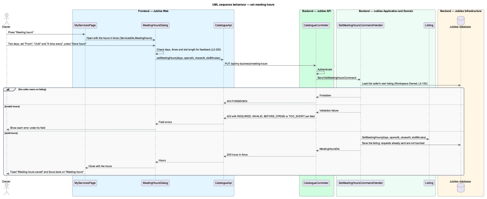

# Book a meeting

## Overview

Jubilee is Toronto's Christian marketplace. A member finds a verified business and asks it for something without
paying through the platform. A *request* is that ask. It has one of three types (booking, quote, order) and
follows one lifecycle shared by the member and the owner. This feature covers the booking type and the calendar
file that a confirmed booking offers.

A *booking* is a request for a meeting about one service at a chosen day, time and mode. A service whose action
is "Book a time" opens the dialog "Book a meeting with {business}". The member chooses a service, a day, how to
meet (video call or in person) and a time from the business's available slots, and may add a note. No payment is
taken. The owner later confirms or declines the request.

A *slot* is a start time on a given day at which the business accepts a meeting for the chosen service. The API
computes slots from the business's meeting hours; the dialog never offers a day in the past, a day the business
is closed, or a day more than 180 days ahead.

*Meeting hours* are what the owner says about when meetings can be booked (`L2-220`): the days of the week, a
"From" and an "Until" time of day in `America/Toronto`, and a slot length. Until an owner saves hours, the
business meets Monday to Friday at the default slots 09:00, 10:00, 13:30, 16:00 and 19:00 (ADR 0015).

A *calendar file* is an iCalendar (`.ics`) document for a confirmed booking. The same link returns the event
with `STATUS:CANCELLED` once the booking is cancelled.

## Description

The feature is a vertical slice from the booking dialog in `Jubilee Web` to `Jubilee database`, with the owner's
e-mail sent by `Jubilee Worker`.

- **`BookMeetingDialog`** — Angular dialog (`dialogs/book-meeting`) composed of `jb-dialog`, `jb-field`,
  `jb-chip-option` and their neighbours from the `components` library. It shows Service (pre-selected when
  opened from a service row), Day (required), How ("Video call" or "In person" with the business's area), Time
  and "What would you like to talk about?" (optional, input stops at 1,000 characters). When the day changes it
  loads that day's slots through `RequestsApi` and shows each as a chip. An empty day or time shows "Choose a
  day. {Owner} meets Monday to Friday." (wording follows the business's meeting hours) and "Choose a time."; a
  day the business does not meet shows "{Owner} can't meet on that day." After success it shows the "Request
  sent to {business}" message with "Close" and "View request". Its form carries `jbDraft` (ADR 0046).
- **`RequestsApi`** — the contract behind the `REQUESTS_API` token, implemented by `HttpRequestsApi`.
  `bookingOptions` calls `GET /api/listings/{slug}/booking`; `availability` calls `GET
  /api/listings/{slug}/availability?serviceId=&day=`; `bookMeeting` calls `POST /api/requests/bookings` with the
  idempotency key from `newKey()` in its body; `calendarUrl` returns `/api/requests/{id}/calendar.ics`.
- **`ListingBookingController`** and **`RequestsController`** — ASP.NET Core controllers in `Jubilee.Api`. The
  first answers the options and the availability of a public listing; the second takes the booking and serves
  the calendar file. Both require a session; `[RequiresConfirmedEmail]` on the booking answers HTTP 403 with
  code `EMAIL_UNCONFIRMED` for an unconfirmed member (`L2-005`).
- **`GetBookingOptionsQuery`** and **`GetAvailabilityQuery`** — MediatR queries with their handlers. The options
  name the bookable services, the owner's first name, the days met ("Monday to Friday"), the area and the 180-day
  limit; the availability gives the slots of one day.
- **`BookMeetingCommand`** — request object carrying `Subject`, `Name`, `ListingSlug`, `ServiceId`, `Day`,
  `Time`, `Mode`, `Note` and `IdempotencyKey`.
- **`BookMeetingCommandHandler`** — MediatR handler. A repeated idempotency key of the same member returns the
  first request and creates nothing (`L2-132`). It requires a day and a time, limits the note to 1,000
  characters, and checks through `BookingAvailability` that the day and the time are still offered; a failure
  is a `ValidationFailedException`, answered as HTTP 422 with a code per field (`REQUIRED`, `TOO_LONG`,
  `DAY_UNAVAILABLE`, `TIME_UNAVAILABLE`). It then creates the `Request`, writes the owner's in-app
  `Notification` through `NotificationRules.Tell` and queues the owner's e-mail in the outbox through
  `EmailPolicy.Queue`, all in one save. The conversation shows the request as a card because the conversation
  query reads the requests between the member and the business; nothing is appended to the conversation.
- **`BookingAvailability`** — static rules in `Jubilee.Application`. `IsOffered` says whether a day is today or
  later, within 180 days and one of the listing's meeting days. `SlotsFor` gives the start times of a day in
  `America/Toronto`: for an owner who saved meeting hours, every `MeetingSlotMinutes` from `MeetingOpensAt`
  while a meeting of the service's length (`LengthOf`) ends by `MeetingClosesAt`; otherwise the default slots.
  Today offers only the times still ahead.
- **`Listing`** — holds the meeting hours: `MeetingDays` (a weekday bitmask, Monday to Friday by default),
  `MeetingOpensAt`, `MeetingClosesAt` and `MeetingSlotMinutes` (null until the owner saves hours) and
  `MeetingArea`. `SetMeetingHours` writes the four together.
- **`SetMeetingHoursCommand`** and **`SetMeetingHoursCommandHandler`** — the owner saves meeting hours through
  `PUT /api/my-business/meeting-hours` on `CatalogueController` (`L2-220`). The handler loads the caller's own
  listing (`Workspace.Owned`, HTTP 403 otherwise), validates through `MeetingHoursRules` (at least one day,
  times as `HH:mm`, "Until" after "From", a slot length of 15, 30, 45, 60, 90 or 120 minutes that fits between
  the two) and answers HTTP 422 with `REQUIRED`, `INVALID`, `BEFORE_OPENS` or `TOO_SHORT` per field. It changes
  the listing only: requests already sent keep their day, time and status. `ListServicesQuery` returns the
  hours in force as `ServicesDto.MeetingHours`.
- **`MeetingHoursDialog`** — Angular dialog (`dialogs/meeting-hours`) opened by "Meeting hours" on My services.
  It shows the days as checkboxes, "From", "Until" and "A time every", checks them as the server does for
  feedback, and saves through `CatalogueApi.setMeetingHours`. On success it closes and My services shows the
  toast "Meeting hours saved".
- **`Request`** — domain entity in `Jubilee.Domain` that owns the request lifecycle (`L2-043`). `RequestStatus`
  holds `New`, `Confirmed`, `Declined`, `Cancelled` and `Completed`. The allowed transitions are `New` →
  `Confirmed` (the owner confirms), `New` → `Declined` (the owner declines), `New` or `Confirmed` → `Cancelled`
  (the member cancels) and `Confirmed` → `Completed` (a booking's meeting end time passes, or the owner marks an
  order fulfilled). `UndoConfirm` and `UndoCancel` return a request to its previous status within 8 seconds.
  Each other transition throws `InvalidTransitionException`; the API maps it to HTTP 409 with code
  `INVALID_TRANSITION` and leaves the request unchanged. A booking fills `ServiceId`, `ServiceName`,
  `StartsAt`, `EndsAt`, `Mode` (`MeetingMode`: `Video`, `InPerson`), `Location` and `Note` on the request
  itself.
- **`RequestTransition`** — child entity of `Request` that records each transition with `From`, `To`, `Actor`
  and `At`. The progress timeline reads these records.
- **`GetBookingCalendarQuery`** and **`GetBookingCalendarQueryHandler`** — query behind `GET
  /api/requests/{id}/calendar.ics`. The handler loads a booking that belongs to the caller (HTTP 404 otherwise)
  and whose status is `Confirmed`, `Completed` or `Cancelled`.
- **`CalendarFileBuilder`** — builds the `text/calendar` body: title, start and end in `America/Toronto`,
  location or "Video", the business name and a link to `/requests/:id`. The event `UID` derives from the request
  ID, so the same link updates the same event. A cancelled booking carries `STATUS:CANCELLED`.
- **`OutboxDispatcherJob`** — hosted job in `Jubilee Worker`. It runs `OutboxDispatcher`, which sends the
  owner's e-mail through `IEmailSender`. The in-app notification needs no job: the handler writes it.

## Requirements

The feature realizes the following level-2 (L2) requirements. Each L2 requirement refines a level-1 (L1)
requirement, cited by identifier.

| L2 ID | Refines (L1) | Requirement |
|-------|--------------|-------------|
| `L2-044` | `L1-007` | From a service whose action is "Book a time", a member shall be able to ask for a meeting. The system shall take no payment. |
| `L2-050` | `L1-007` | A confirmed booking shall offer an iCalendar (`.ics`) download with the title, start and end in America/Toronto, location or "Video", the business name and a link to the request. The same calendar link shall carry `STATUS:CANCELLED` after the booking is cancelled. |
| `L2-043` | `L1-007` | Each booking, quote and order request shall follow one lifecycle shared by the member's and the owner's views. |
| `L2-005` | `L1-001` | Until the e-mail is confirmed, a member may browse, search and save but shall not message, book, request or list a business. |
| `L2-132` | `L1-018` | Each create request shall carry a client-generated idempotency key, and the server shall return the original result for a repeated key within 24 hours without creating a duplicate. |
| `L2-220` | `L1-013` | The owner shall say when meetings can be booked (days, hours in America/Toronto and slot length), and a member shall be offered only the times inside those hours. Requests already sent shall keep their times. |

## Diagrams

### System context

A member books a meeting through Jubilee. Jubilee tells the owner in the application and through the external
e-mail provider.

### Containers

The booking travels from `Jubilee Web` to `Jubilee API`, which stores it, with its idempotency key, in
`Jubilee database`. `Jubilee Worker` dispatches the outbox to the e-mail provider.

### Components

`BookMeetingDialog` calls `ListingBookingController` and `RequestsController` through `RequestsApi`. The
controllers dispatch to the availability, booking and calendar handlers; the booking handler uses
`BookingAvailability` and the `Request` entity. `MeetingHoursDialog` saves the owner's hours through
`CatalogueController`.

### Class structure

`BookMeetingCommandHandler` handles `BookMeetingCommand` and creates a `Request` with its booking fields.
`BookingAvailability` reads the meeting hours of the `Listing`, which `SetMeetingHoursCommandHandler` writes.
`CalendarFileBuilder` reads the same `Request` to build the calendar file.

### Behaviour — send a booking request

The dialog loads slots for the chosen day and sends the booking with an idempotency key. The API enforces
`L2-005` and `L2-132`, the handler creates the request with status `New` (`L2-043`), and the worker notifies the
owner (`L2-044`).

### Behaviour — set meeting hours

The owner opens "Meeting hours" on My services and saves. The API checks the hours again and changes the listing
only; the next member who chooses a day is offered the times inside the new hours (`L2-220`).

### Behaviour — add to calendar

"Add to calendar" downloads the calendar file from the API. The builder writes `STATUS:CANCELLED` when the
booking is cancelled (`L2-050`).

