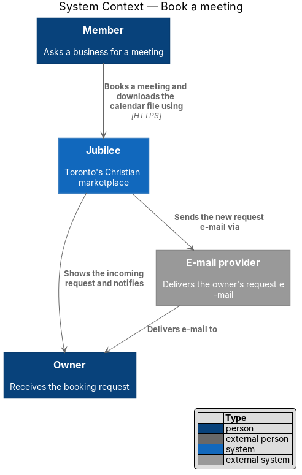
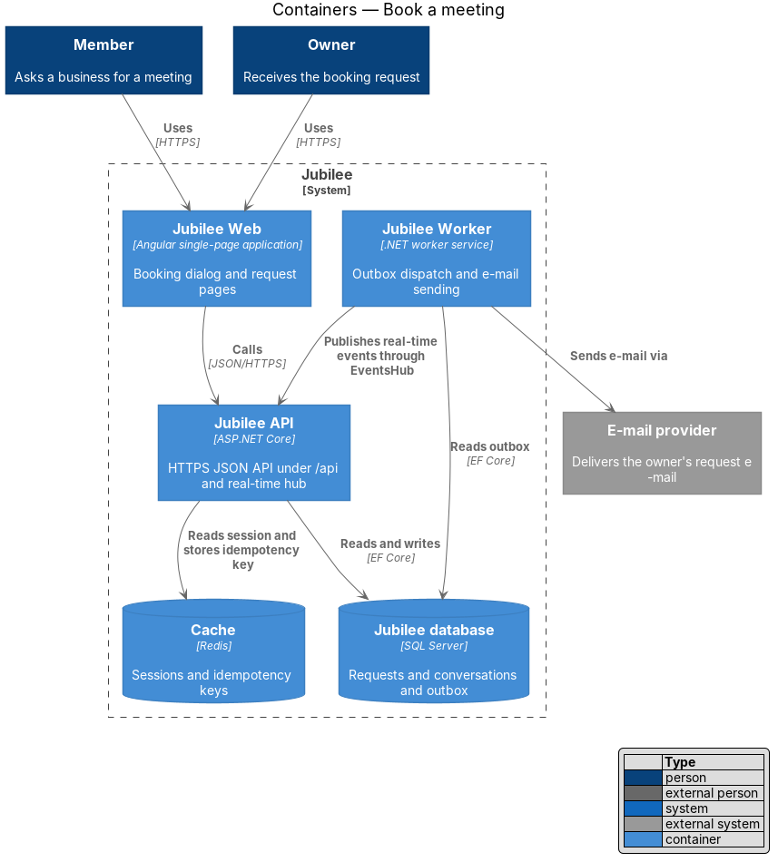
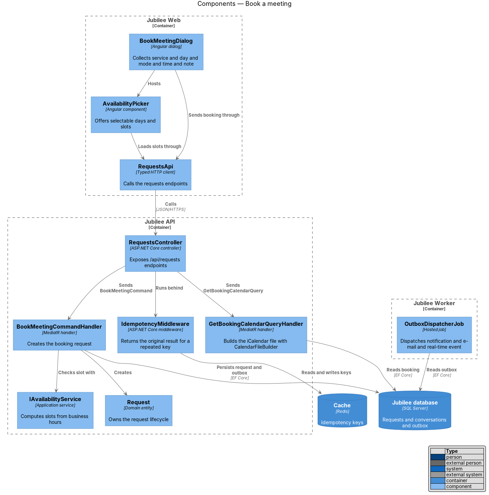
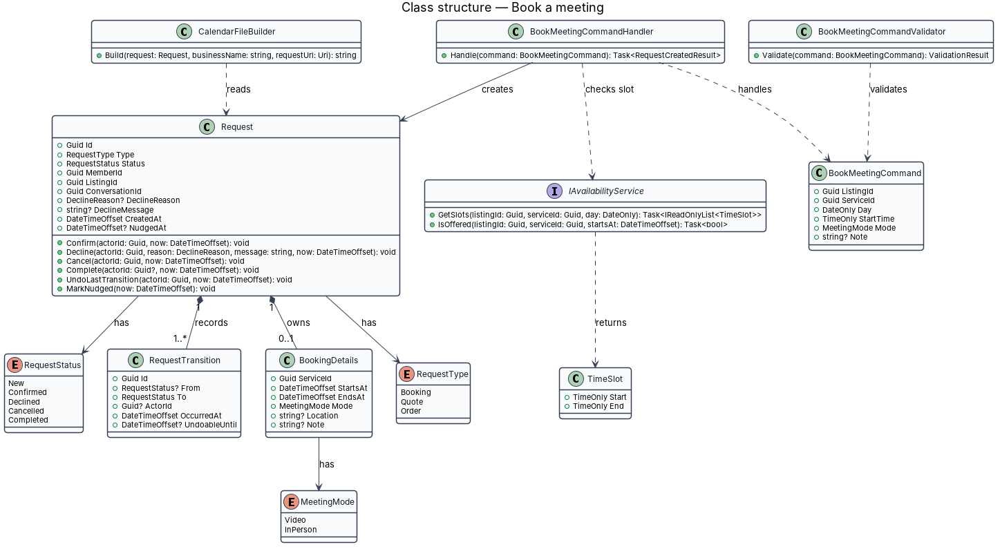
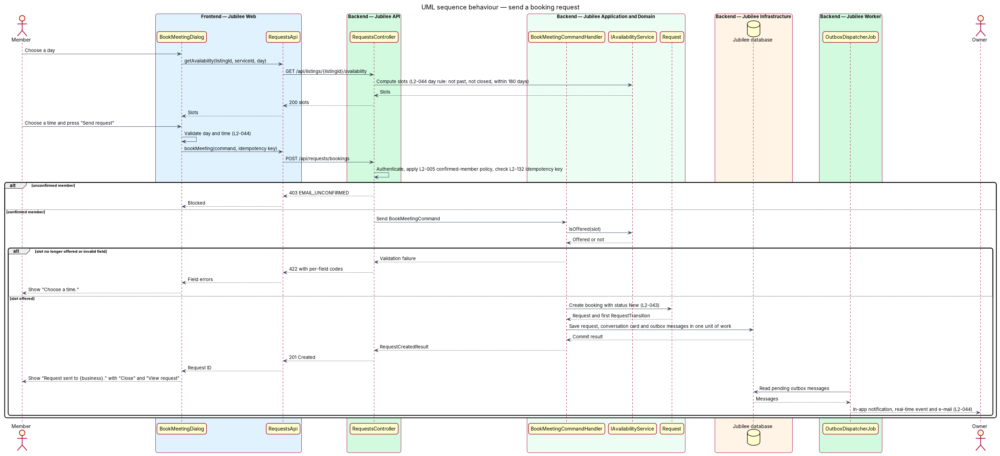
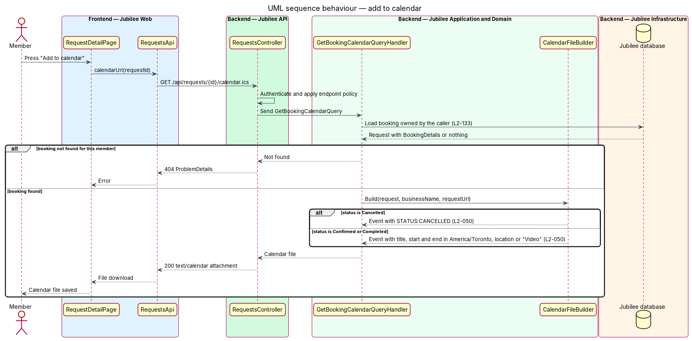

# Book a meeting

## Overview

Jubilee is Toronto's Christian marketplace. A member finds a verified business and asks it for something without
paying through the platform. A *request* is that ask. It has one of three types (booking, quote, order) and
follows one lifecycle shared by the member and the owner. This feature covers the booking type and the calendar
file that a confirmed booking offers.

A *booking* is a request for a meeting about one service at a chosen day, time and mode. A service whose action
is "Book a time" opens the dialog "Book a meeting with {business}". The member chooses a service, a day, how to
meet (video call or in person) and a time from the business's available slots, and may add a note. No payment is
taken. The owner later confirms or declines the request.

A *slot* is a start time on a given day at which the business accepts a meeting for the chosen service. The API
computes slots from the business's hours; the dialog never offers a day in the past, a day the business is
closed, or a day more than 180 days ahead.

A *calendar file* is an iCalendar (`.ics`) document for a confirmed booking. The same link returns the event
with `STATUS:CANCELLED` once the booking is cancelled.

## Description

The feature is a vertical slice from the booking dialog in `Jubilee Web` to `Jubilee database`, with side
effects dispatched by `Jubilee Worker`.

- **`BookMeetingDialog`** — Angular dialog built on `DialogShell`. It shows Service (pre-selected when opened
  from a service row), Day (required), How ("Video call" or "In person" with the business's area), Time and
  "What would you like to talk about?" (optional, input stops at 1,000 characters). An empty day or time shows
  "Choose a day. {Owner} meets Monday to Friday." (wording follows the business's hours) and "Choose a time."
  After success it shows the "Request sent to {business}." message with "Close" and "View request".
- **`AvailabilityPicker`** — child component of the dialog. It marks days in the past, days the business is
  closed and days more than 180 days ahead as unselectable and announces them as unavailable. It loads the slots
  of the chosen day through `RequestsApi`.
- **`RequestsApi`** — typed Angular HTTP client. `getAvailability` calls `GET
  /api/listings/{listingId}/availability?serviceId=&day=`. `bookMeeting` calls `POST /api/requests/bookings`
  with an `Idempotency-Key` header from `IdempotencyKeyFactory`. `calendarUrl` returns
  `/api/requests/{id}/calendar.ics`.
- **`RequestsController`** — ASP.NET Core controller in `Jubilee.Api`. It authenticates the session cookie,
  applies the `ConfirmedMember` policy (HTTP 403 with code `EMAIL_UNCONFIRMED` for an unconfirmed member,
  `L2-005`) and sends the command or query through MediatR. `IdempotencyMiddleware` returns the original result
  for a repeated key within 24 hours (`L2-132`).
- **`BookMeetingCommand`** — request object carrying `ListingId`, `ServiceId`, `Day`, `StartTime`, `Mode` and
  `Note`.
- **`BookMeetingCommandValidator`** — FluentValidation validator. It requires a day and a time, limits `Note` to
  1,000 characters, and rejects a day that is past, closed or more than 180 days ahead. A failure returns HTTP
  422 with a per-field code.
- **`BookMeetingCommandHandler`** — MediatR handler. It checks through `IAvailabilityService` that the slot is
  still offered, creates the `Request` with its `BookingDetails`, appends a booking card to the member–business
  `Conversation`, and writes the owner's notification, e-mail and real-time event to the outbox in one unit of
  work.
- **`IAvailabilityService`** — application service that computes the slots of a day in `America/Toronto` from
  the listing's hours and the service's duration. The storage model of business hours is `<TO SUPPLY>`.
- **`Request`** — domain entity in `Jubilee.Domain` that owns the request lifecycle (`L2-043`). `RequestStatus`
  holds `New`, `Confirmed`, `Declined`, `Cancelled` and `Completed`. The allowed transitions are `New` →
  `Confirmed` (the owner confirms), `New` → `Declined` (the owner declines), `New` or `Confirmed` → `Cancelled`
  (the member cancels) and `Confirmed` → `Completed` (a booking's meeting end time passes, or the owner marks an
  order fulfilled). `UndoLastTransition` returns a request to its previous status within 8 seconds of a cancel
  or a confirm. Each other transition throws `InvalidTransitionException`; the API maps it to HTTP 409 with code
  `INVALID_TRANSITION` and leaves the request unchanged.
- **`RequestTransition`** — child entity of `Request` that records each transition with actor, time and previous
  status. The progress timeline reads these records.
- **`BookingDetails`** — value object owned by a `Request` of type `Booking`. It holds `ServiceId`, `StartsAt`,
  `EndsAt`, `Mode` (`MeetingMode`: `Video`, `InPerson`), `Location` and `Note`.
- **`GetBookingCalendarQuery`** and **`GetBookingCalendarQueryHandler`** — query behind `GET
  /api/requests/{id}/calendar.ics`. The handler loads a booking that belongs to the caller (HTTP 404 otherwise)
  and whose status is `Confirmed`, `Completed` or `Cancelled`.
- **`CalendarFileBuilder`** — builds the `text/calendar` body: title, start and end in `America/Toronto`,
  location or "Video", the business name and a link to `/requests/:id`. The event `UID` derives from the request
  ID, so the same link updates the same event. A cancelled booking carries `STATUS:CANCELLED`.
- **`OutboxDispatcherJob`** — hosted job in `Jubilee Worker`. It delivers the owner's in-app `Notification`,
  sends the e-mail through `IEmailSender` and pushes the real-time event through `EventsHub`.

## Requirements

The feature realizes the following level-2 (L2) requirements. Each L2 requirement refines a level-1 (L1)
requirement, cited by identifier.

| L2 ID | Refines (L1) | Requirement |
|-------|--------------|-------------|
| `L2-044` | `L1-007` | From a service whose action is "Book a time", a member shall be able to ask for a meeting. The system shall take no payment. |
| `L2-050` | `L1-007` | A confirmed booking shall offer an iCalendar (`.ics`) download with the title, start and end in America/Toronto, location or "Video", the business name and a link to the request. The same calendar link shall carry `STATUS:CANCELLED` after the booking is cancelled. |
| `L2-043` | `L1-007` | Each booking, quote and order request shall follow one lifecycle shared by the member's and the owner's views. |
| `L2-005` | `L1-001` | Until the e-mail is confirmed, a member may browse, search and save but shall not message, book, request or list a business. |
| `L2-132` | `L1-018` | Each create request shall carry a client-generated idempotency key, and the server shall return the original result for a repeated key within 24 hours without creating a duplicate. |

## Diagrams

### System context

A member books a meeting through Jubilee. Jubilee tells the owner in the application and through the external
e-mail provider.

### Containers

The booking travels from `Jubilee Web` to `Jubilee API`, which stores it in `Jubilee database` and keeps the
idempotency key in `Cache`. `Jubilee Worker` dispatches the outbox to the e-mail provider and the real-time hub.

### Components

`BookMeetingDialog` calls `RequestsController` through `RequestsApi`. The controller dispatches to the booking
handler and the calendar handler; the booking handler uses `IAvailabilityService` and the `Request` entity.

### Class structure

`BookMeetingCommandHandler` handles `BookMeetingCommand` and creates a `Request` that owns one `BookingDetails`.
`CalendarFileBuilder` reads the same `Request` to build the calendar file.

### Behaviour — send a booking request

The dialog loads slots for the chosen day and sends the booking with an idempotency key. The API enforces
`L2-005` and `L2-132`, the handler creates the request with status `New` (`L2-043`), and the worker notifies the
owner (`L2-044`).

### Behaviour — add to calendar

"Add to calendar" downloads the calendar file from the API. The builder writes `STATUS:CANCELLED` when the
booking is cancelled (`L2-050`).

