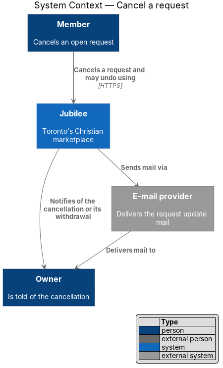
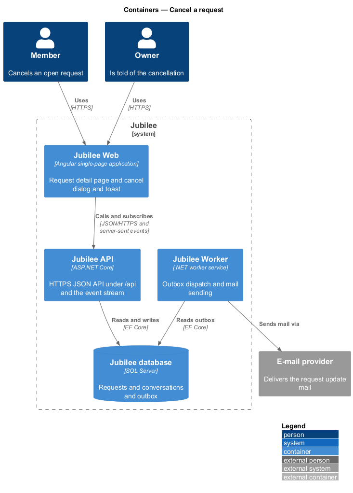
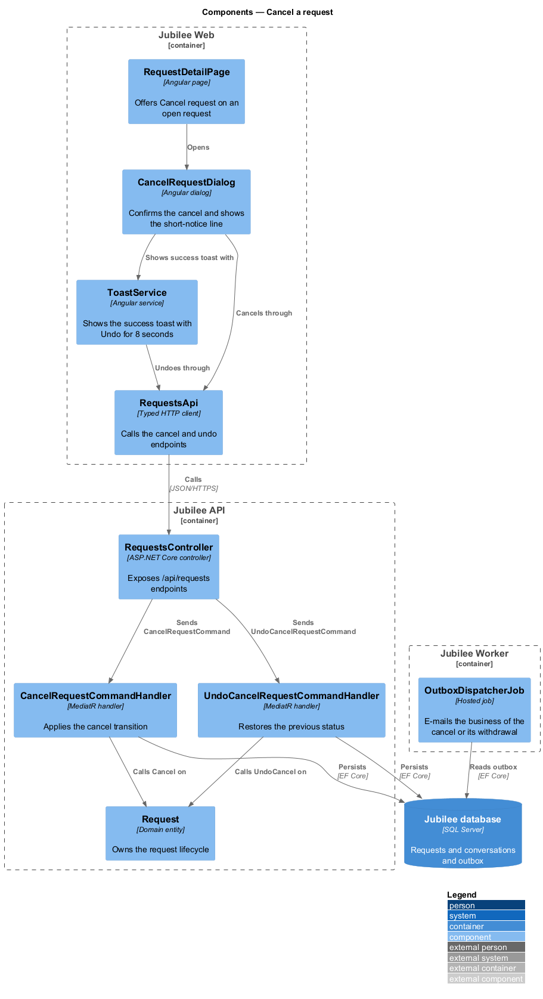
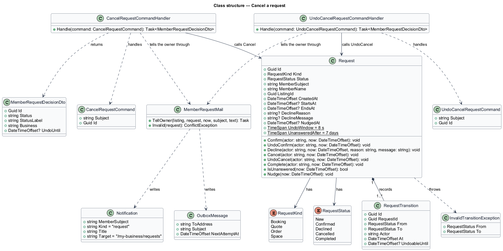
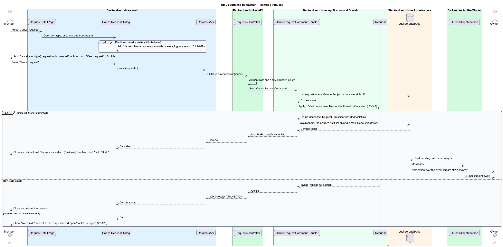
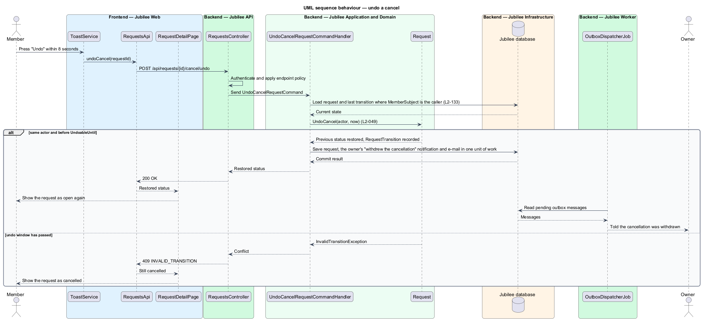

# Cancel a request

## Overview

Jubilee is Toronto's Christian marketplace. A member finds a business and asks it for something without
paying through the platform. A *request* is that ask. It has one of three types (booking, quote, order) and
follows one lifecycle shared by the member and the owner. This feature covers the one transition the member
makes after sending: cancelling.

A member may cancel an *open request* — request whose status is `new` or `confirmed`. "Cancel request" on the
request detail page opens a dialog that asks "Cancel your {type} request to {business}?" and states the
consequence: "{Business} is told straight away. You can ask again later." The safe choice "Keep request" has the
default focus.

Cancelling is reversible for a short time. The success toast "Request cancelled. {Business} has been told."
carries "Undo". *undo window* — the 8 seconds after a cancel during which "Undo" returns the request to its
previous status. After an undo the business is told that the cancellation was withdrawn.

A confirmed booking that starts within 24 hours gets an extra line in the dialog: "It's less than a day away;
consider messaging {owner} too."

## Description

The feature is a vertical slice from the cancel dialog in `Jubilee Web` to `Jubilee database`, with side effects
dispatched by `Jubilee Worker`.

- **`RequestDetailPage`** — Angular page at `/requests/:id`. It offers "Cancel request" ("Cancel booking" for a
  confirmed booking) while the request is open and reflects the new status after a cancel or an undo.
- **`CancelRequestDialog`** — Angular dialog built on `jb-dialog`, with "Keep request" (default focus) and
  "Cancel request". It adds the short-notice line when the detail says `shortNotice` (a `Confirmed` booking
  whose `StartsAt` is less than 24 hours away). On failure it keeps the dialog open and shows "We couldn't
  cancel it. The request is still open. Check your connection and try again." with "Try again" (`L2-128`).
  A 409 (the owner answered a moment ago) closes it and the page reads the request again.
- **`ToastService`** — shows "Request cancelled. {Business} has been told." with "Undo" for 8 seconds. Pressing
  "Undo" calls `RequestsApi.undoCancel`; a late Undo says so in a danger toast.
- **`REQUESTS_API`** — the injection token of `RequestsApi`, the typed Angular HTTP client. `cancel` calls
  `POST /api/requests/{id}/cancel`; `undoCancel` calls `POST /api/requests/{id}/cancel/undo`.
- **`RequestsController`** — ASP.NET Core controller in `Jubilee.Api`. It authenticates the session cookie and
  sends the command through MediatR. Neither endpoint accepts a body, so the client cannot set `status`
  (`L2-133`).
- **`CancelRequestCommand`** and **`CancelRequestCommandHandler`** — the handler loads the request where
  `MemberSubject` is the caller (HTTP 404 otherwise, the attempt logged), calls `Request.Cancel`, and through
  `MemberRequestMail.TellOwner` writes the owner's in-app notification ("{member} cancelled a {noun}", target
  `/my-business/requests`) and the e-mail to the outbox in one unit of work. The e-mail is due at once; it does
  not wait for the undo window. The notification reaches the owner's open page over the event stream, and the
  request's card in the conversation shows "Cancelled" because it reads the request's status.
- **`UndoCancelRequestCommand`** and **`UndoCancelRequestCommandHandler`** — the handler calls
  `Request.UndoCancel`, which restores the status held before the cancel (`New` or `Confirmed`), and tells the
  owner in the app and by e-mail that "{member} withdrew the cancellation".
- **`Request`** — domain entity in `Jubilee.Domain` that owns the request lifecycle (`L2-043`). `RequestStatus`
  holds `New`, `Confirmed`, `Declined`, `Cancelled` and `Completed`. The allowed transitions are `New` →
  `Confirmed` (the owner confirms), `New` → `Declined` (the owner declines), `New` or `Confirmed` → `Cancelled`
  (the member cancels) and `Confirmed` → `Completed` (a booking's meeting end time passes, or the owner marks an
  order fulfilled). Each other transition throws `InvalidTransitionException`.
- **`RequestTransition`** — child entity of `Request` that records each transition with `From`, `To`, `Actor`,
  `At` and `UndoableUntil`. The progress timeline reads these records and leaves out a cancel the member took
  back.
- **Undo rule** — `Request.Cancel` sets `UndoableUntil` on its `RequestTransition` to `At` plus `UndoWindow`
  (8 seconds). `UndoCancel` succeeds only for the actor of that transition and only before `UndoableUntil`;
  later calls return HTTP 409 with code `INVALID_TRANSITION`. No allowance is made for network delay (ADR 0022).
- **`InvalidTransitionException`** — raised when the request is already `Declined`, `Cancelled` or `Completed`.
  `MemberRequestMail.Invalid` turns it into a `ConflictException`, answered with HTTP 409, code
  `INVALID_TRANSITION` and the current status, and the page reads the request again.
- **Calendar** — the calendar link reads the request status when it is opened: a cancelled booking returns
  `STATUS:CANCELLED` (`L2-050`) and no meeting reminder is sent for it.
- **`OutboxDispatcherJob`** — hosted job in `Jubilee Worker`. It sends the e-mails in the outbox through
  `IEmailSender`. The in-app notification is a `Notification` row the event stream (`GET /api/events`) reads.

## Requirements

The feature realizes the following level-2 (L2) requirements. Each L2 requirement refines a level-1 (L1)
requirement, cited by identifier.

| L2 ID | Refines (L1) | Requirement |
|-------|--------------|-------------|
| `L2-049` | `L1-007` | A member shall be able to cancel an open request after a confirmation dialog. The business shall be notified, and "Undo" within 8 seconds shall return the request to its previous status and tell the business the cancellation was withdrawn. |
| `L2-043` | `L1-007` | Each booking, quote and order request shall follow one lifecycle shared by the member's and the owner's views. |
| `L2-129` | `L1-018` | An action that notifies another person shall open a confirmation dialog that states the consequence and focuses the safe choice by default. A reversible action shall carry "Undo" on its success toast. |
| `L2-128` | `L1-018` | A failed dialog submission shall show an error alert at the top of the dialog that says what did not happen, and shall keep everything typed. |
| `L2-133` | `L1-019` | The server shall check the caller's role and ownership of the specific object on each API endpoint before doing anything. |

## Diagrams

### System context

A member cancels a request through Jubilee. Jubilee tells the owner in the application and through the external
e-mail provider.

### Containers

The cancel travels from `Jubilee Web` to `Jubilee API`, which changes the request in `Jubilee database`.
`Jubilee Worker` dispatches the outbox to the owner.

### Components

`CancelRequestDialog` and the "Undo" action of `ToastService` call `RequestsController` through `RequestsApi`.
The two handlers call `Cancel` and `UndoCancel` on `Request`.

### Class structure

`CancelRequestCommandHandler` and `UndoCancelRequestCommandHandler` mutate `Request`, which records a
`RequestTransition` with an `UndoableUntil` time and throws `InvalidTransitionException` for a transition the
lifecycle does not allow.

### Behaviour — cancel a request

The dialog confirms the consequence (`L2-129`), the handler applies the `L2-049` cancel rule through the
`L2-043` lifecycle, and the business is told. A failure keeps the dialog open with "Try again" (`L2-128`).

### Behaviour — undo a cancel

"Undo" within 8 seconds returns the request to its previous status and tells the business the cancellation was
withdrawn (`L2-049`).

