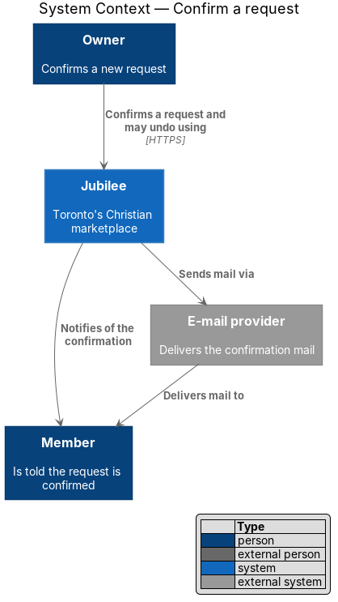
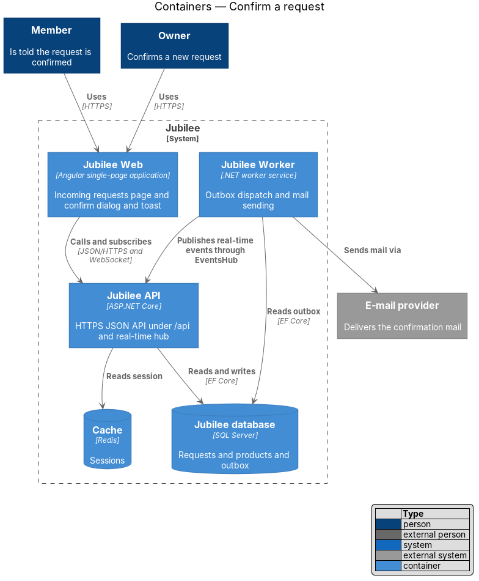
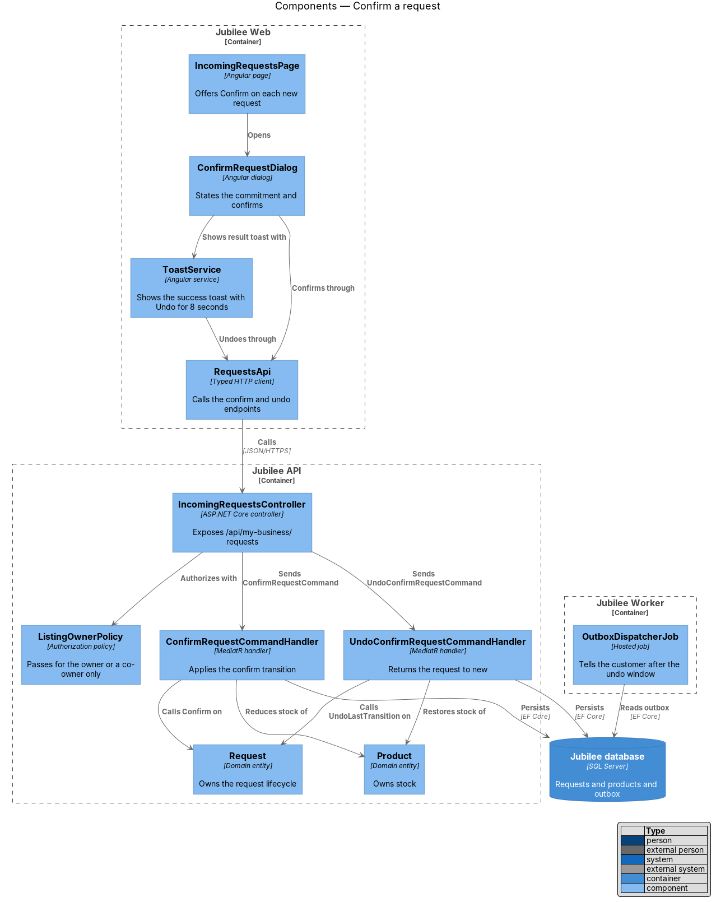
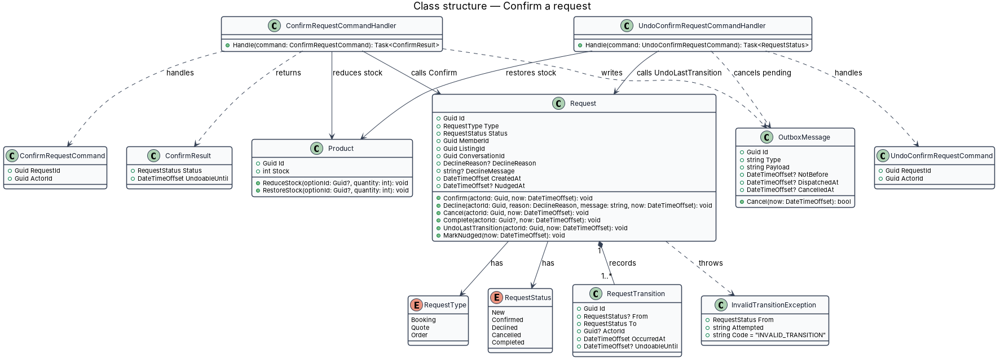
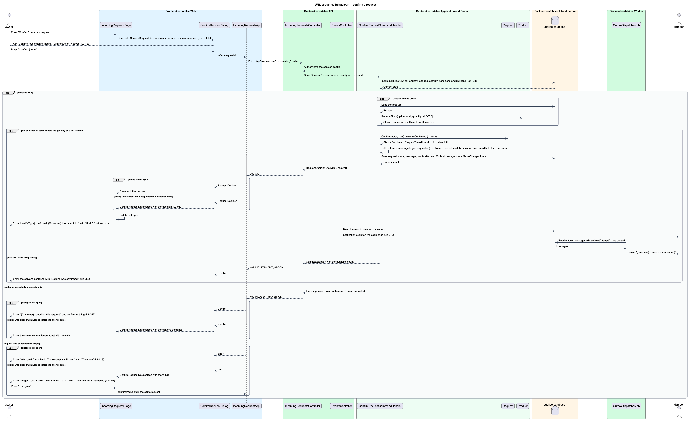
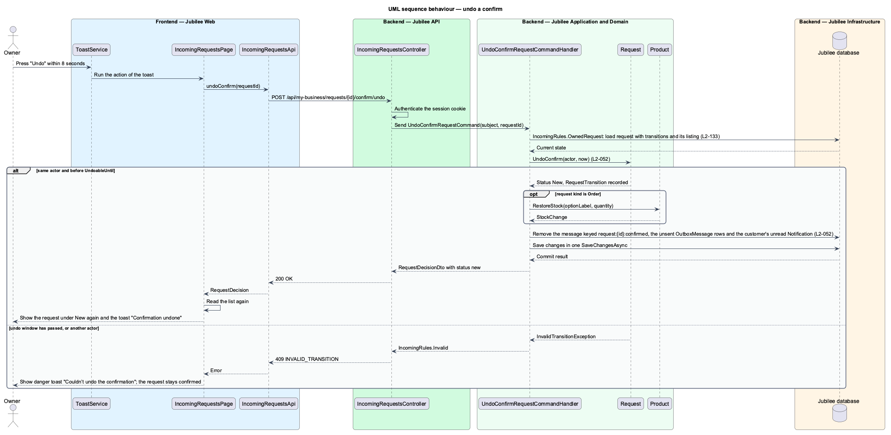

# Confirm a request

## Overview

Jubilee is Toronto's Christian marketplace. A member finds a verified business and asks it for something without
paying through the platform; the owner of the business answers. A *request* is that ask. It has one of three
types (booking, quote, order) and follows one lifecycle shared by the member and the owner. This feature covers
one of the owner's two answers: confirming.

Confirming tells the customer that the business will do what was asked. "Confirm" on a new request opens a
dialog such as "Confirm Samuel's order?" that states the commitment ("Only confirm if you can deliver 24 tees by
Fri 27 Nov."), lists Customer, Order, Needed by and Total ("$528.00 + tax"), and offers "Not yet" and "Confirm
order". The safe choice "Not yet" has the default focus.

A successful confirm moves the request from `new` to `confirmed`, notifies the customer in the application and
by e-mail, adds a confirmation card to the conversation, and, for an order, reduces the product's stock by the
quantity. The toast "Order confirmed. {Customer} has been told. Message him about payment and pickup." carries
"Undo". *undo window* — the 8 seconds after a confirm during which "Undo" returns the request to `new`; the
customer's notification is withdrawn if it is not yet e-mailed.

A customer may cancel a moment before the owner confirms. In that case nothing is confirmed and the owner sees
"{Customer} cancelled this request."

## Description

The feature is a vertical slice from the confirm dialog in `Jubilee Web` to `Jubilee database`, with side
effects dispatched by `Jubilee Worker`.

- **`ConfirmRequestDialog`** — Angular dialog built on `DialogShell`, opened from a row of
  `IncomingRequestsPage`. It shows the commitment line and the request summary with "Not yet" (default focus)
  and the confirm button. On failure it shows "We couldn't confirm it. The request is still new. Check your
  connection and try again." and the primary button reads "Try again" (`L2-128`).
- **`ToastService`** — shows the success toast with "Undo" for 8 seconds. When the dialog was closed before a
  failure returned, it shows the danger toast "Couldn't confirm the order" with "Try again".
- **`RequestsApi`** — typed Angular HTTP client. `confirm` calls `POST /api/my-business/requests/{id}/confirm`;
  `undoConfirm` calls `POST /api/my-business/requests/{id}/confirm/undo`.
- **`IncomingRequestsController`** — ASP.NET Core controller in `Jubilee.Api`. It authenticates the session
  cookie, applies `ListingOwnerPolicy` (HTTP 403 for a caller who is not the owner or a co-owner, `L2-133`) and
  sends the command through MediatR. Neither endpoint accepts a body.
- **`ConfirmRequestCommand`** and **`ConfirmRequestCommandHandler`** — the handler loads the request with its
  row version, calls `Request.Confirm`, calls `Product.ReduceStock` for an order, appends a confirmation card to
  the `Conversation`, and writes the customer's notification, e-mail and real-time event to the outbox in one
  unit of work.
- **`UndoConfirmRequestCommand`** and **`UndoConfirmRequestCommandHandler`** — the handler calls
  `Request.UndoLastTransition`, restores the stock through `Product.RestoreStock`, and withdraws the customer's
  notification when its e-mail `OutboxMessage` is not yet dispatched. The e-mail is queued with the same 8-second delay as the undo window, so
  it is never already sent (ADR 0021).
- **`Request`** — domain entity in `Jubilee.Domain` that owns the request lifecycle (`L2-043`). `RequestStatus`
  holds `New`, `Confirmed`, `Declined`, `Cancelled` and `Completed`. The allowed transitions are `New` →
  `Confirmed` (the owner confirms), `New` → `Declined` (the owner declines), `New` or `Confirmed` → `Cancelled`
  (the member cancels) and `Confirmed` → `Completed` (a booking's meeting end time passes, or the owner marks an
  order fulfilled). `UndoLastTransition` returns a request to its previous status within 8 seconds of a cancel
  or a confirm. Each other transition throws `InvalidTransitionException`; the API maps it to HTTP 409 with code
  `INVALID_TRANSITION` and leaves the request unchanged.
- **`RequestTransition`** — child entity of `Request` that records each transition with actor, time and previous
  status. The progress timeline reads these records.
- **Undo rule** — `Request.Confirm` sets `UndoableUntil` on its `RequestTransition` to 8 seconds after
  `OccurredAt`. `UndoLastTransition` succeeds only for the actor of that transition and only before
  `UndoableUntil`; later calls return HTTP 409 with code `INVALID_TRANSITION`.
- **`Product`** — domain entity. `ReduceStock(optionId, quantity)` lowers the stock by the confirmed quantity;
  `RestoreStock` reverses it on undo. The behaviour when stock is below the quantity at confirm time is `<TO
  SUPPLY>`.
- **Concurrent cancel** — `Request` carries a `RowVersion` concurrency token. When the customer's cancel commits
  first, `Request.Confirm` finds status `Cancelled` and throws `InvalidTransitionException`. The API returns
  HTTP 409 with code `INVALID_TRANSITION` and the current status, and the dialog shows "{Customer} cancelled
  this request."
- **`RequestConfirmedEvent`** — outbox payload. Its e-mail `OutboxMessage` carries `NotBefore` equal to
  `UndoableUntil`, so an undo inside the window can cancel the e-mail before it is sent.
- **`OutboxDispatcherJob`** — hosted job in `Jubilee Worker`. It reads the `OutboxMessage` rows written in the
  same transaction, stores the in-app `Notification`, sends the e-mail through `IEmailSender` and pushes the
  real-time event through `EventsHub`.

## Requirements

The feature realizes the following level-2 (L2) requirements. Each L2 requirement refines a level-1 (L1)
requirement, cited by identifier.

| L2 ID | Refines (L1) | Requirement |
|-------|--------------|-------------|
| `L2-052` | `L1-008` | An owner shall be able to confirm a new request after a confirmation dialog. The request shall become `confirmed`, the customer shall be notified in-app and by e-mail, an order's product stock shall be reduced by the quantity, and "Undo" within 8 seconds shall return the request to `new`. |
| `L2-043` | `L1-007` | Each booking, quote and order request shall follow one lifecycle shared by the member's and the owner's views. |
| `L2-129` | `L1-018` | An action that notifies another person shall open a confirmation dialog that states the consequence and focuses the safe choice by default. A reversible action shall carry "Undo" on its success toast. |
| `L2-128` | `L1-018` | A failed dialog submission shall show an error alert at the top of the dialog that says what did not happen, and shall keep everything typed. |
| `L2-133` | `L1-019` | The server shall return HTTP 403 when an owner API is called for a listing the caller does not own. |

## Diagrams

### System context

An owner confirms a request through Jubilee. Jubilee tells the member in the application and through the
external e-mail provider.

### Containers

The confirm travels from `Jubilee Web` to `Jubilee API`, which changes the request and the stock in `Jubilee
database`. `Jubilee Worker` dispatches the outbox to the member.

### Components

`ConfirmRequestDialog` and the "Undo" action of `ToastService` call `IncomingRequestsController` through
`RequestsApi`. The two handlers mutate `Request` and `Product`.

### Class structure

`ConfirmRequestCommandHandler` calls `Confirm` on `Request` and `ReduceStock` on `Product`.
`UndoConfirmRequestCommandHandler` reverses both and cancels the pending e-mail `OutboxMessage`.

### Behaviour — confirm a request

The dialog states the commitment (`L2-129`). The handler applies the `L2-052` confirm through the `L2-043`
lifecycle and reduces stock. A request the customer cancelled a moment earlier returns HTTP 409, and a failure
keeps the dialog open (`L2-128`).

### Behaviour — undo a confirm

"Undo" within 8 seconds returns the request to `new`, restores the stock and withdraws the customer's
notification if it is not yet e-mailed (`L2-052`).

