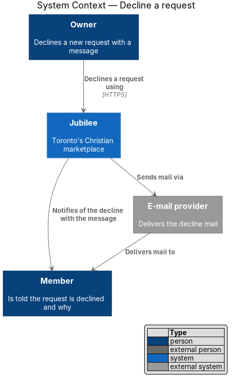
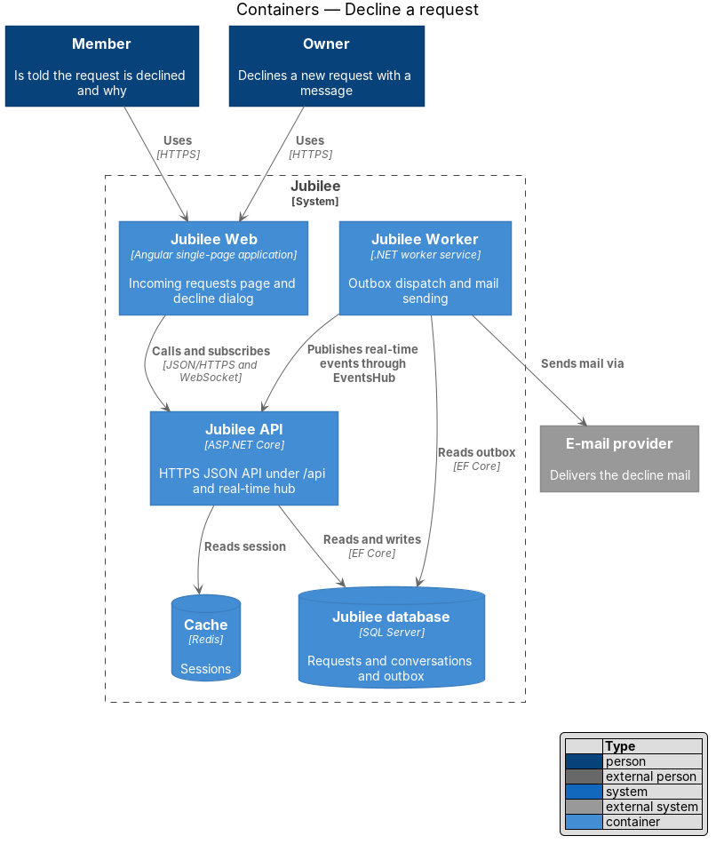
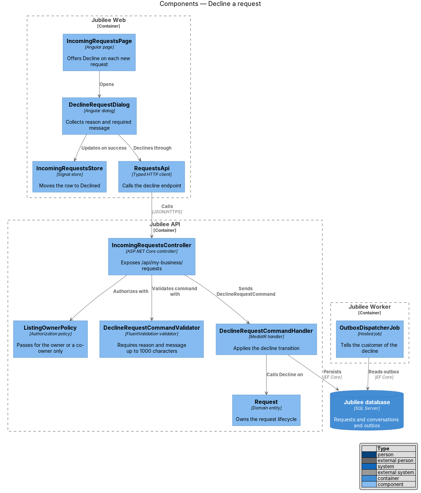
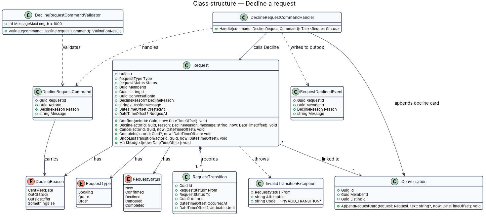
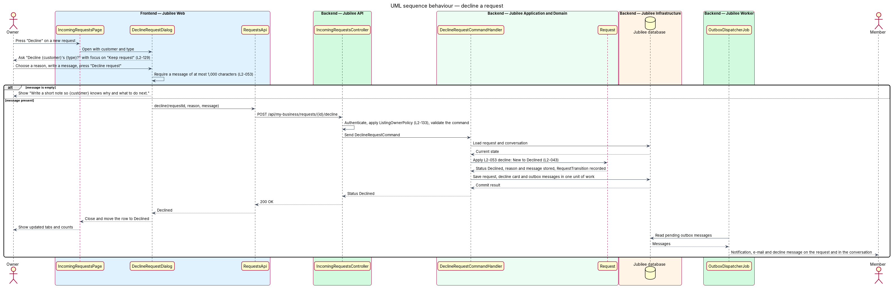
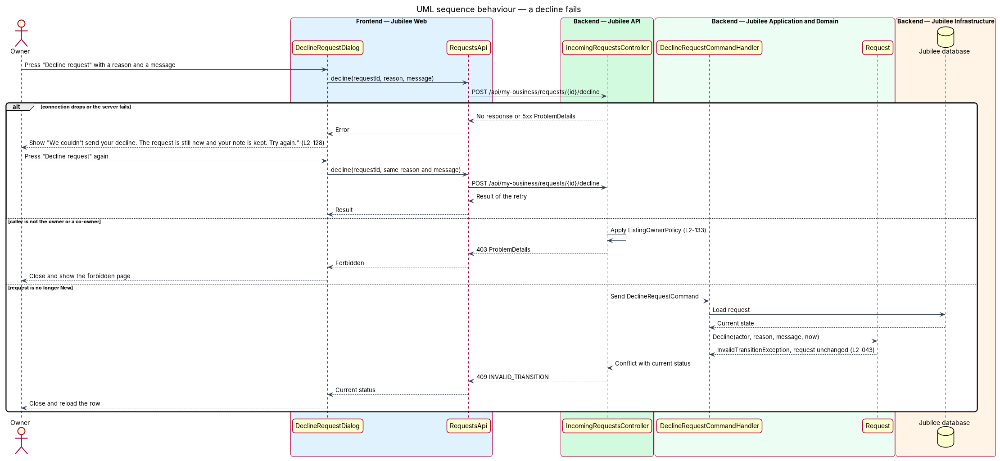

# Decline a request

## Overview

Jubilee is Toronto's Christian marketplace. A member finds a verified business and asks it for something without
paying through the platform; the owner of the business answers. A *request* is that ask. It has one of three
types (booking, quote, order) and follows one lifecycle shared by the member and the owner. This feature covers
one of the owner's two answers: declining.

Declining tells the customer that the business will not do what was asked, and why. "Decline" on a new request
opens a dialog "Decline {customer}'s {type}?" with the guidance "A kind, clear reason keeps the door open.
{Customer} can reply in Messages." The owner picks a reason and writes a message to the customer. The message is
required, because the customer reads it on the request and in the conversation.

*decline reason* — one of four fixed choices: "Can't meet the date", "Out of stock", "Outside what I offer" or
"Something else". *decline message* — owner's note of at most 1,000 characters shown to the customer with the
decline.

A successful decline moves the request from `new` to `declined` and notifies the customer. The lifecycle offers
no transition out of `declined`, and a decline has no undo.

## Description

The feature is a vertical slice from the decline dialog in `Jubilee Web` to `Jubilee database`, with side
effects dispatched by `Jubilee Worker`.

- **`DeclineRequestDialog`** — Angular dialog built on `DialogShell`, opened from a row of
  `IncomingRequestsPage`. It shows "Reason" with the four choices and "Message to {customer}" (required, hint
  "Shown to the customer with your decline.", input stops at 1,000 characters), with "Keep request" (default
  focus) and "Decline request". An empty message shows "Write a short note so {customer} knows why and what to
  do next." On failure it shows "We couldn't send your decline. The request is still new and your note is kept.
  Try again." and keeps the reason and the message (`L2-128`).
- **`RequestsApi`** — typed Angular HTTP client. `decline` calls `POST /api/my-business/requests/{id}/decline`
  with `reason` and `message`.
- **`IncomingRequestsController`** — ASP.NET Core controller in `Jubilee.Api`. It authenticates the session
  cookie, applies `ListingOwnerPolicy` (HTTP 403 for a caller who is not the owner or a co-owner, `L2-133`) and
  sends `DeclineRequestCommand` through MediatR. A body with a field other than `reason` and `message`, such as
  `status`, returns HTTP 400.
- **`DeclineRequestCommand`** — request object carrying `RequestId`, `ActorId`, `Reason` and `Message`.
- **`DeclineRequestCommandValidator`** — FluentValidation validator. It requires a `Reason` from `DeclineReason`
  and a `Message` that is not empty or whitespace and is at most 1,000 characters. A failure returns HTTP 422
  with a per-field code.
- **`DeclineRequestCommandHandler`** — MediatR handler. It loads the request, calls `Request.Decline`, appends a
  decline card with the message to the member–business `Conversation`, and writes the customer's notification,
  e-mail and real-time event to the outbox in one unit of work.
- **`DeclineReason`** — enumeration: `CantMeetDate`, `OutOfStock`, `OutsideOffer`, `SomethingElse`.
- **`Request`** — domain entity in `Jubilee.Domain` that owns the request lifecycle (`L2-043`). `RequestStatus`
  holds `New`, `Confirmed`, `Declined`, `Cancelled` and `Completed`. The allowed transitions are `New` →
  `Confirmed` (the owner confirms), `New` → `Declined` (the owner declines), `New` or `Confirmed` → `Cancelled`
  (the member cancels) and `Confirmed` → `Completed` (a booking's meeting end time passes, or the owner marks an
  order fulfilled). `UndoLastTransition` returns a request to its previous status within 8 seconds of a cancel
  or a confirm. Each other transition throws `InvalidTransitionException`; the API maps it to HTTP 409 with code
  `INVALID_TRANSITION` and leaves the request unchanged.
- **`RequestTransition`** — child entity of `Request` that records each transition with actor, time and previous
  status. The progress timeline reads these records.
- **Decline data** — `Request.Decline` stores `DeclineReason` and `DeclineMessage` on the request.
  `RequestDetailPage` shows the message in quotes to the customer.
- **`InvalidTransitionException`** — raised when the request is no longer `New`, for example when the customer
  cancelled it first. `ProblemDetailsMiddleware` returns HTTP 409 with code `INVALID_TRANSITION` and the current
  status; the dialog closes and the row reloads.
- **`RequestDeclinedEvent`** — outbox payload with the request, the reason and the message.
- **`OutboxDispatcherJob`** — hosted job in `Jubilee Worker`. It reads the `OutboxMessage` rows written in the
  same transaction, stores the in-app `Notification`, sends the e-mail through `IEmailSender` and pushes the
  real-time event through `EventsHub`.
- **`IncomingRequestsStore`** — moves the row from "New" to "Declined" and updates the tab counts after success.
  The response-time badge (`L2-054`) counts the decline as the owner's first response.

## Requirements

The feature realizes the following level-2 (L2) requirements. Each L2 requirement refines a level-1 (L1)
requirement, cited by identifier.

| L2 ID | Refines (L1) | Requirement |
|-------|--------------|-------------|
| `L2-053` | `L1-008` | An owner shall be able to decline a new request with a reason and a required message of at most 1,000 characters. The request shall become `declined`, the message shall be shown to the customer on the request and in the conversation, and the customer shall be notified. |
| `L2-043` | `L1-007` | Each booking, quote and order request shall follow one lifecycle shared by the member's and the owner's views. |
| `L2-129` | `L1-018` | An action that notifies another person shall open a confirmation dialog that states the consequence and focuses the safe choice by default. A reversible action shall carry "Undo" on its success toast. |
| `L2-128` | `L1-018` | A failed dialog submission shall show an error alert at the top of the dialog that says what did not happen, and shall keep everything typed. |
| `L2-133` | `L1-019` | The server shall return HTTP 403 when an owner API is called for a listing the caller does not own. |

## Diagrams

### System context

An owner declines a request through Jubilee. Jubilee tells the member in the application and through the
external e-mail provider.

### Containers

The decline travels from `Jubilee Web` to `Jubilee API`, which changes the request in `Jubilee database`.
`Jubilee Worker` dispatches the outbox to the member.

### Components

`DeclineRequestDialog` calls `IncomingRequestsController` through `RequestsApi`. The controller authorizes with
`ListingOwnerPolicy`; the handler calls `Decline` on `Request` after `DeclineRequestCommandValidator` passes.

### Class structure

`DeclineRequestCommandHandler` handles `DeclineRequestCommand` and calls `Decline` on `Request`, which stores
the `DeclineReason` and the message and records a `RequestTransition`.

### Behaviour — decline a request

The dialog requires a message (`L2-053`) and states the consequence (`L2-129`). The handler applies the decline
through the `L2-043` lifecycle and the customer is told.

### Behaviour — a decline fails

A failed submission keeps the dialog open with the reason and the note intact (`L2-128`). A request that is no
longer `new` returns HTTP 409 and is not changed (`L2-043`).

