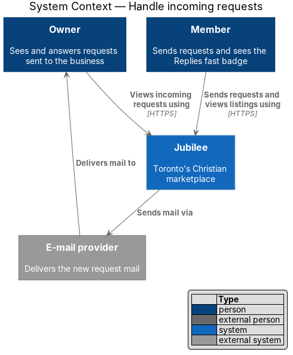
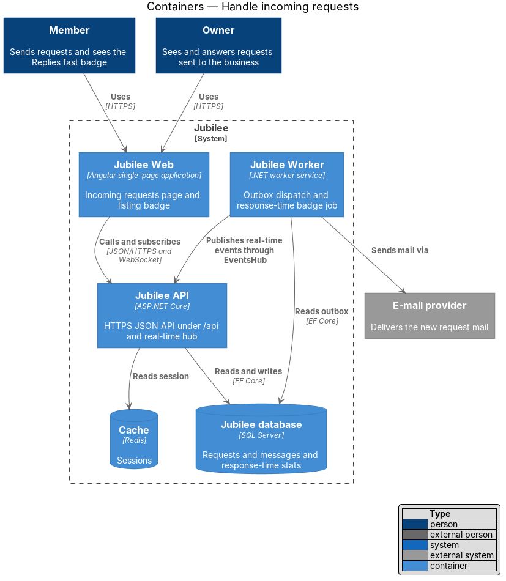
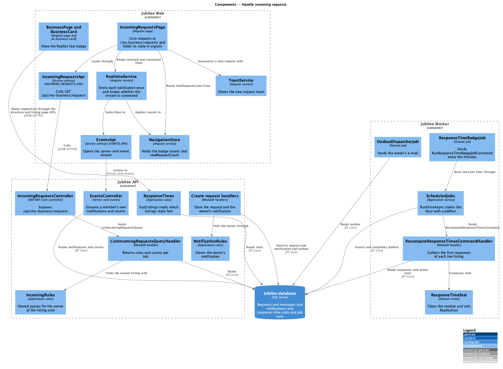
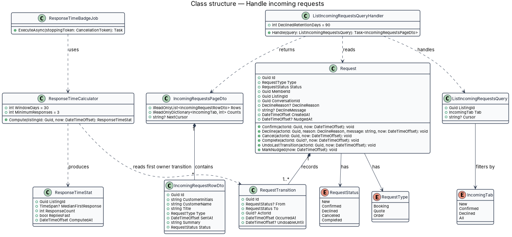
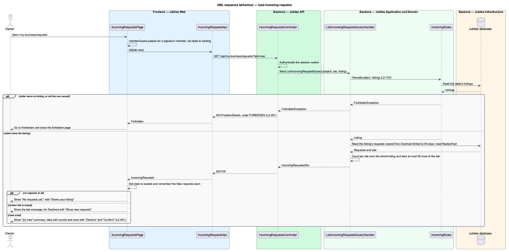
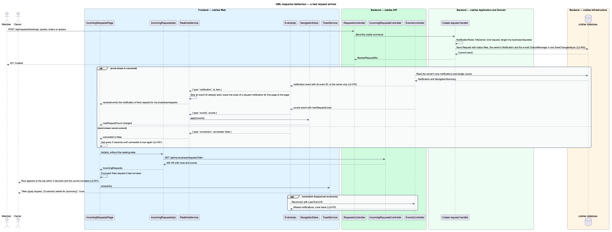
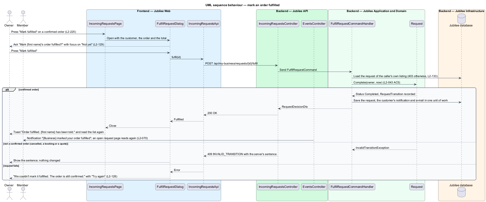
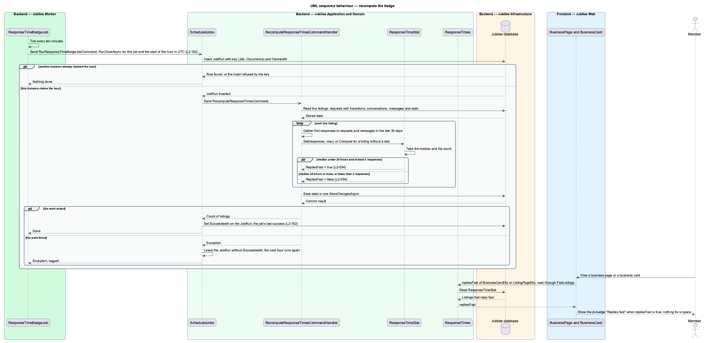

# Handle incoming requests

## Overview

Jubilee is Toronto's Christian marketplace. A member finds a business and asks it for something without
paying through the platform; the owner of the business answers. A *request* is that ask. It has one of four
types (booking, quote, order, space) and follows one lifecycle shared by the member and the owner. This feature
covers the owner's list of those requests and the badge that rewards a fast answer.

"Incoming requests" at `/my-business/requests` lists the requests customers send the owner's business. A summary
line such as "3 new · reply within a day to keep your “replies fast” badge" sits above the tabs "New",
"Confirmed", "Declined" and "All", each with its count. Each new request row shows the customer's initials, the
title, "{Type} · {customer name} · {time}", the customer's note or delivery choice, and the actions "Decline"
and "Confirm". A request that arrives while the page is open appears at the top within 5 seconds.

Only the owner of the listing may open the page or call its API. Each other member receives HTTP 403 and the
forbidden page. A listing has one owner (`Listing.OwnerId`); the code has no co-owner.

*first response* — owner's first answer to a customer: the confirm or decline of a request, or the first reply
to a message. *"Replies fast" badge* — mark on a listing whose median first response over the last 30 days is
under 24 hours, with at least 3 responses. The badge is recomputed hourly and removed when the median reaches 24
hours or more.

## Description

The feature is a vertical slice from the incoming requests page in `Jubilee Web` to `Jubilee database`, with the
badge computed in `Jubilee Worker`. The names below are the names in the code; the parts decided in ADR 0050 are
marked with it.

- **`IncomingRequestsPage`** — Angular page at `/my-business/requests`
  (`frontend/projects/jubilee/src/app/pages/incoming-requests`), behind `memberGuard`. It holds its own state in
  signals (`state`, a `LoadState<IncomingRequests>`, and `tab`); there is no store. It shows the summary line,
  the tabs with counts and the request rows. With no requests at all it shows "No requests yet. When a member
  orders a product, books a service or asks for a quote, it lands here for you to confirm or decline." with
  "Share your listing". An empty Declined tab shows "You haven't declined any requests. Declined requests are
  kept here for 90 days." with "Show new requests". "Confirm" and "Decline" open `ConfirmRequestDialog` and
  `DeclineRequestDialog`. An answer of HTTP 403 sends the owner to `/forbidden`; a list that cannot be read
  shows the load error with the reference `JB-REQ-503`.
- **Listening for new requests** — `IncomingRequestsPage` reads the list again, without the loading state, when
  `RealtimeService.received` emits a notification of kind `request` whose target is `/my-business/requests`, and
  when the `counts` event changes the `newRequestCount` of `NavigationStore`. It remembers the New requests it
  has seen and announces each one it had not with the toast "New {type} request. {Customer} asked for
  {summary}." It polls every 5 seconds only while `RealtimeService.connected` is false, and reads once and stops
  the moment it is true again (ADR 0050, `L2-051` AC5 and AC7).
- **Mark fulfilled** — a confirmed order, under "Confirmed" or "All", carries "Mark fulfilled" (`L2-225`, ADR
  0060). It opens `FulfilRequestDialog`: "Mark {first name}'s order fulfilled?", "Only mark it fulfilled once
  {first name} has it.", the customer, the order and the total, "{first name} is told it's done and the order
  moves to Completed.", "Not yet" (first focus) and "Mark fulfilled". On success the page reads the list again and
  shows the toast "Order fulfilled. {first name} has been told."; there is no Undo, because `completed` is final.
  A failure keeps the dialog open with "We couldn't mark it fulfilled. The order is still confirmed. Check your
  connection and try again." and "Try again"; a 409 shows the server's sentence and changes nothing. A booking,
  a quote and a space request carry no such control.
- **`IncomingRequestsApi`** — service contract behind the `INCOMING_REQUESTS_API` injection token, implemented by
  `HttpIncomingRequestsApi`. `list(tab)` calls `GET /api/my-business/requests?tab=`; the endpoint also takes
  `listing=` for an owner of more than one listing. There is no cursor. `confirm`, `undoConfirm`, `decline` and `fulfil`
  (`POST /api/my-business/requests/{id}/fulfil`) serve the three dialogs.
- **`RealtimeService`** and **`ToastService`** — `RealtimeService` subscribes to `EventsApi.stream()`
  (`SseEventsApi`, an `EventSource` on `/api/events`). It emits each notification once on `received`, applies
  each `counts` event to `NavigationStore` and shows a toast for a notification. On `/my-business/requests` it
  leaves a `request` notification that targets that page to the page, so the owner sees one toast, not two. The
  stream also emits `{ type: 'connection', connected }`, and `RealtimeService.connected` is a signal that holds
  the last value (ADR 0050). `ToastService` shows the toasts in the `jb-toast-region` of the app shell.
- **`IncomingRequestsController`** — ASP.NET Core controller in `Jubilee.Api` for `/api/my-business/requests`.
  It reads the subject of the session cookie and sends `ListIncomingRequestsQuery` through MediatR. It carries
  no authorization policy of its own; the handler decides who owns what.
- **`IncomingRules`** — static rules in `Jubilee.Application` (`Requests/Incoming.cs`) that the owner's side of a
  request shares. `Owned` returns the listing named by `listing=`, or else the caller's live listing, and throws
  `ForbiddenException` (HTTP 403, code `FORBIDDEN`) for a caller who owns no listing, or not the one named
  (`L2-133`). `OwnedRequest` does the same for one request: an unknown request is HTTP 404 and a request of
  another business is HTTP 403. The check runs on the server and does not rely on `memberGuard`.
- **`ListIncomingRequestsQuery`** and **`ListIncomingRequestsQueryHandler`** — return `IncomingRequestsDto`: the
  listing (`OwnerListingDto`), the tab, the counts (`RequestCountsDto`: `New`, `Confirmed`, `Declined`, `All`),
  `RepliesFast` and the rows of the tab, newest first. The counts cover the whole listing, not the tab. Declined
  requests are kept for 90 days (`IncomingRules.DeclinedKept`). The page size is 50 (`PageSize`, ADR 0021).
- **`IncomingRequestRowDto`** — row projection with `Kind`, `KindLabel`, `CustomerName`, `CustomerInitials`,
  `Title`, `Detail` (the note or the delivery choice), `SentAt`, `Status`, `StatusLabel`, `Total` and `When`.
- **`Request`** — domain entity in `Jubilee.Domain` that owns the request lifecycle (`L2-043`). `RequestKind`
  holds `Booking`, `Quote`, `Order` and `Space`; `RequestStatus` holds `New`, `Confirmed`, `Declined`,
  `Cancelled` and `Completed`. `Confirm`, `Decline`, `Cancel` and `Complete` make the allowed transitions and
  `UndoConfirm` and `UndoCancel` reverse one within 8 seconds (`Request.UndoWindow`); any other transition
  throws `InvalidTransitionException`. The handlers answer it with HTTP 409 and code `INVALID_TRANSITION`
  (`IncomingRules.Invalid`) and leave the request unchanged.
- **`RequestTransition`** — child entity of `Request` that records each transition with `From`, `To`, `Actor`,
  `At` and `UndoableUntil`. The progress timeline reads these records.
- **`Notification`** — the owner's in-app notification of a new request. Each create handler
  (`BookMeetingCommandHandler`, `RequestQuoteCommandHandler`, `RequestItemCommandHandler`,
  `RequestSpaceCommandHandler`) writes it with `NotificationRules.Tell`, kind `request` and target
  `/my-business/requests`, in the same `SaveChangesAsync` as the `Request`, and queues the owner's e-mail with
  `EmailPolicy.Queue`.
- **`EventsController`** — `GET /api/events`, the server-sent event stream of a signed-in member (`L2-070`). It
  sends each new `Notification` of its own user as a `notification` event with an event ID, and the badge counts
  (`NavigationSummary`, with `newRequestCount`) as a `counts` event when they change. A reconnect with
  `Last-Event-ID` receives what it missed and nothing twice. The stream carries no row data: the page reads the
  list from the API.
- **`OutboxDispatcherJob`** — hosted job in `Jubilee Worker`. It sends the `OutboxMessage` e-mail to the owner
  through `OutboxDispatcher` and `IEmailSender`. The outbox sends e-mail only; it pushes no real-time event.
- **`ResponseTimeBadgeJob`** — hosted job in `Jubilee Worker` (`WorkerHost.cs`) that ticks every ten minutes and sends
  `RunResponseTimeBadgeJobCommand`, so an instance that starts late in an hour still serves the next one on time. `ScheduledJobs.RunOnceAsync` makes the hour run at most once across
  instances and records its success (ADR 0050, `L2-182`).
- **`JobRun`** — entity with the key (`Job`, `Occurrence`): the name of the job and the start of the hour it ran
  for, in UTC, with `ClaimedAt` and `SucceededAt`. `ScheduledJobs.RunOnceAsync` inserts the row before the work,
  so of two instances one inserts and the other finds the row, or is refused by the key, and does nothing. When
  the work ends `SucceededAt` is set; the job's last success is its newest `SucceededAt`
  (`ScheduledJobs.LastSuccessAsync`). When the work throws, the row stays without a success, which is the record
  of the failure, and the job runs again at the next hour (ADR 0050). The table comes with the migration
  `AddJobRuns`.
- **`RecomputeResponseTimesCommandHandler`** — MediatR handler in `Jubilee.Application` (`Requests/Incoming.cs`)
  that gathers the first responses of each live listing over the last 30 days. For a request, the response time
  runs from `CreatedAt` to the owner's first `RequestTransition` to `Confirmed` or `Declined`. For a message, it
  runs from the customer's message to the owner's first reply; the pairing rule is in ADR 0021: the owner's
  first message after a customer message that had no owner message since. The handler is idempotent.
- **`ResponseTimeStat`** — entity per listing with `MedianFirstResponse`, `ResponseCount`, `RepliesFast` and
  `ComputedAt`. `Compute` and `Set` take the median of the responses; `RepliesFast` is true when the median is
  under 24 hours (`FastUnder`) and the count is at least 3 (`MinimumResponses`).
- **"Replies fast" badge** — `BusinessCardDto` and `ListingPageDto` carry `RepliesFast`, read from
  `ResponseTimeStat` through `ResponseTimes.FastListings`. `BusinessPage` shows `Replies fast` beside the credentials in the head of the page, and `jb-business-card`
  (`BusinessCard`) shows it in its meta line. The words are text, so colour is not what says it. A space and a
  space card do not carry it. The directory read cache (60 seconds) bounds how long a removed badge can still
  show (ADR 0050, `L2-054`).

### Space requests

`RequestKind` gains `Space`. `IncomingRules` holds its words (`KindLabel`
"Space", `Title`, `SpaceWhen`, `SpaceTotal`). A space request is listed with the
title "{call to action} · {the space}", the line "Space · {customer} · {time}" and the
detail of its dates ("Fri 13 Mar – Sun 15 Mar · 2 nights · $240") or move-in
("Move in Sun 1 Mar · 12 months"), with "Decline" and "Confirm". Its
confirm dialog warns that the customer gets the exact address on confirm.
Confirm and decline use the existing endpoints. A new space request reaches the
owner as a notification, which the event stream carries to the open page as it
does for each other request, and a queued e-mail. The
wording, the confirm dialog and the address release are the feature
[Request a space](../request-space/README.md) (ADR 0042).

## Requirements

The feature realizes the following level-2 (L2) requirements. Each L2 requirement refines a level-1 (L1)
requirement, cited by identifier.

| L2 ID | Refines (L1) | Requirement |
|-------|--------------|-------------|
| `L2-051` | `L1-008` | `/my-business/requests` shall list the requests customers send the owner's business. A new request shall reach the open page over the event stream; the page shall ask on a timer only while the stream cannot connect. |
| `L2-054` | `L1-008` | A listing shall carry the "Replies fast" badge, on its listing page and on its business card, when its median first response to requests and messages over the last 30 days is under 24 hours with at least 3 responses. The badge shall be recomputed at least hourly and removed when the median rises to 24 hours or more. A space shall not carry it. |
| `L2-043` | `L1-007` | Each booking, quote and order request shall follow one lifecycle shared by the member's and the owner's views. |
| `L2-225` | `L1-007` | The owner shall be able to mark a confirmed order fulfilled after a confirmation dialog, and the customer shall be told. |
| `L2-133` | `L1-019` | The server shall return HTTP 403 when an owner API is called for a listing the caller does not own. |
| `L2-070` | `L1-010` | A notification, message or request event shall reach an open signed-in page within 2 seconds at the 95th percentile over a persistent connection. |
| `L2-182` | `L1-025` | Each scheduled job shall be idempotent, shall run at most once per schedule across instances, and shall record its last success. |
| `L2-207` | `L1-028` | A space request shall be listed in Incoming requests with the call to action and the space, "Space · {customer} · {time}" and its dates or move-in, confirmed through a dialog that warns the address is shared, declined as any request, and shown to the member with the type "Space". |

## Diagrams

### System context

An owner handles incoming requests through Jubilee. Members send those requests and later see the "Replies fast"
badge on the listing. Jubilee also tells the owner of a new request through the external e-mail provider.

### Containers

`Jubilee Web` reads the list from `Jubilee API` and listens to its event stream `/api/events`. `Jubilee Worker`
sends the outbox e-mail and recomputes the badge in `Jubilee database`; it pushes nothing to the page.

### Components

`IncomingRequestsPage` loads through `IncomingRequestsApi` and reads again when `RealtimeService` receives a
`request` notification or `NavigationStore` gets a new count from `EventsController`. In the worker,
`ResponseTimeBadgeJob` runs `RecomputeResponseTimesCommandHandler` once per hour through `ScheduledJobs`.

### Class structure

`ListIncomingRequestsQueryHandler` projects `Request` to `IncomingRequestRowDto` inside `IncomingRequestsDto`.
`RecomputeResponseTimesCommandHandler` reads `RequestTransition` records and sets the `ResponseTimeStat` of a
listing; `ScheduledJobs` guards the hour with a `JobRun`.

### Behaviour — load incoming requests

`IncomingRules.Owned` runs before any read of requests; a caller who does not own the listing receives HTTP 403
and the forbidden page (`L2-051`, `L2-133`).

### Behaviour — a new request arrives

The create handler stores the owner's `Notification` with the `Request`. `EventsController` streams it to the
open page, which reads the list again and shows the row with one toast (`L2-051`, `L2-070`). While the stream
cannot connect the page polls every 5 seconds instead.

### Behaviour — mark an order fulfilled

"Mark fulfilled" opens the dialog, `FulfilRequestCommandHandler` completes the confirmed order and tells the
customer in the app and by e-mail, and the customer's open request page reads it again (`L2-225`, `L2-070`).

### Behaviour — recompute the badge

`ResponseTimeBadgeJob` claims the hour with a `JobRun`, recomputes the median, sets or clears `RepliesFast`
(`L2-054`) and records its success (`L2-182`).

