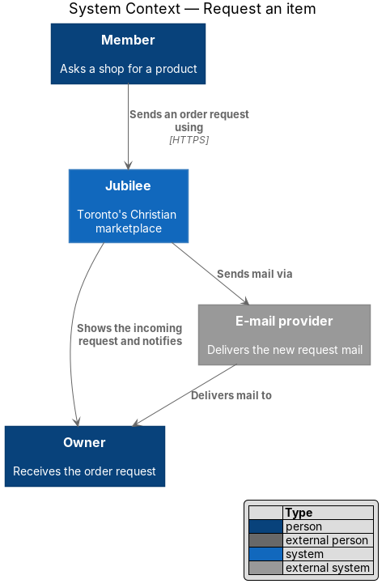
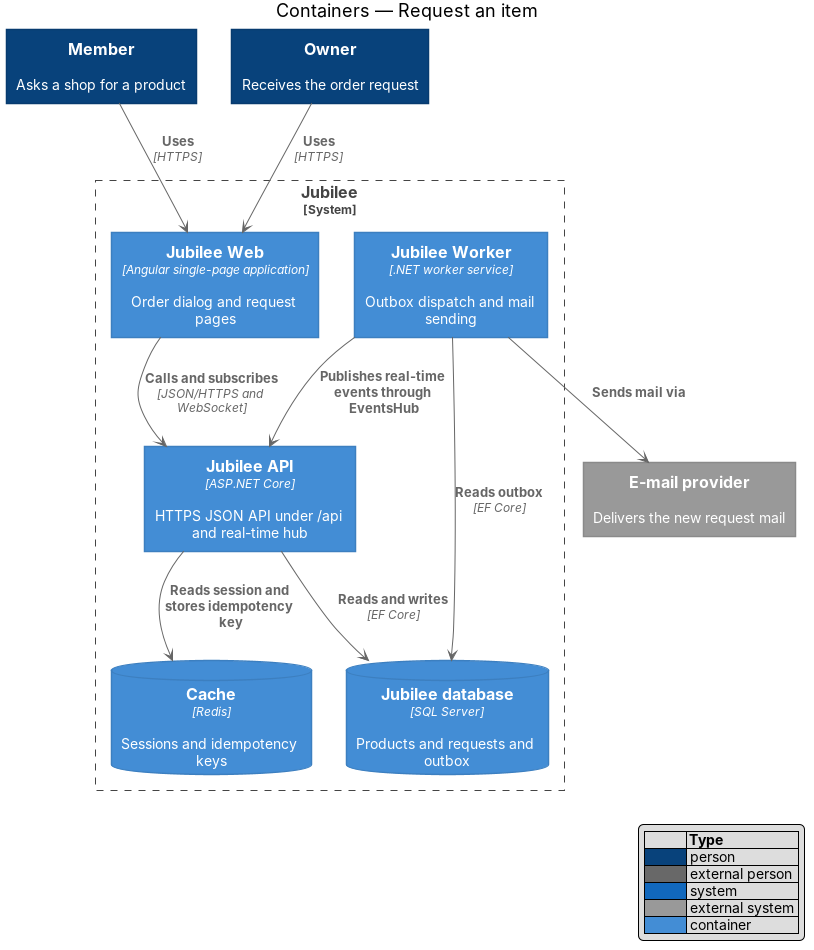
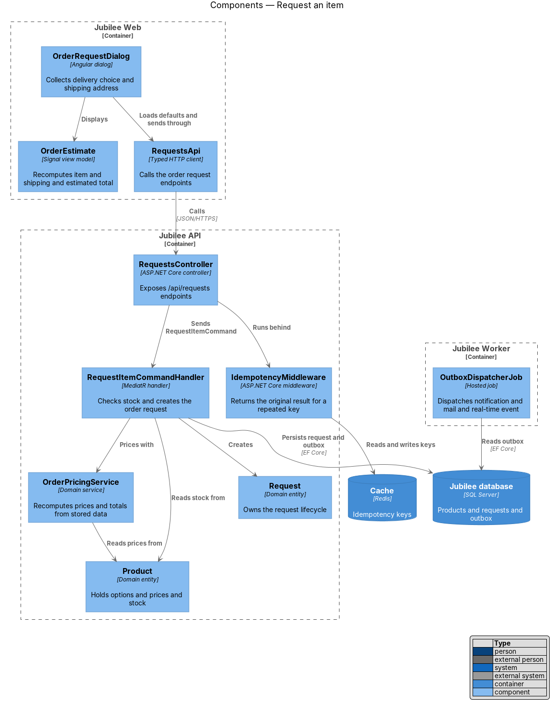
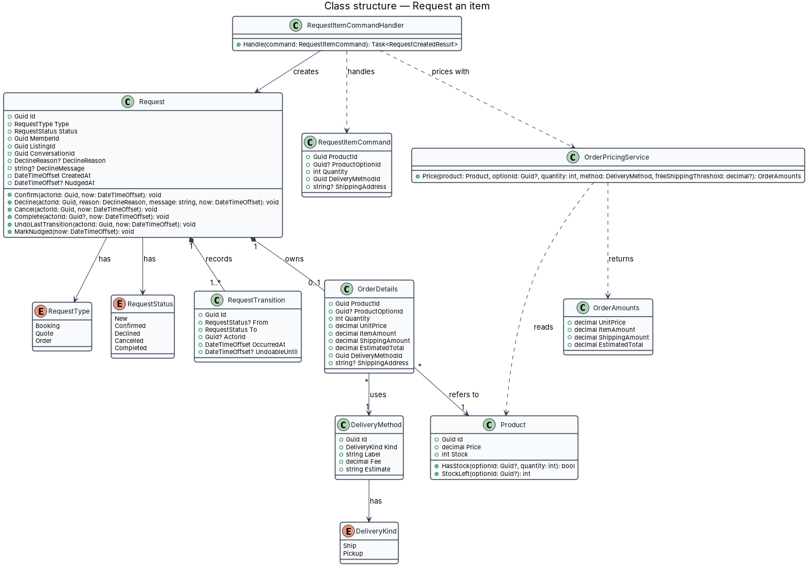
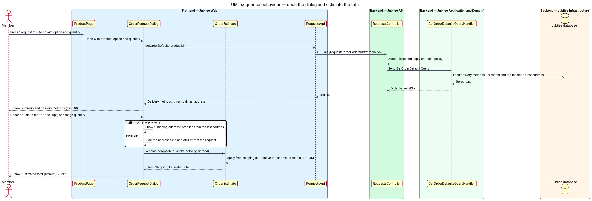
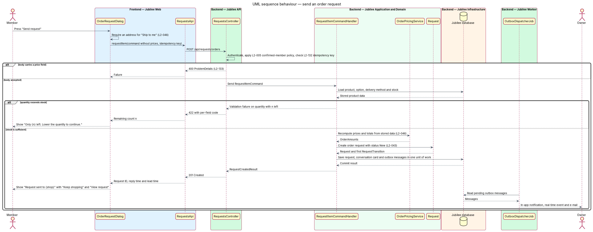

# Request an item

## Overview

Jubilee is Toronto's Christian marketplace. A member finds a verified business and asks it for something without
paying through the platform. A *request* is that ask. It has one of three types (booking, quote, order) and
follows one lifecycle shared by the member and the owner. This feature covers the order type.

An *order request* is a request in which a member asks a shop for a product, with a chosen option, quantity and
delivery method. It opens from "Request this item" on a product. The dialog "Request this item" states "No
payment now. {Shop} confirms and you pay them directly." Jubilee takes no payment; the shop confirms the request
and arranges payment with the member.

A *delivery method* is a way the shop hands over a product, either shipping (for example "Ship to me · Canada
Post, $9 flat · 3–6 business days") or pickup (for example "Pick up in Leslieville · Free"). An *estimated
total* is the item amount plus shipping, before tax, shown as "Estimated total {amount} + tax". A shop may set a
free-shipping threshold (for example $75); at or above it, shipping is free.

The dialog shows an estimate at once as options change. The server never trusts a price from the client: it
recomputes prices and totals from stored product data, and it refuses a quantity above the stock at send time.

## Description

The feature is a vertical slice from the order dialog in `Jubilee Web` to `Jubilee database`, with side effects
dispatched by `Jubilee Worker`.

- **`OrderRequestDialog`** — Angular dialog built on `DialogShell`. It summarises the product, option, quantity
  and unit price and offers the shop's delivery methods. "Ship to me" requires "Shipping address", prefilled
  from the last address used; an empty address shows "Enter the address to ship to, with postal code." "Pick up"
  hides the address field and omits it from the request. After success it shows "Request sent to {shop}" with
  the shop's typical reply time and lead time, "Keep shopping" and "View request".
- **`OrderEstimate`** — signal-based view model of the dialog. It recomputes "Item", "Shipping" and "Estimated
  total {amount} + tax" immediately when the option, quantity or delivery method changes, and applies free
  shipping over the shop's threshold. The estimate is display only.
- **`RequestsApi`** — typed Angular HTTP client. `getOrderDefaults` calls `GET
  /api/requests/orders/defaults?productId=` and returns the delivery methods, the free-shipping threshold, the
  last shipping address, and the shop's typical reply time and lead time. `requestItem` calls `POST
  /api/requests/orders` with an `Idempotency-Key` header from `IdempotencyKeyFactory`.
- **`RequestsController`** — ASP.NET Core controller in `Jubilee.Api`. It authenticates the session cookie,
  applies the `ConfirmedMember` policy (HTTP 403 with code `EMAIL_UNCONFIRMED`) and sends the command through
  MediatR. `IdempotencyMiddleware` returns the original result for a repeated key within 24 hours (`L2-132`).
- **`RequestItemCommand`** — request object carrying `ProductId`, `ProductOptionId`, `Quantity`,
  `DeliveryMethodId` and `ShippingAddress`. It has no price, shipping or total field. The model binder rejects a
  body that includes one with HTTP 400 (`L2-133`).
- **`RequestItemCommandValidator`** — FluentValidation validator. It requires a quantity of at least 1 and a
  delivery method of the shop, requires `ShippingAddress` with a postal code for a shipping method, and discards
  the address for a pickup method. A failure returns HTTP 422 with a per-field code.
- **`RequestItemCommandHandler`** — MediatR handler. It loads the `Product`, its `ProductOption` and the shop's
  `DeliveryMethod`, checks stock, asks `OrderPricingService` for the amounts, creates the `Request` with its
  `OrderDetails`, appends an order card to the member–business `Conversation`, and writes the outbox messages in
  one unit of work. A quantity above stock returns HTTP 422 on `quantity` with the remaining count `n`, which
  the dialog shows as "Only {n} left. Lower the quantity to continue." Sending a request does not reduce stock;
  confirming it does (`L2-052`).
- **`OrderPricingService`** — domain service. It computes the unit price, item amount, shipping amount and
  estimated total from stored `Product`, `ProductOption` and `DeliveryMethod` data, and sets shipping to zero at
  or above the free-shipping threshold. The dialog's `OrderEstimate` mirrors the same rules. Tax calculation is
  `<TO SUPPLY>`.
- **`Request`** — domain entity in `Jubilee.Domain` that owns the request lifecycle (`L2-043`). `RequestStatus`
  holds `New`, `Confirmed`, `Declined`, `Cancelled` and `Completed`. The allowed transitions are `New` →
  `Confirmed` (the owner confirms), `New` → `Declined` (the owner declines), `New` or `Confirmed` → `Cancelled`
  (the member cancels) and `Confirmed` → `Completed` (a booking's meeting end time passes, or the owner marks an
  order fulfilled). `UndoLastTransition` returns a request to its previous status within 8 seconds of a cancel
  or a confirm. Each other transition throws `InvalidTransitionException`; the API maps it to HTTP 409 with code
  `INVALID_TRANSITION` and leaves the request unchanged.
- **`RequestTransition`** — child entity of `Request` that records each transition with actor, time and previous
  status. The progress timeline reads these records.
- **`OrderDetails`** — value object owned by a `Request` of type `Order`. It holds the product and option,
  `Quantity`, the `UnitPrice`, `ItemAmount`, `ShippingAmount` and `EstimatedTotal` computed by the server, the
  delivery method and the optional `ShippingAddress`.
- **`DeliveryMethod`** — entity of a `Listing` of kind `Shop`. It holds `Kind` (`DeliveryKind`: `Ship`,
  `Pickup`), `Label`, `Fee` and `Estimate`.
- **`OutboxDispatcherJob`** — hosted job in `Jubilee Worker`. It reads the `OutboxMessage` rows written in the
  same transaction, stores the in-app `Notification`, sends the e-mail through `IEmailSender` and pushes the
  real-time event through `EventsHub`.

## Requirements

The feature realizes the following level-2 (L2) requirements. Each L2 requirement refines a level-1 (L1)
requirement, cited by identifier.

| L2 ID | Refines (L1) | Requirement |
|-------|--------------|-------------|
| `L2-046` | `L1-007` | From a product, a member shall be able to send an order request with a delivery choice. The system shall take no payment. |
| `L2-043` | `L1-007` | Each booking, quote and order request shall follow one lifecycle shared by the member's and the owner's views. |
| `L2-005` | `L1-001` | Until the e-mail is confirmed, a member may browse, search and save but shall not message, book, request or list a business. |
| `L2-132` | `L1-018` | Each create request shall carry a client-generated idempotency key, and the server shall return the original result for a repeated key within 24 hours without creating a duplicate. |
| `L2-133` | `L1-019` | The server shall reject with HTTP 400 an update or create body that includes a field the caller is not allowed to set, such as `price` on a request, and shall change nothing. |

## Diagrams

### System context

A member sends an order request to a shop through Jubilee. Jubilee tells the owner in the application and
through the external e-mail provider. No payment provider takes part.

### Containers

The order request travels from `Jubilee Web` to `Jubilee API`, which reads product data from and stores the
request in `Jubilee database`. `Jubilee Worker` dispatches the outbox.

### Components

`OrderRequestDialog` shows the `OrderEstimate` and calls `RequestsController` through `RequestsApi`.
`RequestItemCommandHandler` uses `OrderPricingService` and the `Product` to price and check the request before
it creates the `Request`.

### Class structure

`RequestItemCommandHandler` handles `RequestItemCommand`, which carries no price. `OrderPricingService` returns
the amounts that `OrderDetails` stores on the `Request`.

### Behaviour — open the dialog and estimate the total

The dialog loads the delivery methods and the last address, then recomputes the estimate in the browser as
options change (`L2-046`).

### Behaviour — send an order request

The API enforces `L2-005` and `L2-132`. The handler refuses a quantity above stock, recomputes prices from
stored data (`L2-046`) and creates the request with status `New` (`L2-043`).

