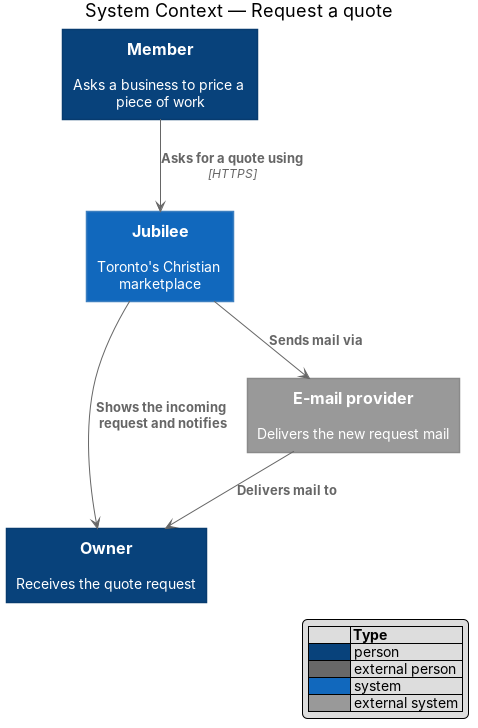
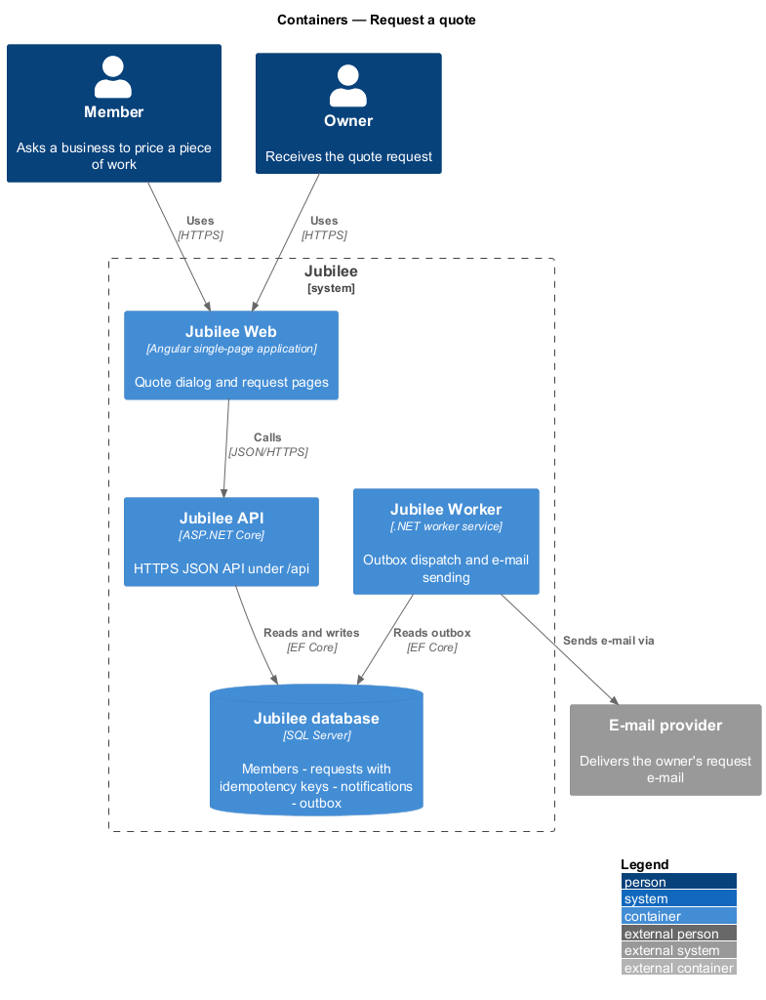
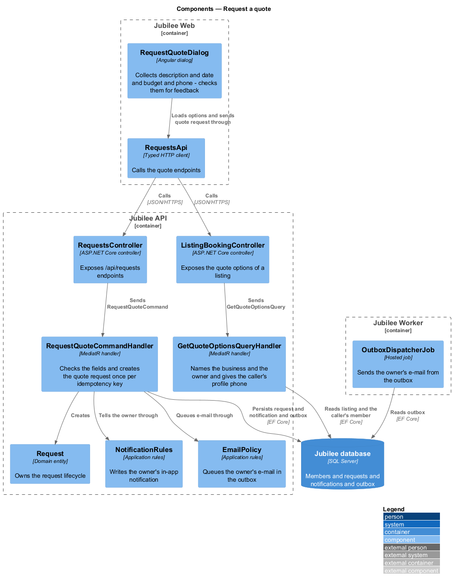
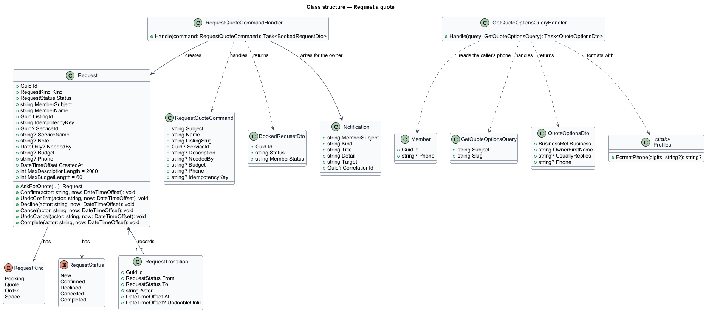
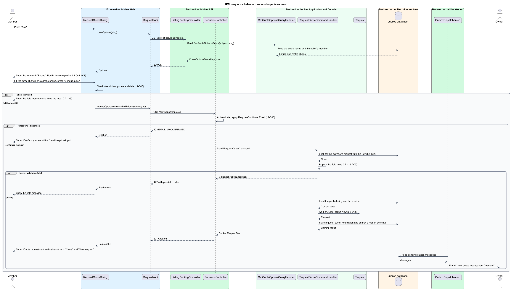
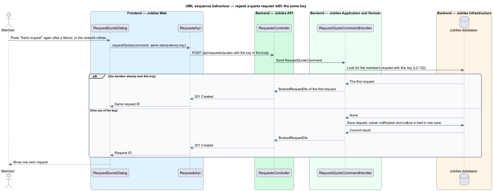

# Request a quote

## Overview

Jubilee is Toronto's Christian marketplace. A member finds a verified business and asks it for something without
paying through the platform. A *request* is that ask. It has one of four kinds (booking, quote, order, space) and
follows one lifecycle shared by the member and the owner. This feature covers the quote kind.

A *quote request* is a request in which a member describes a piece of work and asks the business to price it. It
opens from a service whose action is "Ask for a quote", or from "Ask" on a shop's custom work. The dialog "Ask
{business} for a quote" tells the member "Tell {owner} what you have in mind. There's no obligation to buy." The
owner's quote arrives later in the member's messages.

The member gives a description and may add a date the work is needed by, a budget and a phone number. The
phone number is already filled in from the member's profile; it is shared with that business for that request
only, and changing it in the dialog does not change the profile. The request starts in status `New` and appears
in "Your requests" and in the owner's incoming requests.

## Description

The feature is a vertical slice from the quote dialog in `Jubilee Web` to `Jubilee database`, with the owner's
e-mail sent by `Jubilee Worker`. Its decisions are in ADR 0016.

- **`RequestQuoteDialog`** — Angular dialog (`dialogs/request-quote`) composed of `jb-dialog`, `jb-field`,
  `jb-input`, `jb-textarea` and their neighbours from the `components` library. It opens at
  `/b/{slug}/quote[?service=id]`; a visitor is asked to join first by `SignInRequiredDialog`. It loads its
  options through `RequestsApi` and then shows "What do you need?" (required, input stops at 2,000 characters),
  "Needed by" (optional date), "Budget" (optional text, input stops at 60 characters) and "Phone" (optional,
  hint "Shared with {business} for this request only."). "Phone" starts with the `phone` of the options, the
  member's profile phone; the member can change or clear it, and the dialog never saves it to the profile
  (`L2-045` AC7). The dialog checks the fields itself for feedback: an empty description shows "Describe what
  you need in a sentence or two so {owner} can price it.", a phone that is not 10 digits shows "Enter a 10-digit
  phone number, like 416-555-0142, or leave it empty." and a past "Needed by" date shows "Choose a date from
  today on." Each message sits under its field and focus moves to the first invalid field (`L2-126`). A send
  that fails or takes longer than 10 seconds keeps what was typed and the retry reuses the idempotency key.
  After success it shows "Quote request sent to {business}" with "Close" and "View request". Its form carries
  `jbDraft` (ADR 0046): a restored draft replaces the prefilled phone.
- **`RequestsApi`** — the contract behind the `REQUESTS_API` token, implemented by `HttpRequestsApi`.
  `quoteOptions` calls `GET /api/listings/{slug}/quote` and returns `QuoteOptions`; `requestQuote` calls `POST
  /api/requests/quotes` with the idempotency key from `newKey()` in its body.
- **`ListingBookingController`** and **`RequestsController`** — ASP.NET Core controllers in `Jubilee.Api`. The
  first answers the quote options of a public listing for the caller; the second takes the quote request. Both
  require a session; `[RequiresConfirmedEmail]` on the request answers HTTP 403 with code `EMAIL_UNCONFIRMED`
  for an unconfirmed member (`L2-005`).
- **`GetQuoteOptionsQuery`** and **`GetQuoteOptionsQueryHandler`** — MediatR query carrying the caller's
  `Subject` and the listing's `Slug`. The answer, `QuoteOptionsDto`, names the business, the owner's first name,
  how soon the owner usually replies ("within a few hours", "within a day", "within a few days" or null) and
  `Phone`: the caller's own profile phone written like `416-555-0142` by `Profiles.FormatPhone`, or null when
  the profile has none or the session has no member record. Only the caller's own member is read.
- **`RequestQuoteCommand`** — request object carrying `Subject`, `Name`, `ListingSlug`, optional `ServiceId`,
  `Description`, `NeededBy`, `Budget`, `Phone` and `IdempotencyKey`.
- **`RequestQuoteCommandHandler`** — MediatR handler. A repeated idempotency key of the same member returns the
  first request and creates nothing (`L2-132`). It repeats the dialog's rules: `Description` required and at most
  2,000 characters, `Budget` at most 60 characters, `Phone` empty or 10 digits, `NeededBy` empty or a date not
  before today in `America/Toronto` (`TorontoClock.Today`). A failure is a `ValidationFailedException`, answered
  as HTTP 422 with a code per field (`REQUIRED`, `TOO_LONG`, `INVALID_PHONE`, `INVALID`, `IN_THE_PAST`). A
  business that is not public, or a service of another business, is HTTP 404; the owner asking their own
  business is HTTP 409 with `OWN_LISTING`. It then creates the `Request`, writes the owner's in-app
  `Notification` "New quote request from {member}" through `NotificationRules.Tell` and queues the owner's
  e-mail in the outbox through `EmailPolicy.Queue`, all in one save. It never loads the member for writing, so
  the profile's phone is not changed by a request. The conversation shows the request as a card because the
  conversation query reads the requests between the member and the business; nothing is appended to the
  conversation.
- **`Request`** — domain entity in `Jubilee.Domain` that owns the request lifecycle (`L2-043`). `RequestStatus`
  holds `New`, `Confirmed`, `Declined`, `Cancelled` and `Completed`. The allowed transitions are `New` →
  `Confirmed` (the owner confirms), `New` → `Declined` (the owner declines), `New` or `Confirmed` → `Cancelled`
  (the member cancels) and `Confirmed` → `Completed` (a booking's meeting end time passes, or the owner marks an
  order fulfilled). `UndoConfirm` and `UndoCancel` return a request to its previous status within 8 seconds.
  Each other transition throws `InvalidTransitionException`; the API maps it to HTTP 409 with code
  `INVALID_TRANSITION` and leaves the request unchanged. A quote request (`AskForQuote`) fills `ServiceId`,
  `ServiceName`, `Note` (what the member describes), `NeededBy`, `Budget` and `Phone` on the request itself.
  `Phone` is ten digits; the owner's e-mail and the request's "Contact" line write it as `416-555-0142`, so the
  number is visible for that request alone.
- **`RequestTransition`** — child entity of `Request` that records each transition with `From`, `To`, `Actor`
  and `At`. The progress timeline reads these records.
- **`RequestRules.QueueEmail`** — when the owner confirms or declines (`ConfirmRequestCommandHandler`,
  `DeclineRequestCommandHandler`), it writes the member's in-app `Notification`, which opens `/requests/{id}`,
  and queues the member's e-mail (`L2-045` AC8, `L2-064` AC6).
- **`OutboxDispatcherJob`** — hosted job in `Jubilee Worker`. It runs `OutboxDispatcher`, which sends the
  owner's e-mail through `IEmailSender`. The in-app notification needs no job: the handler writes it, and an
  open page receives it from the event stream `GET /api/events` (`L2-070`).

## Requirements

The feature realizes the following level-2 (L2) requirements. Each L2 requirement refines a level-1 (L1)
requirement, cited by identifier.

| L2 ID | Refines (L1) | Requirement |
|-------|--------------|-------------|
| `L2-045` | `L1-007` | From a service whose action is "Ask for a quote", or from "Ask" on a shop's custom work, a member shall be able to ask for a quote. The phone shall be prefilled from the profile and never written back to it; the owner shall be notified, and the member when the owner answers. |
| `L2-043` | `L1-007` | Each booking, quote, order and space request shall follow one lifecycle shared by the member's and the owner's views. |
| `L2-005` | `L1-001` | Until the e-mail is confirmed, a member may browse, search and save but shall not message, book, request or list a business. |
| `L2-126` | `L1-018` | A dialog form with errors shall show each message under its field, shall move focus to the first invalid field and shall keep the typed values. The server shall enforce each rule that the browser enforces and return the same message code. |
| `L2-132` | `L1-018` | Each create request shall carry a client-generated idempotency key, and the server shall return the original result for a repeated key within 24 hours without creating a duplicate. |

## Diagrams

### System context

A member asks a business for a quote through Jubilee. Jubilee tells the owner in the application and through the
external e-mail provider.

### Containers

The quote request travels from `Jubilee Web` to `Jubilee API`, which stores it, with its idempotency key, in
`Jubilee database`. `Jubilee Worker` dispatches the outbox to the e-mail provider.

### Components

`RequestQuoteDialog` calls `ListingBookingController` and `RequestsController` through `RequestsApi`. The
options handler reads the caller's profile phone; the quote handler checks the fields and creates the
`Request`.

### Class structure

`RequestQuoteCommandHandler` handles `RequestQuoteCommand` and creates a `Request` with its quote fields.
`GetQuoteOptionsQueryHandler` answers `QuoteOptionsDto` with the caller's profile phone.

### Behaviour — send a quote request

The dialog opens with the phone from the member's profile, validates the fields and sends the request with an
idempotency key. The API enforces `L2-005`, the handler repeats the `L2-045` rules and creates the request with
status `New` (`L2-043`), with the owner's notification and e-mail in the same save.

### Behaviour — repeat a quote request with the same key

A double-click or a network retry reaches the API with the same idempotency key. The handler finds the member's
request with that key and returns it; no second request is created (`L2-132`).

