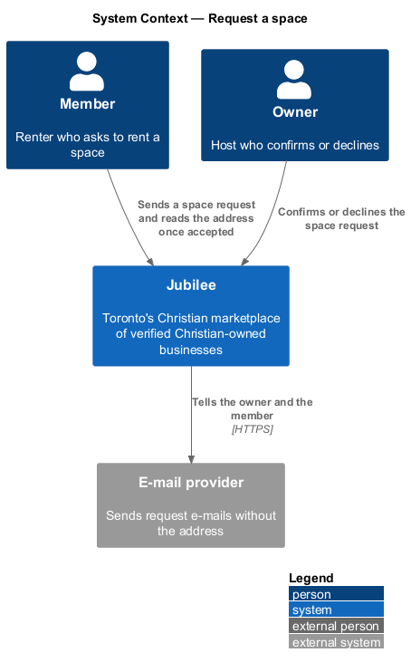
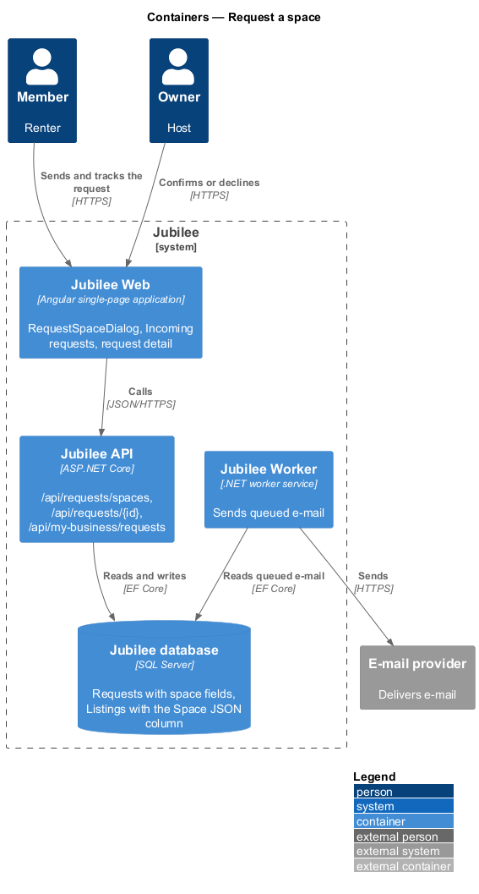
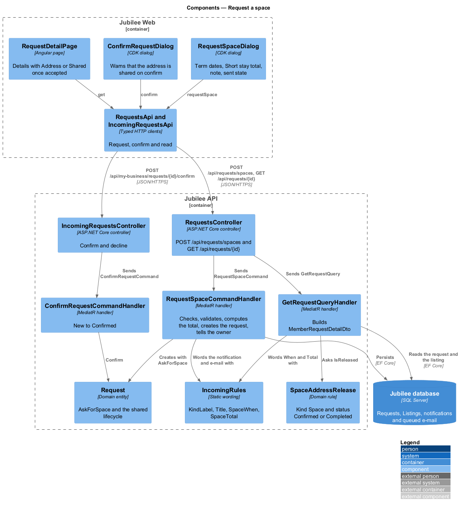
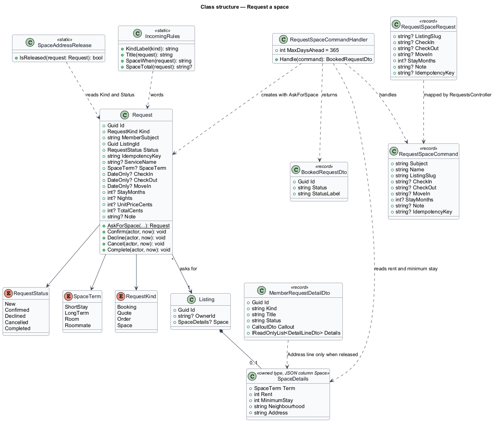
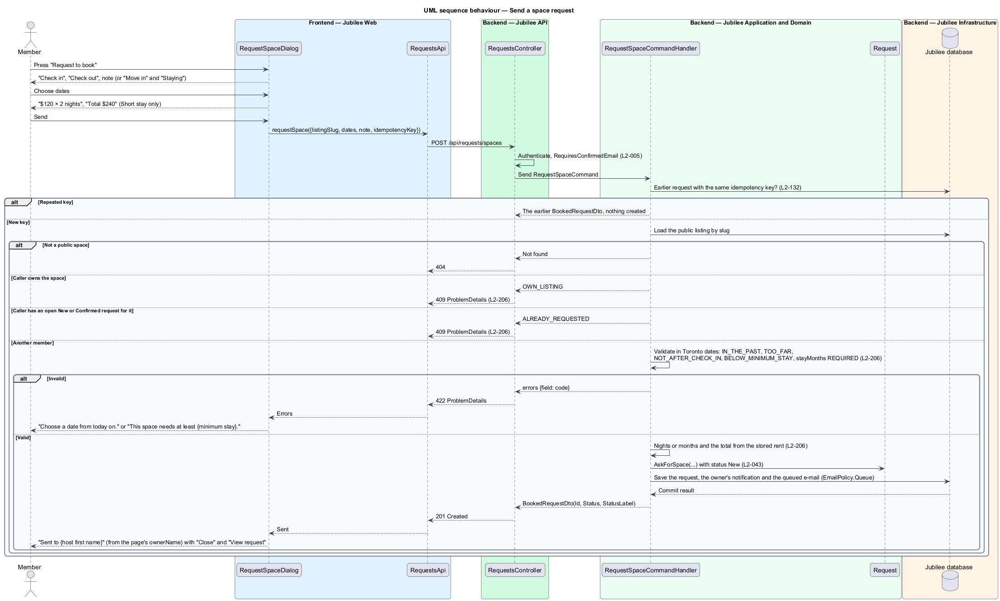
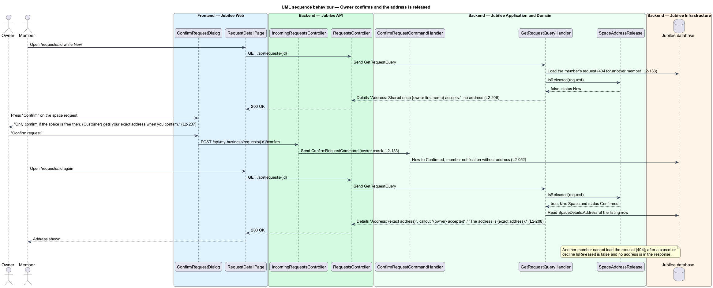

# Request a space

## Overview

Jubilee is Toronto's Christian marketplace. A member finds a verified listing
and asks it for something without paying through the platform. A *request* is
that ask; every request follows one lifecycle shared by the member and the
owner (`L2-043`): `new`, then `confirmed` or `declined`, and `cancelled` or
`completed` after that.

A *space* is a listing for a room, suite, apartment, house or hall that an
owner (the *host*) rents out, under one *term*: "Short stay", "Long term",
"Room" or "Roommate" (`onboarding/describe-space`). A *space request* is the
fourth kind of request, beside booking, quote and order. A *renter* is the
member who sends it. This feature covers:

- the dialog the term's call to action opens on the space page
  (`listings/view-space`);
- the server's checks and the stored request;
- how the request reads in the owner's Incoming requests and the confirm and
  decline dialogs;
- how it reads in the member's Your requests and request detail;
- the release of the space's *exact address* to the accepted renter only.

The call to action is "Request to book" for a Short stay, "Request a viewing"
for a Long term or Room, and "Meet the household" for a Roommate. A Short stay
asks for a *check-in* and *check-out* date and shows the *total*: the nightly
rent times the number of nights. The other terms ask for a *move-in* date and
how long the renter is *staying*, and show no total. Jubilee takes no payment.

The exact address is personal information (`L1-020`). It is stored once, on the
listing, and is shown to a member only while that member's space request is
`confirmed` or `completed`. This is the *address release* rule.

## Description

The feature is a vertical slice from `RequestSpaceDialog` in `Jubilee Web` to
the `Jubilee database`, with notifications dispatched by `Jubilee Worker`. The
model is fixed by ADR 0042.

- **`RequestSpaceDialog`** (`dialogs/request-space/`) — CDK dialog opened by
  the booking card's call to action, composed of `jb-dialog`, `jb-field`,
  `jb-input` (type date), `jb-select`, `jb-textarea` and `jb-button`.
  - Short stay: headed "Request to book" with "{title} · {neighbourhood}", it
    asks "Check in" and "Check out" (required) and an optional "A note to {host
    first name}", and shows "${price} × {n} nights" and "Total ${total}" once
    both dates are valid, with "You won’t pay anything until the host
    accepts."
  - Long term, Room or Roommate: headed by the call to action, it asks "Move
    in" (required) and "Staying" ("Month to month", "4 months", "6 months", "8
    months", "12 months", "18 months") and the optional note, and shows no
    total.
  - Field messages: "Choose a date from today on.", "Choose a check-out after
    check-in.", "Choose a date within the next year." and "This space needs at
    least {minimum stay}."; the same rules run on the server.
  - Success: "Sent to {host first name}" and "You’ll hear back in Messages,
    usually within a day. The exact address is shared once they accept." with
    "Close" and "View request" (to `/requests/:id`). Closing returns the sent
    state to `BusinessPage`, whose booking card then shows it. The host's
    first name comes from the page's `ownerName`, not from the response.
- **`RequestsApi.requestSpace`** — `POST /api/requests/spaces` with the body
  `RequestSpaceRequest` (`listingSlug`, `checkIn`, `checkOut`, `moveIn`,
  `stayMonths`, `note`, `idempotencyKey`). The idempotency key travels in the
  body, as for bookings, quotes and orders (`L2-132`). Unknown fields, such as a
  price, are ignored.
- **`RequestsController`** — the existing ASP.NET Core controller at
  `api/requests` gains the action `Space` (`[HttpPost("spaces")]`,
  `[RequiresConfirmedEmail]`, `L2-005`). It sends `RequestSpaceCommand` and
  returns `201 Created` with the existing `BookedRequestDto(Id, Status,
  StatusLabel)`.
- **`RequestSpaceCommand`** and **`RequestSpaceCommandHandler`** — in
  `Jubilee.Application/Requests/SpaceRequest.cs`. The handler, in order:
  - returns the earlier request for a repeated idempotency key of the same
    member, creating nothing;
  - loads the public listing by slug and answers 404 when it is not a public
    space;
  - refuses the caller's own space with HTTP 409 and code `OWN_LISTING`
    (`L2-206` AC10);
  - refuses a second open (`New` or `Confirmed`) request of the same member
    for the same space with HTTP 409 and code `ALREADY_REQUESTED` (`L2-206`
    AC9);
  - validates the fields itself, in `America/Toronto` dates, and answers HTTP
    422 with `errors` {field: code} (table below);
  - computes the nights or months, and for a Short stay the total, from the
    stored rent (`L2-206` AC8), and creates the request with
    `Request.AskForSpace`;
  - tells the owner with an in-app notification ("New space request from
    {customer}") and a queued e-mail (`EmailPolicy.Queue`) that says the exact
    address is shared only on confirm (`L2-064`). This handler adds no
    conversation card and pushes no real-time event.

  | Field | Codes |
  |---|---|
  | `checkIn`, `checkOut`, `moveIn` | `REQUIRED`, `INVALID`, `IN_THE_PAST` (before today; "Choose a date from today on."), `TOO_FAR` (more than 365 days ahead; "Choose a date within the next year.") |
  | `checkOut` | `NOT_AFTER_CHECK_IN` ("Choose a check-out after check-in."), `BELOW_MINIMUM_STAY` (fewer nights than the minimum stay) |
  | `stayMonths` | `REQUIRED` (not one of 1, 4, 6, 8, 12, 18: `SpaceTerms.StayChoices`), `BELOW_MINIMUM_STAY` (fewer months than the minimum stay) |
  | `note` | `TOO_LONG` |

  `BELOW_MINIMUM_STAY` shows "This space needs at least {minimum stay}." with
  the label from `SpaceTerms.MinimumStayLabel`.
- **`Request.AskForSpace`** — factory on the `Request` entity. It sets `Kind`
  `Space`, `SpaceTerm`, `CheckIn` and `CheckOut` (Short stay) or `MoveIn` and
  `StayMonths` (other terms), the rent as `UnitPriceCents`, `TotalCents` (Short
  stay only), the space's place as `ServiceName`, `Note`, and status `New`.
  `Request.Nights` derives the nights from the two dates.
- **`RequestKind.Space`** — the fourth kind. Confirm, undo, decline, cancel and
  the reminder job keep their paths and switch on the kind for words only.
  Confirm and decline use the existing endpoints `POST
  /api/my-business/requests/{id}/confirm` and `.../decline`. A space request
  becomes `completed` when the owner marks it fulfilled (`POST
  /api/my-business/requests/{id}/fulfil`); no job completes it by date.
- **Wording** — `IncomingRules` (`Jubilee.Application/Requests/Incoming.cs`)
  holds the space words used by the incoming list, the member list, the
  detail, the notification and the e-mail:
  - `KindLabel` "Space";
  - `Title`: the call to action and the space, "Request to book · Guest suite
    near Roncesvalles";
  - `SpaceWhen`: "Fri 13 Mar – Sun 15 Mar · 2 nights" or "Move in Sun 1 Mar ·
    12 months";
  - `SpaceTotal`: "$240" for a Short stay, otherwise none.

  The owner's row reads "Space · {customer} · {time}" with the detail
  `SpaceWhen` and `SpaceTotal` joined by " · ".
- **Owner side** — `ListIncomingRequestsQueryHandler` lists space requests
  with the wording above and "Decline" and "Confirm" (`L2-207` AC1).
  `ConfirmRequestDialog` for a space reads "Confirm {customer}'s request?"
  with "Only confirm if the space is free then. {Customer} gets your exact
  address when you confirm.", lists Customer, When and (Short stay) Total, and
  confirms with "Confirm request" through `ConfirmRequestCommandHandler`
  (`L2-052`). Decline follows `DeclineRequestCommandHandler` (`L2-053`).
- **Member side** — `ListRequestsQueryHandler` lists space requests under
  "All" and, once declined, "Declined", with the type "Space"; there is no
  separate tab for spaces. `GetRequestQueryHandler`
  (`Jubilee.Application/Requests/MemberRequests.cs`) loads only the caller's
  own request (404 otherwise, `L2-133`) and builds `MemberRequestDetailDto` with
  the title and the Details lines "When", "Total" (Short stay) and "Address".
- **`SpaceAddressRelease`** — domain rule in `Jubilee.Domain/Space.cs`,
  `IsReleased(request)`: true when the request's kind is `Space` and its status
  is `Confirmed` or `Completed`. The member check is the query's own: only the
  request's member can load it. `GetRequestQueryHandler` reads
  `SpaceDetails.Address` from the listing only when the rule is true:
  - released — the Details line "Address" holds the exact address and the
    callout reads "{owner first name} accepted" with "The address is {exact
    address}.";
  - not released (`new`, `declined`, `cancelled`) — the Details line reads
    "Address: Shared once {owner first name} accepts." and the response holds
    no address.

  The rule runs on every read, so an address changed later reaches the
  accepted renter only, and a cancelled request stops showing it. Nothing is
  copied onto the request (`L2-208`).
- **Notifications and e-mail** — the owner's notification and e-mail, and the
  member's confirmed and declined notifications, use the space wording. None
  carries the exact address; the member reads it on the request detail.

### Open questions

The choices below are recorded where the design reference and the rules
differ or leave a gap.

- **Dates in a dialog** — the design draws the dates inside the booking card;
  AGENTS.md forbids inline forms in pages, so they are in `dialogs/request-space`
  (ADR 0042).
- **Endpoint shape** — space requests post to `POST /api/requests/spaces` on
  the existing `RequestsController`, like bookings, quotes and orders, and name
  the space by `listingSlug` in the body.
- **Own space** — refused with HTTP 409 `OWN_LISTING`, the status and code the
  other request kinds already use for an owner's own listing, where `L2-206`
  AC10 says HTTP 403. `<TO SUPPLY>`: align the requirement or the code.
- **A second open request** — the page hides the call to action while a request
  is open, and the server also refuses a second open request with HTTP 409
  `ALREADY_REQUESTED`, so two tabs cannot send two (`L2-206` AC9).
- **Completion** — a space request has no end time that a job could use, so it
  completes only when the owner marks it fulfilled.
- **Hourly rent** — deferred; a Short stay is counted in nights.
- **No calendar checks** — overlapping requests for the same dates are not
  detected; the owner confirms only if the space is free (ADR 0042).

## Requirements

The feature realizes the following level-2 (L2) requirements. Each L2
requirement refines a level-1 (L1) requirement, cited by identifier.

| L2 ID | Refines (L1) | Requirement |
|-------|--------------|-------------|
| `L2-206` | `L1-028` | A member shall send the space request of the term from a dialog with the term's dates and an optional note, validated against today, the next year and the minimum stay; the server shall compute nights, months and the Short stay total from the stored rent, refuse the owner's own space with 403 and a second open request of the same member with 409 `ALREADY_REQUESTED`, and the request shall be `new`, notify the owner and appear in the member's requests. |
| `L2-207` | `L1-028` | A space request shall be listed in Incoming requests with the call to action and the space, "Space · {customer} · {time}" and its dates or move-in, confirmed through a dialog that warns the address is shared, declined as any request, and shown to the member with the type "Space", When and the Short stay Total. |
| `L2-208` | `L1-028` | The exact address shall reach only the member whose space request is `confirmed` or `completed`; every public endpoint, every other member and the verification team shall never receive it, and the owner shall see and change it on Edit listing. |
| `L2-043` | `L1-007` | Each booking, quote, order and space request shall follow one lifecycle shared by the member's and the owner's views. |
| `L2-052` | `L1-008` | The owner shall confirm a request through a confirmation dialog, with an undo for a short time. |
| `L2-053` | `L1-008` | The owner shall decline a request with an optional reason and message. |
| `L2-005` | `L1-001` | Until the e-mail is confirmed, a member may browse, search and save but shall not message, book, request or list a business. |
| `L2-132` | `L1-018` | Each create request shall carry a client-generated idempotency key, and the server shall return the original result for a repeated key within 24 hours without creating a duplicate. |
| `L2-133` | `L1-019` | Each API endpoint shall check the caller's role and ownership of the specific object before doing anything. |

## Diagrams

### System context

A member asks to rent a space through Jubilee; the owner confirms or declines
it. Jubilee tells each side in the application and through the e-mail
provider, never with the address.

### Containers

The request travels from `Jubilee Web` to `Jubilee API`, which stores it, the
owner's notification and the queued e-mail in the `Jubilee database`. `Jubilee
Worker` sends the queued e-mail.

### Components

`RequestSpaceDialog` calls `RequestsController` through `RequestsApi`.
`RequestSpaceCommandHandler` validates and creates the request;
`GetRequestQueryHandler` asks `SpaceAddressRelease` before reading the address.

### Class structure

`Request` gains the space fields and the `AskForSpace` factory.
`SpaceAddressRelease` decides from the request's kind and status whether the
listing's `SpaceDetails.Address` is read into the member's request detail.

### Behaviour — send a space request

The dialog sends the dates and note; the server refuses the owner's own space
and a second open request, checks the dates and minimum stay, computes the total
from the stored rent and notifies the owner.

### Behaviour — owner confirms and the address is released

The owner confirms through the dialog of `L2-052`. The member's next read of
the request detail passes `SpaceAddressRelease` and shows the address.

