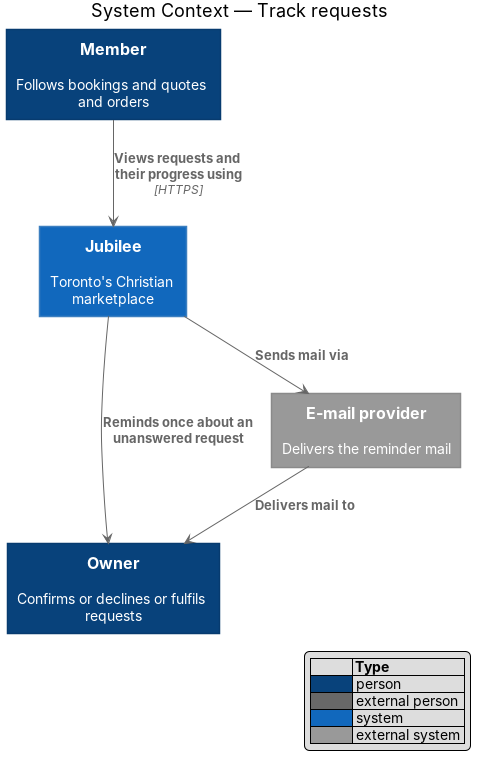
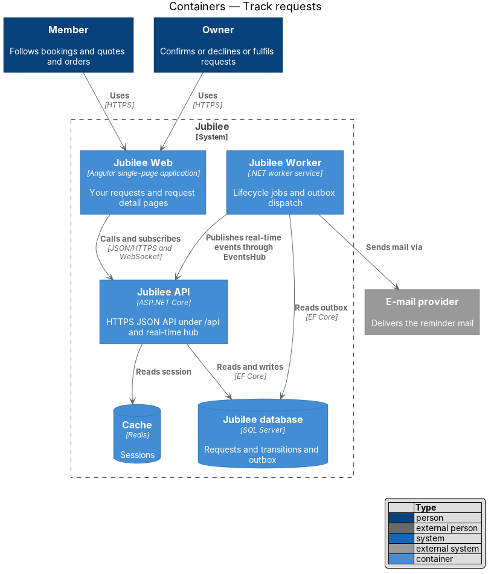
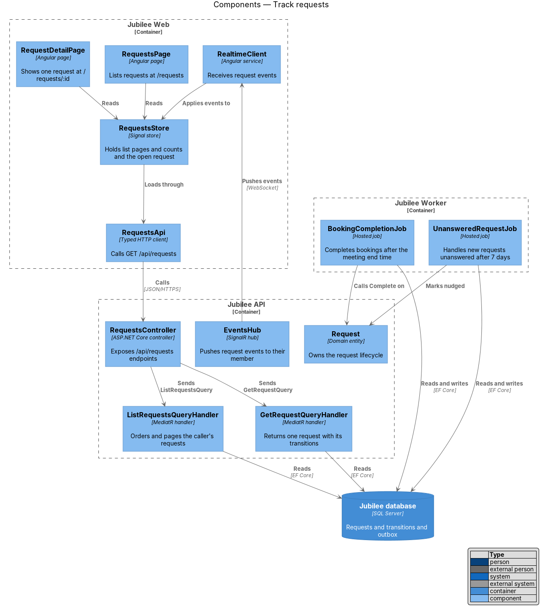
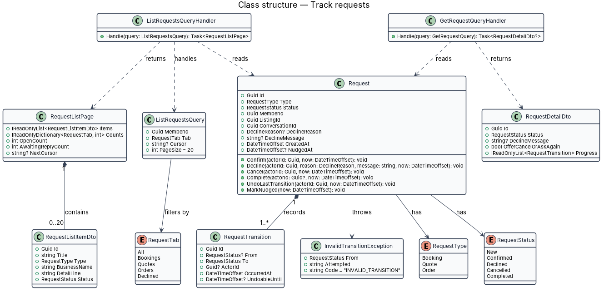
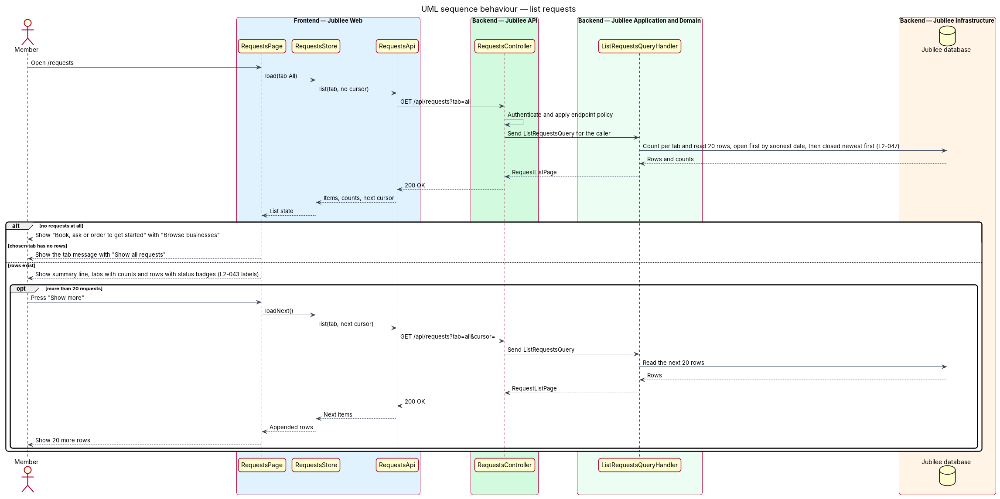
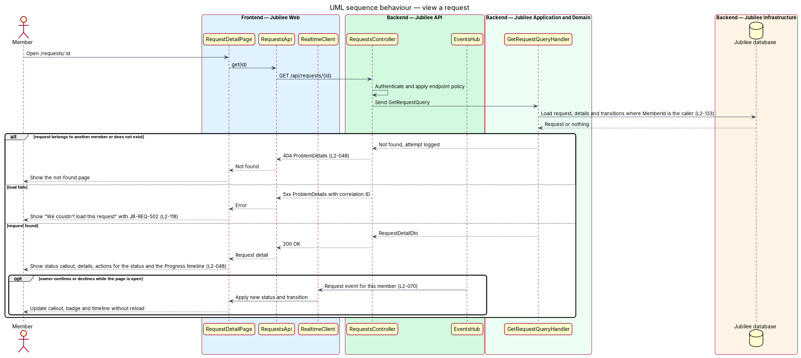
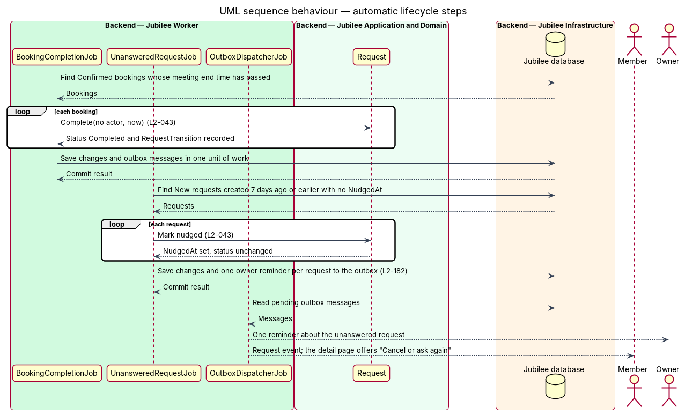

# Track requests

## Overview

Jubilee is Toronto's Christian marketplace. A member finds a verified business and asks it for something without
paying through the platform. A *request* is that ask. It has one of three types (booking, quote, order) and
follows one lifecycle shared by the member and the owner. This feature defines that lifecycle and the two member
pages that follow a request through it.

*request status* — position of a request in its lifecycle: `new`, `confirmed`, `declined`, `cancelled` or
`completed`. A request is created as `new`, which the member sees as "Awaiting reply" and the owner sees as
"New". The other statuses read "Confirmed", "Declined", "Cancelled" and "Completed" on both sides. *open
request* — request whose status is `new` or `confirmed`. *progress timeline* — ordered list of the transitions a
request has made, each with actor and time.

"Your requests" at `/requests` lists the member's bookings, quotes and orders with a summary line such as "3
open · 1 awaiting reply" and the tabs "All", "Bookings", "Quotes", "Orders" and "Declined". The request detail
page at `/requests/:id` shows one request, a callout for its status, its details, the progress timeline and the
next steps.

Two transitions happen without a person pressing a button in these pages. A confirmed booking completes when its
meeting end time passes. A `new` request with no owner response after 7 days offers the member "Cancel or ask
again" and reminds the owner once.

## Description

The feature is a vertical slice from the two request pages in `Jubilee Web` to `Jubilee database`, with
scheduled lifecycle work in `Jubilee Worker`.

- **`Request`** — domain entity in `Jubilee.Domain` that owns the request lifecycle (`L2-043`). `RequestStatus`
  holds `New`, `Confirmed`, `Declined`, `Cancelled` and `Completed`. The allowed transitions are `New` →
  `Confirmed` (the owner confirms), `New` → `Declined` (the owner declines), `New` or `Confirmed` → `Cancelled`
  (the member cancels) and `Confirmed` → `Completed` (a booking's meeting end time passes, or the owner marks an
  order fulfilled). `UndoLastTransition` returns a request to its previous status within 8 seconds of a cancel
  or a confirm. Each other transition throws `InvalidTransitionException`; the API maps it to HTTP 409 with code
  `INVALID_TRANSITION` and leaves the request unchanged.
- **`RequestTransition`** — child entity of `Request` that records each transition with actor, time and previous
  status. The progress timeline reads these records.
- **`RequestStatusLabels`** — mapping from `RequestStatus` and viewer side to the display label: `New` reads
  "Awaiting reply" for the member and "New" for the owner; the other statuses read the same on both sides.
- **`RequestsPage`** — Angular page at `/requests`, behind `AuthGuard`. It shows the summary line, the tabs with
  counts, and rows of title (service, quote summary or "{product} × {qty}"), "{Type} · {business}", a detail
  line and a status badge. An empty tab shows its own message with "Show all requests"; no requests at all shows
  "Book, ask or order to get started" with "Browse businesses". The list loads 20 rows at a time with "Show
  more".
- **`RequestDetailPage`** — Angular page at `/requests/:id`. It shows the title, "{Type} · {business} ·
  {status}", the status callout, "Details", "Message", the actions the status allows and the "Progress"
  timeline. A confirmed booking offers "Add to calendar". A declined request shows the business's message in
  quotes and "See other {category word}". A cancelled request offers no action except "Message". A load failure
  shows "We couldn't load this request" with `JB-REQ-502` and "Back to your requests" (`L2-118`).
- **`RequestsStore`** — signal store that holds the list pages, the tab counts and the open request. It applies
  request events from `RealtimeClient` so a status change appears without reload.
- **`RequestsApi`** — typed Angular HTTP client. `list` calls `GET /api/requests?tab=&cursor=`; `get` calls `GET
  /api/requests/{id}`.
- **`RequestsController`** — ASP.NET Core controller in `Jubilee.Api`. It authenticates the session cookie and
  sends `ListRequestsQuery` or `GetRequestQuery` through MediatR. `ProblemDetailsMiddleware` maps
  `InvalidTransitionException` to HTTP 409 with code `INVALID_TRANSITION`.
- **`ListRequestsQuery`** and **`ListRequestsQueryHandler`** — return the caller's requests for a tab, 20 per
  page, with the counts per tab. Open requests come first by soonest upcoming date; closed requests follow,
  newest first.
- **`GetRequestQuery`** and **`GetRequestQueryHandler`** — return one request with its details and
  `RequestTransition` records. A request that belongs to another member returns HTTP 404 and the attempt is
  logged (`L2-133`).
- **`CompleteRequestCommand`** and **`CompleteRequestCommandHandler`** — apply `Confirmed` → `Completed` when
  the owner marks an order fulfilled, through `POST /api/my-business/requests/{id}/fulfil`. The owner-side
  control for this action is `<TO SUPPLY>`.
- **`BookingCompletionJob`** — hosted job in `Jubilee Worker`. It finds each `Confirmed` booking whose meeting
  end time has passed and calls `Complete` with no actor. The schedule interval is `<TO SUPPLY>`.
- **`UnansweredRequestJob`** — hosted job in `Jubilee Worker`. For each `New` request with no owner response
  after 7 days it sets `NudgedAt`, writes one owner reminder to the outbox, and the detail page then offers the
  member "Cancel or ask again". `NudgedAt` makes the reminder single (`L2-182`).

## Requirements

The feature realizes the following level-2 (L2) requirements. Each L2 requirement refines a level-1 (L1)
requirement, cited by identifier.

| L2 ID | Refines (L1) | Requirement |
|-------|--------------|-------------|
| `L2-043` | `L1-007` | Each booking, quote and order request shall follow one lifecycle shared by the member's and the owner's views. |
| `L2-047` | `L1-007` | `/requests` shall list the member's bookings, quotes and orders. |
| `L2-048` | `L1-007` | `/requests/:id` shall show one request, its progress and next steps. |
| `L2-133` | `L1-019` | The server shall return HTTP 404 and log the attempt when a member requests another member's request by ID. |
| `L2-118` | `L1-016` | Each load-error state shall show a reference the user can quote to support. |
| `L2-070` | `L1-010` | A notification, message or request event shall reach an open signed-in page within 2 seconds at the 95th percentile over a persistent connection. |
| `L2-182` | `L1-025` | Each scheduled job shall be idempotent, shall run at most once per schedule across instances, and shall record its last success. |

## Diagrams

### System context

A member follows requests through Jubilee, and the owner's decisions change what the member sees. Jubilee
reminds the owner of an unanswered request through the external e-mail provider.

### Containers

`Jubilee Web` reads requests from `Jubilee API` and receives request events over the real-time connection.
`Jubilee Worker` runs the lifecycle jobs against `Jubilee database`.

### Components

`RequestsPage` and `RequestDetailPage` read through `RequestsStore` and `RequestsApi`. In the API the two query
handlers read `Request`; in the worker the two jobs apply the automatic parts of the lifecycle.

### Class structure

`Request` owns its `RequestTransition` records and exposes one method per transition. The query handlers project
it to `RequestListItemDto` and `RequestDetailDto`.

### Behaviour — list requests

The handler returns the caller's requests ordered open first by soonest upcoming date, then closed newest first,
20 per page (`L2-047`).

### Behaviour — view a request

The handler returns HTTP 404 for a request of another member (`L2-048`, `L2-133`). A load failure shows
`JB-REQ-502`. A later status change reaches the open page as a real-time event (`L2-070`).

### Behaviour — automatic lifecycle steps

`BookingCompletionJob` completes a confirmed booking after its meeting end time, and `UnansweredRequestJob`
handles a `new` request with no owner response after 7 days (`L2-043`).

