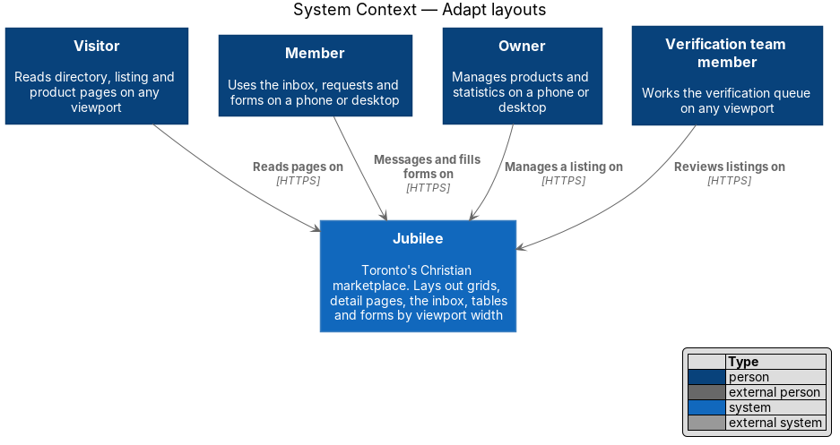
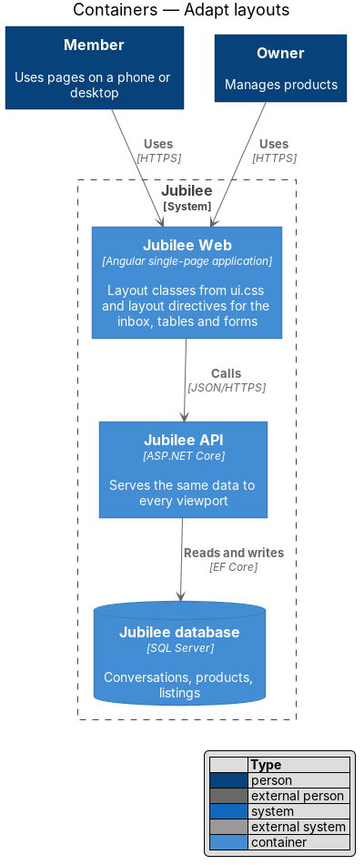
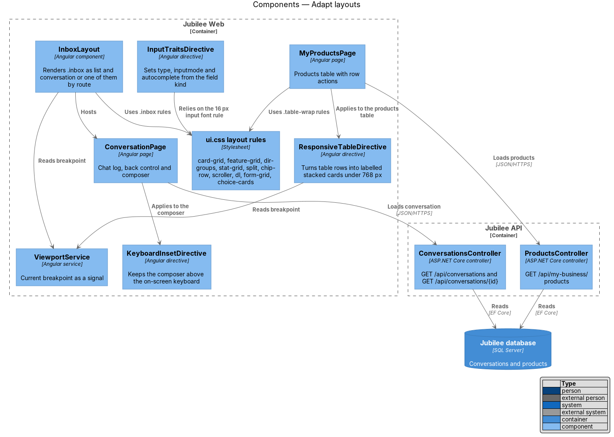
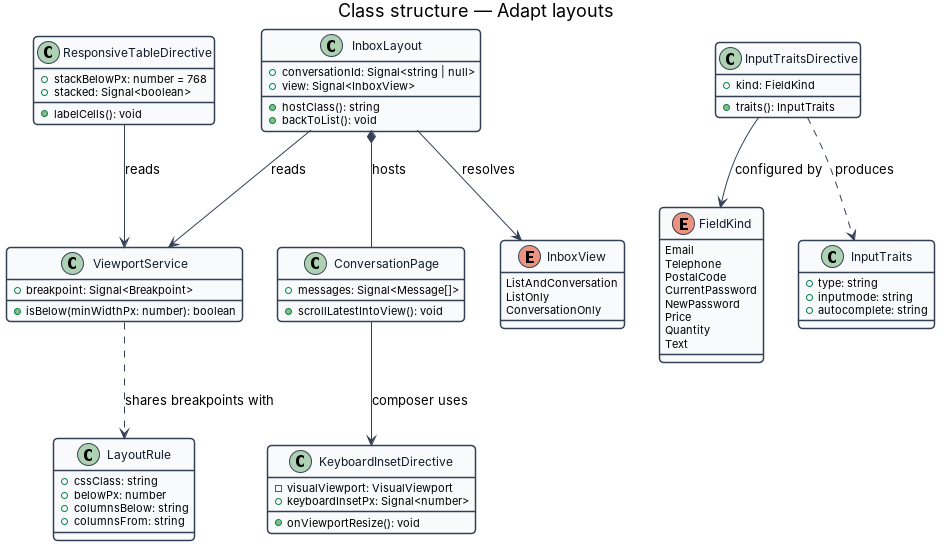
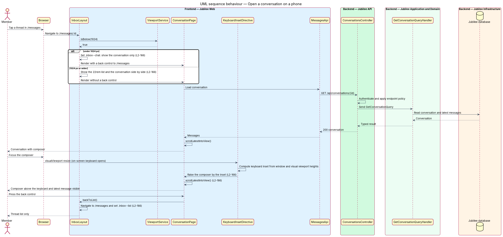
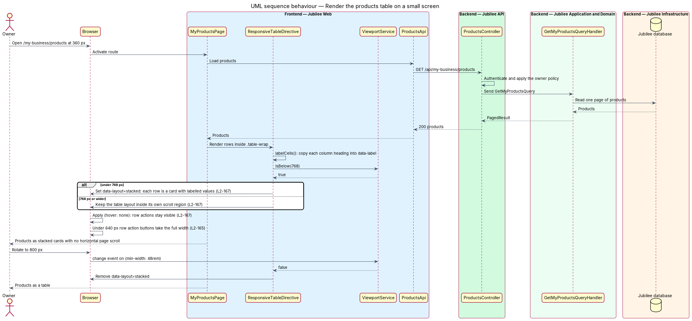

# Adapt layouts

## Overview

Jubilee is Toronto's Christian marketplace: a directory of
Christian-owned businesses that members browse, message and send requests to.
Every screen shall work from a `360 px` phone to a `1280 px` desktop with no
horizontal page scrolling and no lost function. This feature covers the content
inside the page frame: card grids, detail pages, the inbox, tables and forms,
and the width at which each one changes shape.

The feature uses these terms:

- **layout class** — BEM class from `docs/mocks/assets/ui.css` that defines the arrangement of its children and changes at a breakpoint
- **breakpoint** — viewport width at which a layout changes; this feature uses `640 px` (`40rem`), `768 px` (`48rem`) and `1024 px` (`64rem`)
- **card grid** — grid of business or product cards (`.card-grid`)
- **split** — main column and side column of a detail page (`.split`) in the ratio 1.6 : 1
- **inbox** — two-pane view of the conversation list and one conversation (`.inbox`)
- **stacked card** — presentation of one table row as a block of labelled values
- **on-screen keyboard** — software keyboard of a phone, which covers the lower part of the viewport while an input has focus

Most of the feature is CSS: the layout classes carry their own media queries,
so pages declare a class and add no page-specific layout code. Three behaviours
depend on script and are implemented as Angular parts: the inbox pane choice by
route, the composer position above the on-screen keyboard, and stacked table
rows. The navigation frame and the visual regression suite that verifies every
layout belong to the sibling feature `adapt-navigation`.

## Description

The slice lives in `Jubilee Web`. `Jubilee API` returns the same data for every
viewport; no endpoint varies by width.

- **`.card-grid`** — grid for `BusinessCard` and product cards: `2` columns
  under `768 px`, `3` columns from `768 px` and `4` columns from `1024 px`. The
  modifier `.card-grid--3` keeps `3` columns from `1024 px`.
- **`.feature-grid`** — modifier used for "Featured this week". From `1024 px`
  the first card spans two columns and two rows; under `1024 px` it spans the
  full row.
- **`.dir-groups` and `.stat-grid`** — the directory groups are one column
  under `1024 px` and two columns from `1024 px`. The owner statistics are a
  `2`-column grid under `1024 px` and `4` columns from `1024 px`.
- **`.split`** — layout of `BusinessPage`, `ProductPage` and
  `RequestDetailPage`. From `1024 px` it is `minmax(0, 1.6fr) minmax(0, 1fr)`;
  under `1024 px` the side column stacks below the main column.
- **`.chip-row` and `.scroller`** — category chips and the product scroller.
  Under `768 px` each scrolls horizontally inside itself (`overflow-x: auto`)
  with `scroll-snap-type: x proximity` and `scroll-snap-align: start` on its
  items; from `768 px` the chips wrap. The page body never scrolls horizontally.
- **`.dl` and `.row--stack`** — under `640 px` a definition list becomes one
  column with each label above its value, and the buttons in `.row__actions`
  take the full width of the row.
- **`InboxLayout`** — Angular component for `/messages` and `/messages/:id`.
  From `1024 px` it shows the list (`22rem`) and the conversation side by side.
  Under `1024 px` it sets `.inbox--list` on `/messages` and `.inbox--chat` on
  `/messages/:id`, so one pane shows. `ConversationPage` then shows a back
  control (`.back-link`) to `/messages`.
- **`KeyboardInsetDirective`** — Angular directive on the composer
  (`.composer`). It listens to `visualViewport` `resize` and `scroll` events,
  computes the height covered by the on-screen keyboard, and raises the
  composer by that inset. `ConversationPage` then scrolls the latest message
  into view.
- **`.table-wrap`** — wrapper of each data table. It has `overflow-x: auto`,
  so a wide table scrolls inside its own region; the first column is sticky in
  that mode.
- **`ResponsiveTableDirective`** — Angular directive on the listings, reports
  and products tables. It copies each column heading into a `data-label`
  attribute on the cells of that column. Under `768 px` it sets
  `data-layout="stacked"`, and each row renders as a stacked card with labelled
  values. The table markup and its accessible names stay unchanged.
- **Row actions** — `.row-actions` are revealed on hover or focus on pointer
  devices. Under `@media (hover: none)` they are always visible.
- **`.form-grid--2` and `.choice-cards`** — paired fields (first and last
  name, price and stock) and the choice cards "Products" / "Services" sit side
  by side from `640 px` and stack under `640 px`.
- **`InputTraitsDirective`** — Angular directive that sets `type`, `inputmode`
  and `autocomplete` on an input from its `FieldKind`: `email`, `tel`,
  `postal-code`, `current-password` and `new-password`. Inputs, selects and
  text areas use a font size of at least `16 px` (`--font-size-md`), so iOS
  does not zoom on focus.

## Requirements

The feature realizes the following level-2 (L2) requirements. Each L2
requirement refines a level-1 (L1) requirement, cited by identifier.

| L2 ID | Refines (L1) | Requirement |
|-------|--------------|-------------|
| `L2-165` | `L1-023` | Business and product card grids shall show 2 columns under 768 px, 3 from 768 px and 4 from 1024 px (3 for `card-grid--3`), and the first "Featured this week" card shall span two columns and two rows from 1024 px. Directory groups shall be one column under 1024 px and two from 1024 px, owner statistics shall be 2 columns under 1024 px and 4 from 1024 px, and listing, product and request detail pages shall use a main and a side column (1.6 : 1) from 1024 px with the side column stacked below under 1024 px. Category chips and the product scroller shall scroll horizontally within themselves with snap points under 768 px and chips shall wrap from 768 px; under 640 px definition-list labels shall stack above values and row action buttons shall become full width. |
| `L2-166` | `L1-023` | From 1024 px `/messages` and `/messages/:id` shall show the list (22rem) and the conversation side by side. Under 1024 px `/messages` shall show only the list and `/messages/:id` only the conversation with a back control to the list, and on a phone the composer shall stay visible above the on-screen keyboard with the latest message in view. |
| `L2-167` | `L1-023` | Under 768 px each row of the listings, reports and products tables shall become a stacked card with labelled values, or the table shall scroll within its own region with a sticky first column; the page shall not scroll horizontally. Row actions shall be always visible on touch devices. |
| `L2-168` | `L1-023` | Paired fields and the choice cards "Products" / "Services" shall sit side by side from 640 px and stack under 640 px. Inputs on phones shall use the right `type`, `inputmode` and `autocomplete` and a font size of at least 16 px. |
| `L2-163` | `L1-023` | Every screen and state rendered at 360, 576, 768, 992 and 1280 px wide in light and dark themes shall show no horizontal overflow and no overlapping content, and every function shown at XL shall be reachable at XS. |

## Diagrams

### System context

Visitors, members, owners and Jubilee team members use the same pages on
any viewport. The feature involves no external system.

### Containers

`Jubilee Web` holds every layout rule. `Jubilee API` and `Jubilee database`
serve the same data to each viewport.

### Components

The layout rules in `ui.css` arrange grids, detail pages and forms.
`InboxLayout`, `KeyboardInsetDirective`, `ResponsiveTableDirective` and
`InputTraitsDirective` add the behaviour that CSS alone does not provide, and
`ViewportService` supplies the current breakpoint.

### Class structure

`InboxLayout` resolves an `InboxView` from the route and `ViewportService` and
hosts `ConversationPage`, whose composer uses `KeyboardInsetDirective`.
`InputTraitsDirective` maps a `FieldKind` to `InputTraits`, and `LayoutRule`
records the columns of a layout class on each side of a breakpoint.

### Behaviour — open a conversation on a phone

Under `1024 px` `InboxLayout` shows only the conversation with a back control.
When the on-screen keyboard opens, `KeyboardInsetDirective` raises the composer
and `ConversationPage` keeps the latest message in view.

### Behaviour — render the products table on a small screen

`ResponsiveTableDirective` labels each cell and, under `768 px`, switches the
rows to stacked cards. Row actions stay visible on touch devices, and the table
returns to its tabular layout from `768 px`.

