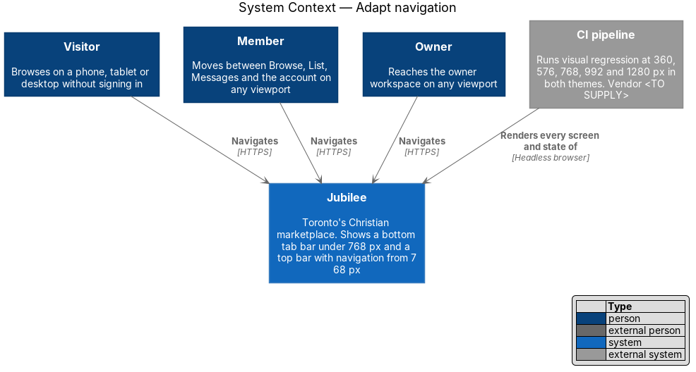
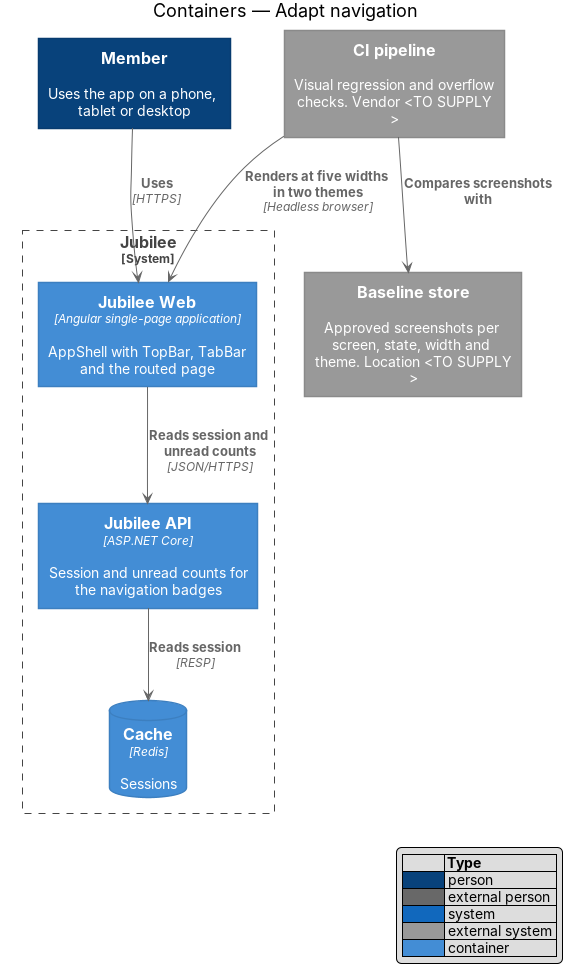
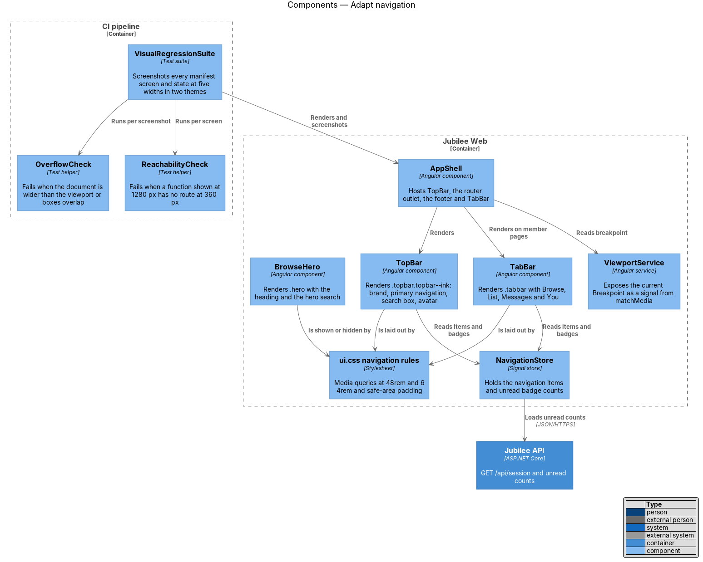
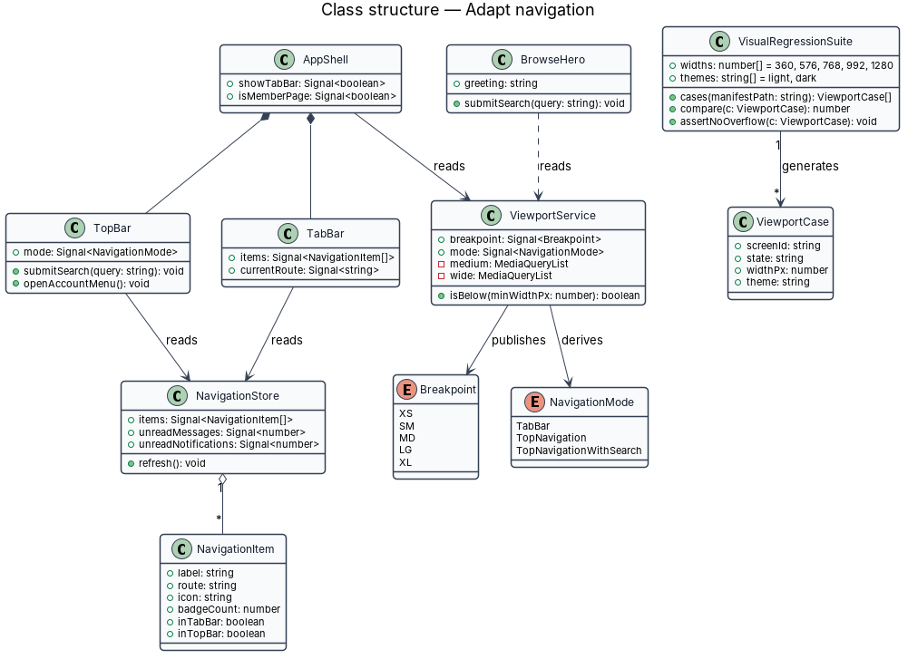
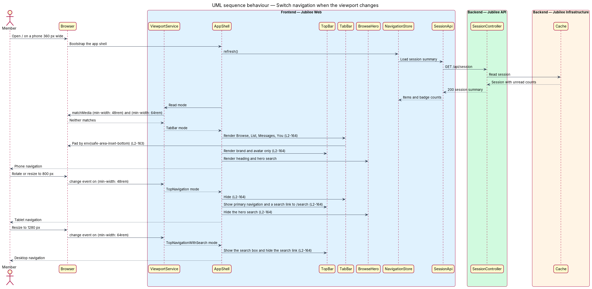
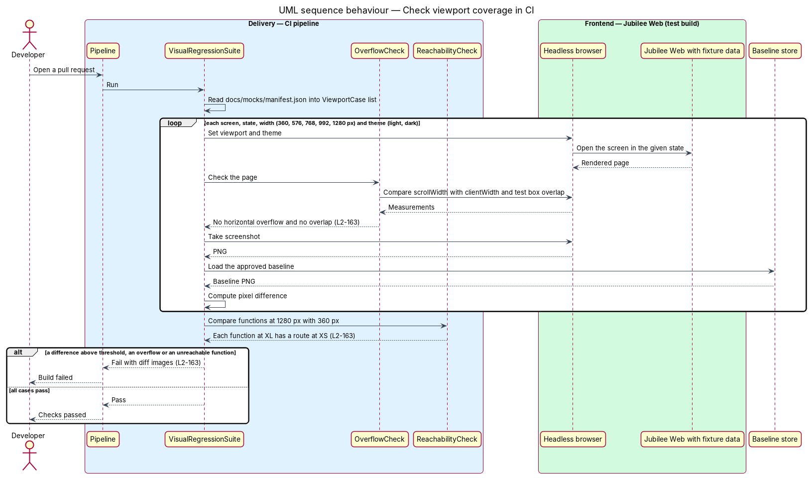

# Adapt navigation

## Overview

Jubilee is Toronto's Christian marketplace: a directory of verified
Christian-owned businesses that members browse, message and send requests to.
People use it on phones, tablets and desktops, and every screen shall work at
each viewport size with no horizontal scrolling and no lost function. This
feature covers the frame around every page: the top bar, the phone tab bar and
the search entry points, and how they change with the width of the viewport. It
also covers the automated checks that hold every screen to its approved
appearance at five widths.

The feature uses these terms:

- **viewport** — visible area of the browser window, measured in CSS pixels
- **breakpoint** — viewport width at which the layout changes; the size classes are XS (under 576 px), SM (from 576 px), MD (from 768 px), LG (from 992 px) and XL (from 1200 px)
- **top bar** — ink-coloured sticky header (`.topbar.topbar--ink`) that carries the brand, the primary navigation, the search box and the avatar
- **tab bar** — fixed bar at the bottom of a phone screen (`.tabbar`) with the items "Browse", "List", "Messages" and "You"
- **browse hero** — ink band at the top of the browse home (`.hero`) with the greeting, the heading and a search field
- **safe area** — part of a phone screen not covered by a notch or home indicator, reported by `env(safe-area-inset-*)`
- **baseline** — approved screenshot of one screen in one state, width and theme

Navigation changes at two widths: `768 px` (`48rem`) and `1024 px` (`64rem`).
Under `768 px` the tab bar is the primary navigation. From `768 px` the top bar
carries the primary navigation. From `1024 px` the top bar also carries the
search box. The layouts of the pages inside this frame belong to the sibling
feature `adapt-layouts`.

## Description

The slice is a frontend slice in `Jubilee Web` with a test suite in the CI
pipeline. Visibility is decided by CSS media queries, so the first paint is
correct before any script runs; `ViewportService` serves the components that
change behaviour as well as appearance.

- **`AppShell`** — root Angular component. It renders `TopBar`, the router
  outlet, the footer and, on member pages, `TabBar`. It declares
  `viewport-fit=cover` in the viewport meta tag so that `env(safe-area-inset-*)`
  reports the device insets.
- **`TopBar`** — Angular component that renders `.topbar.topbar--ink`. Under
  `768 px` it shows only the brand (`.topbar__brand`) and the avatar. From
  `768 px` it shows the primary navigation (`.topbar__nav`) with "Browse",
  "Messages" and "List your business" (or "My business" for an owner), and a
  search link (`.only-narrow`, label "Search") to `/search`. From `1024 px` it
  shows the search box (`.search`) and hides the search link. The current item
  carries `aria-current="page"`.
- **`TabBar`** — Angular component that renders `.tabbar` inside
  `nav` with the label "Primary, phone". It shows "Browse", "List", "Messages"
  and "You" with unread counts (`.badge--count`), marks the current item with
  `aria-current="page"`, and is hidden from `768 px`. Each `.tabbar__item` is
  `--layout-tabbar-height` (`3.75rem`) tall, which satisfies `L2-162`.
- **`BrowseHero`** — Angular component that renders `.hero` on the browse
  home. Under `768 px` it shows the hero search, which submits to
  `/search?q={query}`. From `768 px` the hero search is hidden and the hero
  shows the heading only.
- **`ViewportService`** — Angular service. It listens to
  `matchMedia("(min-width: 48rem)")` and `matchMedia("(min-width: 64rem)")`
  and exposes `breakpoint` and `mode` signals. `NavigationMode` is `TabBar`,
  `TopNavigation` or `TopNavigationWithSearch`.
- **`NavigationStore`** — signal store that holds the `NavigationItem` list
  for the signed-in role and the unread counts shown on "Messages" and on the
  notifications button. It loads the counts from `GET /api/session` and updates
  them from `RealtimeClient` events.
- **Navigation rules in `ui.css`** — the media queries that show and hide
  `.tabbar`, `.topbar__nav`, `.topbar--ink .search`, `.hero .search`,
  `.only-mobile`, `.only-desktop` and `.only-narrow`. They use the breakpoint
  values of `--layout-breakpoint-md` and `--layout-breakpoint-lg`.
- **Safe-area rules** — `.tabbar` adds `env(safe-area-inset-bottom)` to its
  bottom padding, the page body reserves
  `calc(var(--layout-tabbar-height) + env(safe-area-inset-bottom))` while the
  tab bar shows, and `.topbar` adds `env(safe-area-inset-top)`,
  `env(safe-area-inset-left)` and `env(safe-area-inset-right)`. `Toast` regions
  sit above the tab bar.
- **`VisualRegressionSuite`** — CI test suite (runner `<TO SUPPLY>`). It reads
  each screen and state from `docs/mocks/manifest.json`, renders the matching
  product screen with fixture data at `360`, `576`, `768`, `992` and `1280 px`
  in the light and dark themes, and compares each screenshot with its baseline.
  A difference above the threshold (`<TO SUPPLY>`) fails the build.
- **`OverflowCheck`** — helper run for every case. It fails when
  `document.documentElement.scrollWidth` exceeds `clientWidth` or when the
  bounding boxes of two sibling content elements overlap.
- **`ReachabilityCheck`** — helper run per screen. It collects the links and
  buttons present at `1280 px` and fails when one has no counterpart at
  `360 px`, either on the screen, in the tab bar or in the account menu.
- **Baseline store** — approved screenshots keyed by screen, state, width and
  theme; location `<TO SUPPLY>`. A baseline changes only through a reviewed
  change.

## Requirements

The feature realizes the following level-2 (L2) requirements. Each L2
requirement refines a level-1 (L1) requirement, cited by identifier.

| L2 ID | Refines (L1) | Requirement |
|-------|--------------|-------------|
| `L2-163` | `L1-023` | Every screen and state rendered at 360, 576, 768, 992 and 1280 px wide in light and dark themes shall show no horizontal overflow and no overlapping content, and every function shown at XL shall be reachable at XS. Visual regression tests in CI shall compare each screen with its approved baseline at those widths and fail the build on a difference above threshold, and fixed bars shall respect `env(safe-area-inset-*)`. |
| `L2-164` | `L1-023` | Under 768 px each member page shall show the bottom tab bar and a top bar with only the brand and the avatar. From 768 px to 1023 px the tab bar shall be hidden and the top bar shall show the primary navigation; from 1024 px the top bar shall also show the search box. The browse hero search shall be hidden from 768 px. |
| `L2-162` | `L1-022` | Each interactive target shall be at least 24 × 24 CSS px, and primary controls on touch devices (buttons, tab bar items, list rows, chips) shall be at least 44 × 44 CSS px. |

## Diagrams

### System context

Visitors, members and owners navigate Jubilee on any viewport. The CI pipeline
renders every screen and state to check viewport coverage.

### Containers

`Jubilee Web` holds the whole navigation frame and reads the session and unread
counts from `Jubilee API`. The CI pipeline renders `Jubilee Web` and compares
screenshots with the baseline store.

### Components

`AppShell` renders `TopBar` and `TabBar`, which read `NavigationStore`. The
navigation rules in `ui.css` decide what is visible, and `ViewportService`
publishes the current breakpoint. `VisualRegressionSuite` runs `OverflowCheck`
and `ReachabilityCheck`.

### Class structure

`ViewportService` publishes a `Breakpoint` and derives a `NavigationMode`.
`AppShell` owns `TopBar` and `TabBar`, both of which read `NavigationItem`
values from `NavigationStore`. `VisualRegressionSuite` generates one
`ViewportCase` per screen, state, width and theme.

### Behaviour — switch navigation when the viewport changes

At `360 px` the shell shows the tab bar, a top bar with brand and avatar, and
the hero search. At `800 px` the tab bar and hero search are hidden and the top
bar shows the primary navigation with a search link. At `1280 px` the top bar
shows the search box.

### Behaviour — check viewport coverage in CI

`VisualRegressionSuite` renders each manifest screen and state at five widths
in two themes, runs `OverflowCheck`, and compares the screenshot with its
baseline. Any overflow, unreachable function or difference above threshold
fails the build.

