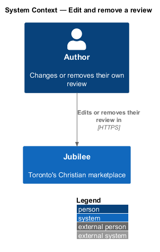
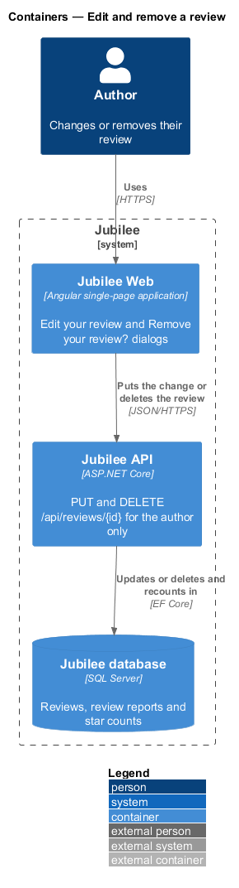
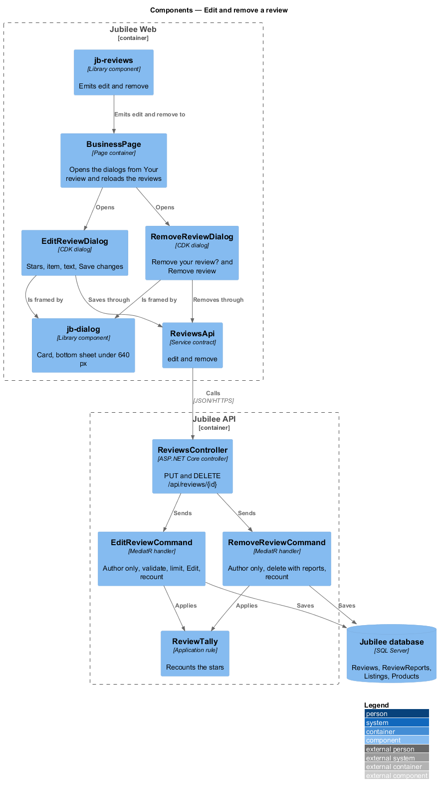
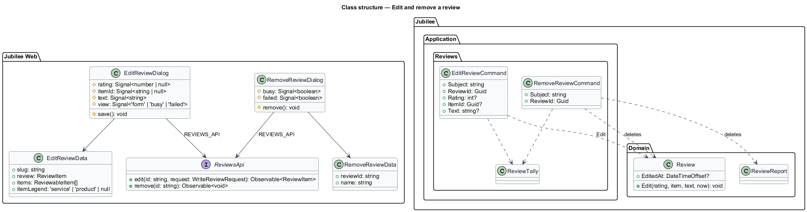
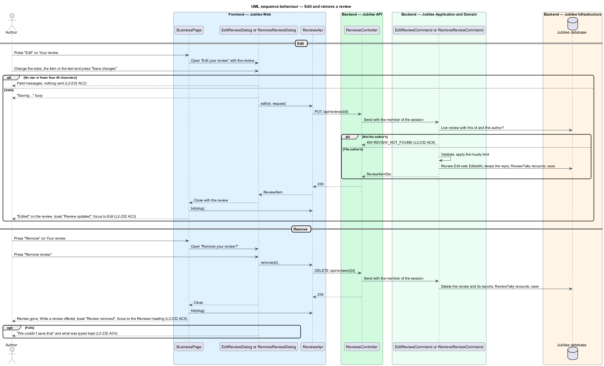

# Edit and remove a review

## Overview

Jubilee is Toronto's Christian marketplace. The author of a review can change
it when their view changes, or take it away. This feature covers the "Edit" and
"Remove" actions of "Your review" on a listing page, their two CDK dialogs, and
the API that changes or deletes a review. An edit shows "Edited"; a removal
frees the member to write again.

The terms below are local to this feature.

- **your review** — the review of the member of the session, pinned first in the section (`read-reviews`)
- **edit** — a change of the rating, the item or the text, stamped with `EditedAt`
- **remove** — deletion of the review with its reply and its reports by its author

Only the author edits or removes a review; an owner never does
(`moderate-reviews`). The decisions are recorded in
[ADR 0066](../../../adr/0066-reviews.md).

## Description

- **Entry** — `jb-reviews` emits `edit` and `remove` from the buttons of the
  pinned `jb-review` with `mine`. `BusinessPage` (and `ProductPage`) open the
  dialogs through the CDK `Dialog` with `ariaModal`, the `backdrop` class and
  `restoreFocus` on the pressed button; under 640 px `jb-dialog` is a bottom
  sheet (`L2-130`).
- **`EditReviewDialog`** — new CDK dialog
  (`frontend/projects/jubilee/src/app/dialogs/edit-review/`,
  `edit-review.dialog.ts` and `edit-review.dialog.html`, no stylesheet). Its
  data is the review, the listing's name, its items with their legend, and
  whether it is a space. The items are a business's services; a shop's review
  keeps the product it is about (the listing page's product cards carry no
  id), and a space's is about the stay. It
  composes `jb-dialog` titled "Edit your review", `fieldset[jb-star-scale]`
  "Your rating" (the words of `L2-227`), the `jb-chip` item row when there is
  more than one item, the `jb-field` "Tell others about it" with its counter,
  and "Cancel" and "Save changes".
  - Validation as `L2-228 AC1, AC2`; nothing is sent while a message shows.
  - "Save changes" says "Saving…" and is busy; `ReviewsApi.edit(id, request)`
    puts the change with a 10-second `timeout`.
  - On success the dialog closes with the changed review; the page's
    `ListingReviewsStore` puts it in place and counts the summary again, and
    the page shows the toast "Review updated"
    and focus returns to "Edit".
  - On a failure a `jb-alert` "We couldn’t save that" says "Your review has not
    changed. Try again." and everything typed is kept (`L2-128`).
- **`RemoveReviewDialog`** — new CDK dialog (`dialogs/remove-review/`):
  "Remove your review?", "Your review of {name} will be taken off their page.
  You can write a new one later.", "Cancel" and the danger button "Remove
  review" (busy while it runs). On success the page reloads the reviews, "Write
  a review" is offered again, the toast "Review removed" shows and focus moves
  to the "Reviews" heading (`L2-233 AC5`). This is the confirmation of a
  consequential action (`L2-129`).
- **`PUT /api/reviews/{id}`** — `ReviewsController.Edit` sends
  `EditReviewCommand`: the review must be the caller's and live, otherwise 404
  `REVIEW_NOT_FOUND` (`L2-133 AC2`); the fields are validated as for writing
  (422 per field); the limit of 30 edits and replies per member per hour
  applies (429). `Review.Edit(rating, item, text, now)` sets `EditedAt` and
  keeps the reply (`L2-233 AC7`); `ReviewTally` recounts the listing and both
  the old and the new product. Nobody is told (`L2-235 AC4`).
- **`DELETE /api/reviews/{id}`** — `RemoveReviewCommand`: the caller's live
  review or 404; it deletes the `Review` and its `ReviewReport`s, recounts
  through `ReviewTally` and answers 204.
- **`ReviewsApi`** gains `edit(id, request)` and `remove(id)`.

### Open questions

Every choice below is recorded in [ADR 0066](../../../adr/0066-reviews.md).

| Question | Decision | Why |
|---|---|---|
| Is an edit marked | Yes, "Edited" beside the date; the reply stays. | Readers see that the words changed after the owner may have answered. |
| Does an edit notify anyone | No. | Only new reviews, first replies and take-downs notify. |
| What removal deletes | The review, its reply and its reports; the stars are recounted. | The author takes their words back entirely. |
| May the author write again after removing | Yes; one live review per member and listing. | The place is freed. |
| Can the owner remove a review | Never; they report it (`moderate-reviews`). | A business must not edit its own record. |
| Limits | 30 edits and replies per member per hour. | `L2-137`. |

## Requirements

The feature realizes the following level-2 (L2) requirements. Each L2
requirement refines a level-1 (L1) requirement, cited by identifier.

| L2 ID | Refines (L1) | Requirement |
|-------|--------------|-------------|
| `L2-233` | `L1-031` | The author shall edit their review in "Edit your review" and remove it in "Remove your review?"; nobody else may change or remove it. |
| `L2-238` | `L1-031` | `PUT` and `DELETE /api/reviews/{id}` shall answer the author only, validate again and keep the star counts. |
| `L2-240` | `L1-031` | The dialogs shall work by touch and keyboard, be bottom sheets under 640 px and disable sending offline. |
| `L2-128` | `L1-018` | A failed dialog submission shall keep everything typed and say what did not happen. |
| `L2-129` | `L1-018` | A consequential action shall be confirmed in a dialog. |
| `L2-130` | `L1-018` | An open dialog shall hold focus and return it to its opener. |
| `L2-133` | `L1-019` | Owned data shall be changed only by its owner; another's answers 404. |

## Diagrams

### System context

The author changes or removes their own review.

### Containers

`Jubilee Web` sends the change or the removal to `Jubilee API`, which
updates `Jubilee database`.

### Components

The page opens `EditReviewDialog` or `RemoveReviewDialog`, which call
`ReviewsApi`; `EditReviewCommand` and `RemoveReviewCommand` apply the owner
check and `ReviewTally`.

### Class structure

Both dialogs depend on the `ReviewsApi` contract; `Review.Edit` stamps
`EditedAt`.

### Behaviour — edit and remove

An edit is validated in the dialog and again on the server; a removal is
confirmed first. Another member's review is a 404.

