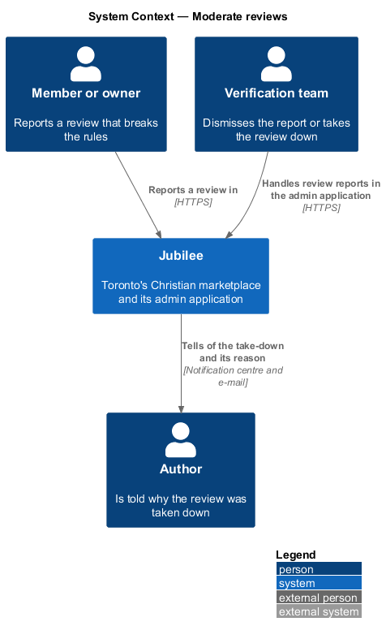
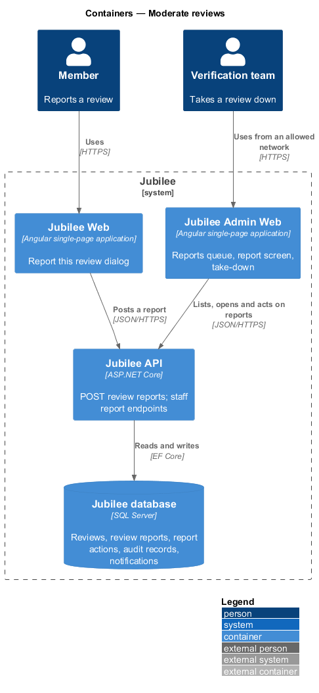
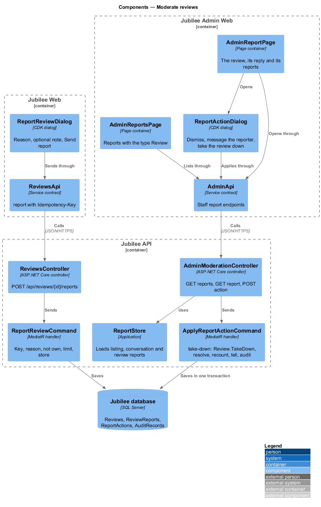
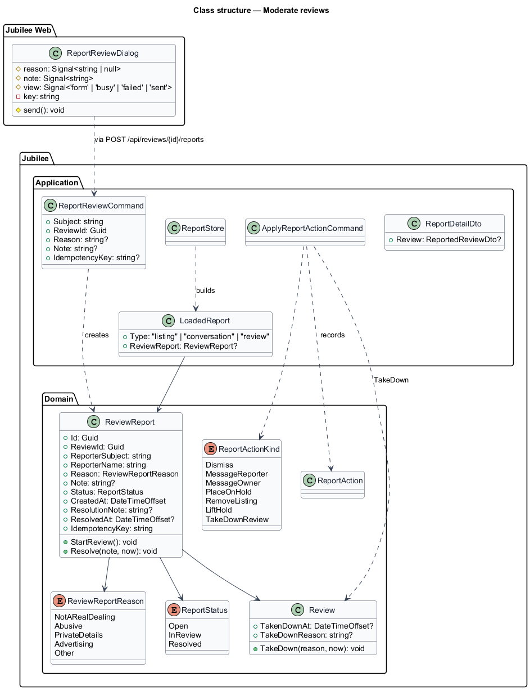
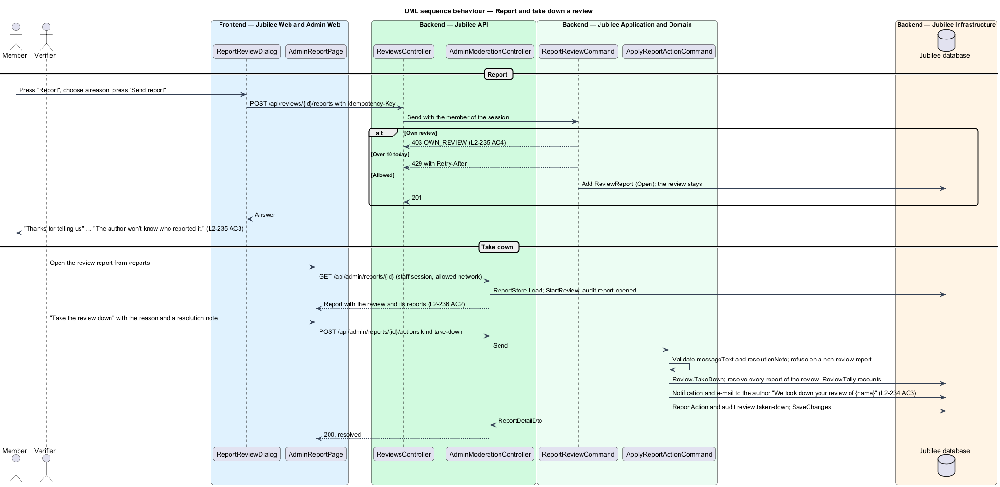

# Moderate reviews

## Overview

Jubilee is Toronto's Christian marketplace. A review that breaks the review
rules is reported by anyone signed in, the owner included, and the Jubilee team
decides in the admin application: dismiss the report, message the reporter, or take the review down with a reason the author reads. An owner
never removes a review. This feature covers the "Report" action and its dialog
in the app, the review report as a third kind of report in the reports queue of
the admin application, the take-down action, the author's notification and the
audit record.

The terms below are local to this feature.

- **review report** — one member's report of one review, with a reason and an optional note
- **review rules** — the review is about the author's own dealing, honest, names no other person, shares no private details, carries no advertising or links and uses no abusive or hateful words; a negative review may stay
- **take down** — the Jubilee team hides a review for good, with the reason the author reads and a resolution note
- **reports queue** — `/reports` of the admin application (`L2-105`), now listing listing, conversation and review reports

The decisions are recorded in [ADR 0066](../../../adr/0066-reviews.md).

## Description

### Report in the app

- **Entry** — for a member who is not the review's author, `jb-review` offers
  "Report" and `jb-reviews` emits `report`; a visitor sees no "Report". The page
  opens `ReportReviewDialog`.
- **`ReportReviewDialog`** — new CDK dialog
  (`frontend/projects/jubilee/src/app/dialogs/report-review/`, `.ts` and
  `.html`, no stylesheet), built like `ReportListingDialog`. It composes
  `jb-dialog` "Report this review", a `fieldset[jb-radio-group]` "What’s wrong
  with it?" with "It isn’t about a real dealing with them", "It’s abusive or
  hateful", "It shares private details", "It’s advertising or off-topic" and
  "Something else", the `jb-field` "Tell us more" marked "(optional)" with a
  `jb-textarea` held to 1,000 characters, "Cancel" and "Send report".
  - No choice shows "Choose what’s wrong with it." and sends nothing.
  - "Send report" is busy while `ReviewsApi.report(id, request, key)` posts
    with the `Idempotency-Key` header and a 10-second `timeout`.
  - Success shows "Thanks for telling us" and "The Jubilee team will look
    at it within one business day. The author won’t know who reported it." with
    "Done".
  - 429 shows "You’re doing that a lot. Try again in {n} minutes."; other
    failures an alert with what was chosen and typed kept, and a retry with the
    same key.
- **`POST /api/reviews/{id}/reports`** — `ReviewsController.Report` sends
  `ReportReviewCommand`: a repeated key answers the first report; the reason is
  one of `not-a-real-dealing`, `abusive`, `private-details`, `advertising`,
  `other` (422 `REASON_REQUIRED`); the note is at most 1,000 characters (422
  `TOO_LONG`); the review must be live (404); the author may not report their
  own (403 `OWN_REVIEW`); 10 review reports per member per day (429). It stores
  a `ReviewReport` with status `Open`; the review stays on the page
  (`L2-236 AC5`).

### Take down in the admin application

- **`ReviewReport`** (`Jubilee.Domain`) — new entity: review id, reporter
  subject and name (for the Jubilee team only), reason, note, the
  `ReportStatus` shared with the other reports, `CreatedAt`, resolution note,
  `ResolvedAt` and idempotency key. `StartReview` and `Resolve` as
  `ListingReport` has.
- **`ReportStore`** (`Jubilee.Application/Moderation/Reports.cs`) — loads
  review reports beside listing and conversation reports as `LoadedReport`
  with the type `review`, the reason label and the note, so `GetReportsQuery`
  lists them oldest first with "Overdue" after one business day
  (`L2-237 AC1`). The listing of a review report is the review's listing.
- **`ReportDetailDto`** gains `review` (author, rating, item, date, text and
  reply) for a review report; `OpenReportCommand` moves it to "In review" and
  writes the audit record `report.opened` (`L2-237 AC2`). A moderator who owns
  the listing gets 403 `OWN_LISTING`.
- **`ApplyReportActionCommand`** gains the kind `take-down`
  (`ReportActionKind.TakeDownReview`), allowed on review reports only, with
  `messageText` as the reason the author reads (required, at most 1,000) and
  the resolution note. It calls `Review.TakeDown(reason, now)`, resolves every
  open report of that review, recounts through `ReviewTally`, tells the author
  "We took down your review of {name}" with the reason and e-mails it
  (`reply-to-a-review`), records the `ReportAction`, and writes the audit
  record `review.taken-down` with the moderator, the time, the review, the
  reason and the note (`L2-237 AC3`). "Dismiss" and "Message the reporter"
  work as they do for other reports; "Message the owner", "Place on hold",
  "Remove listing" and "Lift hold" are refused for a review report.
- **Admin application** — `AdminReportsPage`
  (`frontend/projects/admin/src/app/pages/admin-reports/`) shows the type
  "Review"; `AdminReportPage` shows the review as it stands with its reply and
  its reports, and the actions "Dismiss", "Message the reporter" and "Take the
  review down"; `ReportActionDialog` gains the take-down form with "Reason the
  author will read" and the resolution note. The staff endpoints keep their
  staff session and network checks (`L2-191`, `L2-192`).
- **After a take-down** — the review leaves the listing page, the summary and
  the cards (`TakenDownAt` is set; reads skip it), and the author may write a
  new one (`L2-237 AC5`). It is deleted with its reports 12 months later by the
  daily retention job; the audit record remains (`L2-239 AC4`).

### Open questions

Every choice below is recorded in [ADR 0066](../../../adr/0066-reviews.md).

| Question | Decision | Why |
|---|---|---|
| Who may report | Anyone signed in but the author, the owner included. | An owner's only way to contest a review. |
| Can an owner remove a review | Never. | A business must not curate its own record. |
| Where reports are handled | The existing reports queue of the admin application, as a third type. | One queue, one overdue rule, one audit (ADR 0040). |
| Actions on a review report | Dismiss, Message the reporter, Take the review down. | The listing actions do not apply to a review. |
| What the author is told | "We took down your review of {name}" with the reason; the reporter is never named. | The author learns why (Matthew 5:37); reporters are protected (`L2-105 AC5`). |
| What is kept after a take-down | The review hidden for 12 months, then deleted; the audit record stays. | A record for a dispute, then deletion (`L2-148`). |
| The review rules | As above; a negative review that keeps them stays. | Honest measures (Proverbs 11:1). |
| Limits | 10 review reports per member per day. | `L2-137 AC1`. |

## Requirements

The feature realizes the following level-2 (L2) requirements. Each L2
requirement refines a level-1 (L1) requirement, cited by identifier.

| L2 ID | Refines (L1) | Requirement |
|-------|--------------|-------------|
| `L2-236` | `L1-031` | Anyone signed in but the author shall report a review with a reason and an optional note, privately. |
| `L2-237` | `L1-031` | The Jubilee team shall see review reports in the reports queue and dismiss them or take the review down with a reason, audited. |
| `L2-235` | `L1-031` | The author of a review taken down shall be told why. |
| `L2-238` | `L1-031` | `POST /api/reviews/{id}/reports` shall validate, refuse the author and apply the limit. |
| `L2-239` | `L1-031` | A review taken down shall be deleted after 12 months. |
| `L2-105` | `L1-014` | Reports shall be reviewed in the admin application within one business day, and the reporter never shown to the owner. |
| `L2-180` | `L1-025` | Sensitive staff actions shall be written to the audit log. |

## Diagrams

### System context

A member reports a review; the Jubilee team takes it down; the author is
told.

### Containers

`Jubilee Web` posts the report; `Jubilee Admin Web` reads the queue and applies
the action through the staff endpoints of `Jubilee API`.

### Components

`ReportReviewDialog` posts through `ReviewsApi`; `ReportStore` and
`ApplyReportActionCommand` handle review reports beside the others.

### Class structure

`ReviewReport` shares `ReportStatus` with the other reports;
`ReportActionKind` gains `TakeDownReview`.

### Behaviour — report and take down

The report is private and the review stays until a moderator decides; a
take-down resolves every report of the review and tells the author.

