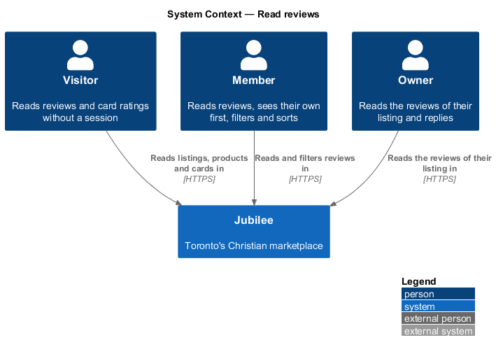
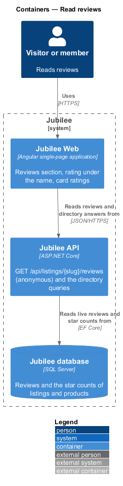
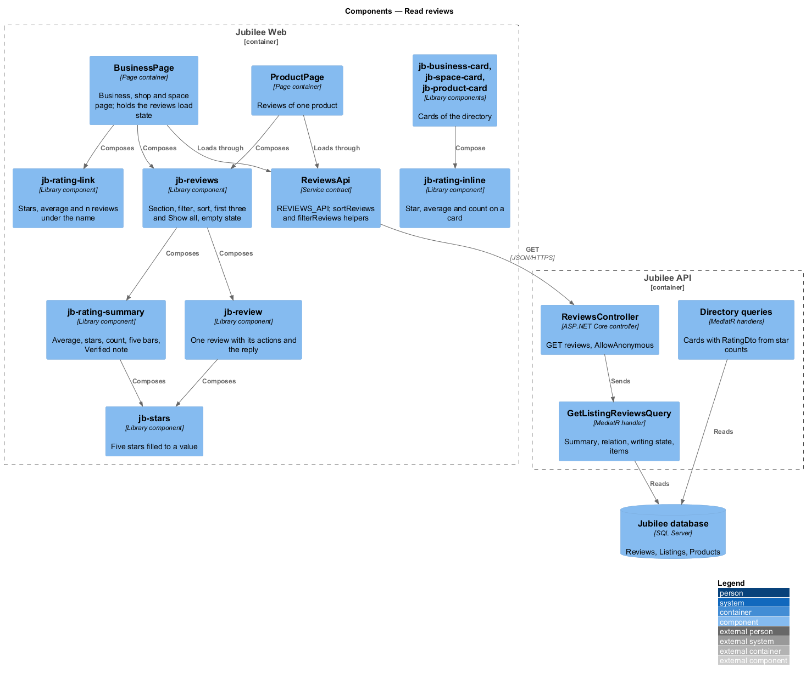
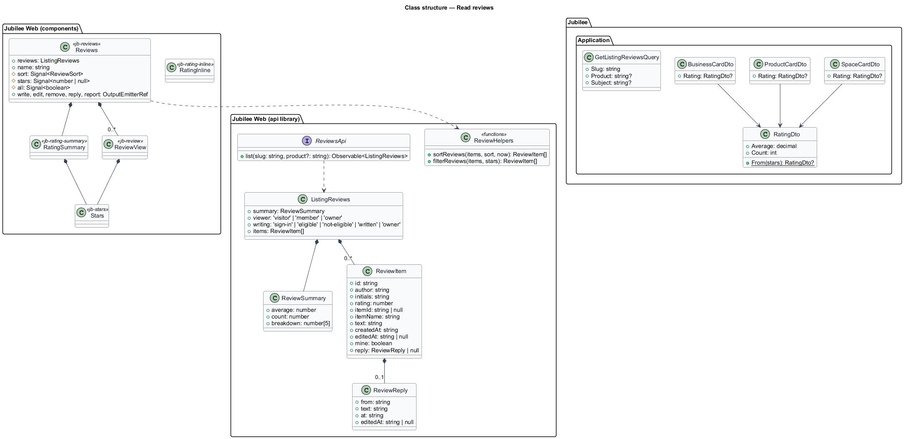
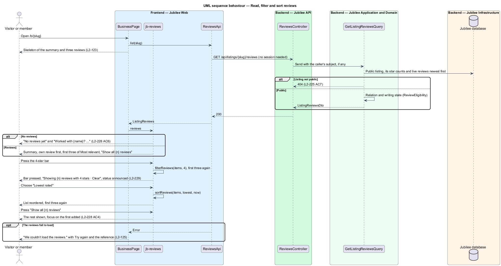

# Read reviews

## Overview

Jubilee is Toronto's Christian marketplace. Everyone, signed in or not, reads
what members who dealt with a business, shop or space found. This feature
covers the rating under a listing's name, the "Reviews" section of the business,
shop and space pages (summary, breakdown, list, the first three and "Show all",
the empty state, the member's own review, the owner's reply), the filter by
stars and the sort, the reviews of one product on its page, and the rating on
business, space and product cards.

The terms below are local to this feature.

- **summary** — the average to one decimal, the count and the count of each star from 5 to 1
- **breakdown** — the five bars of the summary; each one is a filter
- **filter** — the star rating the list is narrowed to, or none
- **sort** — "Most relevant", "Newest", "Highest rated" or "Lowest rated"
- **your review** — the review the member of the session wrote, pinned first
- **card rating** — the star, the average and the count in brackets on a card; shown from 3 reviews
- **star counts** — `Stars1` to `Stars5` stored on a `Listing` and a `Product`

Writing is `write-a-review`; the actions on a review (edit, remove, reply,
report) are opened from this section and described in
`edit-and-remove-a-review`, `reply-to-a-review` and `moderate-reviews`. The
decisions are recorded in [ADR 0066](../../../adr/0066-reviews.md).

## Description

The feature is a vertical slice from the cards and the listing page to
`ReviewsController` and the directory queries.

- **`GET /api/listings/{slug}/reviews`** — `ReviewsController.List`, marked
  `[AllowAnonymous]` on purpose: reading public reviews needs no session. It
  sends `GetListingReviewsQuery` with the caller's subject when there is one.
  The handler loads the public listing (404 otherwise, `L2-226 AC7`), its live
  reviews (not taken down) newest first, and answers `ListingReviewsDto`:
  - `summary` — `average` (rounded half up to one decimal), `count` and
    `breakdown` (the counts of 5, 4, 3, 2 and 1 stars), read from the stored
    star counts (`L2-238 AC9`).
  - `viewer` — `visitor`, `member` or `owner`.
  - `writing` — `sign-in`, `eligible`, `not-eligible`, `written` or `owner`,
    from `ReviewEligibility` (`write-a-review`).
  - `items` — each `ReviewItemDto`: `id`, `author` (first name and last
    initial), `initials`, `rating`, `itemId`, `itemName`, `text`, `createdAt`,
    `editedAt`, `mine` and `reply` (`from`, `text`, `at`, `editedAt`) or null.
    No field of the author's account (subject, e-mail, home church) is in the
    answer (`L2-238 AC1`, `L2-239 AC1`).
  - `?product={product slug}` narrows the items and the summary to the reviews
    whose item is that product, with the product's star counts; an unknown
    product is 404 (`L2-232 AC4`).
- **`ReviewsApi.list(slug, product?)`** in the `api` library returns
  `ListingReviews`; the pure helpers `sortReviews(items, sort, now)` and
  `filterReviews(items, stars)` (`frontend/projects/api/src/lib/models/reviews.ts`)
  order and narrow them. "Most relevant" puts reviews of the last 12 months
  first, then the longer text, then the newer; "Newest" by `createdAt`;
  "Highest rated" and "Lowest rated" by stars, then newest (`L2-230 AC5`).
- **`ListingReviewsStore`** (`jubilee/src/app/services/listing-reviews.store.ts`)
  — provided by the page (`providers`), so the rating under the name and the
  section read one answer. It holds the reviews as a `LoadState<ListingReviews>`,
  the star filter, the sort and whether all show; it counts the summary from
  the reviews it holds (`summarize`), so an edit or a removal redraws it.
- **`BusinessPage`** (`pages/business/`) — after a live listing loads, it
  loads the reviews into the store. It composes:
  - `jb-rating-link` (new) under the name: `jb-stars`, the average and
    "{n} reviews" as a link to `#reviews`; "No reviews yet" with none.
  - `jb-listing-reviews` (`pages/business/listing-reviews.ts`, a container
    like `jb-inbox-list`) after the content and before "More in {category}".
    It draws `jb-reviews` from the store, offers "Write a review" (a link to
    `/b/{slug}/review`; a visitor gets the "Join to review {name}" prompt), and
    gives each review the viewer's actions through the `actions` template:
    Edit and Remove on the member's own review, Reply or Edit reply and Report
    for the owner, Report for any other member. It opens the dialogs and shows
    their toasts. On a product page it shows no Edit or Remove: the author
    changes a review from the listing's page, as the posted screen says.
  - On a load error, `jb-reviews` shows "We couldn’t load the reviews." with
    "Try again" and the error reference; the rest of the page works
    (`L2-229 AC9`). While loading it shows its skeleton.
- **`jb-reviews`** (new, `components/src/lib/reviews/`, block `reviews`) — a
  `section#reviews` with the heading "Reviews" and the write action. It holds
  the presentation state: the sort (a `jb-select` named "Sort reviews"), the
  filter and whether all are shown.
  - With reviews: a grid of `jb-rating-summary` (a column of 260 px from 768 px,
    300 px from 1024 px, sticky) and the list; under 768 px the summary is
    above (`L2-229 AC10`).
  - The toolbar says "Tap a star bar to filter" or "Showing {n} reviews with
    {s} stars" with "Clear"; a visually hidden polite status announces
    "Showing {n} reviews" when the filter or the sort changes (`L2-230 AC6`).
  - `ul.reviews__list` holds `jb-review` for the first three of the current
    sort and filter, then "Show all {n} reviews", which shows the rest and
    moves focus to the first one added (`L2-229 AC4`). An empty filter says
    "No {s}-star reviews written up yet."
  - The member's own review is pinned first, outside the filter and the sort,
    as `jb-review` with `mine` ("Your review", "Posted {date}", "Edit",
    "Remove"); it is not repeated in the list (`L2-229 AC7`).
  - With none: the empty state "No reviews yet" and "Worked with {name}? Your
    review helps the next family decide." (a space: "Stayed with this host?
    …"; a product: "Bought {product}? …"), with "Write a review" when the
    writing state is `eligible` or `sign-in`.
  - With `not-eligible`, the line "You can review {name} after they confirm a
    request of yours." stands in place of the write action.
- **`jb-rating-summary`** (new, block `rating-summary`) — the average in the
  display face, `jb-stars`, "{n} reviews", five `button` bars with
  `aria-pressed`, each named "{s} stars, {n} reviews", whose fill is its share
  of the largest count. It carries no note about verification (ADR 0057).
- **`jb-review`** (new, block `review`, modifier `review--mine`) — the initials
  in `jb-avatar`, the author, the date in the form "3 Nov 2026" (`L2-131`) and
  "Edited", `jb-stars` named "{n} out of 5 stars", the item, the
  text with its line breaks (`white-space: pre-line`, interpolated, never
  markup), the actions it is given, and the reply headed "Response from {from}
  · {date}".
- **`jb-stars`** (new, block `stars`) — a `role="img"` of five stars, each
  filled to its share of the value (a 4.7 fills seven tenths of the fifth),
  named "Rated {value} out of 5". The fill is drawn with the accent token and
  the track with the border token, and the stars keep their outline in forced
  colours (`L2-240 AC3`).
- **`ProductPage`** (`pages/product/`) — loads `list(slug, productSlug)` and
  composes `jb-rating-link` and `jb-reviews` with the product's name; "Write a
  review" leads to `/b/{slug}/review?item={product id}` (`L2-232`).
- **Card rating** — `RatingDto(Average, Count)` is a new nullable `Rating` of
  `BusinessCardDto`, `SpaceCardDto` (from the listing's star counts) and
  `ProductCardDto` (from the product's), built by `RatingDto.From(counts)`,
  which answers null below 3 reviews (`L2-231 AC3, AC4`). Every place that
  builds a card (browse home, category, welcome, search, saved, related) keeps
  calling `From(listing)`; no query is added per card.
- **`jb-rating-inline`** (new, block `rating-inline`) — on `jb-business-card`,
  `jb-photo-business-card`, `jb-space-card` and `jb-product-card` after the
  tagline or the shop: a star, the average and "(count)", hidden from
  assistive technology, with the visually hidden name "Rated {average} out of 5
  from {n} reviews". It renders nothing for a null rating.
- **Freshness** — the directory read cache keeps its bound: a change to a
  review reaches the cards within 60 seconds (`L2-231 AC5`).

### Open questions

Every choice below is recorded in [ADR 0066](../../../adr/0066-reviews.md).

| Question | Decision | Why |
|---|---|---|
| Sort and filter on the server or in the app | In the app, over one answer that carries every live review; paging on the server when a listing passes 200 reviews. | Few reviews per listing at launch; instant bars and sort; one cached answer. |
| "Most relevant" without Helpful votes | Last 12 months first, then the longer text, then the newer. | Helpful is deferred; votes can be gathered. |
| Helpful | Deferred, left out of the mocks. | See ADR 0066. |
| Photos on reviews | Deferred, left out of the mocks. | See ADR 0066. |
| The fewest reviews for a card rating | 3; below it the card shows nothing (no "New"). | An average of one or two reviews misleads. |
| "Top rated" shelf, ratings on service rows | Deferred. | Not needed for a first version. |
| How the card rating is read | Stored star counts on `Listing` and `Product`. | No query per card (`L2-156`). |
| Context line under the author | Not shown: only the date. | Home church is private (L1-020); no neighbourhood is collected. |
| "Verified" words | None: a review carries no "Verified" mark and the summary no note. | ADR 0057: Jubilee shows no "Verified" mark anywhere. |

## Requirements

The feature realizes the following level-2 (L2) requirements. Each L2
requirement refines a level-1 (L1) requirement, cited by identifier.

| L2 ID | Refines (L1) | Requirement |
|-------|--------------|-------------|
| `L2-229` | `L1-031` | A listing page shall show its rating under the name and a "Reviews" section with the summary, the list of the first three and "Show all", the empty state, the member's own review first, the owner's reply, and its loading and error states. |
| `L2-230` | `L1-031` | The bars of the summary shall filter the list by stars and a select shall sort it by relevance, date or rating. |
| `L2-231` | `L1-031` | Business, space and product cards shall show the average and count from 3 reviews and nothing below. |
| `L2-232` | `L1-031` | A product page shall show the reviews of that product and lead to writing one about it. |
| `L2-226` | `L1-031` | No review shall carry a "Verified" mark or a note about verification. |
| `L2-238` | `L1-031` | `GET /api/listings/{slug}/reviews` shall answer anyone the summary, the reviews, the caller's relation and writing state, and nothing of the author's account. |
| `L2-239` | `L1-031` | A review shall show only the author's first name, last initial and initials. |
| `L2-240` | `L1-031` | The section shall fit from 360 px, work by touch and keyboard, carry no state by colour alone and use the tokens. |
| `L2-123` | `L1-018` | A loading region shall show a skeleton. |
| `L2-125` | `L1-018` | A region that fails to load shall say so with "Try again" and an error reference. |

## Diagrams

### System context

Visitors and members read reviews; the cards of the directory carry the
average.

### Containers

`Jubilee Web` reads the reviews of a listing or a product from `Jubilee API`;
the directory answers carry the card rating from the stored star counts.

### Components

`BusinessPage` and `ProductPage` compose `jb-rating-link` and `jb-reviews`,
which composes `jb-rating-summary`, `jb-review` and `jb-stars`; the cards
compose `jb-rating-inline`.

### Class structure

`ListingReviews` carries the summary, the relation, the writing state and the
items; `RatingDto` is null below 3 reviews.

### Behaviour — read, filter and sort

The page loads the reviews once; the bars, the sort and "Show all" work on
them in the browser.

