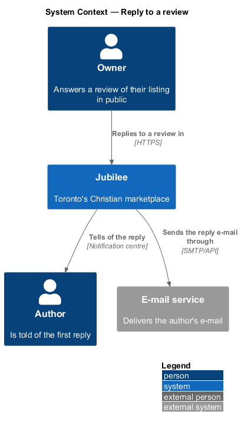
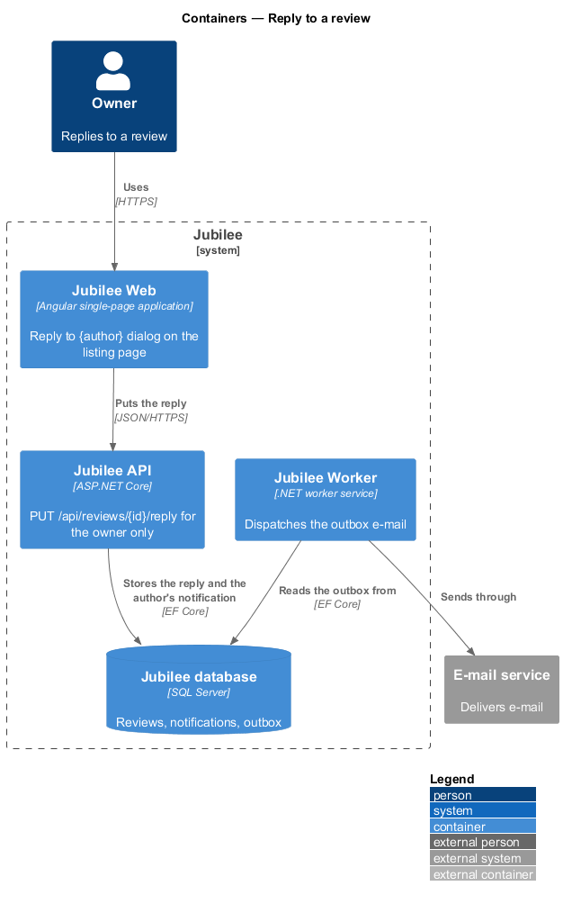
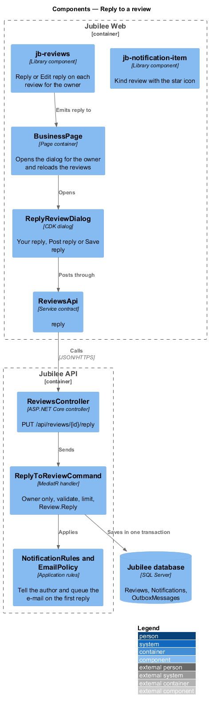
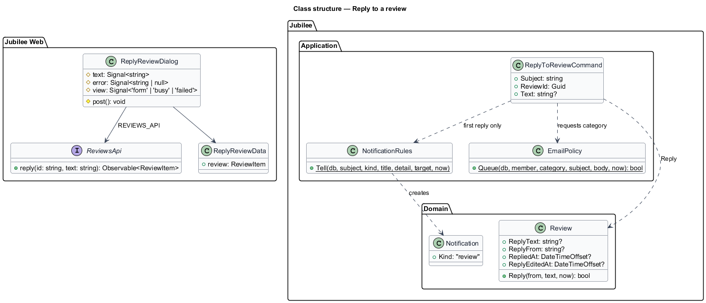
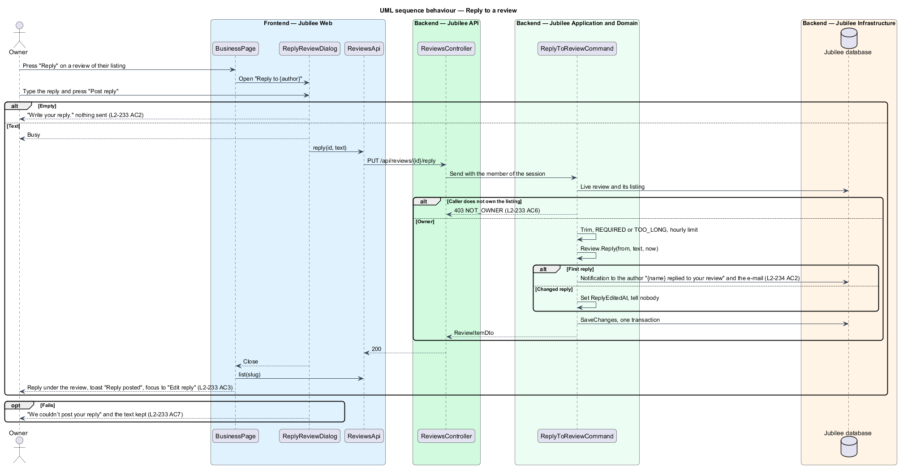

# Reply to a review

## Overview

Jubilee is Toronto's Christian marketplace. The owner of a listing answers a
review once, in public, under the review, and may change the answer. The author
is told of the first reply. This feature covers the "Reply" and "Edit reply"
actions an owner sees on their own listing, the reply dialog, the endpoint that
stores the reply, and the three notifications about reviews: the owner's of a
new review, the author's of a reply, and the author's of a review taken down.

The terms below are local to this feature.

- **reply** — the owner's one public answer to a review, shown as "Response from {from}"
- **from** — the name the reply is shown under: the owner name before its first comma, or the listing's name when the owner gave none
- **review notification** — a notification of kind `review` with the star icon

The decisions are recorded in [ADR 0066](../../../adr/0066-reviews.md).

## Description

- **Entry** — `GET /api/listings/{slug}/reviews` answers `viewer: 'owner'` for
  the owner of the listing (`read-reviews`). `jb-reviews` then gives each
  `jb-review` the action "Reply", or "Edit reply" once it has one, and emits
  `reply`. `BusinessPage` opens `ReplyReviewDialog` with `restoreFocus` on the
  review's button.
- **`ReplyReviewDialog`** — new CDK dialog
  (`frontend/projects/jubilee/src/app/dialogs/reply-review/`, `.ts` and
  `.html`, no stylesheet). Its data is the review. It composes `jb-dialog`
  titled "Reply to {author}" (with a reply: "Edit your reply"), the review's
  `jb-stars` and text, the note "Your reply is public. Everyone who reads the
  review reads it too.", the `jb-field` "Your reply" with a `jb-textarea` held
  to 1,000 characters and its counter, "Cancel" and "Post reply" (with a
  reply: "Save reply").
  - An empty reply shows "Write your reply." and sends nothing.
  - The button is busy while `ReviewsApi.reply(id, text)` runs.
  - On success the dialog closes; the page reloads the reviews, the toast
    "Reply posted" (or "Reply updated") shows, and focus returns to the
    review's "Edit reply" (`L2-234 AC3, AC4`).
  - On a failure a `jb-alert` "We couldn’t post your reply" with "Try again."
    keeps what was typed.
- **`PUT /api/reviews/{id}/reply`** — `ReviewsController.Reply` sends
  `ReplyToReviewCommand`. The review must be live (404 otherwise); the caller
  must own its listing (403 `NOT_OWNER`, `L2-234 AC6`); the text is trimmed,
  required (422 `REQUIRED`) and at most 1,000 characters (422 `TOO_LONG`); the
  limit of 30 edits and replies per member per hour applies.
  `Review.Reply(from, text, now)` sets `ReplyText`, `ReplyFrom` and
  `RepliedAt` the first time and `ReplyEditedAt` after; a second `PUT`
  replaces the first (`L2-234 AC5`).
- **Notifications** (`L2-235`) — written with `NotificationRules.Tell` in the
  same transaction as the change they report, and e-mailed through
  `EmailPolicy.Queue` under the `requests` category, so a member who turned off
  e-mails about requests gets the notification only:
  - a new review (`WriteReviewCommand`, `write-a-review`): to the owner, "New
    review of {name}", "{author} gave it {n} of 5 stars for {item}.", opening
    `/b/{slug}`;
  - the first reply (`ReplyToReviewCommand`): to the author, "{name} replied to
    your review" with the first 120 characters of the reply, opening
    `/b/{slug}`; a changed reply tells nobody;
  - a review taken down (`moderate-reviews`): to the author, "We took down your
    review of {name}" with the reason, opening `/notifications`; the reporter is
    told nothing.
  The event stream carries each to the member's other devices (`L2-070`).
- **`jb-notification-item`** — the kind `review` maps to the `star` icon
  (`L2-235 AC5`).
- **`ReviewsApi`** gains `reply(id, text)`.

### Open questions

Every choice below is recorded in [ADR 0066](../../../adr/0066-reviews.md).

| Question | Decision | Why |
|---|---|---|
| How many replies per review | One, kept on the review row (`ReplyText`, `ReplyFrom`, `RepliedAt`, `ReplyEditedAt`), not a `ReviewReply` table. | There is never more than one. |
| Can the owner change or remove the reply | Change it (shown "Edited"); a removal is not offered. | Keeps the answer on the record. |
| Who is told of a reply | The author, on the first reply only. | A correction should not ring again. |
| Which e-mail preference governs review e-mails | The existing "requests" category. | A review follows a request; no new preference. |
| The name a reply shows under | The owner name before its first comma, else the listing's name. | Credentials are not needed in the heading. |

## Requirements

The feature realizes the following level-2 (L2) requirements. Each L2
requirement refines a level-1 (L1) requirement, cited by identifier.

| L2 ID | Refines (L1) | Requirement |
|-------|--------------|-------------|
| `L2-234` | `L1-031` | The owner shall reply once to a review in public, change the reply, and nobody else shall reply. |
| `L2-235` | `L1-031` | The owner shall be told of a new review, the author of the first reply and of a review taken down, in the notification centre and by e-mail. |
| `L2-229` | `L1-031` | The reply shall show under its review headed "Response from {from}" and its date. |
| `L2-238` | `L1-031` | `PUT /api/reviews/{id}/reply` shall store the owner's reply and apply the limits. |
| `L2-064` | `L1-010` | Notifications shall be listed in the notification centre for 90 days. |
| `L2-068` | `L1-010` | E-mail notifications shall follow the member's choices. |

## Diagrams

### System context

The owner replies; the author is told.

### Containers

`Jubilee Web` puts the reply to `Jubilee API`, which stores it with the
author's notification; `Jubilee Worker` sends the e-mail.

### Components

`ReplyReviewDialog` calls `ReviewsApi`; `ReplyToReviewCommand` checks the
owner and tells the author through `NotificationRules` and `EmailPolicy`.

### Class structure

The reply lives on `Review`; the dialog depends on the `ReviewsApi` contract.

### Behaviour — reply and tell the author

The first reply tells the author; a change of it tells nobody.

