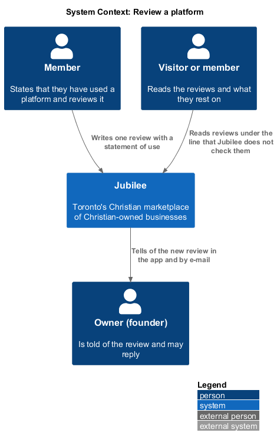
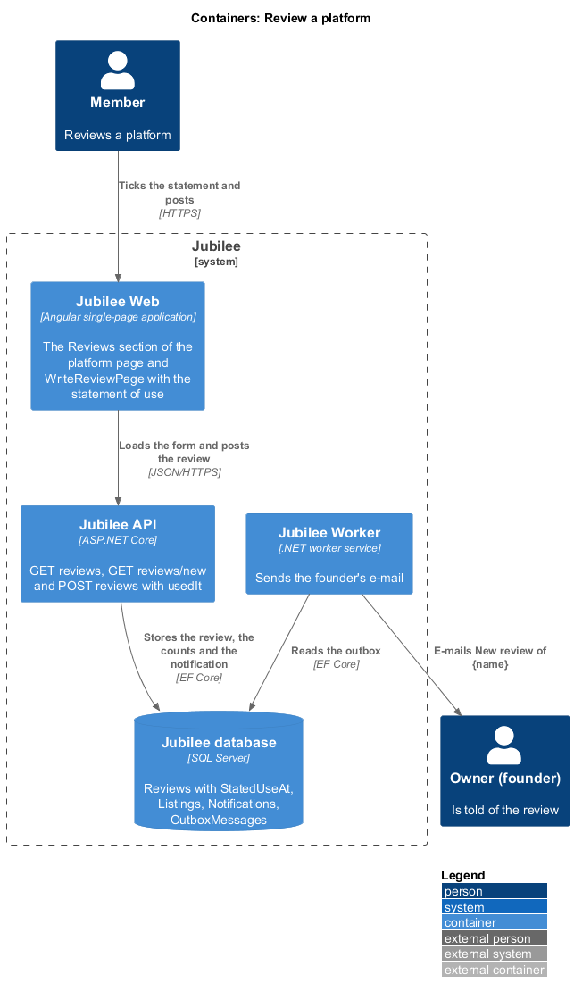
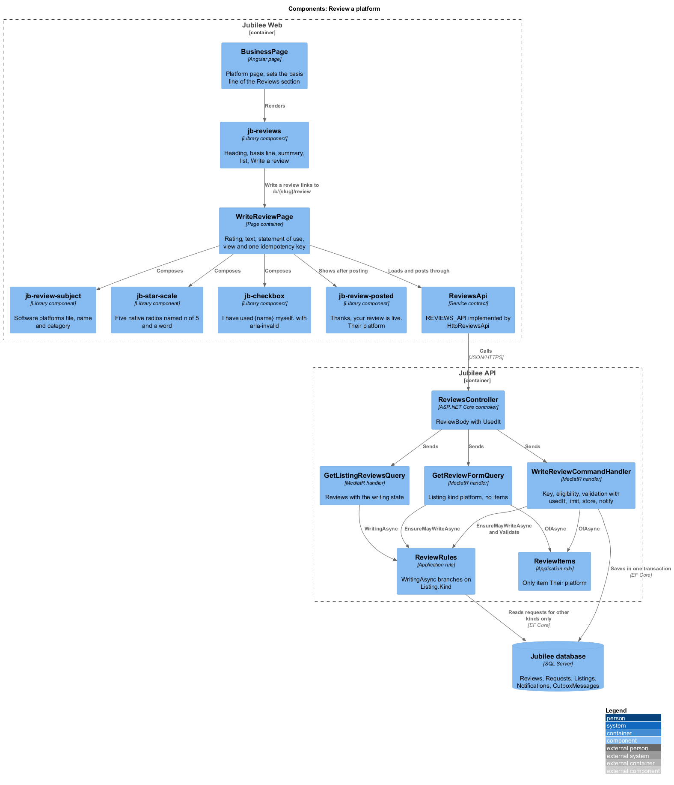
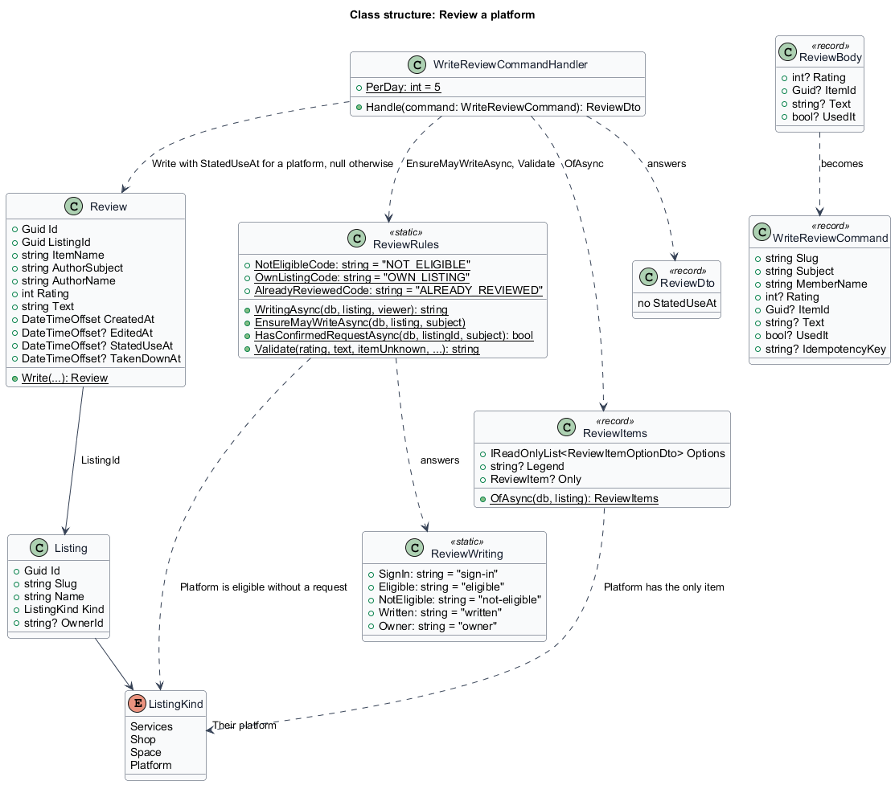
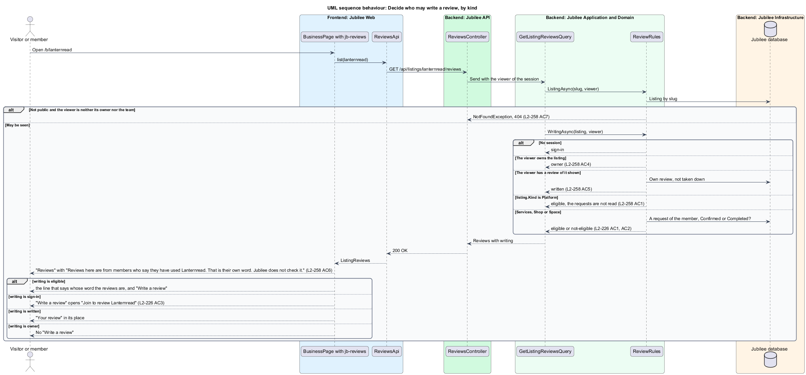
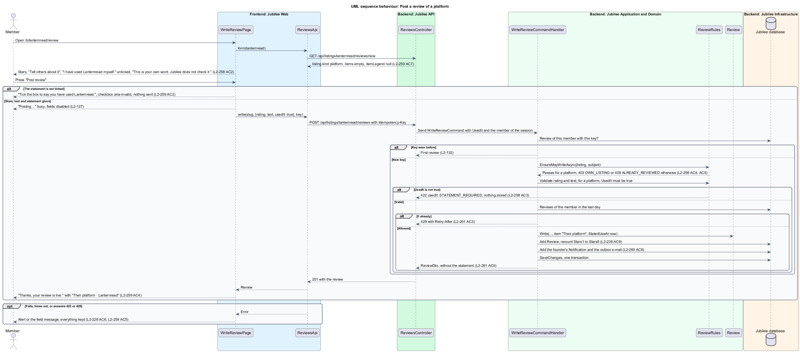

# Review a platform

## Overview

Jubilee is Toronto's Christian marketplace. A member writes a review of a
business, a shop or a space only after its owner confirmed or completed a
request of theirs (`reviews/write-a-review`). A *software platform* (a
*platform* for short) takes no requests: it is used on its own website
(`listings/view-platform`). That rule can never be met for a platform, so a
platform would have no reviews at all.

This feature covers the rule that takes its place, for platforms only. A
member reviews a platform on their own *statement of use*: their own word that
they have used it. Jubilee does not check the statement, and says so wherever
such a review is read. Everything else about a review of a platform is a
review like any other: one per member and listing, edit and remove, the one
public reply, reports and take-down, notifications, privacy, the star counts
and the rating on cards.

The terms below are local to this feature.

- **statement of use**: the member's own word that they have used the platform, given by ticking a checkbox on the Write a review screen
- **stated-use time**: the time the member made the statement, the only thing of it that is stored
- **founder**: what the copy calls the owner of a platform; the role is the owner of L1
- **eligible**: for a platform, a signed-in member who is not its owner and has no review of it shown
- **item**: what the review is about; for a platform always "Their platform"

A statement of use counts for a platform only. It never makes a member
eligible to review a business, a shop or a space. No review, summary or card
of a platform carries a "Verified" mark or the words verified, approved or
vetted. The decisions are recorded in
[ADR 0072](../../../adr/0072-software-platforms.md), which amends
[ADR 0066](../../../adr/0066-reviews.md) for this kind only.

## Description

The feature changes one rule and adds one field to the slice of
`reviews/write-a-review`, from the platform page to `ReviewsController`. It
adds no page, no endpoint and no presentation component.

- **Eligibility by kind**: `ReviewRules.WritingAsync` branches on
  `listing.Kind`. The first three answers are the same for every kind:
  `sign-in` for a visitor, `owner` for the listing's owner, `written` for a
  member who has a review of it shown. After them:
  - for `Platform`, the answer is `eligible`, and the requests are not read;
  - for `Services`, `Shop` and `Space`, the answer is `eligible` when
    `HasConfirmedRequestAsync` finds a confirmed or completed request, and
    `not-eligible` otherwise, unchanged.

  `ReviewRules.EnsureMayWriteAsync` is unchanged: it still refuses the owner
  with HTTP 403 `OWN_LISTING` and a second review with HTTP 409
  `ALREADY_REVIEWED`, and for a platform it never answers `NOT_ELIGIBLE`. A
  review removed by its author or taken down frees the place, as for any
  listing.
- **Entry**: in `jb-reviews` on the platform page, "Write a review" is offered
  to an eligible member and links to `/b/{slug}/review`; with no reviews the
  section invites the first with "Used {name}? Your review helps the next
  family decide." (`L2-260` AC2). A visitor who presses it gets the
  sign-in prompt of `L2-012`, "Join to review {name}". The founder is not
  offered it. A member with a review sees "Your review" in its place. `GET
  /api/listings/{slug}/reviews` answers `writing` `eligible` for a member
  whether or not they ever sent the platform anything.
- **The line that says what the reviews rest on**: the "Reviews" section of a
  platform always carries, under its heading, "Reviews here are from members
  who say they have used {name}. That is their own word. Jubilee does not
  check it." It shows with or without reviews. `jb-reviews` gains one text
  input, `basis`, rendered under the heading; the page sets it for a platform
  only. With no reviews the section says "No reviews yet" and "Used {name}?
  Your review helps the next family decide."
- **`GetReviewFormQuery`**: for a platform it answers `listing.kind`
  `platform`, `items` empty and `itemLegend` null, after
  `EnsureMayWriteAsync` agrees.
- **`ReviewItems.OfAsync`**: for a platform it returns no options and the only
  item "Their platform", as it returns "My stay" or "Renting here" for a
  space. The name is kept on the review like every item name.
- **`WriteReviewPage`** (`pages/write-review/`): when `listing.kind` is
  `platform` the screen shows, in this order:
  - "Back to {name}";
  - `jb-review-subject` with the "Software platforms" tile, the name and,
    under it, "Software platforms";
  - the heading "How was it?" and the stars (`L2-227` AC2);
  - "Tell others about it" with the prompt "What did you use it for, and how
    did it go? Was the price what the site said? Would you use it again?";
  - the statement of use: a `jb-checkbox` "I have used {name} myself." with,
    under it, "This is your own word. Jubilee does not check it."; it is
    unticked until the member ticks it;
  - the note of `L2-227` AC5 and "Post review".

  There is no item choice. No line asks for a good review or says the
  member's use was checked.
- **Validation in the browser**: on "Post review" with the statement
  unticked, "Tick the box to say you have used {name}." shows under the
  checkbox, the checkbox carries `aria-invalid="true"` and nothing is sent.
  When the stars or the text are missing too, their messages show with it
  (`L2-228` AC1, AC2) and focus moves to the first problem in reading order:
  the stars, the text, then the statement (`L2-126`).
- **Posting**: `ReviewsApi.write` sends the review with `usedIt: true`
  (`ReviewRequest.usedIt` in `models/reviews.ts`), with the idempotency key
  and the busy state of `L2-228` AC3. `ReviewBody` gains `UsedIt` (`bool?`)
  and `ReviewsController` passes it as `WriteReviewCommand.UsedIt`.
- **`WriteReviewCommandHandler`**: applies, in order: the listing as the
  caller may see it (HTTP 404 when it is not public, `L2-226` AC7); the
  idempotency key (a repeat answers the first review);
  `EnsureMayWriteAsync`; the item; the validation of the rating and the text
  and, for a platform, of the statement: when `UsedIt` is not `true` the same
  HTTP 422 answer carries `usedIt` `STATEMENT_REQUIRED` and nothing is stored;
  then the limit of 5 new reviews a day. It then calls `Review.Write` with the
  stated-use time, the handler's `now`, and stores the review, the star counts
  and the founder's notification in one `SaveChangesAsync`.
- **Other kinds ignore the statement** (`L2-258` AC8): for a business, a shop
  or a space, `UsedIt` is read by nobody. A member without a confirmed or
  completed request is refused with HTTP 403 `NOT_ELIGIBLE` exactly as
  before, with or without `usedIt`, and `StatedUseAt` stays null.
- **`Review.StatedUseAt`** (`DateTimeOffset?`): the time the member made the
  statement; null for every other kind. Only the time is kept (`L2-261` AC4).
  It is in no API answer: `ReviewDto` does not carry it, and nothing of the
  statement is shown beyond the line under the heading. It goes with the
  review when the review or the account is deleted (`reviews/review-data`).
  The column is added to `Reviews` by the migration `AddSoftwarePlatforms`
  (`onboarding/describe-platform`).
- **Posted and failed**: the posted state is `jb-review-posted` with "Their
  platform · {name}" and "See it on their page". A failed send follows
  `L2-228` AC6; HTTP 422 with `usedIt` shows the message of the unticked
  statement.
- **Editing and removing** (`reviews/edit-and-remove-a-review`): the edit
  dialog shows no item choice and does not ask for the statement again.
  `PUT /api/reviews/{id}` shares `ReviewBody`, so it accepts `usedIt` and
  ignores it; `StatedUseAt` stands from the day it was made.
- **Reply, reports and notifications**: unchanged
  (`reviews/reply-to-a-review`, `reviews/moderate-reviews`). The founder's
  reply is headed "Response from {owner name}". The founder is told "New
  review of {name}" with "{author} gave it {n} of 5 stars for Their
  platform.", built from the item name. A member who believes the author did
  not use the platform reports the review with the reason "It isn’t about a
  real dealing with them".
- **Limits** (`L2-261` AC3): unchanged. 5 new reviews a day whatever the kind
  of listing, 30 edits and replies an hour and 10 reports a day, each
  answering HTTP 429 with `Retry-After`. No request bounds who may review a
  platform, so the daily limit is what bounds a member.
- **Cards**: a platform with at least 3 reviews shows the rating of `L2-231`
  on its business card; the stored star counts are kept as for any listing
  (`L2-238` AC9).
- **Offline**: "Write a review" and "Post review" carry
  `jbRequiresConnection` and are disabled offline (`L2-240` AC5).
- **Seed**: `DemoReviews.cs` adds reviews of Lanternread, each with a
  stated-use time.
- **Tests**: API integration tests on the InMemory provider (ADR 0009) in
  `backend/tests/Jubilee.Api.Tests/` (`PlatformReviewTests`, beside
  `ReviewTests`), named for their criterion (`L2_258_AC1_...`,
  `L2_258_AC3_...`, `L2_258_AC8_...`, `L2_259_AC7_...`). The Playwright
  behaviour spec `e2e/tests/review-a-platform.spec.ts` drives the screen
  through `e2e/pages/write-review.page.ts` and reads the section through
  `e2e/pages/reviews.region.ts`; `e2e/fixtures/routes.ts` gains the platform
  states of the screen and of the section.

### Open questions

Every decision below is recorded in
[ADR 0072](../../../adr/0072-software-platforms.md), except where the row says
otherwise.

| Question | Decision | Why |
|---|---|---|
| On what a review of a platform rests | The member's statement of use; no request is needed. | A platform takes no requests, so the rule of `L2-226` can never be met, and reviews are the purpose of the feature. |
| Proof of use | None is asked. | A receipt or a screenshot is something nobody at Jubilee could judge. |
| Keeping the measure honest | The section always says "That is their own word. Jubilee does not check it.", the screen says "This is your own word. Jubilee does not check it.", and nothing is called verified. | A review of a platform is weaker evidence than a review of a business; saying so keeps a just weight (Proverbs 11:1). |
| What is stored of the statement | Its time only, on the review. | Enough to say when the word was given; nothing more is needed (`L2-261` AC4). |
| The statement on an edit | Not asked again. | It stands from the day it was made (`L2-260` AC4). |
| Scope of the statement | Platforms only; `usedIt` is ignored for every other kind. | A confirmed request stays the only way to review a business, a shop or a space. |
| Abuse | The daily limit of 5 new reviews and the report reason "It isn’t about a real dealing with them". | Both exist. If they prove too little, the remedy is a later decision (an account age, or a founder-issued code), not a silent mark. |
| The item | "Their platform", with no choice. | There is nothing to choose, as for a space. |
| The stated-use time in the data download | `<TO SUPPLY>` | `L2-261` AC4 and `L2-239` AC3 do not say whether the member's download of their reviews carries it; not decided by ADR 0072. |
| The design reference | The Magic Patterns reference draws no platform. The "Write a Review" frame is reused and the statement of use is drawn in `docs/mocks/pages/write-review/platform*.html`. | ADR 0072. |

## Requirements

The feature realizes the following level-2 (L2) requirements. Each L2
requirement refines a level-1 (L1) requirement, cited by identifier.

| L2 ID | Refines (L1) | Requirement |
|-------|--------------|-------------|
| `L2-258` | `L1-033` | A signed-in member who is not the platform's owner and has no review of it shown shall be eligible to review it on their statement of use, whatever they sent the platform; the API shall refuse a platform review without `usedIt: true` with HTTP 422 `usedIt: STATEMENT_REQUIRED` and store the time of the statement otherwise; the "Reviews" section of a platform shall always say the reviews are the members' own word and that Jubilee does not check it; and a statement of use shall never count for a business, a shop or a space. |
| `L2-259` | `L1-033` | The Write a review screen of a platform shall show the "Software platforms" tile, the name, "How was it?", the stars, "Tell others about it" with its platform prompt, the statement of use, the note and "Post review", with no item choice; an unticked statement shall show "Tick the box to say you have used {name}." and send nothing; and `GET /api/listings/{slug}/reviews/new` shall answer `listing.kind` `platform`, no items and a null legend. |
| `L2-260` | `L1-033` | Once written, a review of a platform shall be read, rated on cards, edited, removed, replied to, reported, taken down, notified and retained like any other, with "Their platform" as its item, and an edit shall not ask for the statement again. |
| `L2-261` | `L1-033` | The review limits shall hold unchanged for platforms; only the time of the statement of use shall be kept, nothing of it shall be shown beyond the line of the "Reviews" section, and it shall go with the review. |
| `L2-262` | `L1-033` | The Write a review screen of a platform shall fit from 360 px, work by keyboard and touch, say the state of the statement of use in text or an accessible name, and disable "Write a review" and "Post review" offline. |
| `L2-226` | `L1-031` | A member shall write a review of a business, a shop or a space only after its owner confirmed or completed a request of theirs, once per listing whatever its kind; no review shall carry a "Verified" mark. |
| `L2-227` | `L1-031` | The Write a review screen at `/b/{slug}/review` shall show the listing, "How was it?", the stars, the item choice, "Tell others about it" and the note on what is shown, with no line that asks for a good review; a platform shows no choice and the review is about "Their platform". |
| `L2-228` | `L1-031` | Posting shall check the rating and 40 characters, send once with an idempotency key, confirm with "Thanks, your review is live." and keep everything on a failure. |
| `L2-238` | `L1-031` | The API shall store a review for the member of the session, validate every field, refuse the owner and a second review, apply the limits and keep the star counts. |
| `L2-126` | `L1-018` | A form shall validate on submit, show each message under its field and move focus to the first problem. |

## Diagrams

### System context

A member reviews a platform they say they have used; the founder is told.
Jubilee checks nothing at the platform's website.

### Containers

`Jubilee Web` shows the screen and posts the review with the statement to
`Jubilee API`, which stores it with the stated-use time, the founder's
notification and e-mail in `Jubilee database`; `Jubilee Worker` sends the
e-mail.

### Components

`WriteReviewPage` adds `jb-checkbox` for the statement of use.
`ReviewRules` decides eligibility by the listing's kind, and
`WriteReviewCommandHandler` requires the statement for a platform.

### Class structure

`Review` gains `StatedUseAt`, and `WriteReviewCommand` gains `UsedIt`.
`ReviewRules.WritingAsync` reads `Listing.Kind`; `ReviewDto` does not carry
the statement.

### Behaviour: decide who may write, by kind

The same rule answers the "Reviews" section and the Write a review screen.
For a platform it never reads the requests.

### Behaviour: post a review of a platform

The browser checks the statement first; the server checks it again, stores
its time with the review and tells the founder in one transaction.

