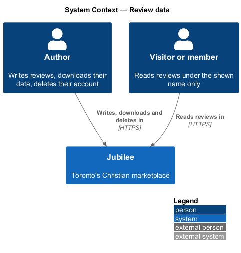
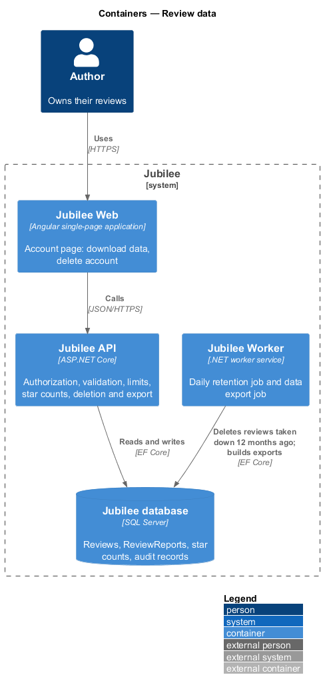
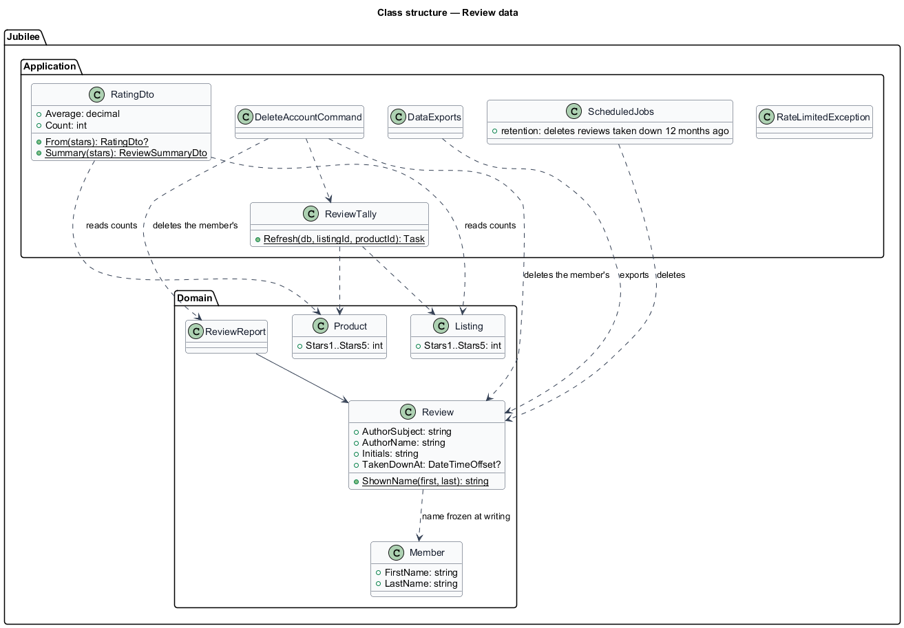
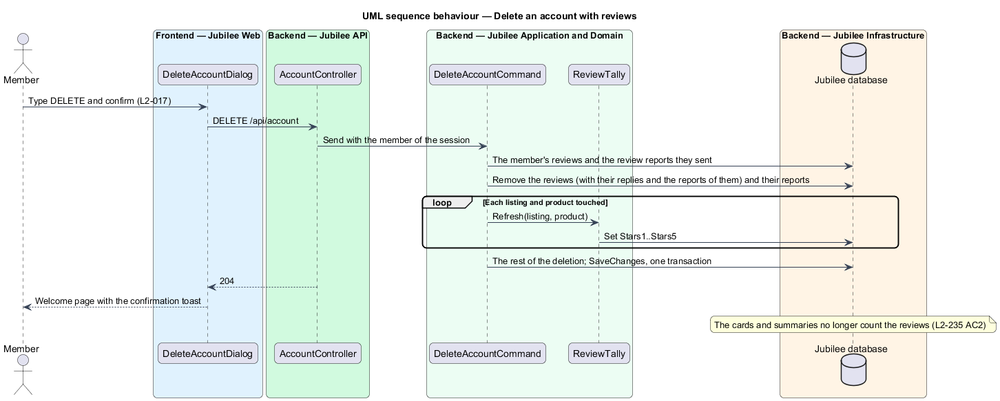

# Review data

## Overview

Jubilee is Toronto's Christian marketplace. A review is personal data of its
author, shown in public under as little of them as serves the reader. This
feature covers what of the author a review shows, what happens to reviews when
an account is deleted or its data downloaded, the stored star counts, the
retention of reviews taken down, the limits on writing, and the rules every
review endpoint shares (authorization, validation, text stored as text).

The terms below are local to this feature.

- **shown name** — first name and the first letter of the last name with a full stop, as it was when the review was written
- **star counts** — `Stars1` to `Stars5` on `Listing` and `Product`
- **live review** — a review that is not taken down

The decisions are recorded in [ADR 0058](../../../adr/0058-reviews.md).

## Description

- **Shown name** — `Review.Write` takes `AuthorName` ("Joanna A.") and
  `Initials` ("JA") from the `Member`'s first and last name when the review is
  written; a later change of name does not change the review. No answer of the
  API carries the author's subject, e-mail, home church, neighbourhood or photo
  (`L2-238 AC1`, `L2-145`); `mine` is computed for the caller and is the only
  link between a review and the session.
- **Authorization** (`L2-133`) — `GET /api/listings/{slug}/reviews` is the only
  `[AllowAnonymous]` review endpoint, on purpose; every write falls under the
  fallback policy (401 for a visitor). The member comes from the session in
  every command, never from the body. Another member's review answers 404 to
  `PUT` and `DELETE`; a reply from anyone but the listing's owner answers 403
  `NOT_OWNER`; the owner's review of their own listing answers 403
  `OWN_LISTING`; the author's report of their own review answers 403
  `OWN_REVIEW`. A listing that is not public answers 404 to all but its owner
  and the verification team (`L2-225 AC7`).
- **Validation** (`L2-136`) — every request body is a record with
  `[JsonUnmappedMemberHandling(Disallow)]`, so an unknown field is refused. The
  handlers check every field again: rating 1 to 5, item among the listing's,
  text 40 to 2,000 after trimming, reply 1 to 1,000, report reason among five,
  note at most 1,000; failures are 422 with a code per field in the
  ProblemDetails `errors`. Text is stored as typed (trimmed) and shown by
  interpolation, never as markup, in the app, the admin application and e-mail
  (`L2-237 AC8`).
- **Limits** (`L2-137`) — counted in the handlers from stored rows, as listing
  reports are: 5 new reviews per member per day, 30 edits and replies per member
  per hour, 10 review reports per member per day. Beyond them the answer is 429
  with `Retry-After` (`RateLimitedException`).
- **Star counts** (`L2-237 AC9`) — `ReviewTally.Refresh(db, listingId,
  productId)` recounts the live reviews of the listing, and of a product when
  one is named, into `Stars1` to `Stars5`, in the same `SaveChangesAsync` as
  the change: a write, an edit (old and new product), a removal, a take-down,
  and an account deletion. `RatingDto.From` turns them into the average,
  rounded half up to one decimal, and the count, or null below 3 for cards.
- **Account deletion** (`L2-238 AC2`) — `DeleteAccountCommand` deletes the
  member's reviews (their replies and the reports of them go too), deletes the
  review reports they sent, and recounts the stars of every listing and product
  touched. The replies they wrote as an owner go with their listings, as
  `L2-017 AC4` already unpublishes those.
- **Data download** (`L2-238 AC3`) — `DataExports` adds `reviews` (listing,
  rating, item, text, `createdAt`, `editedAt` and the reply) and
  `reviewReports` (review id, reason, note, date) for the member; for an owner,
  `listingReviews` holds the reviews of their listings with their replies.
- **Retention** (`L2-238 AC4`, `L2-148`) — the daily retention job deletes a
  review taken down 12 months ago with its reports; its `AuditRecord` stays.
- **Persistence** — `Reviews` (index on `ListingId`, on `ProductId`, and on
  `AuthorSubject` with `IdempotencyKey`) and `ReviewReports` (index on
  `ReviewId`, and on `ReporterSubject` with `IdempotencyKey`), configured in
  `EntityConfigurations.cs`, added in one migration of
  `Jubilee.Infrastructure/Migrations` with the star-count columns; tests run on
  the InMemory provider (ADR 0009).

### Open questions

Every choice below is recorded in [ADR 0058](../../../adr/0058-reviews.md).

| Question | Decision | Why |
|---|---|---|
| What of the author is shown | First name, last initial and initials, frozen at writing. | Enough to be a real person, no more (L1-020, `L2-145`). |
| "Anonymous" for sensitive services | Deferred. | A review stands by a name; revisit when a counselling business asks. |
| Reviews on account deletion | Deleted with the reports the member sent; stars recounted. | The member's words go with the member. |
| Taken-down reviews | Kept hidden 12 months, then deleted; the audit stays. | A record for a dispute, then deletion. |
| Where the counts live | Stored star counts on `Listing` and `Product`. | Cards without a query each (`L2-156`). |
| Limits | 5 reviews a day, 30 edits and replies an hour, 10 reports a day. | `L2-137`. |

## Requirements

The feature realizes the following level-2 (L2) requirements. Each L2
requirement refines a level-1 (L1) requirement, cited by identifier.

| L2 ID | Refines (L1) | Requirement |
|-------|--------------|-------------|
| `L2-237` | `L1-031` | The review endpoints shall authorize every call, validate every field, store text as text, apply the limits and keep the star counts. |
| `L2-238` | `L1-031` | A review shall show the author's first name and last initial only, go with a deleted account, be in the data download, and a taken-down review shall be deleted after 12 months. |
| `L2-017` | `L1-002` | Deleting an account shall delete the member's data. |
| `L2-018` | `L1-002` | The data download shall hold the member's data. |
| `L2-133` | `L1-019` | Owned data shall be reached only by its owner. |
| `L2-136` | `L1-019` | Every input shall be validated on the server and text shall never be rendered as markup. |
| `L2-137` | `L1-019` | Writes shall be rate limited with 429 and `Retry-After`. |
| `L2-148` | `L1-020` | Data shall be deleted on its retention schedule. |

## Diagrams

### System context

Members' reviews are kept, shown and deleted by Jubilee on their behalf.

### Containers

`Jubilee API` holds the rules; `Jubilee Worker` runs the retention job.

### Class structure

`ReviewTally` keeps the counts that `RatingDto` reads; the account commands
reach the reviews of the member.

### Behaviour — delete an account with reviews

The member's reviews and reports go, and the counts are recounted, in the
deletion's transaction.

