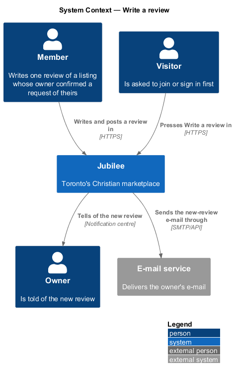
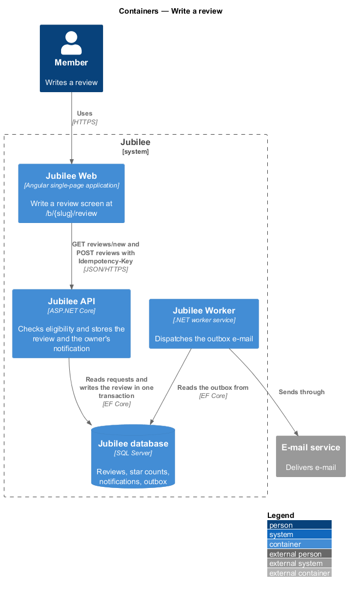
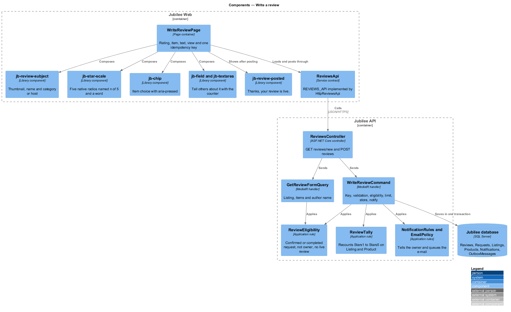
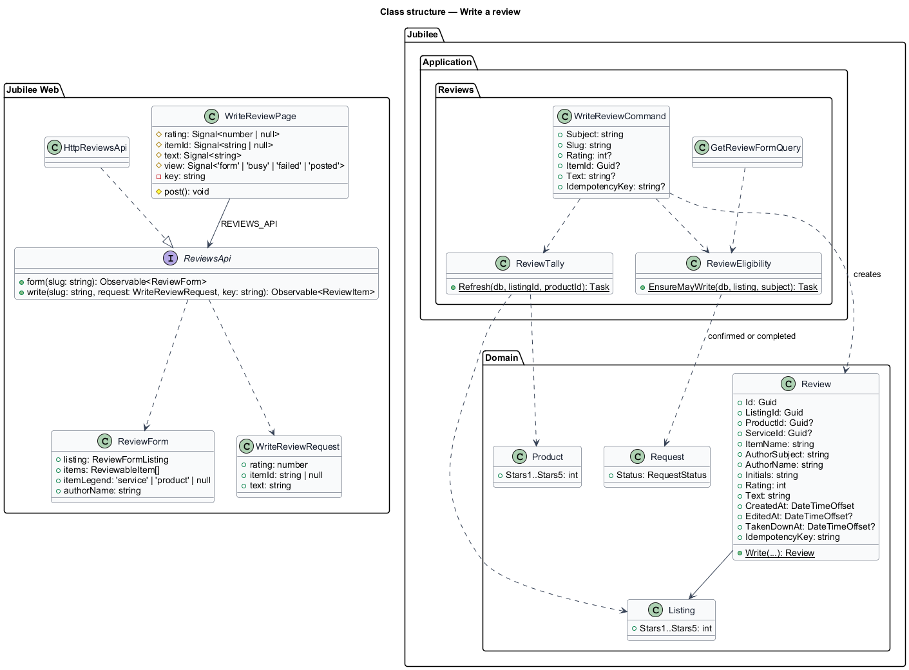
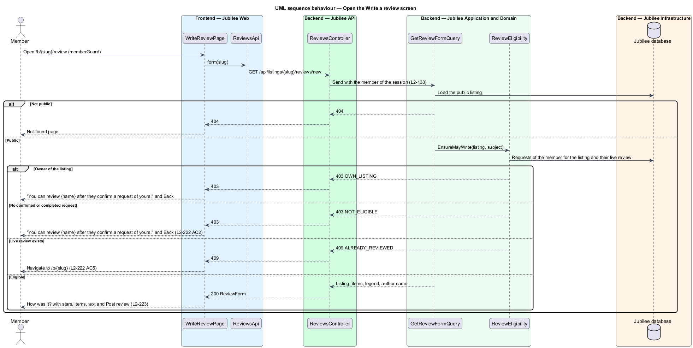
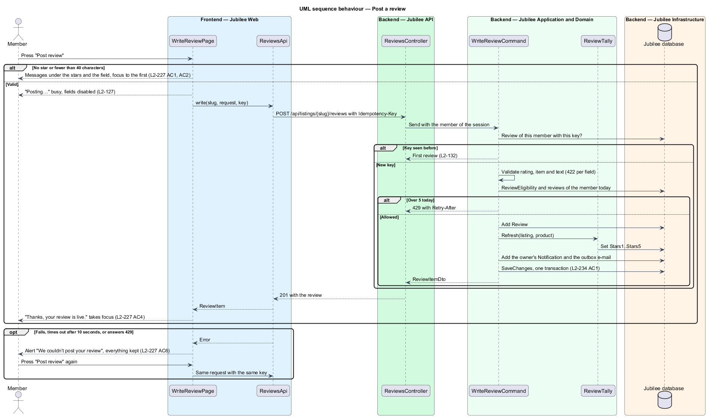

# Write a review

## Overview

Jubilee is Toronto's Christian marketplace. A member whose request a business,
shop or space confirmed writes one honest review of that listing: a rating of 1
to 5 stars, the service, product or stay it is about, and what happened. Every
review on Jubilee therefore comes from a real dealing.
This feature covers who may write, the Write a review screen at
`/b/{slug}/review`, posting, the posted confirmation, the owner's notification
of the new review, and the API that stores it.

The terms below are local to this feature.

- **review** — one member's rating, item and text about one listing
- **author** — the member who wrote the review (L1 roles table)
- **eligible** — the member has a request for the listing whose status is `confirmed` or `completed`
- **item** — the service, product or stay the review is about, kept by id and by name
- **writing state** — what the caller may do: `sign-in`, `eligible`, `not-eligible`, `written` or `owner`
- **star counts** — the five stored counts of reviews per star on a listing and on a product
- **idempotency key** — client-generated identifier that lets the server recognise a repeated post

Reading the reviews on a listing is `read-reviews`; editing and removing are
`edit-and-remove-a-review`; the owner's reply is `reply-to-a-review`; reports
and take-downs are `moderate-reviews`. The decisions are recorded in
[ADR 0066](../../../adr/0066-reviews.md).

## Description

The feature is a vertical slice from the listing page to `ReviewsController`.
Presentation is in the `components` library; the app declares a page container
only (ADR 0035).

- **Entry** — "Write a review" in `jb-reviews` on the listing page
  (`read-reviews`) is a link to `/b/{slug}/review`. A visitor who presses it
  gets the sign-in prompt of `L2-012`, "Join to review {name}", which returns
  to `/b/{slug}/review`. A product page links to
  `/b/{slug}/review?item={product id}`.
- **Route** — `/b/:slug/review` in `app.routes.ts`, behind `memberGuard`, with
  `shell: 'app'`, `page: 'write-review'` and `section: 'browse'`. The posted
  confirmation is a state of the page, not an address.
- **`WriteReviewPage`** — new page container
  (`frontend/projects/jubilee/src/app/pages/write-review/`,
  `write-review.page.ts` and `write-review.page.html`, no stylesheet). It
  loads `GET /api/listings/{slug}/reviews/new` through `ReviewsApi` and holds
  the rating, the item, the text, the view (`form`, `busy`, `failed`,
  `posted`), the errors and one idempotency key as signals.
  - `403 NOT_ELIGIBLE` shows "You can review {name} after they confirm a
    request of yours." with "Back to {name}" and no form; `403 OWN_LISTING`
    shows the same for the owner's own listing.
  - `409 ALREADY_REVIEWED` navigates to `/b/{slug}` with `replaceUrl`.
  - `404` shows the not-found page, as the listing page does.
- **Form** — composed of existing and new `jb-*` components:
  - `jb-back-link` "Back to {name}" (a space: "Back to listing").
  - `jb-review-subject` (new): a 48 px rounded thumbnail (the
    category tile), the listing's name and, under it, the category or, for a
    space, "Hosted by {owner name}".
  - The heading "How was it?".
  - `fieldset[jb-star-scale]` (reused, `lg`) with the legend "Your rating" and
    the words "Poor", "Not great", "Okay", "Good" and "Excellent"; each star is
    a native radio named "{n} of 5: {word}", and "Tap to rate" shows before one
    is chosen.
  - "Which service?" (a shop: "Which product?") as a `jb-chip` row of toggle
    buttons with `aria-pressed`, one per item, the first chosen or the one of
    `?item=`. One item or none, and every space, show no choice.
  - `div[jb-field]` "Tell others about it" with the prompt as its hint, a
    `textarea[jb-textarea]` held to 2,000 characters, the placeholder "Say
    what happened, as you would tell a friend.", and the counter "At least 40
    characters · {n}" until 40 trimmed characters, then "Looks good · {n}".
  - The note "Your review posts under your first name and last initial:
    {author name}." and "Keep to what happened to you: no private details of
    anyone and no advertising."
  - `button[jb-button]` "Post review", the width of the screen under 640 px.
- **Validation in the browser** — on "Post review": no star shows "Choose a
  star rating to post your review." under the stars; fewer than 40 trimmed
  characters shows "Write at least 40 characters. This has {n}." under the
  field; focus moves to the first problem and nothing is sent (`L2-126`).
- **Posting** — `ReviewsApi.write(slug, request, key)` posts with the
  `Idempotency-Key` header and a 10-second `timeout`. While it runs the button
  says "Posting…" with `aria-busy="true"`, the fields are disabled and a second
  press sends nothing (`L2-127`). The control carries `jbRequiresConnection`,
  so it is disabled offline with the reason (`L2-240`).
- **Failed** — a `jb-alert` "We couldn’t post your review" with "Your review is
  still here. Try again." and the reason; on 429 "You’re doing that a lot. Try
  again in {n} minutes."; on 422 the field messages. Everything is kept, and a
  retry reuses the key (`L2-128`, `L2-132`).
- **Posted** — `jb-review-posted` (new): a round check mark, "Thanks, your
  review is live." (takes focus), "{name} will be notified and can reply
  publicly. You can edit or remove your review from their page.", the stars
  with their word, "{item} · {name}", the first three lines of the text, "See
  it on their page" (a space: "See it on the listing") to `/b/{slug}` and "Back
  to browse" to `/`.
- **`ReviewsApi`** — service contract in the `api` library
  (`frontend/projects/api/src/lib/api/reviews-api.ts`) with the injection token
  `REVIEWS_API`, implemented by `HttpReviewsApi` and provided in
  `app.config.ts`; models in `models/reviews.ts`. The page depends on the
  token.
- **`ReviewsController`** — ASP.NET Core controller. `GET
  api/listings/{slug}/reviews/new` and `POST api/listings/{slug}/reviews`
  require a member session; the member is taken from the session, never from
  the body (`L2-133`). The body refuses unknown fields (`L2-136`).
- **`GetReviewFormQuery`** (`Jubilee.Application/Reviews/`) — answers the
  listing (slug, name, kind, category name and slug, owner name),
  the items and their legend (`service`, `product` or none) and the author's
  name, after `ReviewEligibility` agrees.
- **`ReviewEligibility`** — the rule of `L2-226`: the listing is public; the
  caller is not its owner (`OWN_LISTING`); the caller has a request for it in
  `Confirmed` or `Completed` (`NOT_ELIGIBLE`); the caller has no live review of
  it (`ALREADY_REVIEWED`). A review removed by its author or taken down does not
  count.
- **`WriteReviewCommand`** — handler that applies, in order: the idempotency
  key (a repeat answers the first review); validation (rating 1 to 5
  `RATING_REQUIRED`; item `ITEM_UNKNOWN`; text 40 to 2,000 trimmed `TOO_SHORT`
  or `TOO_LONG`, as 422 with a code per field); `ReviewEligibility`; the limit
  of 5 new reviews per member per day (429 with `Retry-After`). It then stores
  the `Review`, updates the star counts through `ReviewTally`, tells the owner
  through `NotificationRules.Tell` (kind `review`, "New review of {name}",
  "{author} gave it {n} of 5 stars for {item}.", target `/b/{slug}`) and
  queues the e-mail through `EmailPolicy.Queue` under the "requests" category,
  all in one `SaveChangesAsync` (`L2-235 AC1`).
- **`Review`** (`Jubilee.Domain`) — new entity: listing id, the product or
  service id when the item is one, the item's name, the author's subject, the
  author's name as first name and last initial and their initials (taken from
  the `Member` when written), the rating, the trimmed text, `CreatedAt`,
  `EditedAt`, the reply fields, `TakenDownAt`, `TakeDownReason` and the
  idempotency key. Its text is stored as text and rendered by interpolation,
  never as markup (`L2-238 AC8`).
- **`ReviewTally`** — recounts `Stars1` to `Stars5` on the `Listing` and, when
  the item is a product, on the `Product`, from the live reviews, in the same
  transaction (`L2-238 AC9`).
- **Persistence** — `ReviewConfiguration` in `EntityConfigurations.cs`, a
  `Reviews` set on `IAppDbContext`, and one migration in
  `Jubilee.Infrastructure/Migrations` that adds `Reviews`, `ReviewReports`
  and the star counts; `jubilee migrate` applies it (the API never migrates).
  `DemoDataSeeder` adds the sample reviews idempotently.

### Software platforms

A software platform takes no requests, so the rule above cannot apply to it
([ADR 0072](../../../adr/0072-software-platforms.md), `L2-258`). The slice
branches by the listing's kind in three places; the detail is in
[Review a platform](../review-a-platform/README.md).

- **Who may write**: `ReviewRules.WritingAsync` branches on `listing.Kind`.
  For `Platform`, every signed-in member who is not the owner and has no
  review shown is `eligible`; no request is read. For a business, a shop or a
  space the rule is unchanged.
- **The statement of use**: the body of `POST api/listings/{slug}/reviews`
  gains `usedIt` (`ReviewBody.UsedIt`, `WriteReviewCommand.UsedIt`, `bool?`).
  A review of a platform without `usedIt: true` is refused with HTTP 422
  `usedIt: STATEMENT_REQUIRED`; with it, the time is stored as
  `Review.StatedUseAt`. For every other kind `usedIt` is ignored: it never
  makes a member eligible, and `NOT_ELIGIBLE` is answered as before.
- **The screen and the item**: for `listing.kind` `platform`,
  `WriteReviewPage` shows no item choice and adds a `jb-checkbox` "I have
  used {name} myself." above the note; `ReviewItems.OfAsync` returns the only
  item "Their platform".

### Open questions

Every choice below is recorded in [ADR 0066](../../../adr/0066-reviews.md).

| Question | Decision | Why |
|---|---|---|
| Who may review | A member with a request the owner confirmed or completed; nobody else (403 `NOT_ELIGIBLE`). No review carries a "Verified" mark (ADR 0057). | Jubilee takes no payment; a confirmed request is the only proof of a dealing, and a review with no dealing behind it is a false balance (Proverbs 11:1). |
| How many reviews per member and listing | One live review; a removed or taken-down one frees the place. An edit shows "Edited". | Keeps one voice per dealing and the change visible. |
| The item | A service or product by id, its name kept; "Their service", "A purchase", "My stay" or "Renting here" when there is no choice. | As `reviewableItems` of the design; a renamed product keeps the review whole. |
| The name shown | First name and last initial with initials; no church, neighbourhood or "Anonymous". | The home church is private (L1-020); a review stands by a name. |
| Photos ("Add photos (optional)") | Deferred and left out of the screen and the mocks. | Would need the photo pipeline of ADR 0014 and 0039 for a first version that does not need it. |
| The owner's notification | In-app and e-mail under the "requests" category, in the review's transaction. | A review follows a request; no new preference is needed. |
| Writing on a screen or in a dialog | A screen, `/b/:slug/review`, as the frame draws it. | AGENTS.md: no inline forms; the frame is a full screen. |
| Copy that leans towards praise | "What did they do well?" becomes "What did they do, and how did it go? …". | No line may push towards a good review. |
| Limits | 5 new reviews per member per day. | `L2-137`. |

## Requirements

The feature realizes the following level-2 (L2) requirements. Each L2
requirement refines a level-1 (L1) requirement, cited by identifier.

| L2 ID | Refines (L1) | Requirement |
|-------|--------------|-------------|
| `L2-226` | `L1-031` | A member shall write a review of a listing only after its owner confirmed or completed a request of theirs, once per listing; no review shall carry a "Verified" mark. |
| `L2-227` | `L1-031` | The Write a review screen at `/b/{slug}/review` shall show the listing, "How was it?", the stars, the item choice, "Tell others about it" and the note on what is shown, with no line that asks for a good review. |
| `L2-228` | `L1-031` | Posting shall check the rating and 40 characters, send once with an idempotency key, confirm with "Thanks, your review is live." and keep everything on a failure. |
| `L2-235` | `L1-031` | The owner shall be told of a new review in the notification centre and by e-mail. |
| `L2-238` | `L1-031` | The API shall store a review for the member of the session, validate every field, refuse an ineligible member, the owner and a second review, apply the limits and keep the star counts. |
| `L2-240` | `L1-031` | The screen shall fit from 360 px, work by touch and keyboard, carry no state by colour alone, use the tokens and disable sending offline. |
| `L2-126` | `L1-018` | A form shall validate on submit, show each message under its field and move focus to the first problem. |
| `L2-127` | `L1-018` | While submitting, the primary button shall be busy and a second press shall send nothing. |
| `L2-132` | `L1-018` | Each create request shall carry an idempotency key and a repeat shall return the first result. |
| `L2-137` | `L1-019` | Writes shall be limited per member and answered 429 with `Retry-After` beyond the limit. |
| `L2-258` | `L1-033` | A member shall review a platform on their own statement of use, sent as `usedIt: true`; a statement of use shall never make a member eligible to review a business, a shop or a space. |
| `L2-259` | `L1-033` | The Write a review screen of a platform shall add the statement of use and show no item choice, the review being about "Their platform". |

## Diagrams

### System context

A member writes a review of a listing they dealt with; the owner is told.

### Containers

`Jubilee Web` shows the screen and posts the review to `Jubilee API`, which
stores it with the owner's notification and e-mail in `Jubilee database`;
`Jubilee Worker` sends the e-mail.

### Components

`WriteReviewPage` composes the reused and new components and sends through
`ReviewsApi` to `ReviewsController`, whose handlers apply `ReviewEligibility`
and `ReviewTally`.

### Class structure

`WriteReviewPage` depends on the `ReviewsApi` contract. `Review` holds the
item by id and name and the author by subject and shown name; `ReviewTally`
keeps the star counts of `Listing` and `Product`.

### Behaviour — open the screen

The form is shown only to an eligible member; the other answers of the API
decide what the screen says instead.

### Behaviour — post a review

The browser checks first, sends once with a key, and the server checks again,
stores the review, recounts the stars and tells the owner in one transaction.

