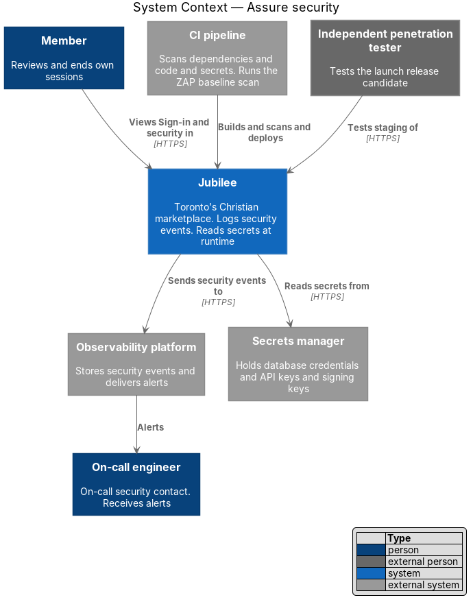
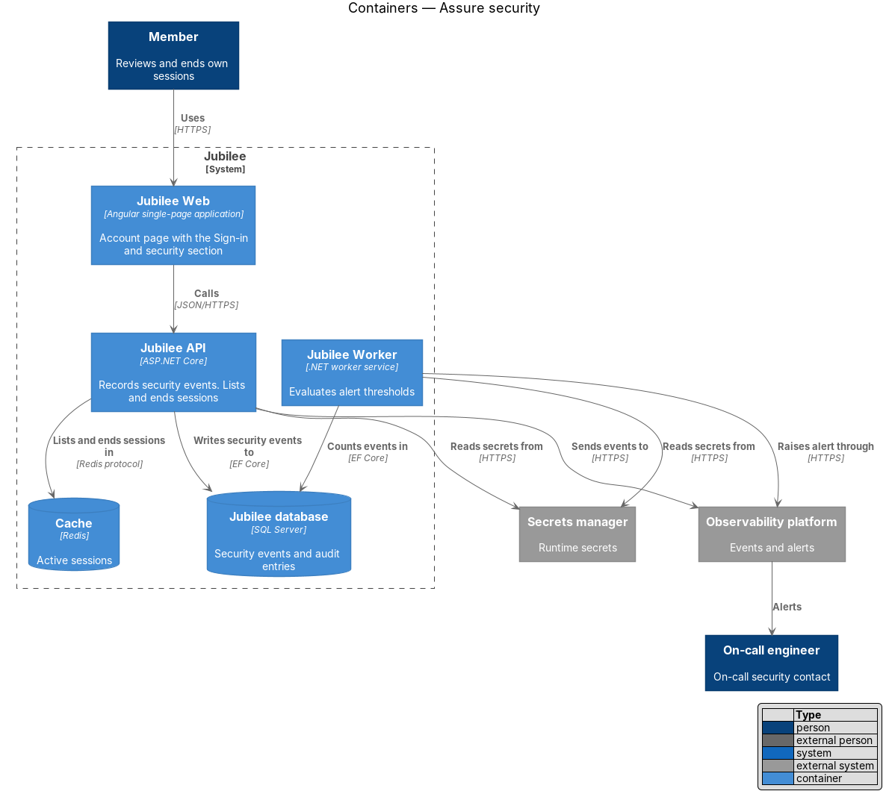
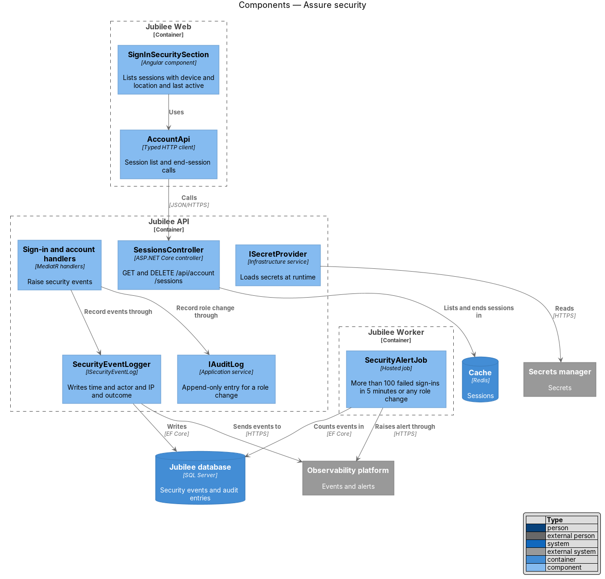
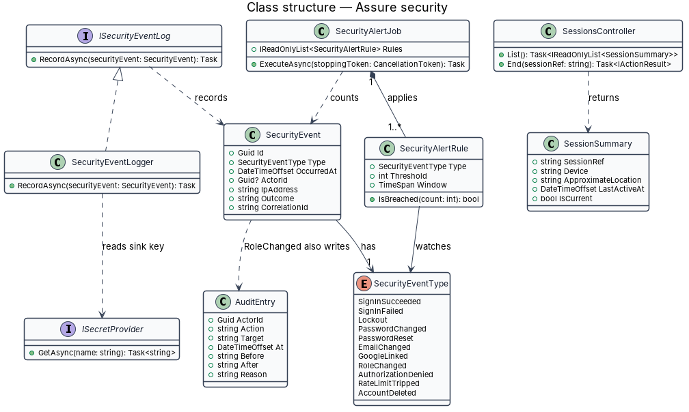
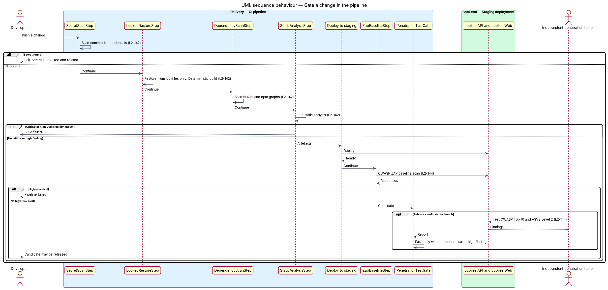
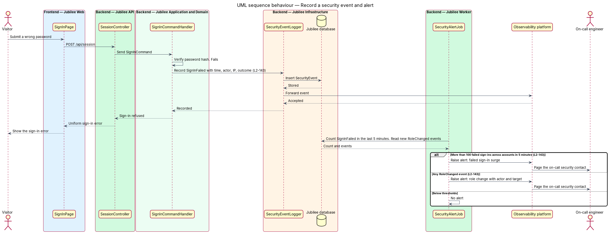
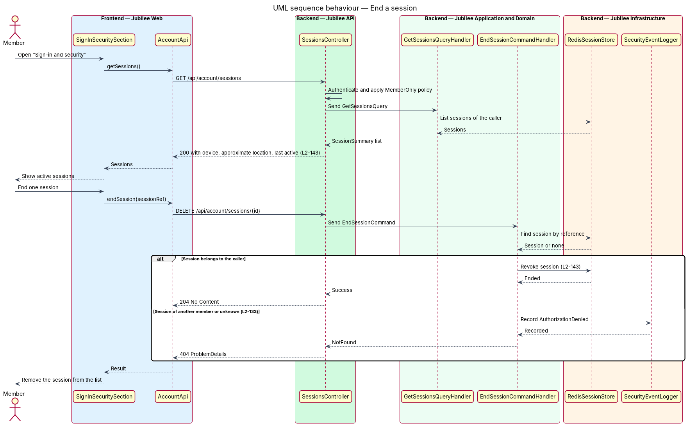

# Assure security

## Overview

Jubilee is Toronto's Christian marketplace. The other security slices describe
controls inside the running product. This feature describes how Jubilee keeps
evidence that those controls hold: checks that every code change passes before
it ships, the handling of secrets, a log of security events with alerts, a
screen where a member reviews their own sessions, and independent testing
before launch.

The design uses five terms. *supply chain* — third-party packages and build
tools that become part of the product. *secret* — credential that grants access
to a system, such as a database password, an API key or a signing key.
*security event* — occurrence that matters for detecting misuse of accounts,
such as a failed sign-in or a role change. *on-call security contact* — person
alerted when a security threshold is crossed. *penetration test* — attack
simulation by an independent tester.

The feature has three parts. The delivery pipeline refuses a change that
contains a known critical or high vulnerability, a committed secret or an
unpinned dependency. The running system records each security event with time,
actor, IP address and outcome, and raises an alert on defined thresholds. A
release candidate for launch ships only when the penetration test has no open
critical or high finding and the OWASP ZAP baseline scan reports no high-risk
alert.

## Description

The slice spans the CI pipeline, the `Jubilee API`, `Jubilee Worker` and the
account page.

- **`DependencyScanStep`** — pipeline step run on every change. It scans the
  NuGet and npm dependency graphs for known vulnerabilities and fails the build
  on a critical or high finding. Tool: `<TO SUPPLY>`.
- **`StaticAnalysisStep`** — pipeline step run on every change. It runs static
  application security testing (SAST) over the C# and TypeScript sources and
  fails the build on a critical or high finding. Tool: `<TO SUPPLY>`.
- **`SecretScanStep`** — check run on every push to every branch. It fails when
  a commit contains a credential pattern. Tool: `<TO SUPPLY>`.
- **`LockedRestoreStep`** — pipeline step that restores from lockfiles only:
  `packages.lock.json` with locked-mode restore for .NET and
  `package-lock.json` with `npm ci` for `Jubilee Web`. A lockfile that does not
  match its manifest fails the build. Deterministic compiler settings make two
  builds of one commit produce identical artefacts.
- **`ISecretProvider`** — infrastructure service that reads database
  credentials, API keys and signing keys from the secrets manager (vendor
  `<TO SUPPLY>`) at start-up and on rotation. Configuration files and the
  repository hold secret names only.
- **`SecretRotationSchedule`** — operations record listing each secret, its
  owner and its last rotation date. Each secret is rotated at least once every
  12 months; a scheduled check alerts when a rotation is overdue.
- **`ISecurityEventLog`** — application service implemented by
  `SecurityEventLogger`. It writes a `SecurityEvent` with time, actor, IP
  address and outcome to the `Jubilee database` and to the
  `Observability platform`.
- **`SecurityEventType`** — enumeration: `SignInSucceeded`, `SignInFailed`,
  `Lockout`, `PasswordChanged`, `PasswordReset`, `EmailChanged`, `GoogleLinked`,
  `RoleChanged`, `AuthorizationDenied`, `RateLimitTripped`, `AccountDeleted`.
- **`SecurityAlertJob`** — hosted job in `Jubilee Worker`. It alerts the
  on-call security contact through the `Observability platform` when more than
  100 `SignInFailed` events across accounts fall within 5 minutes, and for
  every `RoleChanged` event. Evaluation interval: `<TO SUPPLY>`.
- **`IAuditLog`** — a role change also writes an append-only `AuditEntry` with
  before and after values (L2-180).
- **`SessionsController`** — `GET /api/account/sessions` lists the caller's
  active sessions; `DELETE /api/account/sessions/{id}` ends one. Both act only
  on sessions of the caller (L2-133).
- **`SignInSecuritySection`** — section of the account page titled "Sign-in and
  security". It lists each active session with device, approximate location and
  last active time, and offers an action to end it. Approximate location comes
  from the IP address; lookup source `<TO SUPPLY>`.
- **`ZapBaselineStep`** — pipeline step that runs the OWASP ZAP baseline scan
  against the staging deployment and fails on a high-risk alert.
- **`PenetrationTestGate`** — manual release gate for the launch release
  candidate. It passes when the report of an independent penetration test
  covering the OWASP Top 10 and OWASP ASVS Level 2 lists no open critical or
  high finding. Testing firm: `<TO SUPPLY>`.

## Requirements

The feature realizes the following level-2 (L2) requirements. Each L2
requirement refines a level-1 (L1) requirement, cited by identifier.

| L2 ID | Refines (L1) | Requirement |
|-------|--------------|-------------|
| `L2-142` | `L1-019` | The build pipeline shall run dependency vulnerability scanning and static analysis on every change and shall fail on a known critical or high vulnerability. Secrets shall come from a secrets manager at runtime, shall never be committed (secret scanning on every push) and shall be rotated at least yearly; lockfiles shall pin exact dependency versions and builds shall be reproducible. |
| `L2-143` | `L1-019` | The system shall log sign-in success and failure, lockout, password change and reset, e-mail change, Google link, role change, failed authorization, rate-limit trips and account deletion with time, actor, IP and outcome. The system shall alert the on-call security contact on more than 100 failed sign-ins across accounts in 5 minutes or on any role change, and a member shall see active sessions (device, approximate location, last active) under "Sign-in and security" and be able to end any of them. |
| `L2-144` | `L1-019` | A release candidate for launch shall have no open critical or high findings from an independent penetration test covering the OWASP Top 10 and OWASP ASVS Level 2, and the OWASP ZAP baseline scan run in CI against a staging deployment shall report no high-risk alerts. |
| `L2-180` | `L1-025` | The system shall store an append-only audit record of actor, action, target, time, before and after values and reason for sensitive actions, including role changes, and shall keep audit records for 2 years with no edit or delete through the application. |
| `L2-133` | `L1-019` | The server shall check the caller's role and ownership of the specific object on every API endpoint before doing anything. |

## Diagrams

### System context

Members review their sessions in Jubilee. Jubilee sends security events to the
observability platform, which alerts the on-call engineer acting as security
contact.

### Containers

The `Jubilee API` records security events and serves the session list.
`Jubilee Worker` evaluates alert thresholds. Sessions live in the `Cache`, and
events live in the `Jubilee database`.

### Components

`SecurityEventLogger` receives events from the handlers. `SecurityAlertJob`
reads them and raises alerts. `SessionsController` serves
`SignInSecuritySection`, and `ISecretProvider` supplies secrets to both
services.

### Class structure

`ISecurityEventLog` records `SecurityEvent` values typed by
`SecurityEventType`. `SecurityAlertJob` applies `SecurityAlertRule` thresholds,
and `SessionSummary` is the shape the account page shows.

### Behaviour — gate a change in the pipeline

Every push runs the secret scan, the locked restore, the dependency scan and
static analysis. Staging then receives the ZAP baseline scan, and the launch
release candidate waits for the penetration-test gate.

### Behaviour — record a security event and alert

A failed sign-in is logged with time, actor, IP address and outcome. The alert
job counts failures over 5 minutes and alerts the on-call security contact above
100, or on any role change.

### Behaviour — end a session

A member opens "Sign-in and security", sees the active sessions and ends one.
The API ends only a session that belongs to the caller.

