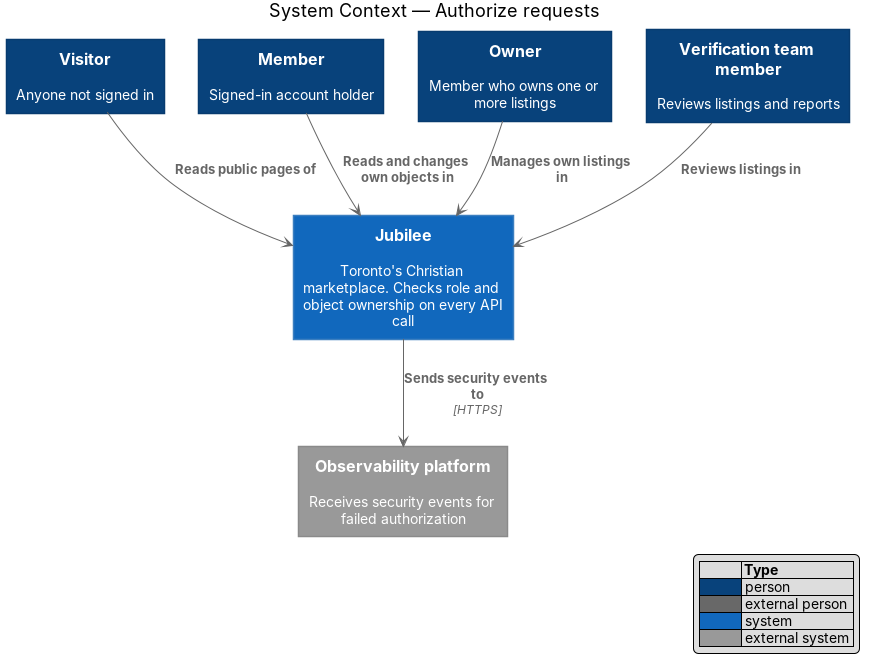
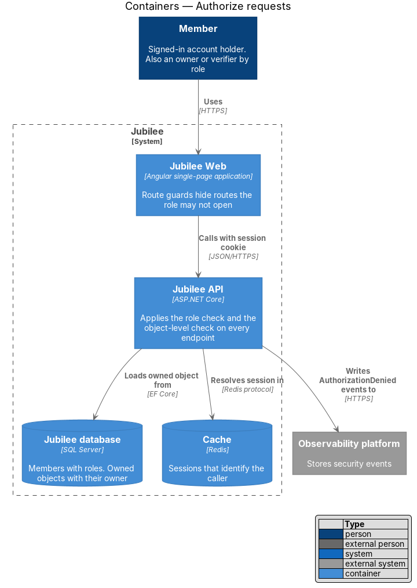
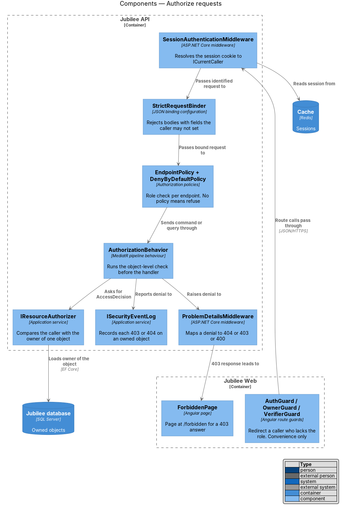
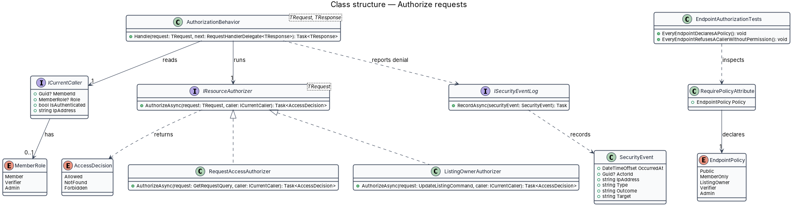
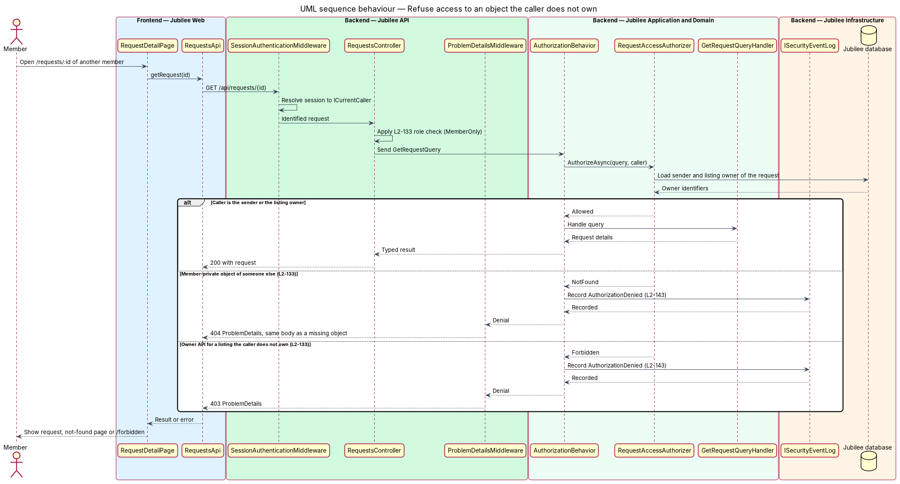
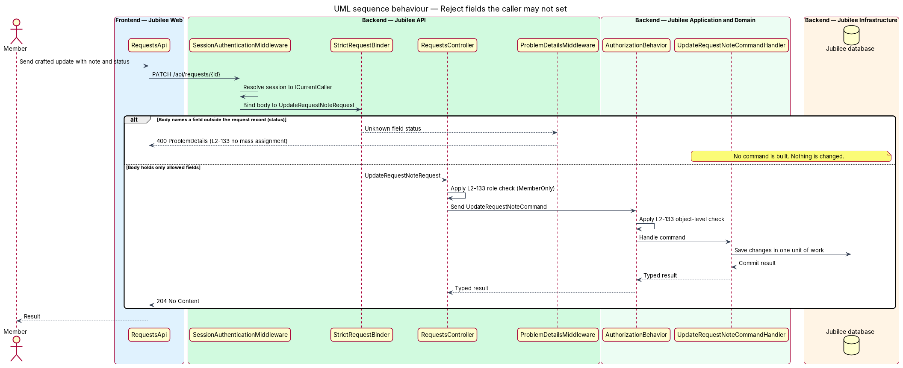

# Authorize requests

## Overview

Jubilee is Toronto's Christian marketplace: a directory of verified
Christian-owned businesses that members message, book and order from. Each
person acts in one of five roles: visitor, member, owner of a listing, verifier
and admin. This feature is the server-side rule that decides, for each call to
the `Jubilee API`, whether the caller may perform the action on the specific
object named in the request.

The design uses two terms. *role check* — comparison of the caller's role with
the policy declared on an endpoint. *object-level check* — comparison of the
caller's identity with the owner or participants of the one object the request
names. Both checks run on the server before any state is read for the response
or written. Route guards and hidden controls in `Jubilee Web` improve the
experience only; no check relies on them.

A refusal takes one of three forms. A member who asks for another member's
private object (request, conversation, saved list, profile or notification)
receives `404`, so the response does not confirm that the object exists. An
owner who calls an owner API for a listing owned by someone else receives `403`.
An update that carries a field the caller may not set receives `400` and changes
nothing. Each refusal on an owned object is written to the security event log.

The feature is cross-cutting: every other slice declares a policy on its
endpoints and an authorizer for its commands and queries, and inherits the
behaviour described here.

## Description

The slice runs from the Angular route guards to the MediatR pipeline and the
automated test suite.

- **`AuthGuard`, `OwnerGuard`, `VerifierGuard`** — Angular route guards in
  `Jubilee Web`. They redirect a caller who lacks the role for a route. They are
  a convenience and carry no security weight.
- **`SessionAuthenticationMiddleware`** — middleware in `Jubilee.Api`. It
  resolves the session cookie to an `ICurrentCaller`, or to an anonymous caller
  with the role `Visitor`.
- **`ICurrentCaller`** — scoped service that exposes `MemberId`, `Role`
  (`MemberRole`) and `IsAuthenticated` to policies and authorizers.
- **`EndpointPolicy`** — enumeration of the role policies an endpoint may
  declare: `Public`, `MemberOnly`, `ListingOwner`, `Verifier`, `Admin`. Each
  controller action carries exactly one `[RequirePolicy(EndpointPolicy.X)]`
  attribute.
- **`DenyByDefaultPolicy`** — the ASP.NET Core fallback authorization policy. An
  endpoint that declares no policy refuses every caller, so a forgotten
  attribute fails closed.
- **`AuthorizationBehavior<TRequest, TResponse>`** — MediatR pipeline behaviour
  in `Jubilee.Application`. It resolves the `IResourceAuthorizer<TRequest>` for
  the command or query and runs it before the handler. A request type without a
  registered authorizer fails at start-up.
- **`IResourceAuthorizer<TRequest>`** — object-level check for one command or
  query. Examples: `RequestAccessAuthorizer` (the caller is the member who sent
  the `Request` or the owner of its `Listing`), `ConversationAccessAuthorizer`,
  `ListingOwnerAuthorizer` (the caller's `MemberId` equals `Listing.OwnerId`).
- **`AccessDecision`** — result of an authorizer: `Allowed`, `NotFound` or
  `Forbidden`. Member-private objects map a failed check to `NotFound` (`404`);
  owner APIs for a listing the caller does not own map it to `Forbidden`
  (`403`).
- **`StrictRequestBinder`** — JSON binding configuration for request bodies.
  Each endpoint binds to a request record that lists only the fields the caller
  may set. A body that names any other field, for example `status`, `verified`,
  `role`, `ownerId` or `price` on a request, is rejected with `400` before the
  command is built.
- **`ISecurityEventLog`** — application service that records an
  `AuthorizationDenied` event with time, actor, IP address and outcome for each
  `403` or `404` on an owned object (L2-143).
- **`ProblemDetailsMiddleware`** — converts each refusal into an RFC 9457
  `ProblemDetails` body with the correlation ID. The `404` body is identical to
  the body for an object that does not exist.
- **`EndpointAuthorizationTests`** — integration test fixture. It reads every
  route from the API's `EndpointDataSource` and fails when a route has no test
  case in which a caller without permission is refused. The fixture also holds
  those test cases.
- **`ForbiddenPage`** — page at `/forbidden` that `Jubilee Web` shows when the
  API answers `403`.

## Requirements

The feature realizes the following level-2 (L2) requirements. Each L2
requirement refines a level-1 (L1) requirement, cited by identifier.

| L2 ID | Refines (L1) | Requirement |
|-------|--------------|-------------|
| `L2-133` | `L1-019` | The server shall check the caller's role and ownership of the specific object on every API endpoint before doing anything, shall answer `404` for another member's private object, `403` for an owner API on a listing the caller does not own and `400` for an update carrying fields the caller may not set, and shall have at least one automated test per endpoint proving a caller without permission is refused. |
| `L2-143` | `L1-019` | The system shall log security events, including failed authorization (`403`/`404` on owned objects), with time, actor, IP and outcome, shall alert the on-call security contact on defined thresholds, and shall let a member view and end active sessions. |

## Diagrams

### System context

Each role reaches Jubilee through the same API. Jubilee decides every call on
the server and sends security events to the observability platform.

### Containers

`Jubilee Web` sends each call with the session cookie. The `Jubilee API` reads
the session from the `Cache`, loads the owned object from the `Jubilee database`
and decides.

### Components

Route guards sit in `Jubilee Web`. Inside the `Jubilee API`, the middleware
identifies the caller, the endpoint policy applies the role check, and
`AuthorizationBehavior` applies the object-level check before the handler runs.

### Class structure

`AuthorizationBehavior` depends on `ICurrentCaller` and one
`IResourceAuthorizer` per request type. Each authorizer returns an
`AccessDecision`, and a denial becomes a `SecurityEvent`.

### Behaviour — refuse access to an object the caller does not own

A member asks for a request by ID. The role check passes, the object-level check
fails, the attempt is logged, and the API answers `404`. The alternate branch
shows the `403` for an owner API on a listing the caller does not own.

### Behaviour — reject fields the caller may not set

An update names the field `status`. `StrictRequestBinder` rejects the body with
`400` before any command is built, and nothing is changed.

