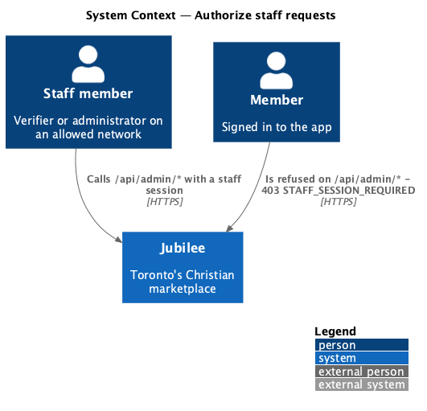
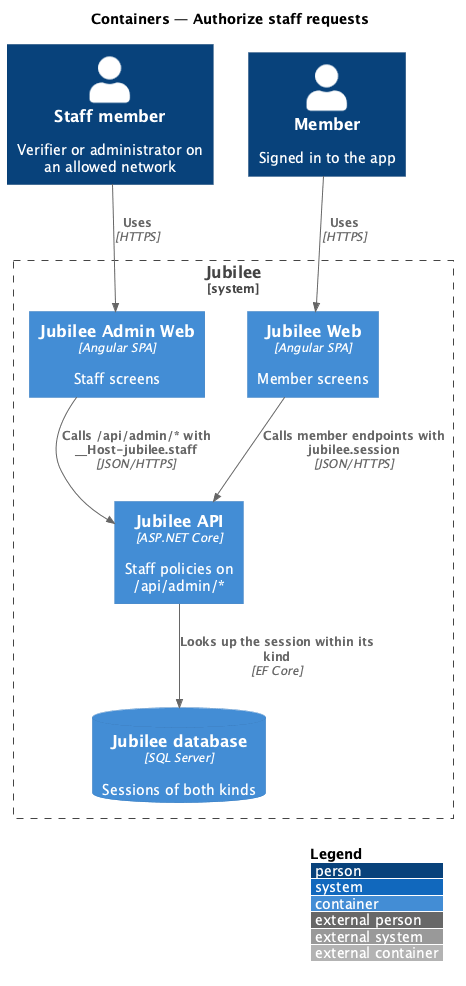
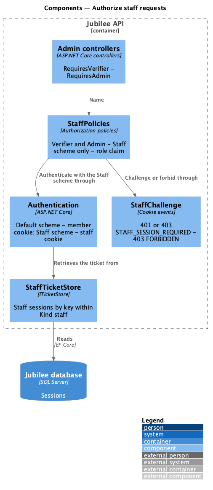
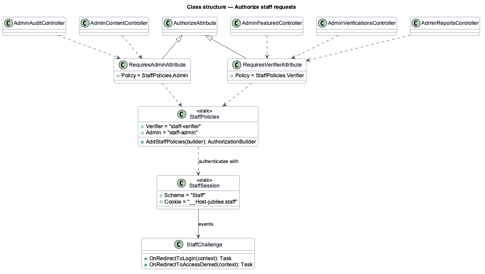
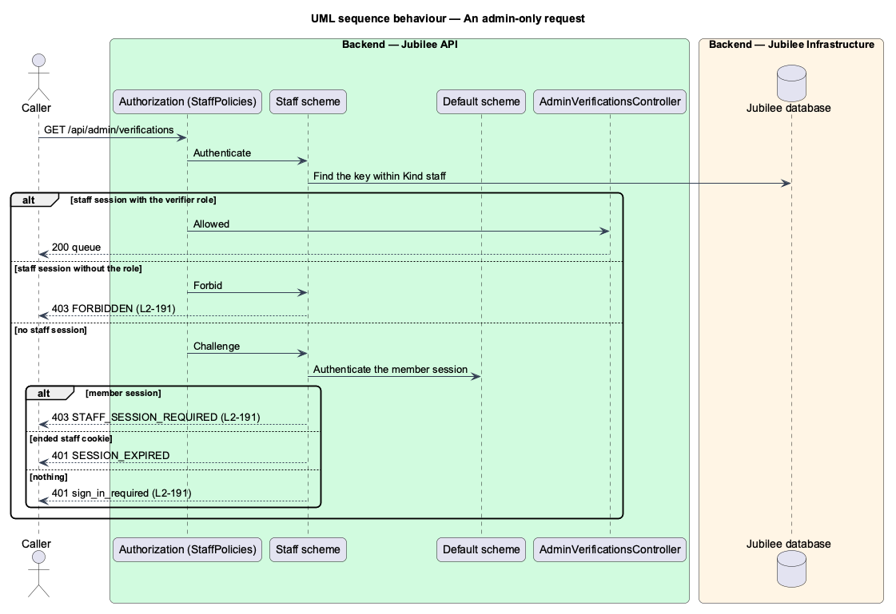

# Authorize staff requests

## Overview

The *admin-only endpoints* are the endpoints of the verification team and of
administrators under `/api/admin/*`: the verification queue and decisions, the
reports and their actions, the featured businesses, the audit search and the
policy-page versions. This feature narrows the role check of
`security/authorize-requests` for them: they answer only a *staff session*
(`accounts/sign-in-as-staff`), never a member session, whatever the member
session carries (`L2-191`). The verification and moderation rules behind the
endpoints are unchanged.

## Description

- **`Staff` authentication scheme** — the cookie scheme of staff sessions. The
  default scheme stays the members' cookie, so a staff session never
  authenticates a member endpoint and a member session never authenticates a
  staff endpoint.
- **`StaffPolicies`** — two authorization policies, `StaffPolicies.Verifier` and
  `StaffPolicies.Admin`. Each names `Staff` as its only authentication scheme
  and requires the `role` claim `verifier` or `admin`.
- **`RequiresVerifierAttribute`** and **`RequiresAdminAttribute`** — the
  existing attributes become `AuthorizeAttribute`s with those policies. They
  sit on `AdminVerificationsController`, `AdminAuditController`,
  `AdminReportsController`, `AdminFeaturedController` and
  `AdminContentController`; because each carries authorization data, the
  fallback policy of the default scheme does not apply to them.
- **`StaffChallenge`** — the `Staff` scheme's challenge and forbid handlers.
  A challenge first authenticates the default scheme: a member session answers
  403 with `code` `STAFF_SESSION_REQUIRED` and the title "This is for the
  Jubilee staff." A request with an ended staff cookie answers 401
  `SESSION_EXPIRED`, and any other 401 `sign_in_required`. A forbid (a staff
  session without the role) answers 403 `FORBIDDEN`. Every refusal is
  ProblemDetails and is logged as a failed authorization with the actor,
  address, method and path (ADR 0020).
- **`ViewerClaims.ToViewer`** — builds the `Viewer` from the claims of the
  principal; on the admin-only endpoints that principal is the staff session,
  whose subject is the matching member's id or `staff|{id}` (ADR 0040).

## Requirements

The feature realizes the following level-2 (L2) requirements. Each L2
requirement refines a level-1 (L1) requirement, cited by identifier.

| L2 ID | Refines (L1) | Requirement |
|-------|--------------|-------------|
| `L2-191` | `L1-019` | The admin-only endpoints shall answer 401 `sign_in_required` without a session, 403 `STAFF_SESSION_REQUIRED` to a member session whatever it carries, and 403 `FORBIDDEN` to a staff session without the role; a staff session shall never be treated as a member session; every admin-only endpoint shall have a test that a member session is refused. |
| `L2-098` | `L1-014` | A caller without a staff session holding the `verifier` role shall be refused by every admin API as `L2-191` states. |
| `L2-133` | `L1-019` | Every endpoint shall check the caller's role and ownership on the server before doing anything, and every endpoint shall have a test proving that a caller without permission is refused. |

## Diagrams

### System context

Members and staff call the same API; only staff, signed in to the admin
application, reach the admin-only endpoints.

### Containers

`Jubilee API` reads the staff session from the `Jubilee database` on each
admin-only request.

### Components

The admin controllers carry the staff policies; the `Staff` scheme
authenticates and its challenge tells a member session from no session.

### Class structure

`RequiresVerifierAttribute` and `RequiresAdminAttribute` name the policies that
`StaffPolicies` registers against the `Staff` scheme.

### Behaviour — an admin-only request

A staff session with the role reaches the controller; a member session, no
session and a staff session without the role are refused before it
(`L2-191`).

