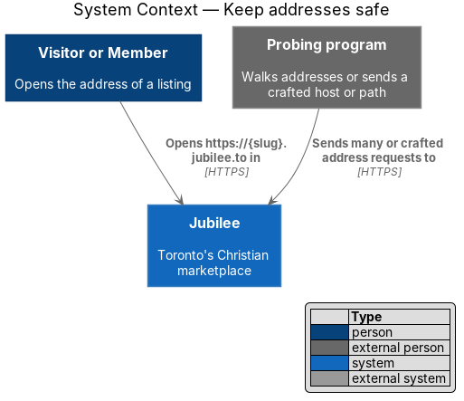
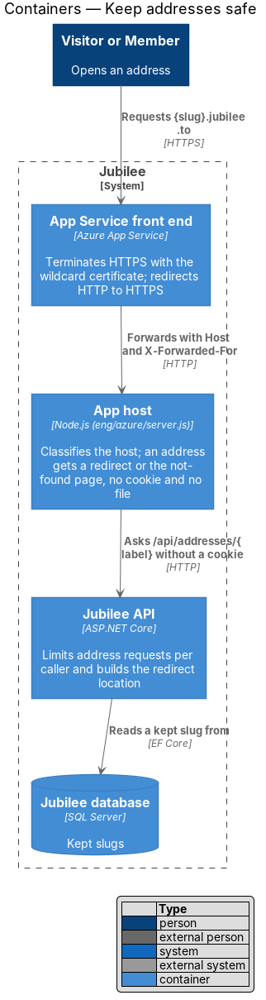
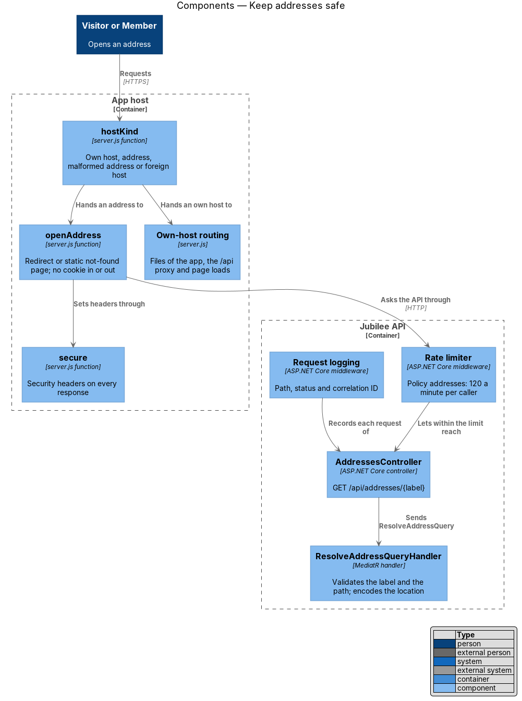
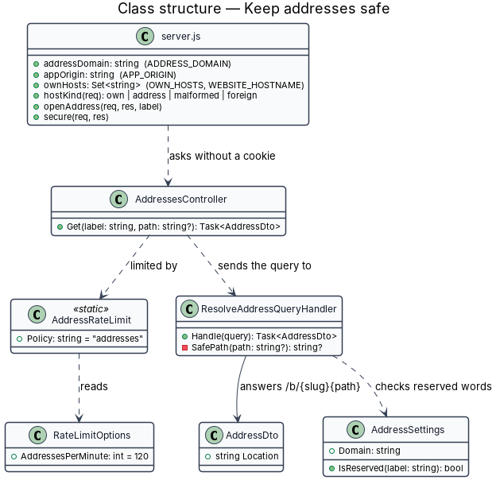
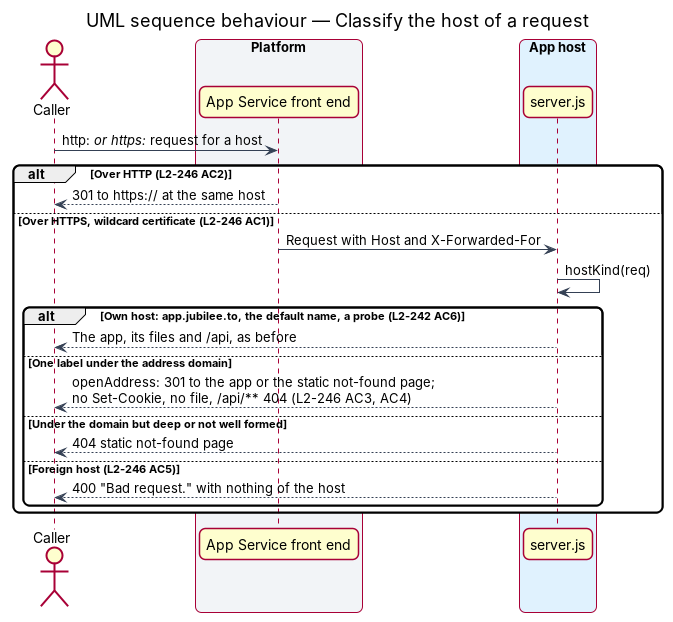
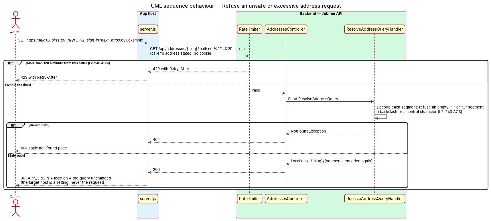

# Keep addresses safe

## Overview

Jubilee is Toronto's Christian marketplace. Every published listing has the
address `https://{slug}.jubilee.to`, so Jubilee answers a host name for each
listing under its own domain. This feature covers the safeguards that keep
those host names from weakening a member's session, the app's origin rules or a
listing's privacy.

A host name per listing brings risks that a path under one host does not. A
cookie scoped to the whole domain would reach every address. An address that
served the app would be a second origin of the app. A redirect built from the
request could send a person to another site. A program could walk addresses to
list every business. The safeguards below close each of these.

The feature uses the following local terms.

- **address** — the public link `https://{slug}.{domain}` of a published listing
- **address domain** — the domain addresses sit under (`jubilee.to` in production)
- **own host** — a host name Jubilee serves itself (`www.jubilee.to`, `app.jubilee.to`, `admin.jubilee.to`)
- **foreign host** — a host name that is neither an own host nor under the address domain
- **app host** — the Node.js program (`eng/azure/server.js`) that answers the app's host and every address
- **open redirect** — a redirect whose target a caller can choose
- **wildcard certificate** — one TLS certificate valid for every label directly under a domain

The safeguards sit in the app host, in `Jubilee API` and in the deployment
(ADR 0071). The redirect itself is designed in
[Open a listing by its address](../../listings/open-listing-by-address/README.md).

## Description

- **Host classification** — `hostKind(req)` in `server.js` runs before any
  other routing when `ADDRESS_DOMAIN` is set. An own host is one of
  `OWN_HOSTS`, the App Service default name (`WEBSITE_HOSTNAME`), a loopback
  name or an IP literal, which is how the platform's probes arrive. A foreign
  host is answered 400 "Bad request." and the answer repeats nothing of the
  request.
- **An address answers a redirect or the not-found page only** — on an address,
  `server.js` reaches neither the static files of the app nor the `/api` proxy.
  `/api/**`, every method other than `GET` and `HEAD`, and every label that is
  not well formed answer the static not-found page with 404.
- **No cookie on an address** — `openAddress` sets no `Set-Cookie` and, unlike
  a page load, forwards no `Cookie` to the API. The member session stays in
  `__Host-jubilee.session` on the app's host and the staff session in
  `__Host-jubilee.staff` on the admin application's host (ADR 0046, ADR 0040).
  A `__Host-` cookie cannot carry a `Domain`, so a browser never sends either
  to an address.
- **The redirect target is built, not copied** — the target is `APP_ORIGIN`, a
  setting, followed by the location `ResolveAddressQueryHandler` answers, which
  always begins `/b/{label or current slug}`. The handler decodes each path
  segment and encodes it again, and answers 404 for an empty segment (`//`), a
  `.` or `..` segment, a backslash or a control character. The host accepts a
  location only when it begins with `/b/`, and appends the query of the request
  unchanged; a query cannot change the host or the path of the target.
- **Rate limit** — the policy `addresses` on `AddressesController` allows 120
  requests a minute per caller (`RateLimitOptions.AddressesPerMinute`), counted
  on the caller's address as the host states it. Further requests answer 429
  with `Retry-After`, which the host passes on.
- **Origin rules** — unchanged. The API has no CORS allowlist (ADR 0046), so a
  request from an address is refused like any other origin. Return URLs accept
  a path of the app only (`L2-012` AC3), so an address is never a return URL or
  a redirect address of sign-in.
- **Text only** — the app renders a slug and an address through Angular
  interpolation and attribute binding, which encode them; the static not-found
  page holds nothing of the request.
- **Headers** — `secure(req, res)` sets `X-Content-Type-Options`,
  `Referrer-Policy`, `X-Frame-Options` and, over HTTPS, `Strict-Transport-
  Security` on every address response, as on every other response of the host.
- **Log** — the API's request log records the path `/api/addresses/{label}`,
  the status and the correlation ID the host passes. A label is a public slug;
  the log holds no cookie, no query and no personal data.
- **Certificate and HTTPS** — deployment properties (`eng/azure/README.md`). A
  wildcard DNS record `*.jubilee.to` points at the app's App Service, one
  wildcard certificate is bound to it, and "HTTPS only" redirects HTTP to HTTPS
  at the same address before the host sees the request. The source of the
  certificate and its renewal job are `<TO SUPPLY>` by the owner; an expiry
  alert 30 days ahead is set on it (`L2-176`). Addresses stay switched off
  (`Addresses:Domain` empty) until these exist.

## Requirements

The feature realizes the following level-2 (L2) requirements. Each L2
requirement refines a level-1 (L1) requirement, cited by identifier.

| L2 ID | Refines (L1) | Requirement |
|-------|--------------|-------------|
| `L2-246` | `L1-019` | An address shall answer over HTTPS with a trusted certificate as soon as its listing is published, and HTTP shall redirect to HTTPS. An address shall set no cookie and read none. An address shall answer a redirect or the not-found page and nothing else, and `/api/**` under an address shall answer 404. A host that is neither an own host nor one well-formed label under the address domain shall be refused with 400 without repeating the host. The redirect target shall always be on the app's host under `/b/{slug}`, and a path that tries to leave it shall answer 404. No address shall be an allowed origin, a return URL or a redirect address of sign-in. More than 120 addresses from one caller within a minute shall be refused with 429 and `Retry-After`. A slug or an address shall be shown as text. The log of a redirect shall hold the label, the status and the correlation ID and no personal data. |
| `L2-242` | `L1-032` | A request for a host name Jubilee serves itself shall be answered as that host and never as a listing's address. |
| `L2-135` | `L1-019` | Session cookies shall be host-only, and the API shall allow no other origin. |
| `L2-137` | `L1-019` | A caller over a rate limit shall be refused with 429 and `Retry-After`. |
| `L2-139` | `L1-019` | Every response shall carry the security headers. |

## Diagrams

### System context

A person, or a program that probes addresses, reaches Jubilee by a host name
under the address domain.

### Containers

The platform terminates HTTPS with the wildcard certificate. The app host
classifies the host name, and `Jubilee API` limits and resolves addresses.

### Components

`hostKind` separates own hosts, addresses and foreign hosts before any file or
proxy is reached. The rate limiter stands in front of `AddressesController`.

### Class structure

The settings of the host and of the API that bound what an address can do.

### Behaviour — classify the host of a request

Each request is answered as an own host, as an address, or refused.

### Behaviour — refuse an unsafe or excessive address request

A path that tries to leave the listing's page answers 404, and a caller over
the limit answers 429.

