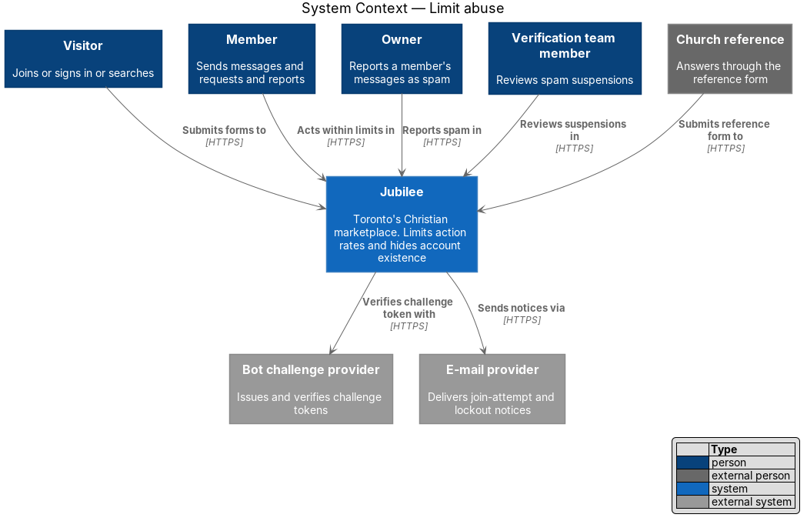
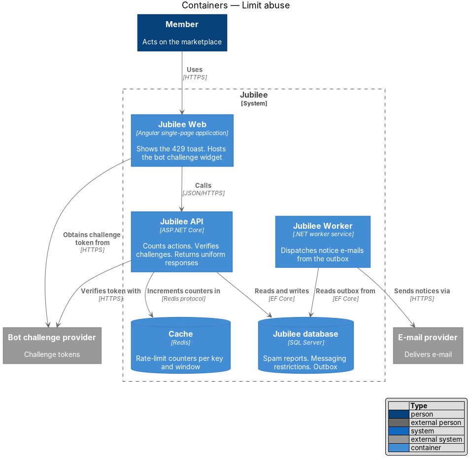
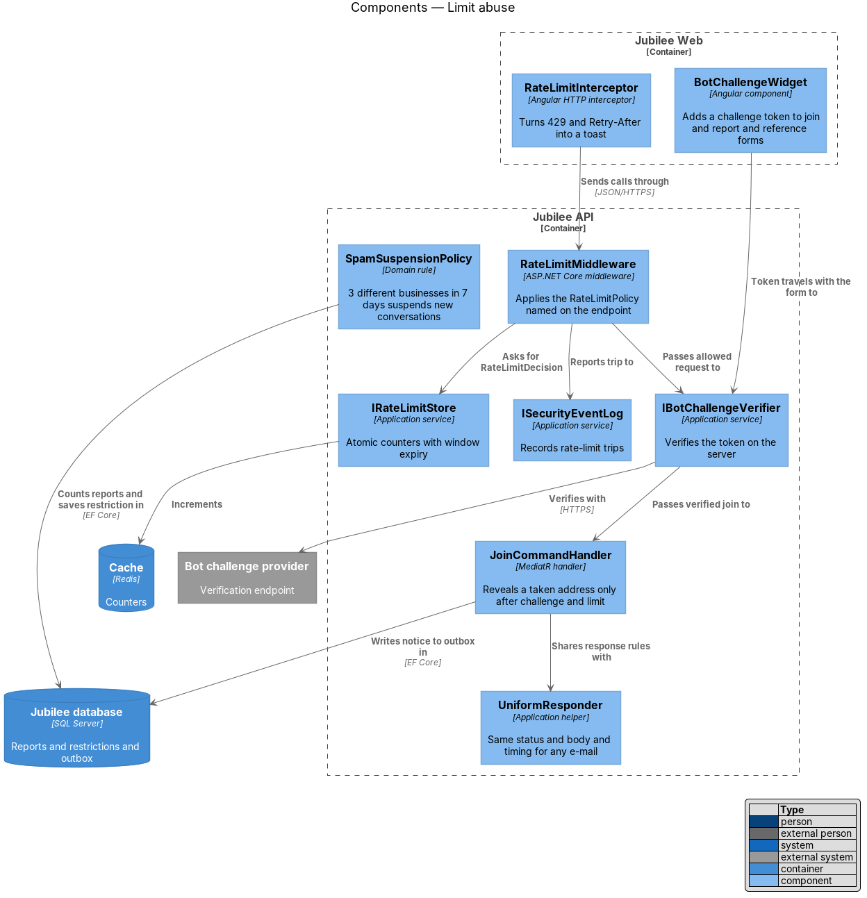
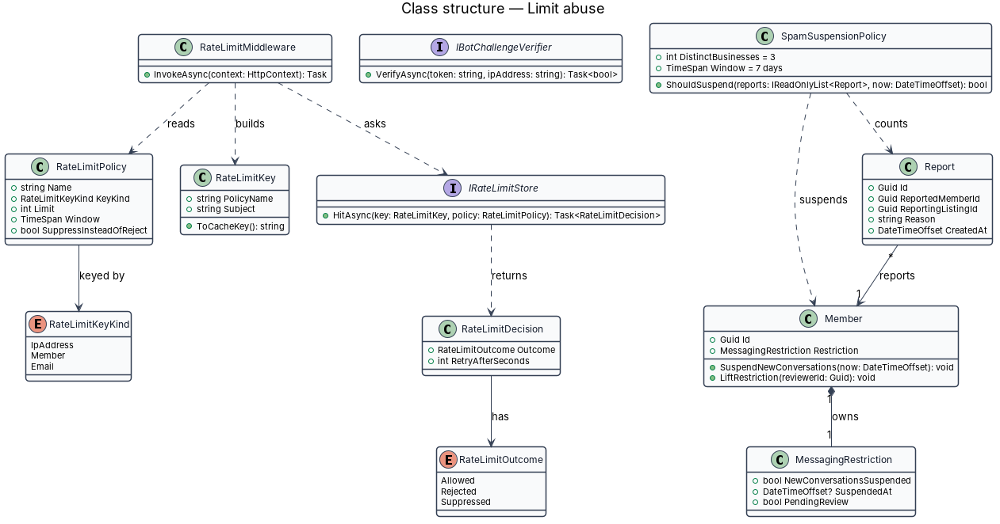
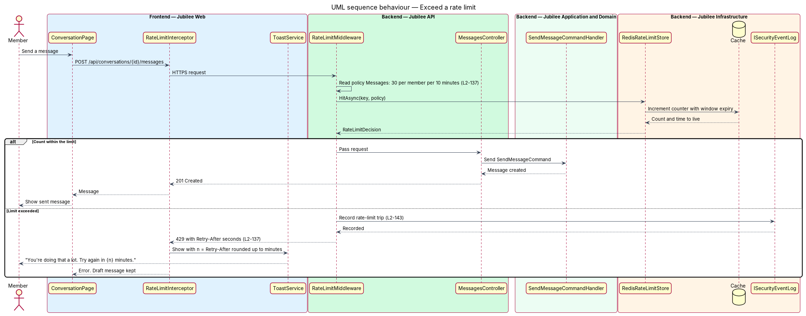
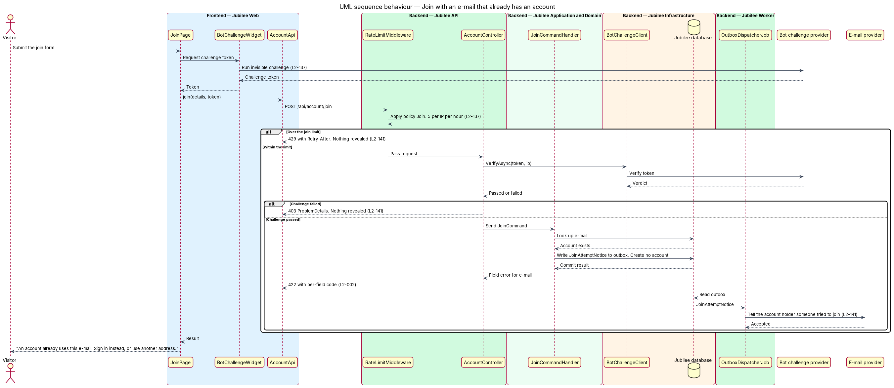
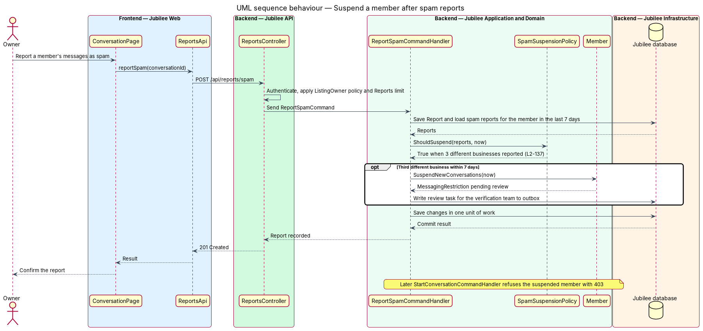

# Limit abuse

## Overview

Jubilee is Toronto's Christian marketplace. Its forms and endpoints are open to
the internet, so automated clients can try to guess passwords, flood businesses
with messages, create fake accounts, or learn which e-mail addresses have
accounts. This feature bounds how often each action may happen, places a bot
challenge on the forms a signed-out person can submit, suspends a member whose
messages are reported as spam, and keeps account existence private.

The design uses four terms. *rate limit* — maximum count of one action for one
key (IP address, member or e-mail address) within a time window. *bot
challenge* — check supplied by the `Bot challenge provider` that separates
people from scripts, invisible to most users and accessible to all. *spam
suspension* — block on starting new conversations, placed on a member pending
review. *account enumeration* — discovery of whether an e-mail address has an
account by comparing the responses for known and unknown addresses.

A request over a limit receives `429` with a `Retry-After` header, and the UI
shows "You're doing that a lot. Try again in {n} minutes." Sign-in,
forgot-password and e-mail-change endpoints return the same status, body shape
and timing for an existing and a non-existing address. The join form reveals
that an address is taken only after the bot challenge passes and within the join
limit, and the existing account holder is told by e-mail.

The feature is cross-cutting: the join, sign-in, messaging, request, report,
search and church-reference slices each name a policy from the table held here.

## Description

The slice runs from the Angular HTTP interceptor to the counters in the `Cache`
and the outbox in the `Jubilee database`.

- **`RateLimitPolicy`** — named limit with a key kind, a count and a window.
  The table holds: `Join` 5 per IP per hour; `PasswordReset` 3 per e-mail per
  hour; `ConfirmationResend` 5 per hour; `Messages` 30 per member per
  10 minutes; `NewConversations` 10 per member per day; `Requests` (booking,
  quote, order) 20 per member per day; `Reports` 10 per member per day;
  `Search` 60 per IP per minute; `SignIn` per L2-007 (5 failures per account
  and 20 failures per IP in 15 minutes); `ReferenceResend` per L2-080 (3 per
  24 hours).
- **`RateLimitMiddleware`** — middleware in `Jubilee.Api`. It reads the policy
  named on the endpoint by `[RateLimit(...)]`, builds the `RateLimitKey` and
  asks the store for a decision before the controller runs.
- **`IRateLimitStore`** — application service implemented by
  `RedisRateLimitStore`. It counts hits per key in the `Cache` with an atomic
  increment and an expiry equal to the window, and returns a
  `RateLimitDecision` with the seconds until the window frees a slot.
- **`RateLimitDecision`** — `Allowed`, `Rejected` or `Suppressed`. `Rejected`
  becomes `429` with `Retry-After` in seconds. `Suppressed` applies to
  `PasswordReset`: the endpoint returns its normal success response and sends no
  e-mail (L2-008), so the limit does not reveal anything about the address.
- **`RateLimitInterceptor`** — Angular HTTP interceptor. On `429` it reads
  `Retry-After`, rounds up to whole minutes and asks `ToastService` to show
  "You're doing that a lot. Try again in {n} minutes."
- **`BotChallengeWidget`** — Angular component on the join page (`/join`), the
  report dialog and the church-reference form (`/reference/:token`). It obtains
  a challenge token from the `Bot challenge provider` and adds it to the
  submission.
- **`IBotChallengeVerifier`** — application service implemented by
  `BotChallengeClient`. It verifies the token with the provider on the server.
  A failed verification ends the request with `403` before any handler runs.
  Vendor: `<TO SUPPLY>`.
- **`UniformResponder`** — helper used by the sign-in, forgot-password and
  e-mail-change handlers. It returns one status and one body shape for existing
  and non-existing addresses. Sign-in verifies a fixed dummy Argon2id hash when
  no account exists; forgot-password and e-mail-change move e-mail sending to
  the outbox, so both paths do the same work inside the request.
- **`JoinCommandHandler` existing-address branch** — reached only after the bot
  challenge and the `Join` limit pass. It returns the field error of L2-002,
  "An account already uses this e-mail. Sign in instead, or use another
  address.", creates nothing, and writes a `JoinAttemptNotice` e-mail for the
  existing account holder to the outbox.
- **`SpamSuspensionPolicy`** — domain rule evaluated when a business reports a
  member's messages as spam. When 3 different businesses have reported the
  member within 7 days, the third report calls
  `Member.SuspendNewConversations`.
- **`MessagingRestriction`** — value on `Member` that records the suspension,
  its start time and its review state. `StartConversationCommandHandler`
  refuses a suspended member with `403`. The verification team lifts or
  confirms the restriction.
- **`ISecurityEventLog`** — records each rate-limit trip with time, actor, IP
  address and outcome (L2-143).
- **`EnumerationTimingTest`** — automated test that sends 100 requests each for
  an existing and a non-existing address to each of the three endpoints and
  fails when the median times differ by 50 ms or more.

## Requirements

The feature realizes the following level-2 (L2) requirements. Each L2
requirement refines a level-1 (L1) requirement, cited by identifier.

| L2 ID | Refines (L1) | Requirement |
|-------|--------------|-------------|
| `L2-137` | `L1-019` | The server shall respond 429 with `Retry-After` when a defined limit is exceeded (join, sign-in, password reset, confirmation resend, messages, new conversations, requests, reports, search, reference resends), and the UI shall show "You're doing that a lot. Try again in {n} minutes." The join, report and church-reference forms shall be protected by a privacy-respecting, accessible bot challenge, and a member reported for spam by 3 different businesses within 7 days shall be suspended from starting new conversations pending review. |
| `L2-141` | `L1-019` | Sign-in, forgot-password and e-mail-change endpoints shall return the same status, body shape and timing for existing and non-existing e-mails. Join with an existing e-mail shall show the inline message of L2-002 only after the bot challenge passes and within the join rate limit, and shall e-mail the existing account holder that someone tried to join with their address. |
| `L2-007` | `L1-001` | Repeated failed sign-ins shall be slowed and then temporarily blocked to stop password guessing. |
| `L2-008` | `L1-001` | A visitor shall be able to ask for a password reset link at `/forgot-password`, and the response shall be the same whether or not an account exists. |
| `L2-143` | `L1-019` | The system shall log security events, including rate-limit trips, with time, actor, IP and outcome. |

## Diagrams

### System context

Visitors, members and owners act on Jubilee within limits. Jubilee verifies bot
challenges with the provider and sends notices through the e-mail provider.

### Containers

The `Jubilee API` keeps counters in the `Cache` and suspension state in the
`Jubilee database`. `Jubilee Worker` dispatches the notice e-mail from the
outbox.

### Components

`RateLimitMiddleware` and `IBotChallengeVerifier` run before the handlers.
`UniformResponder` and `SpamSuspensionPolicy` act inside them. In
`Jubilee Web`, `RateLimitInterceptor` turns a `429` into the toast.

### Class structure

`RateLimitMiddleware` reads a `RateLimitPolicy` and asks `IRateLimitStore` for a
`RateLimitDecision`. `SpamSuspensionPolicy` sets a `MessagingRestriction` on
`Member`.

### Behaviour — exceed a rate limit

A member sends a message beyond 30 in 10 minutes. The middleware rejects the
request with `429`, logs the trip, and the interceptor shows the toast.

### Behaviour — join with an e-mail that already has an account

The join limit and the bot challenge run first. Only then does the handler
reveal that the address is taken, and the account holder receives a notice
e-mail.

### Behaviour — suspend a member after spam reports

The third spam report from a different business within 7 days suspends the
member's ability to start conversations until the verification team reviews it.

