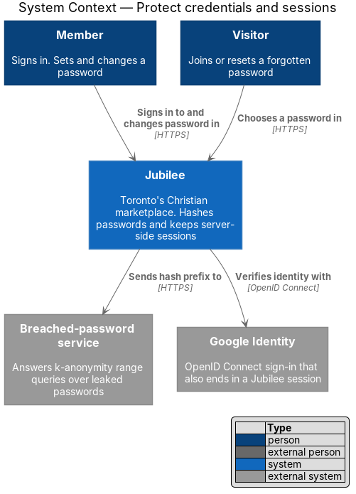
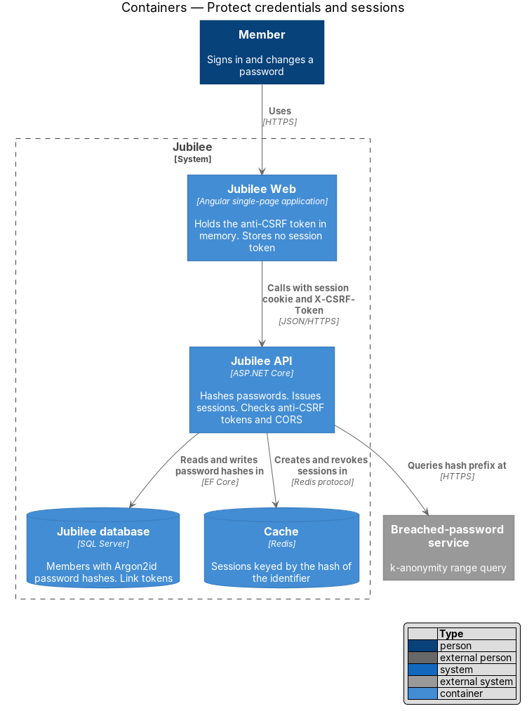
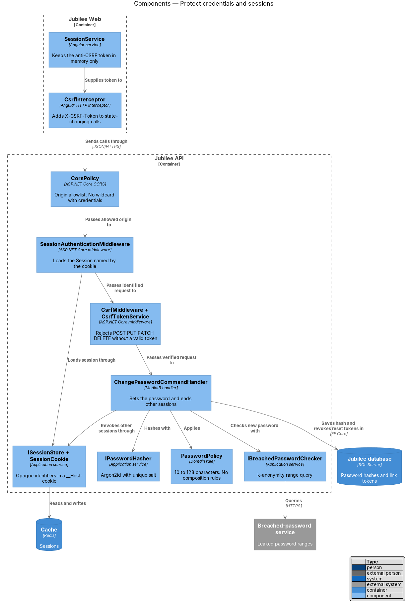
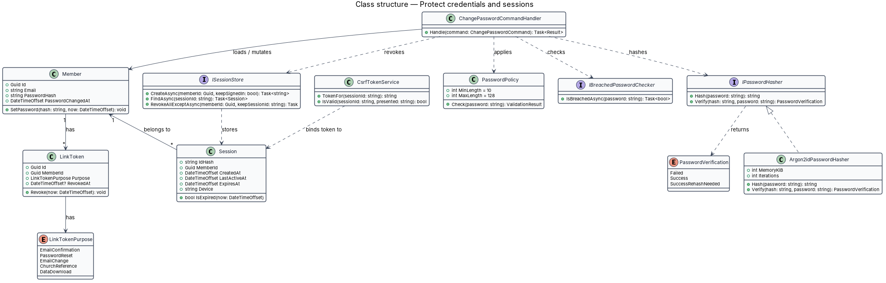
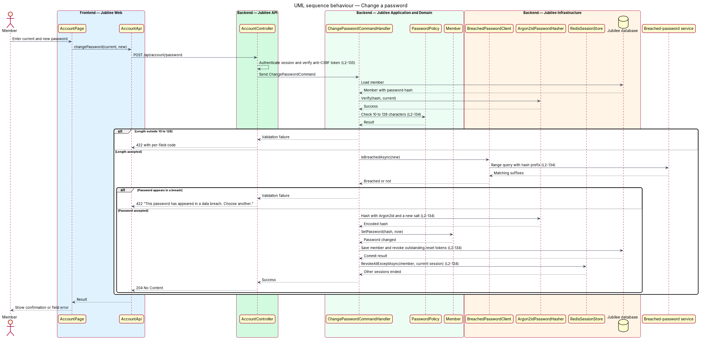
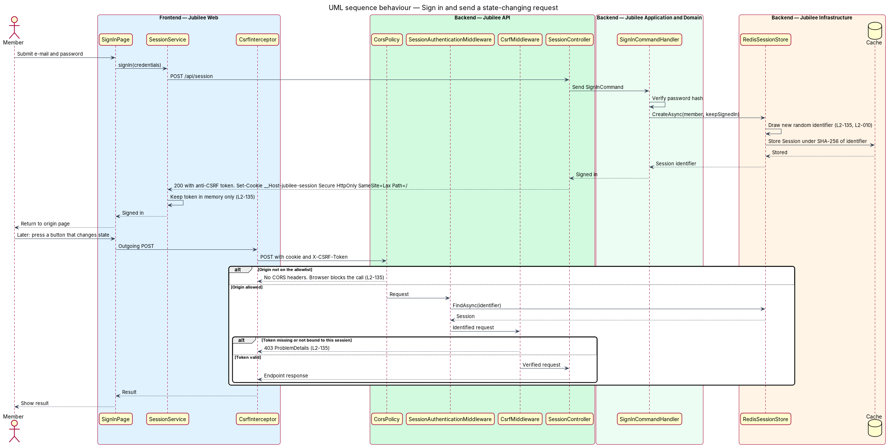

# Protect credentials and sessions

## Overview

Jubilee is Toronto's Christian marketplace. A member signs in with an e-mail
address and a password, or with Google, and then holds a signed-in session. This
feature defines how the `Jubilee API` stores passwords, how it issues and
recognises sessions, and how it refuses requests that a member's browser sends
without the member's intent.

The design uses four terms. *password hash* — one-way Argon2id digest of a
password, stored with its own salt and parameters. *breached password* —
password that appears in a published list of leaked passwords. *session* —
server-side record of a signed-in browser, found by an opaque random identifier
held in a cookie. *anti-CSRF token* — value bound to one session that a
state-changing request shall present, which a page on another site cannot read.

A plain password exists only in memory for the duration of one request. It never
reaches logs, analytics or error reports. The session identifier lives only in a
cookie that script cannot read; `Jubilee Web` stores no session token in
`localStorage`. A change of password ends every other session of the account and
cancels every outstanding reset link.

The feature is cross-cutting. The join, sign-in, reset-password and account
slices call the building blocks below; every state-changing endpoint of every
slice passes through `CsrfMiddleware`.

## Description

The slice runs from the Angular HTTP interceptor to the session store in the
`Cache`.

- **`PasswordPolicy`** — domain rule for a new password: 10 to 128 characters,
  any Unicode characters including spaces, no composition rules. A password
  outside the range fails validation with `422` and a per-field code.
- **`IBreachedPasswordChecker`** — application service implemented by
  `BreachedPasswordClient`. It sends only a prefix of the password's hash to the
  `Breached-password service` (k-anonymity range query) and compares the
  returned suffixes locally. Hash function and prefix length follow the service:
  `<TO SUPPLY>`. Behaviour when the service is unreachable: `<TO SUPPLY>`.
- **`IPasswordHasher`** — application service implemented by
  `Argon2idPasswordHasher`. It hashes with Argon2id, memory `19 MiB` or more,
  iterations `2` or more, and a unique random salt per password. The stored
  string holds algorithm, parameters, salt and digest. `Verify` reports when a
  stored hash uses weaker parameters than the current configuration, and the
  sign-in handler then stores a fresh hash.
- **`ChangePasswordCommandHandler`** — handler behind
  `POST /api/account/password`. It verifies the current password, applies
  `PasswordPolicy` and the breached-password check, calls `Member.SetPassword`,
  ends every other session and marks every outstanding `PasswordReset`
  `LinkToken` of the account as revoked. `ResetPasswordCommandHandler` applies
  the same steps.
- **`Session`** — record holding `MemberId`, creation time, last activity,
  expiry and the device description. Lifetime rules come from L2-010.
- **`ISessionStore`** — application service implemented by `RedisSessionStore`.
  `CreateAsync` draws a 256-bit identifier from the cryptographic random number
  generator, which exceeds the 128-bit minimum. The `Cache` key is the SHA-256
  hash of the identifier. `RevokeAllExceptAsync` ends the other sessions of a
  member.
- **`SessionCookie`** — writer for the cookie `__Host-jubilee-session` with the
  attributes `Secure`, `HttpOnly`, `SameSite=Lax` and `Path=/`, and no `Domain`
  attribute. Each sign-in issues a new identifier (L2-010).
- **`SessionAuthenticationMiddleware`** — reads the cookie, loads the `Session`
  and sets the current caller. A missing or ended session leaves the caller
  anonymous.
- **`CsrfTokenService`** — computes the anti-CSRF token as an HMAC over the
  session identifier with a server-held key. `GET /api/session` returns the
  token in its body. A caller who is not signed in receives a pre-sign-in
  session (lifetime `<TO SUPPLY>`), so the join and sign-in forms carry a token
  as well; sign-in replaces it with a new identifier.
- **`CsrfMiddleware`** — for each `POST`, `PUT`, `PATCH` and `DELETE` request it
  compares the `X-CSRF-Token` header with the token for the session in constant
  time. A missing or wrong token ends the request with `403`.
- **`SessionService` and `CsrfInterceptor`** — Angular service and HTTP
  interceptor. `SessionService` keeps the anti-CSRF token in memory only.
  `CsrfInterceptor` adds the `X-CSRF-Token` header to each state-changing call.
- **`CorsPolicy`** — CORS configuration built from an origin allowlist in
  configuration (`<TO SUPPLY>`). It allows credentials only for listed origins.
  Start-up fails when the allowlist contains the wildcard `*`.
- **`SensitiveDataRedactor`** — logging filter that removes the fields
  `password`, `newPassword` and `currentPassword`, the session cookie and the
  `X-CSRF-Token` header from logs, analytics events and error reports.
- **`NoTokenStorageRule`** — lint rule in the `Jubilee Web` build. It fails the
  build when code writes a session or anti-CSRF value to `localStorage` or
  `sessionStorage`.

## Requirements

The feature realizes the following level-2 (L2) requirements. Each L2
requirement refines a level-1 (L1) requirement, cited by identifier.

| L2 ID | Refines (L1) | Requirement |
|-------|--------------|-------------|
| `L2-134` | `L1-019` | The system shall store each password as an Argon2id hash (memory at least 19 MiB, iterations at least 2) with a unique salt and shall keep plain passwords out of logs, analytics and error reports. A password shall be 10 to 128 characters of any Unicode with no composition rules, shall be checked against a breached-password list by k-anonymity range query, and a password change shall invalidate every other session and every outstanding reset link. |
| `L2-135` | `L1-019` | The system shall issue each session as an opaque random identifier of at least 128 bits in a `__Host-` prefixed cookie with `Secure`, `HttpOnly`, `SameSite=Lax` and `Path=/`, and shall store no session token in `localStorage`. The system shall reject a state-changing request without a valid anti-CSRF token bound to the session with 403, shall deny requests from origins outside the CORS allowlist, and shall not allow credentials with a wildcard origin. |
| `L2-010` | `L1-001` | Sessions shall be server-side, shall last up to 30 days when "Keep me signed in" is ticked, and shall end when the password changes. |
| `L2-009` | `L1-001` | The reset link at `/reset-password/:token` shall let the member choose a new password. |

## Diagrams

### System context

A member sets passwords and holds sessions in Jubilee. Jubilee asks the
breached-password service whether a new password appears in a breach.

### Containers

The `Jubilee API` keeps password hashes in the `Jubilee database` and sessions
in the `Cache`. `Jubilee Web` carries the session cookie and the anti-CSRF
header.

### Components

`CsrfInterceptor` adds the token to state-changing calls. In the `Jubilee API`,
the session middleware and `CsrfMiddleware` run before the controller, and the
password handler uses the policy, the breach checker, the hasher and the session
store.

### Class structure

`ChangePasswordCommandHandler` depends on `PasswordPolicy`,
`IBreachedPasswordChecker`, `IPasswordHasher` and `ISessionStore`. `Member` owns
the password hash, and `Session` belongs to one `Member`.

### Behaviour — change a password

The handler checks length, checks the breach list, hashes with Argon2id, then
ends the other sessions and cancels reset links in the same unit of work.

### Behaviour — sign in and send a state-changing request

Sign-in issues a new session identifier in the `__Host-` cookie. Each later
state-changing request carries the anti-CSRF token, and `CsrfMiddleware` answers
`403` when the token is missing or wrong.

