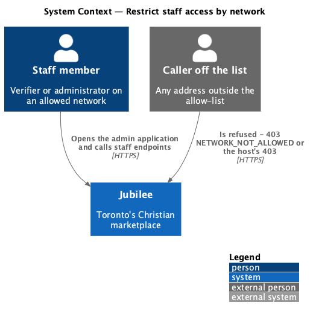
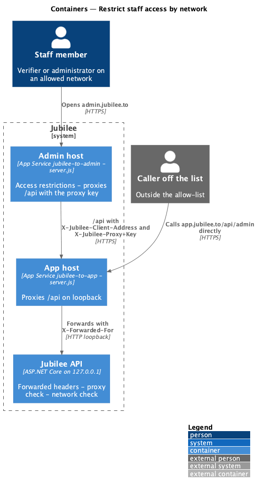
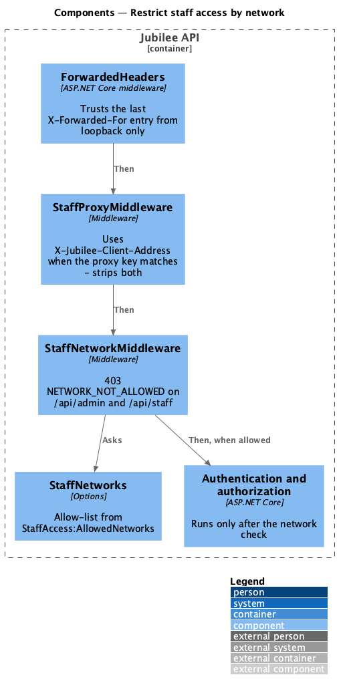
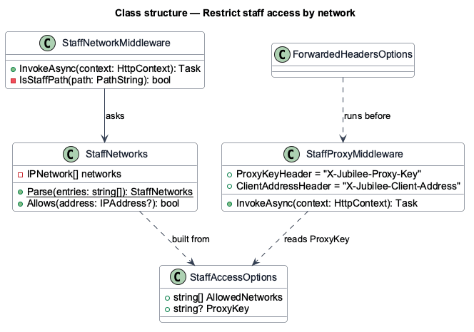
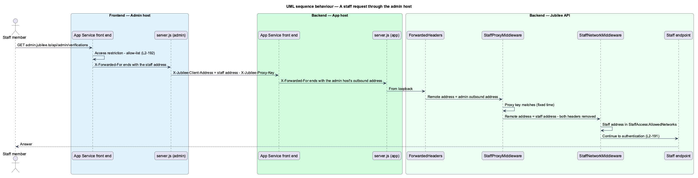
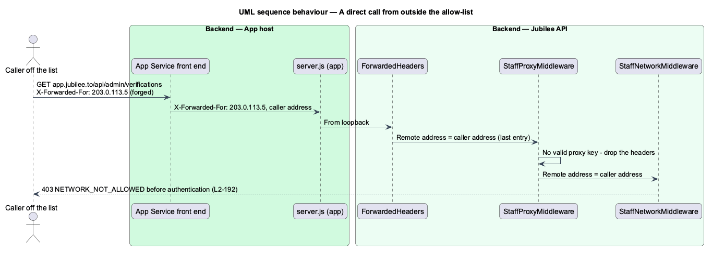

# Restrict staff access by network

## Overview

The admin application and the staff endpoints of the API (`/api/admin/*` and
`/api/staff/*`) answer only callers on an *allowed network*: an allow-list of
addresses and address ranges in configuration (`L2-192`). The restriction is
applied twice. The admin application's host refuses other callers before the
application loads, through App Service access restrictions. The API refuses
them on every host it answers, before any authentication or authorization
check, so that calling a staff endpoint through `https://app.jubilee.to/api`
from outside the list is refused too.

The caller's address is the one the trusted proxy in front of the API wrote. A
*trusted proxy* is a hop whose headers the API believes: `server.js` on
loopback beside the API, and the admin host's proxy when it proves itself with
the shared proxy key (ADR 0040). An address header a caller sends is never
trusted on its own.

## Description

- **`ForwardedHeaders` set-up** — `UseForwardedHeaders` runs first in the
  pipeline, with `X-Forwarded-For` and `X-Forwarded-Proto`, `ForwardLimit` 1
  and the loopback addresses as the only known proxies. It takes the last
  `X-Forwarded-For` entry, the one App Service's front end appended, and only
  when the request came from `server.js` on loopback.
  `ASPNETCORE_FORWARDEDHEADERS_ENABLED` is no longer set in `start.sh`.
- **`StaffProxyMiddleware`** — runs next. When `X-Jubilee-Proxy-Key` equals
  `StaffAccess:ProxyKey` (compared in fixed time; an empty key matches nothing)
  and `X-Jubilee-Client-Address` is an IP address, it sets the connection's
  remote address to it. It removes both headers from every request.
- **`StaffNetworkMiddleware`** — runs before `UseAuthentication`. For a path
  under `/api/admin` or `/api/staff` it reads the remote address (an
  IPv4-mapped IPv6 address as IPv4) and checks it against `StaffNetworks`. A
  caller outside the list gets 403 ProblemDetails with `code`
  `NETWORK_NOT_ALLOWED` and the title "This is only open on a Jubilee staff
  network.", and the refusal is logged with the address and path. Other paths
  pass untouched.
- **`StaffNetworks`** — options object read from `StaffAccess:AllowedNetworks`
  (a comma-separated list or an array of addresses and CIDR ranges, IPv4 and
  IPv6, parsed as `System.Net.IPNetwork`). An entry that does not parse stops
  the API at start-up. An empty list refuses everyone.
- **Admin host `server.js`** — with `API_ORIGIN=https://app.jubilee.to` and
  `PROXY_KEY` set, it proxies `/api` over HTTPS with `Host` set to the API's
  host, writes `X-Jubilee-Client-Address` from the last `X-Forwarded-For` entry
  App Service wrote (port removed) and `X-Jubilee-Proxy-Key`, and drops any
  incoming copies of both headers.
- **App Service access restrictions on `jubilee-to-admin`** — one allow rule
  per allowed range, default action deny (`eng/azure/README.md`).
- **`SignInPage` network state** — the admin application's sign-in screen
  shows "You're not on an allowed network…" and no button when
  `GET /api/staff/session` answers `NETWORK_NOT_ALLOWED`.

## Requirements

The feature realizes the following level-2 (L2) requirements. Each L2
requirement refines a level-1 (L1) requirement, cited by identifier.

| L2 ID | Refines (L1) | Requirement |
|-------|--------------|-------------|
| `L2-192` | `L1-027` | The staff endpoints shall answer 403 `NETWORK_NOT_ALLOWED` to a caller outside `StaffAccess:AllowedNetworks` before any authentication or authorization check, on every host; an empty list shall refuse everyone; the caller's address shall be read only from the trusted proxy's forwarded address; the admin host shall refuse callers outside the list before the application loads; the sign-in screen shall say so; other endpoints shall not be restricted. |
| `L2-189` | `L1-027` | The staff sign-in endpoints shall be reached without a session but only from an allowed network. |

## Diagrams

### System context

A staff member on an allowed network reaches the admin application; anyone
else is refused at the admin host and at the API.

### Containers

The admin host proxies to `Jubilee API` with the caller's address and the proxy
key; a direct call to `app.jubilee.to/api` is judged by the address App
Service wrote.

### Components

`ForwardedHeaders`, `StaffProxyMiddleware` and `StaffNetworkMiddleware` decide
the caller's address and refuse it before authentication.

### Class structure

`StaffNetworkMiddleware` asks `StaffNetworks` whether the address is allowed;
`StaffAccessOptions` holds the list and the proxy key.

### Behaviour — a staff request through the admin host

The admin host proves itself with the proxy key, so the API judges the staff
member's own address (`L2-192`).

### Behaviour — a direct call from outside the list

A call to `app.jubilee.to/api/admin` with a forged address header is judged by
the address App Service appended and refused (`L2-192`).

