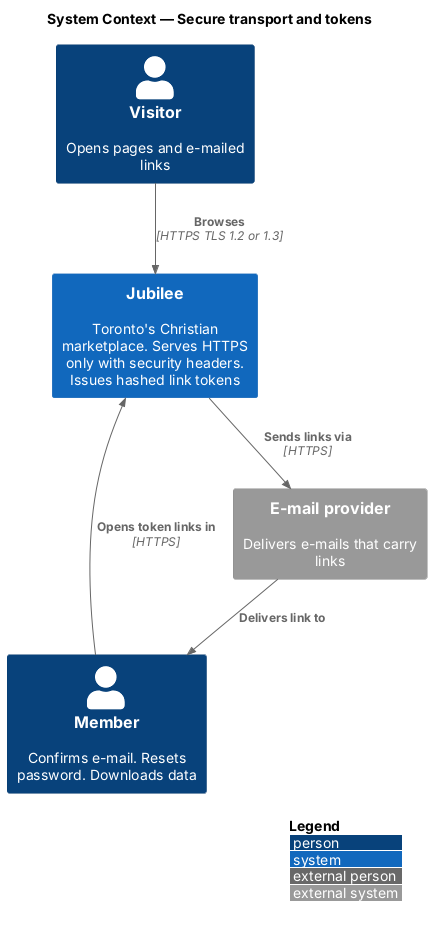
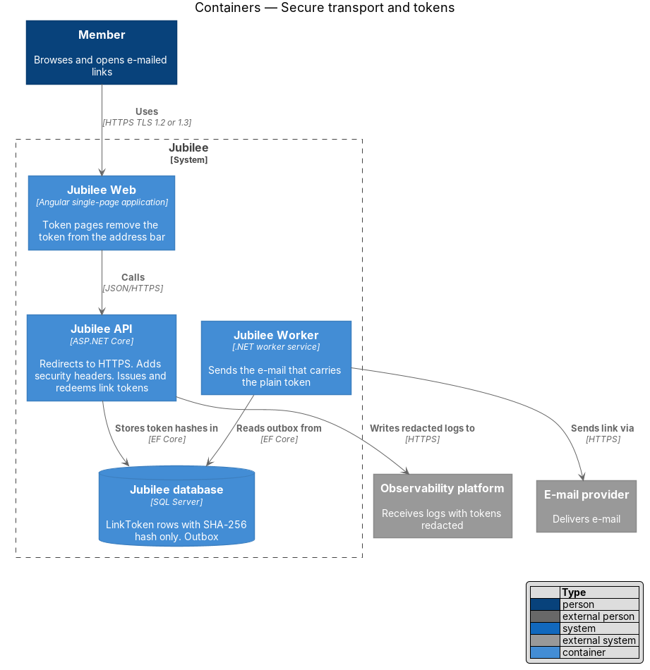
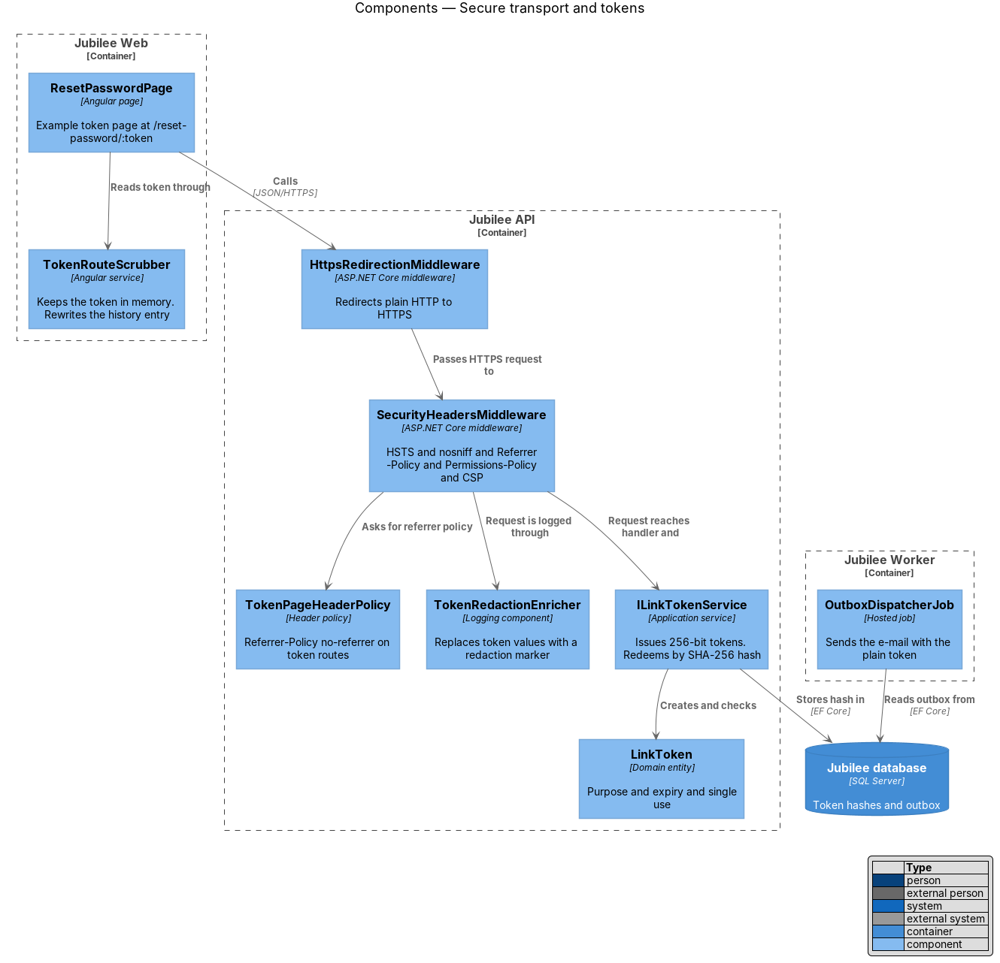
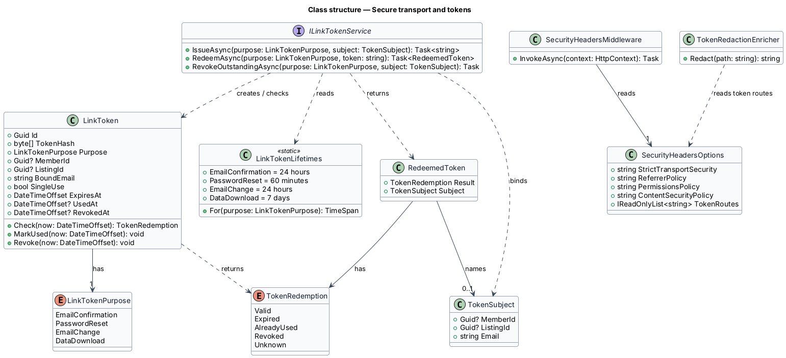
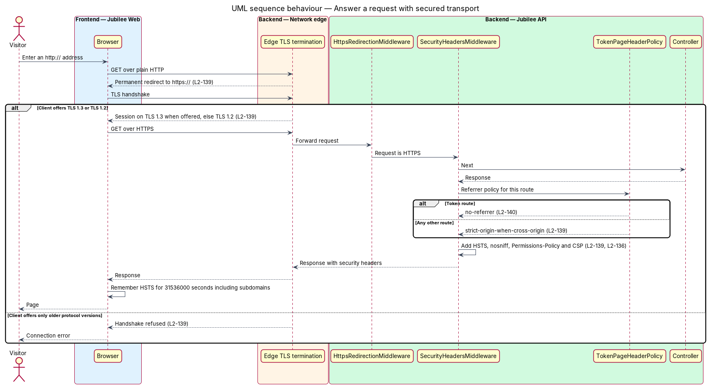
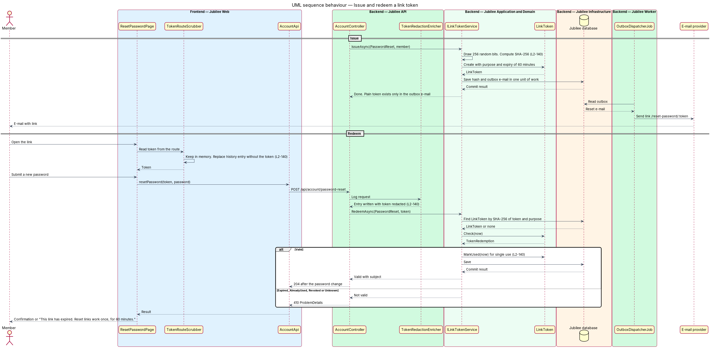

# Secure transport and tokens

## Overview

Jubilee is Toronto's Christian marketplace. Every exchange between a browser and
Jubilee crosses networks that neither side controls, and some actions start from
a link in an e-mail: confirming an address, resetting a password, changing an
address, and downloading personal data. This
feature defines how connections are encrypted, which protective headers every
response carries, and how e-mailed links are made hard to guess, steal or reuse.

The design uses three terms. *security header* — HTTP response header that
instructs the browser to restrict what a page may do or reveal. *link token* —
random secret placed in an e-mailed link that proves the holder received the
e-mail. *token page* — page whose address contains a link token, for example
`/reset-password/:token`.

Plain HTTP is redirected to HTTPS, with TLS 1.2 as the minimum and TLS 1.3
preferred. Each response carries the same header set. A link token has one
purpose and one lifetime, and the `Jubilee database` holds only its SHA-256
hash, so a copy of the database does not yield usable links. The token is kept
out of the three places it could leak from: the `Referer` header, the address
bar and the logs.

The feature is cross-cutting: the account and privacy slices issue and redeem their links through the service described here.

## Description

The slice runs from the network edge to the token table and the delivery
pipeline.

- **Edge TLS termination** — load balancer or CDN in front of the
  `Jubilee API` and the static host (vendor `<TO SUPPLY>`). It accepts TLS 1.2
  and TLS 1.3, prefers TLS 1.3, refuses older protocol versions and answers
  each plain HTTP request with a permanent redirect to the same URL on HTTPS.
- **`HttpsRedirectionMiddleware`** — ASP.NET Core middleware that repeats the
  redirect inside the `Jubilee API`, so a request that bypasses the edge is
  still redirected.
- **`SecurityHeadersMiddleware`** — adds to every response:
  `Strict-Transport-Security: max-age=31536000; includeSubDomains`,
  `X-Content-Type-Options: nosniff`,
  `Referrer-Policy: strict-origin-when-cross-origin`, a `Permissions-Policy`
  that disables each browser feature the application does not use (feature
  list `<TO SUPPLY>`), and the Content Security Policy of L2-136. The static
  host applies the same `SecurityHeadersOptions`.
- **`TokenPageHeaderPolicy`** — part of `SecurityHeadersMiddleware`. For token
  pages (`/verify-email/:token`, `/reset-password/:token`
  and the e-mail-change and data-download pages, routes `<TO SUPPLY>`) and for
  the API endpoints that redeem tokens it replaces the referrer policy with
  `Referrer-Policy: no-referrer`.
- **`LinkToken`** — entity holding `TokenHash`, `Purpose`, the `Member` it is
  bound to, `ExpiresAt`,
  `UsedAt` and `RevokedAt`. The plain token is never stored.
- **`LinkTokenPurpose`** — enumeration with one lifetime each:
  `EmailConfirmation` 24 hours, `PasswordReset` 60 minutes, `EmailChange`
  24 hours, `DataDownload` 7 days. `PasswordReset` is single-use (L2-008);
  the other purposes follow their own requirements.
- **`ILinkTokenService`** — application service. `IssueAsync` draws 32 bytes
  (256 bits, above the 128-bit minimum) from the cryptographic random number
  generator, encodes them as base64url, stores the SHA-256 hash and returns the
  plain token for the e-mail only. `RedeemAsync` hashes the presented token,
  looks the hash up, and checks purpose, expiry, use and revocation. A token
  presented for another purpose is treated as unknown.
- **`TokenRedemption`** — result of `RedeemAsync`: `Valid`, `Expired`,
  `AlreadyUsed`, `Revoked` or `Unknown`. The API answers `410` for every result other than
  `Valid`, and the token page shows the expired-link copy of its own slice.
- **`TokenRouteScrubber`** — Angular service used by each token page. It reads
  the token from the route, keeps it in memory, and replaces the browser history
  entry with the same route without the token before the page makes any other
  request.
- **`TokenRedactionEnricher`** — logging component in the `Jubilee API` and at
  the edge. It replaces the token segment of token routes and the `token` field
  of request bodies with `[redacted]` before a log entry is written.
- **`HeaderScanCheck`** — delivery pipeline step that runs an external header
  scan (for example Mozilla Observatory) against production after each
  deployment and fails when the grade is below A.
- **`SecurityHeadersTests`** — integration tests asserting the header set on a
  page response, an API response and an error response, and `no-referrer` on
  each token route.

## Requirements

The feature realizes the following level-2 (L2) requirements. Each L2
requirement refines a level-1 (L1) requirement, cited by identifier.

| L2 ID | Refines (L1) | Requirement |
|-------|--------------|-------------|
| `L2-139` | `L1-019` | The system shall redirect any HTTP request to HTTPS with TLS 1.2 as the minimum and TLS 1.3 preferred. Every response shall include `Strict-Transport-Security: max-age=31536000; includeSubDomains`, `X-Content-Type-Options: nosniff`, `Referrer-Policy: strict-origin-when-cross-origin`, a `Permissions-Policy` disabling unused features and the CSP of L2-136, and an external scan of production shall grade A or better. |
| `L2-140` | `L1-019` | Each e-mailed link token (e-mail confirmation, password reset, change of e-mail, data download) shall have at least 128 bits of randomness, be stored only as a SHA-256 hash, have a single purpose, expire as specified (24 hours, 60 minutes, 24 hours, 7 days) and be single-use where specified. A token page shall set `Referrer-Policy: no-referrer` and remove the token from the address bar after reading it, and the token value shall be redacted from logs. |
| `L2-136` | `L1-019` | The Content Security Policy shall allow scripts only from the app's own origin with nonces or hashes, disallow `unsafe-inline` scripts and `unsafe-eval`, and set `frame-ancestors 'none'`. |

## Diagrams

### System context

People reach Jubilee over HTTPS only. Jubilee sends links through the e-mail
provider, and the members who receive them open them.

### Containers

`Jubilee Web` and the `Jubilee API` answer with the same header set. The
`Jubilee API` stores token hashes in the `Jubilee database`, and
`Jubilee Worker` sends the e-mail that carries the plain token.

### Components

`SecurityHeadersMiddleware` and `TokenRedactionEnricher` wrap every request.
`ILinkTokenService` issues and redeems tokens, and `TokenRouteScrubber` clears
the address bar in the browser.

### Class structure

`ILinkTokenService` creates and checks `LinkToken` records. Each `LinkToken` has
one `LinkTokenPurpose`, and redemption returns a `TokenRedemption`.

### Behaviour — answer a request with secured transport

A plain HTTP request is redirected. The HTTPS request is served with the full
header set, and a token route receives `no-referrer`.

### Behaviour — issue and redeem a link token

The password-reset slice issues a token, of which only the hash is stored. The
token page scrubs the address bar, and redemption checks purpose, expiry and
single use.

