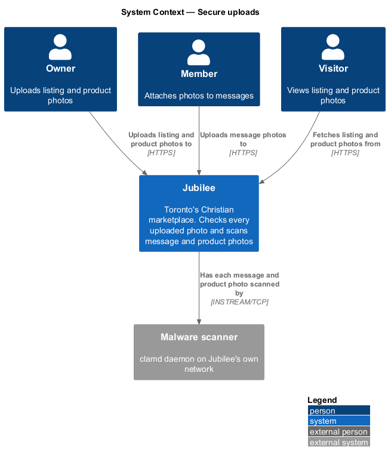
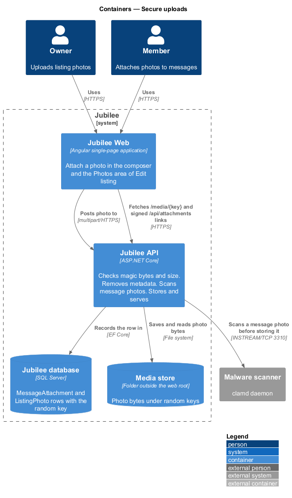
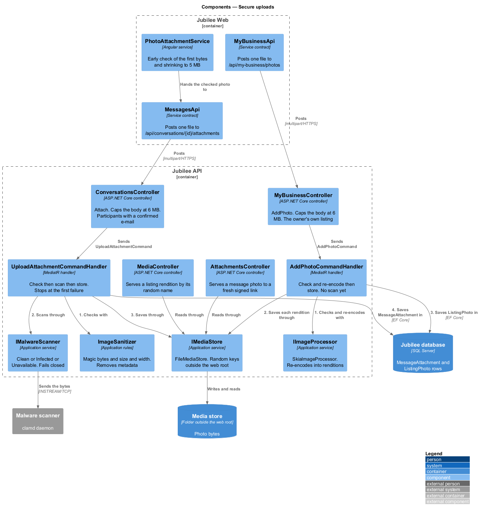
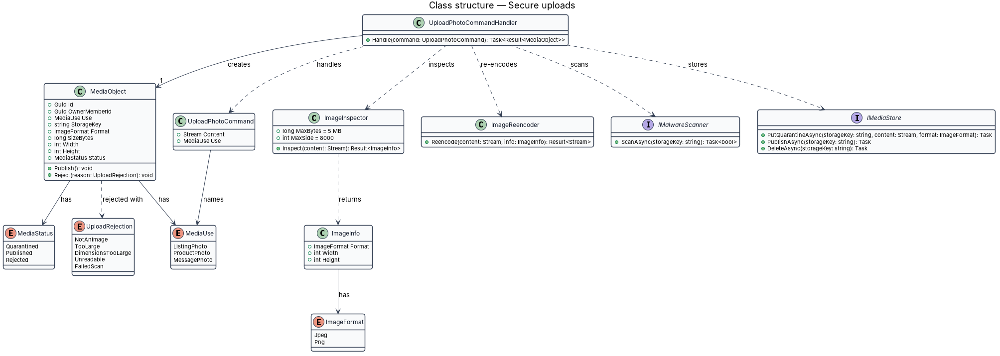
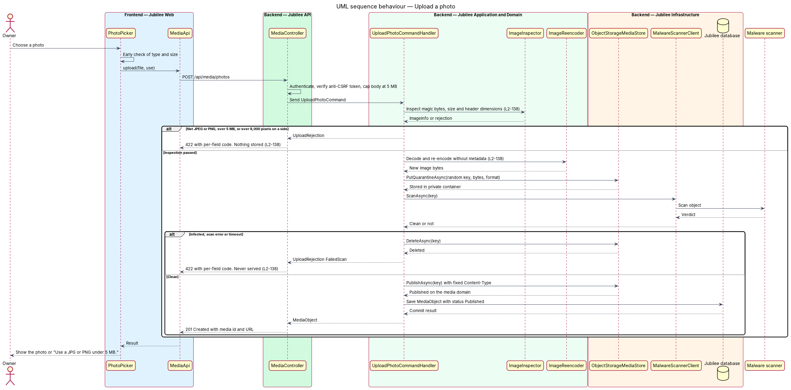
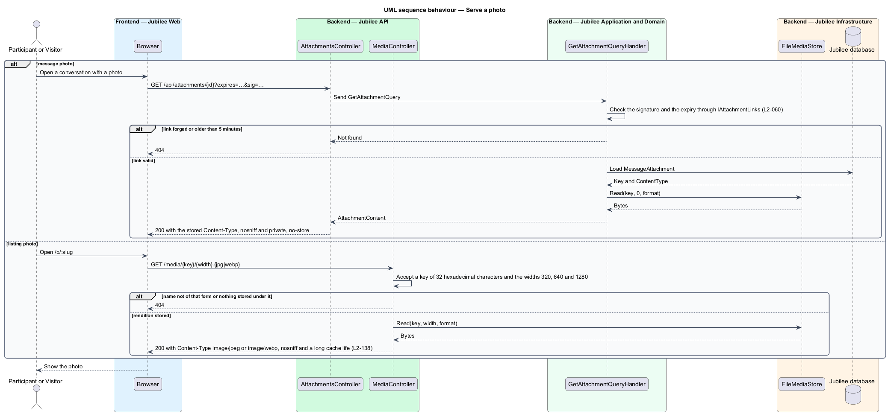

# Secure uploads

## Overview

Jubilee is Toronto's Christian marketplace. Owners upload listing photos and
product photos, and members and owners attach photos to messages. A file from an
untrusted person can be oversized, can be something other than the image it
claims to be, can carry malware, or can carry hidden data such as the location
where a photo was taken. This feature defines the single path every uploaded
photo takes before any browser can fetch it.

The design uses four terms. *magic bytes* — first bytes of a file that identify
its real format, independent of its name and declared content type.
*re-encoding* — decoding an image to pixels and writing a new file from those
pixels, which discards everything that is not image data. *quarantine* — private
storage area that no public URL reaches. *media domain* — separate cookieless
domain from which published photos are served.

The path has one rule: a file that fails any check is rejected and is never
served. The original bytes of an upload are never published; only the
re-encoded image is, under a random name. The `Jubilee API` accepts JPEG and
PNG only, up to `5 MB` and 8,000 × 8,000 pixels.

The listing, product and messaging slices call this path for their photos and
store the returned `MediaObject` identifier. A message photo is also checked by
its first bytes and shrunk on the device before it is sent; that check is for
feedback only and the server still decides (ADR 0038). A message photo is served
by a signed link valid for `5 minutes`, renewed for a participant only through
`GET /api/conversations/{id}/attachments/{attachmentId}` (ADR 0014, ADR 0038).

## Description

The slice runs from the Angular upload control to `Media storage`.

- **`PhotoPicker`** — Angular component used by the listing, product and
  message forms. It checks type and size in the browser for early feedback and
  shows "Use a JPG or PNG under 5 MB." The server repeats every check.
- **`MediaApi`** — typed Angular HTTP client for `POST /api/media/photos`
  (multipart form data, one file per call, with the anti-CSRF header).
- **`MediaController`** — ASP.NET Core controller. It requires a signed-in
  member, caps the request body at `5 MB` plus the multipart overhead so a larger body
  is cut off before it is buffered, and sends `UploadPhotoCommand` with the stream and the intended
  use (`MediaUse`: `ListingPhoto`, `ProductPhoto`, `MessagePhoto`).
- **`UploadPhotoCommandHandler`** — MediatR handler. It runs inspection,
  re-encoding, the malware scan and storage in that order, and stops at the
  first failure.
- **`ImageInspector`** — reads the leading bytes and accepts only the JPEG
  signature (`FF D8 FF`) and the PNG signature (`89 50 4E 47 0D 0A 1A 0A`). The
  declared content type and the file extension are ignored. It reads width and
  height from the image header and refuses more than 8,000 pixels on either
  side before any pixel data is decoded.
- **`ImageReencoder`** — decodes the image and writes a new JPEG or PNG from the
  pixels. The output holds no EXIF, GPS, comment or colour-profile metadata from
  the original. A decode error rejects the upload. Imaging library:
  `<TO SUPPLY>`.
- **`IMalwareScanner`** — application service implemented by
  `MalwareScannerClient`. It submits the stored quarantine object to the
  `Malware scanner`. An infected verdict, a scan error or a timeout
  (`<TO SUPPLY>`) rejects the upload.
- **`IMediaStore`** — application service implemented by
  `ObjectStorageMediaStore`. `PutQuarantineAsync` writes to the private
  quarantine container. `PublishAsync` copies a clean object to the public
  container behind the CDN with `Content-Type` fixed to `image/jpeg` or
  `image/png`. `DeleteAsync` removes a rejected object. Both containers sit
  outside any web root.
- **`MediaObject`** — entity recording the storage key, the owner, the use, the
  size, the dimensions and the `MediaStatus` (`Quarantined`, `Published`,
  `Rejected`). The storage key is 128 random bits, hex-encoded, plus the
  extension; it contains nothing from the original file name.
- **`UploadRejection`** — enumeration of failure reasons returned as per-field
  codes with `422`: `NotAnImage`, `TooLarge`, `DimensionsTooLarge`,
  `Unreadable`, `FailedScan`.
- **Media domain** — CDN host name `<TO SUPPLY>`, registered apart from the
  application's domain so that no Jubilee cookie is sent to it. Every response
  carries the stored `Content-Type` and `X-Content-Type-Options: nosniff`.
- **`UploadSecurityTests`** — integration tests that upload a renamed
  executable, a file of `5 MB` plus one byte, an image of 8,001 pixels on one
  side, a photo with GPS metadata and a standard anti-malware test file, and
  assert each outcome.

## Requirements

The feature realizes the following level-2 (L2) requirements. Each L2
requirement refines a level-1 (L1) requirement, cited by identifier.

| L2 ID | Refines (L1) | Requirement |
|-------|--------------|-------------|
| `L2-138` | `L1-019` | The server shall check each upload's content type by its magic bytes, accept only JPEG and PNG up to 5 MB and 8,000 × 8,000 pixels, re-encode the image and strip metadata. Uploads shall be kept in object storage outside the web root with random names, scanned for malware, and served from a separate cookieless domain with `Content-Type` fixed and `X-Content-Type-Options: nosniff`; a file that fails any check shall be rejected and never served. |
| `L2-133` | `L1-019` | The server shall check the caller's role and ownership of the specific object on every API endpoint before doing anything. |
| `L2-135` | `L1-019` | The system shall reject a state-changing request without a valid anti-CSRF token bound to the session with 403. |

## Diagrams

### System context

Owners and members upload photos to Jubilee. Jubilee has each file scanned by
the malware scanner, and visitors later fetch published photos.

### Containers

`Jubilee Web` posts the file to the `Jubilee API`, which writes to
`Media storage` and records a `MediaObject` in the `Jubilee database`. Browsers
fetch published photos from `Media storage` directly, without cookies.

### Components

`UploadPhotoCommandHandler` calls `ImageInspector`, `ImageReencoder`,
`IMalwareScanner` and `IMediaStore` in order. `PhotoPicker` and `MediaApi` form
the browser side.

### Class structure

`UploadPhotoCommandHandler` produces a `MediaObject` whose `MediaStatus` moves
from `Quarantined` to `Published` or `Rejected`. An `UploadRejection` names the
failed check.

### Behaviour — upload a photo

The handler checks magic bytes, size and dimensions, re-encodes, stores the
result in quarantine, scans it, and publishes it only when every check passes.
Each failure rejects the upload with `422`.

### Behaviour — serve a published photo

The browser fetches the photo from the media domain. The request carries no
Jubilee cookie, and the response carries the fixed `Content-Type` and `nosniff`.

