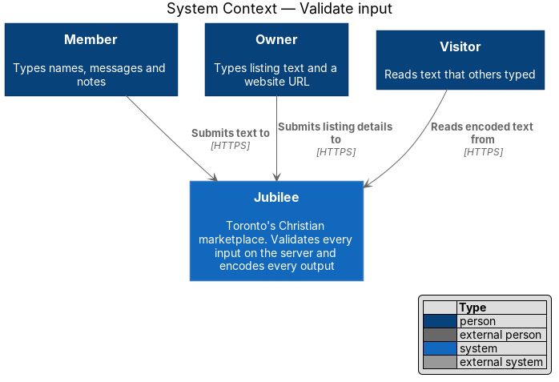
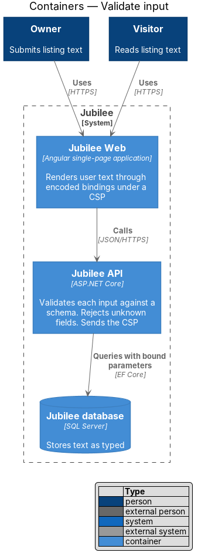
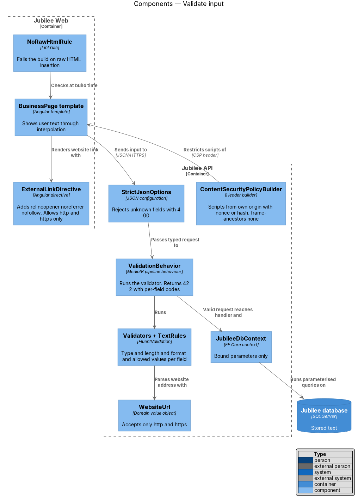
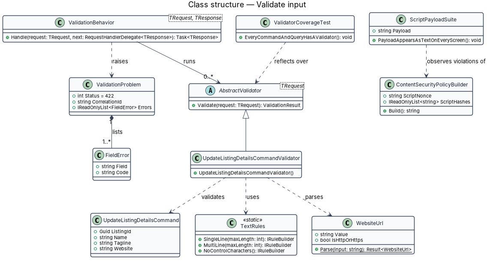
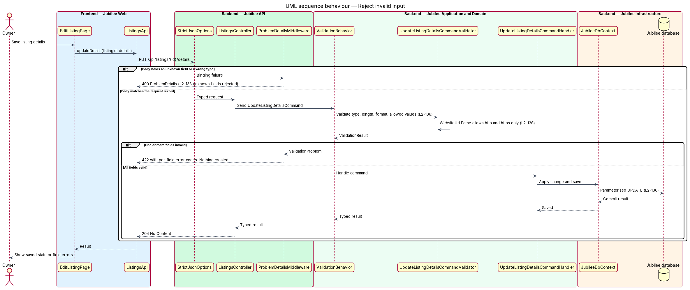
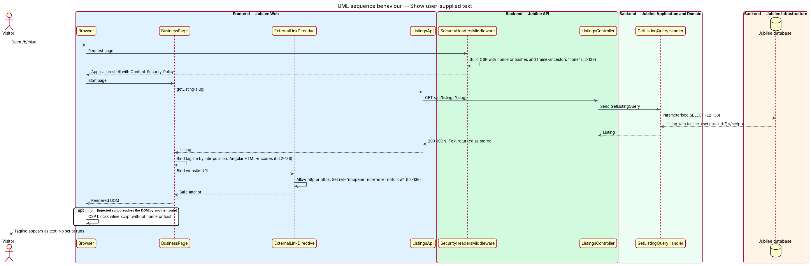

# Validate input

## Overview

Jubilee is Toronto's Christian marketplace. Members and owners type names,
taglines, messages, notes and website addresses that other people later read.
This feature defines how the `Jubilee API` checks everything it receives and how
`Jubilee Web` shows user-supplied text, so that hostile input is refused or
displayed as plain text and never runs as code.

The design uses four terms. *schema* — declared type, length, format and allowed
values of each field of a request. *unknown field* — field in a request body
that the schema does not declare. *output encoding* — conversion of text to a
form the browser displays as characters and does not interpret as markup.
*Content Security Policy (CSP)* — response header that tells the browser which
scripts may run and which pages may frame the application.

The feature works in layers. The server validates each input against its schema
and rejects unknown fields. Database access uses bound parameters only. The
browser renders user text through Angular's default binding, which encodes it.
The CSP stops a script that still reaches a page from running. An automated test
proves the result with the payload ``.

The feature is cross-cutting: each slice supplies a validator for its commands
and queries and inherits the pipeline, the encoding rules and the build checks
described here.

## Description

The slice runs from the Angular templates to the MediatR pipeline, the database
context and the build checks.

- **`StrictJsonOptions`** — JSON configuration of the `Jubilee API`. It maps
  each body to a typed request record and rejects a body that contains an
  unknown field with `400`. It also rejects a wrong JSON type for a field.
- **`ValidationBehavior<TRequest, TResponse>`** — MediatR pipeline behaviour in
  `Jubilee.Application`. It runs the FluentValidation validator of the command
  or query before the handler. A failure returns `422` with per-field error
  codes and creates nothing.
- **`AbstractValidator<TRequest>` implementations** — one validator per command
  and query, for example `BookMeetingCommandValidator`. Each declares type,
  length, format and allowed values for every field.
- **`TextRules`** — shared validator rules: maximum length per field kind,
  trimming, rejection of control characters, and enumeration membership. Text
  is stored as typed; encoding happens at output.
- **`WebsiteUrl`** — domain value object for an owner-entered website address.
  `WebsiteUrl.Parse` accepts an absolute URL with the scheme `http` or `https`
  and rejects every other scheme. No server component fetches the address.
- **`ExternalLinkDirective`** — Angular directive `jbExternalLink`. It renders
  the website link with `rel="noopener noreferrer nofollow"` and refuses a
  value whose scheme is not `http` or `https`.
- **Angular default binding** — every template shows user-supplied text through
  interpolation (`{{ value }}`) or property binding to text, which HTML-encodes
  it.
- **`NoRawHtmlRule`** — lint rule in the `Jubilee Web` build. It fails the build
  on `[innerHTML]`, `outerHTML`, `document.write`, `bypassSecurityTrustHtml` and
  the other `DomSanitizer` bypass methods.
- **`ContentSecurityPolicyBuilder`** — builds the CSP header that
  `SecurityHeadersMiddleware` adds to each response. `script-src` holds `'self'`
  and a per-response nonce or build-time hashes; it holds neither
  `'unsafe-inline'` nor `'unsafe-eval'`. `frame-ancestors` is `'none'`. The
  remaining directives (`img-src` for the media domain, `connect-src` for the
  API and the real-time hub) are `<TO SUPPLY>`.
- **`JubileeDbContext`** — EF Core context. Every query uses LINQ or bound
  parameters.
- **`NoRawSqlRule`** — analyzer rule in the backend build. It fails the build on
  `FromSqlRaw`, `ExecuteSqlRaw` and string-built SQL commands.
- **`ValidatorCoverageTest`** — unit test that reflects over every command and
  query and fails when one has no validator.
- **`ScriptPayloadSuite`** — end-to-end test. It saves the payload
  `` in every text field, opens every screen that shows
  the field, and asserts that the payload appears as text and that no dialog or
  CSP violation occurs. Test runner: `<TO SUPPLY>`.

## Requirements

The feature realizes the following level-2 (L2) requirements. Each L2
requirement refines a level-1 (L1) requirement, cited by identifier.

| L2 ID | Refines (L1) | Requirement |
|-------|--------------|-------------|
| `L2-136` | `L1-019` | The server shall validate every API input against a schema (type, length, format, allowed values), shall reject unknown fields, and shall use parameterised queries only. User-supplied text shall be HTML-encoded by the framework's default binding with no raw HTML insertion, the Content Security Policy shall allow scripts only from the app's own origin with nonces or hashes and set `frame-ancestors 'none'`, owner website URLs shall allow only `http` and `https` and open with `rel="noopener noreferrer nofollow"`, and an automated test shall prove the payload `` appears as text on every screen. |
| `L2-139` | `L1-019` | The system shall redirect HTTP to HTTPS with TLS 1.2 as the minimum, and every response shall include the specified security headers and the CSP of L2-136. |
| `L2-002` | `L1-001` | The join form shall validate on submit, in the browser and again on the server, and shall report every problem at once. |

## Diagrams

### System context

Members and owners submit text to Jubilee and read text that others submitted.
Jubilee validates on receipt and encodes on display.

### Containers

`Jubilee Web` renders text through encoded bindings. The `Jubilee API` validates
each body and reaches the `Jubilee database` through bound parameters.

### Components

In the `Jubilee API`, `StrictJsonOptions` rejects unknown fields,
`ValidationBehavior` runs the validator, and `ContentSecurityPolicyBuilder`
supplies the CSP. In `Jubilee Web`, templates and `ExternalLinkDirective`
control output.

### Class structure

`ValidationBehavior` runs one validator per request type. Validators share
`TextRules`, and `WebsiteUrl` owns the scheme rule.

### Behaviour — reject invalid input

An owner saves listing details. An unknown field ends the request with `400`, a
schema failure ends it with `422` and per-field codes, and valid input reaches
the handler and the database through bound parameters.

### Behaviour — show user-supplied text

A visitor opens a business page whose tagline holds the script payload. The
response carries the CSP, Angular encodes the tagline, and the website link
receives its `rel` attribute.

