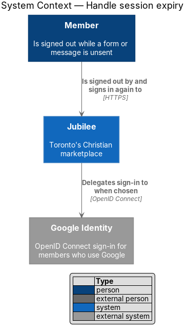
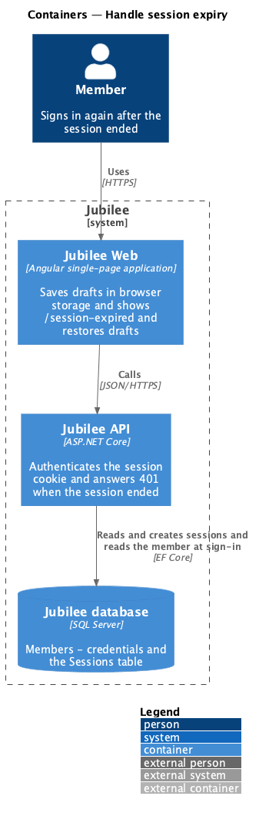
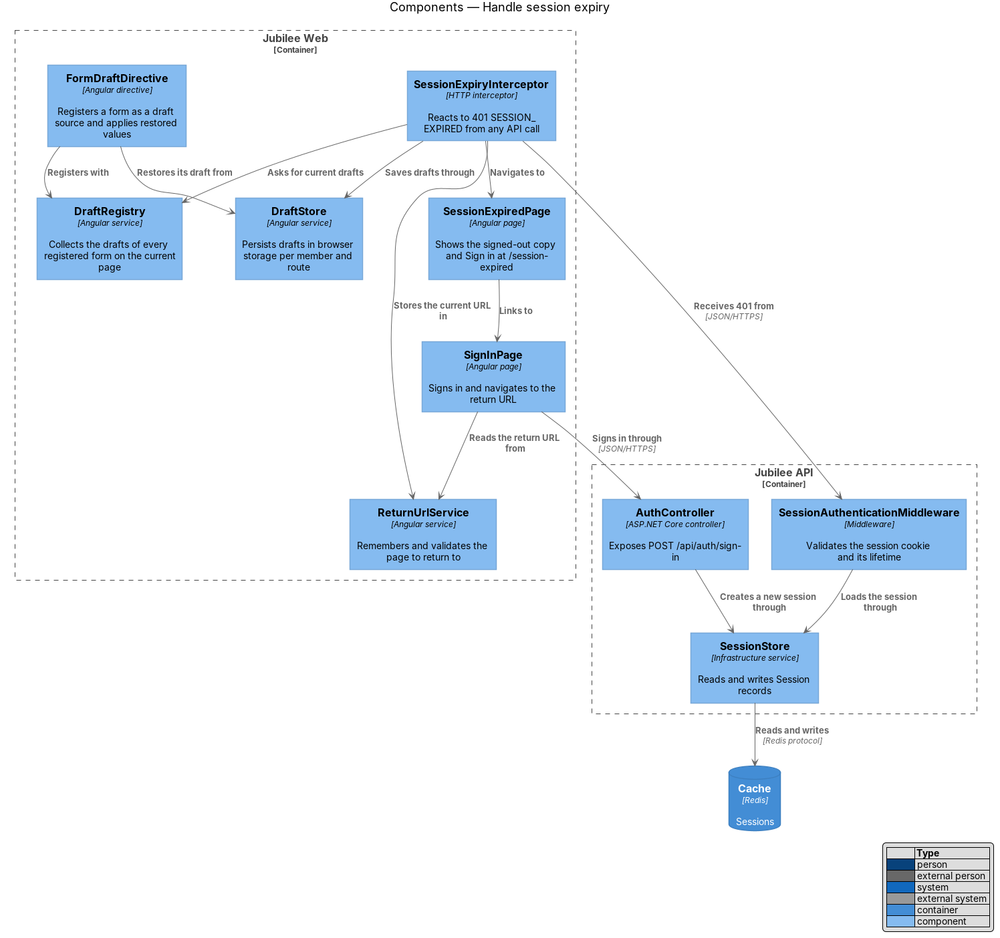
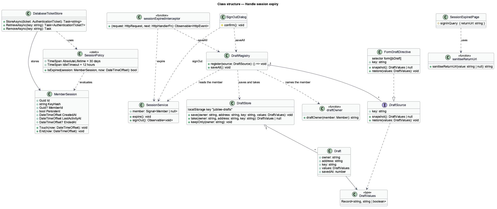
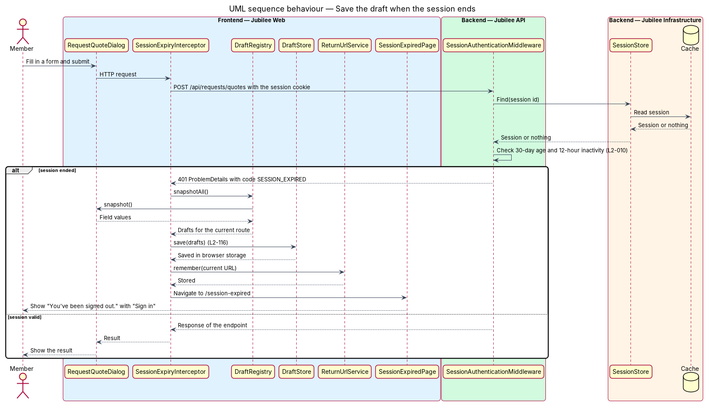
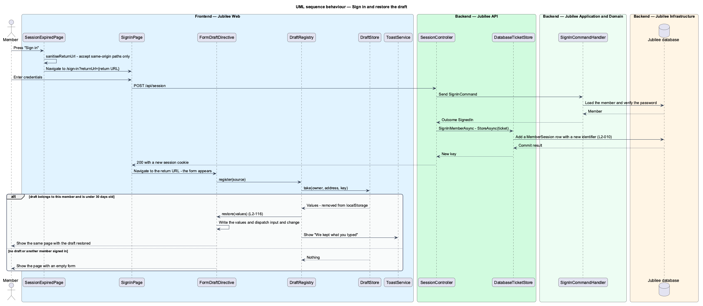

# Handle session expiry

## Overview

Jubilee keeps sessions on the server. A session lasts up to 30 days when "Keep
me logged in" is ticked, ends after 12 hours without activity otherwise, and
ends when the password changes (`L2-010`). A member can therefore be signed out
in the middle of writing a message or filling in a form. This feature makes that
moment harmless: the work in progress is kept, the member is told what happened,
and after sign-in the member returns to the same page with the draft restored.

*Draft* — what a member has typed into a form or a message and not yet sent,
kept on the device and never on the server. *Return URL* — address of the page
the member was on when the session ended.

The slice is mostly client-side. `Jubilee API` contributes one precise signal: a
401 response that states the session ended. `Jubilee Web` reacts to that signal
in one place, an HTTP interceptor, so every form in the product gains the
behaviour by registering as a draft source. Drafts are saved at two moments and
not as the member types: when the session ends, and when the member confirms
"Sign out" (ADR 0046). The outgoing message queue of the
`Jubilee service worker` (`L2-119`–`L2-122`) is a separate mechanism for
connectivity loss and is not part of this slice.

## Description

- **Cookie authentication** and **`DatabaseTicketStore`** — the cookie scheme
  of `Jubilee API` resolves the session cookie on each request through
  `DatabaseTicketStore`, which finds the `MemberSession` row of the `Sessions`
  table. When the row is missing, ended or expired, a protected endpoint
  returns HTTP 401 as `ProblemDetails` with the code `SESSION_EXPIRED` and the
  cookie is removed. A request that never carried a session cookie receives
  401 with the code `sign_in_required`.
- **`SessionPolicy`** — static domain class. `IsExpired` is true 30 days after
  sign-in, or after 12 hours without activity when `MemberSession.Persistent`
  is false. A password change or reset ends the member's sessions by setting
  `EndedAt` on their rows.
- **`sessionExpiredInterceptor`** — Angular HTTP interceptor. On a 401 with
  `SESSION_EXPIRED`, while `SessionService.member()` is still set, it calls
  `DraftRegistry.saveAll()`, then `SessionService.expire()`, closes every open
  dialog with `Dialog.closeAll()`, because a dialog does not close when the
  address changes, and navigates to `/session-expired?returnUrl={Router.url}`.
  The first refusal clears the member, so refusals that arrive together or one
  after another open the page once. `unsavedChangesGuard` lets this navigation
  pass without asking: the member cannot stay, and the draft is kept.
- **`DraftSource`** — TypeScript interface with `key`, `snapshot()` and
  `restore(values)`. `snapshot` returns `DraftValues`, a
  `Record<string, string | boolean>`, or `null` when nothing is typed.
- **`FormDraftDirective`** — directive with the selector `form[jbDraft]` that
  implements `DraftSource` for a `<form>` of named native controls. The app has
  no reactive forms: each control is bound to a signal with `ngModel`. Its
  snapshot is the value of each named control except passwords, files, hidden
  fields and buttons. Its restore writes the values back and dispatches the
  browser's `input` and `change` events, so the signals follow as if the member
  had typed. It registers with `DraftRegistry` while the form is on screen.
  It becomes a source only once the member has changed a control, and a form
  typed in and then cleared leaves no draft. A control that is shown only
  after another has its value takes its value when it appears.
- **Draft sources** — the forms that carry `jbDraft`: the message dialog
  (`message`) and the message composer of `ConversationPage` (`composer`); the
  booking (`book`), quote (`quote`), order (`order`) and space request
  (`space`) dialogs; the two report dialogs (`report`); the feedback page
  (`feedback`) and panel (`feedback-panel`); the profile form of `AccountPage`
  (`profile`); the listing editor (`listing`); and the away period (`away`). A
  dialog that has no address of its own is keyed by what it is about, so that
  one draft never fills another record: `decline:{request id}`,
  `product:{product id}` and `service:{service id}`.
- **`DraftRegistry`** — service that holds the draft sources of the page on
  screen. `register(source)` adds a source and returns the function that
  unregisters it. When `DraftStore.take` has a draft for the signed-in member,
  the current address (`Router.url`) and the key of the source, `register`
  restores it at once and shows, through `ToastService`, the toast "We kept
  what you typed" with "Check it over, then send it when you’re ready."
  `saveAll()` writes the snapshot of each registered source into `DraftStore`
  for the signed-in member; a source with nothing typed leaves no draft. When a
  member is signed in the registry calls `DraftStore.keepOnly`.
- **`DraftStore`** — service that keeps `Draft` records (`owner`, `address`,
  `key`, `values`, `savedAt`) in `localStorage` under `jubilee-drafts`.
  `save(owner, address, key, values)` writes one. `take(owner, address, key)`
  returns a draft once, to the same owner only, and removes it; it drops a
  draft older than 30 days. `keepOnly(owner)` removes every other member's
  drafts. Drafts never reach the server.
- **`draftOwner`** — function that names the member of a draft: a 53-bit hash
  of the member's e-mail address, so the device keeps no address in clear.
- **`SessionExpiredPage`** — Angular page at `/session-expired`. It shows
  "You've been signed out. For your safety we sign you out after 30 days, or
  when your password changes." and "Sign in", which links to `/sign-in` with
  the `returnUrl` passed through `sanitiseReturnUrl`.
- **`sanitiseReturnUrl`** — function that accepts same-origin relative paths
  only; any other value becomes `/`.
- **`SignInPage`** — after a successful sign-in it navigates to the sanitised
  `returnUrl`; the draft sources of that page restore their drafts as they
  register.
- **`SignOutDialog`** — calls `DraftRegistry.saveAll()` before
  `SessionService.signOut()`, so a draft is kept at sign-out by the same
  mechanism (`L2-011`).
- **`SessionController`** and **`SignInCommandHandler`** — `POST /api/session`
  verifies the credentials, and `DatabaseTicketStore.StoreAsync` adds a
  `MemberSession` row with a new identifier, so the expired identifier is never
  reused.

The listing-a-business wizard is not a draft source: its text is saved to the
server as the owner goes (ADR 0018). The password, e-mail-change and
delete-account dialogs are not draft sources either. A draft restores what a
native control holds; a chosen photo is not restored.

## Requirements

The feature realizes the following level-2 (L2) requirements. Each L2
requirement refines a level-1 (L1) requirement, cited by identifier.

| L2 ID | Refines (L1) | Requirement |
|-------|--------------|-------------|
| `L2-116` | `L1-016` | A draft — what a member has typed into a form or a message and not yet sent — shall be kept on the device and never on the server. When an API call returns 401 because the session ended, the application shall save any draft in the current form, navigate to `/session-expired` and, after sign-in, return to the same page with the draft restored. When several API calls are refused at once, `/session-expired` shall open once. A restored draft shall be announced with "We kept what you typed", shall be restored once, shall hold no password and no chosen file, shall be kept for 30 days, and shall be shown only to the member who typed it. |
| `L2-010` | `L1-001` | Sessions shall be server-side, shall last up to 30 days when "Keep me logged in" is ticked, shall end after 12 hours without activity otherwise, and shall end when the password changes. The system shall send a member whose session has ended to `/session-expired`, shall restore an unsent message or form draft after the next sign-in as the same member, and shall issue a new session identifier at each sign-in. |

## Diagrams

### System context

The member is signed out by Jubilee and signs in again, through Jubilee's own
form or through Google Identity.

### Containers

`Jubilee API` reads sessions from the `Jubilee database` and answers 401 when
one has ended. `Jubilee Web` keeps the draft in the browser and restores it
after sign-in.

### Components

`sessionExpiredInterceptor` calls `DraftRegistry` and `SessionService` before
it navigates to `SessionExpiredPage`. `FormDraftDirective` supplies the draft
and receives it back; `DraftRegistry` moves it to and from `DraftStore`.

### Class structure

`FormDraftDirective` realises `DraftSource`; `DraftRegistry` aggregates draft
sources and `DraftStore` aggregates `Draft` records. On the server,
`DatabaseTicketStore` stores `MemberSession`, and `SessionPolicy` owns the
lifetime rules.

### Behaviour — save the draft when the session ends

The API answers 401 with `SESSION_EXPIRED`; the interceptor saves the drafts,
clears the member, then shows `/session-expired` with the return URL in its
address. A second refusal of the same moment finds no member and does nothing.

### Behaviour — sign in and restore the draft

Sign-in issues a new session identifier. The member returns to the page named
by the return URL, where each draft source registers and `DraftRegistry` takes
its draft from `DraftStore`, restores it and shows the toast.

