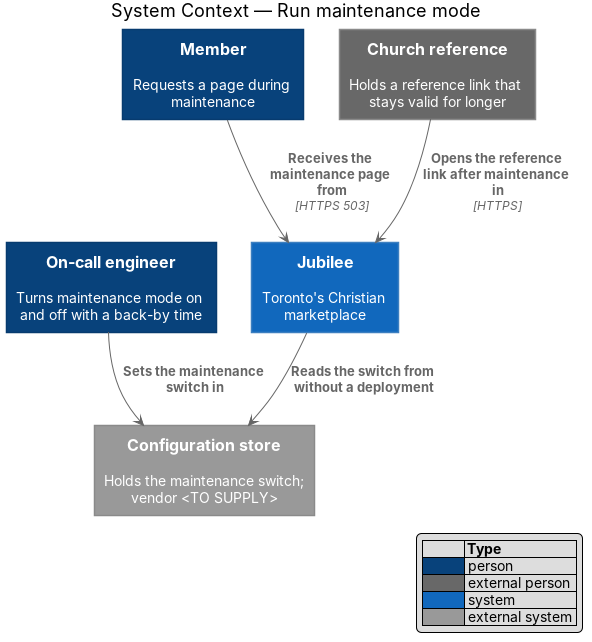
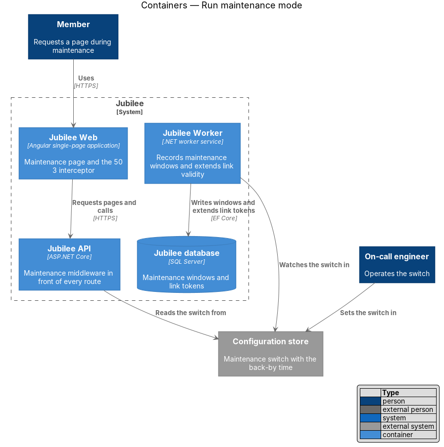
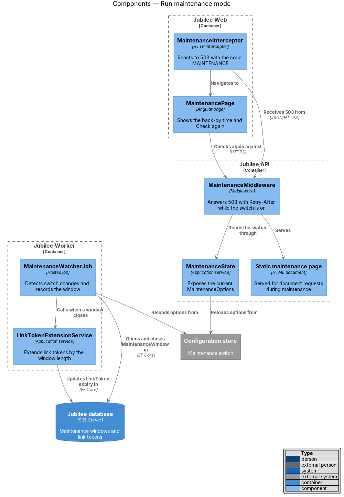
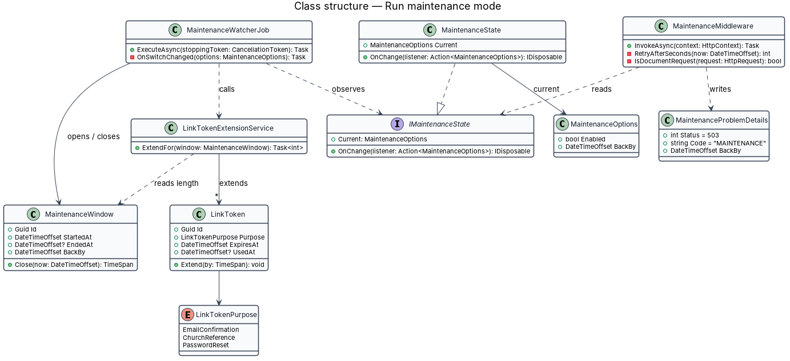
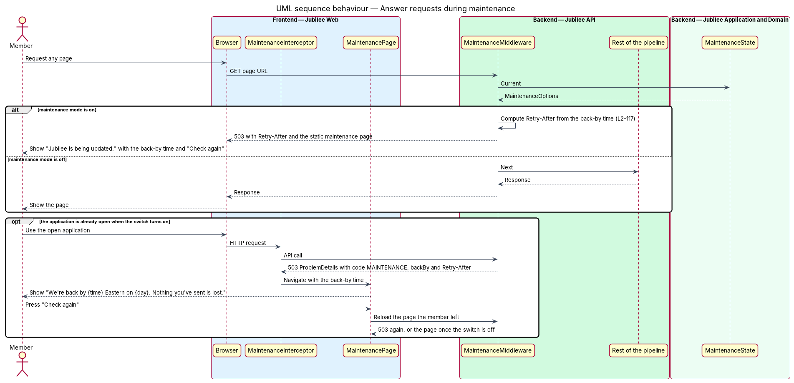
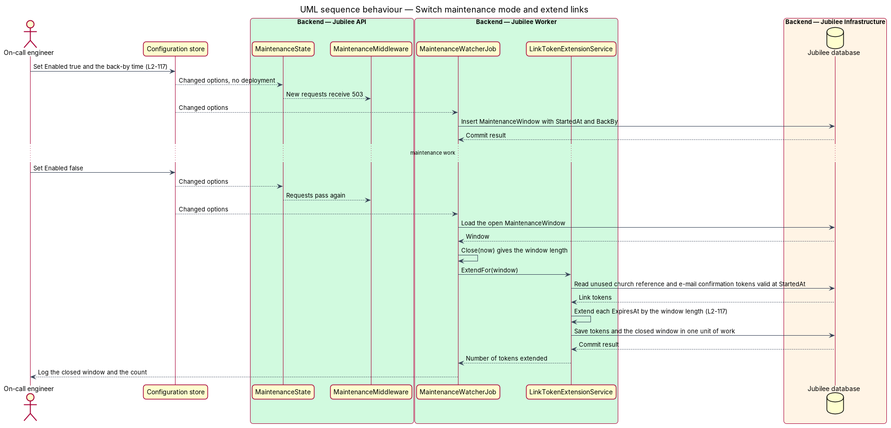

# Run maintenance mode

## Overview

Some updates to Jubilee cannot run while the product serves traffic.
*Maintenance mode* — state in which every page request is answered with HTTP 503
and a page that says when Jubilee is back. An operator turns the mode on and off
with a configuration switch, without a deployment, and the switch carries the
*back-by time*, the time at which service is expected to resume.

The page reads "Jubilee is being updated. We're back by {time} Eastern on {day}.
Nothing you've sent is lost." with the button "Check again". The 503 response
carries a `Retry-After` header so that browsers, crawlers and monitoring tools
know when to return.

Maintenance also affects links that were sent earlier. Church reference links
and e-mail confirmation links have a limited validity; a pastor who opens a
reference link during maintenance cannot answer. The design therefore extends
the remaining validity of those links by the length of the *maintenance window*,
the interval between the switch turning on and turning off.

## Description

The slice is operational: one middleware, one configuration object, one page and
one background job.

- **`MaintenanceOptions`** — configuration object with `Enabled` and `BackBy`.
  It is bound to the `Configuration store` with reload on change, so a new value
  takes effect in running processes. The store's vendor and its propagation
  delay are `<TO SUPPLY>`.
- **`MaintenanceState`** — application service behind `IMaintenanceState`. It
  exposes the current options and notifies listeners when they change.
- **`MaintenanceMiddleware`** — placed in `Jubilee API` ahead of routing. While
  `Enabled` is true it answers every page request with HTTP 503 and a
  `Retry-After` header computed from `BackBy`. A document request receives the
  static maintenance page; an API request receives `ProblemDetails` with the
  code `MAINTENANCE` and the `backBy` value. Paths exempt from the switch (for
  example health probes) are `<TO SUPPLY>`.
- **Static maintenance page** — self-contained HTML document with the copy from
  the mock. It formats `BackBy` in Eastern time as "{time} Eastern on {day}"
  (for example "6:00 a.m. Eastern on Wednesday 11 November") and depends on no
  API call, database or script bundle.
- **`MaintenanceInterceptor`** — Angular HTTP interceptor. When an open
  application receives a 503 with the code `MAINTENANCE`, it navigates to
  `MaintenancePage` and passes the back-by time. Unsent form input stays in
  place because the route state is kept.
- **`MaintenancePage`** — Angular page with the same copy as the static page.
  "Check again" reloads the page the member left; the server answers 503 again
  or serves the page once the switch is off.
- **`MaintenanceWatcherJob`** — hosted job in `Jubilee Worker`. It observes
  `IMaintenanceState`. When the switch turns on it inserts a
  `MaintenanceWindow` with `StartedAt` and `BackBy`; when the switch turns off
  it closes the window and calls `LinkTokenExtensionService`.
- **`MaintenanceWindow`** — entity that records one period of maintenance.
  `Close(now)` sets `EndedAt` and returns the window length.
- **`LinkTokenExtensionService`** — selects each unused `LinkToken` with the
  purpose `ChurchReference` or `EmailConfirmation` that was valid at
  `StartedAt`, and adds the window length to its `ExpiresAt`. Tokens and the
  closed window are saved in one unit of work, so a window is applied once.
- **`LinkToken.Extend`** — domain method that moves `ExpiresAt` forward. Other
  purposes, such as password reset, are not extended.
- **Operator procedure** — the `On-call engineer` sets `Enabled` and `BackBy` in
  the `Configuration store`. The tool used to change the switch and the access
  control on it are `<TO SUPPLY>`.

## Requirements

The feature realizes the following level-2 (L2) requirements. Each L2
requirement refines a level-1 (L1) requirement, cited by identifier.

| L2 ID | Refines (L1) | Requirement |
|-------|--------------|-------------|
| `L2-117` | `L1-016` | While maintenance mode is on, the server shall respond 503 with `Retry-After` to any page request and show the maintenance page with the back-by time and "Check again". Church reference links and e-mail confirmation links shall keep their remaining validity extended by the length of the maintenance window. An operator shall turn the mode on or off with a configuration switch, without a deployment, and the back-by time shall be part of the switch. |

## Diagrams

### System context

The on-call engineer sets the switch in the configuration store, Jubilee reads
it, and members receive the maintenance page. A church reference benefits from
the extended link validity.

### Containers

`Jubilee API` reads the switch and answers 503. `Jubilee Worker` watches the
same switch, records the window in the `Jubilee database` and extends link
tokens.

### Components

`MaintenanceMiddleware` reads `MaintenanceState` and serves the static page or
a 503 that `MaintenanceInterceptor` turns into `MaintenancePage`.
`MaintenanceWatcherJob` calls `LinkTokenExtensionService` when a window closes.

### Class structure

`MaintenanceMiddleware` and `MaintenanceWatcherJob` both depend on
`IMaintenanceState`. The job opens and closes `MaintenanceWindow`, and
`LinkTokenExtensionService` extends `LinkToken` records by the window length.

### Behaviour — answer requests during maintenance

The middleware answers 503 with `Retry-After` while the switch is on. An
application that is already open reaches `MaintenancePage` through the
interceptor.

### Behaviour — switch maintenance mode and extend links

The switch takes effect without a deployment. When it turns off, the job closes
the window and the service extends church reference and e-mail confirmation
links by the window length.

