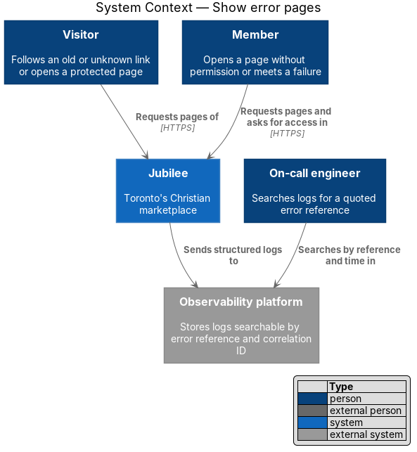
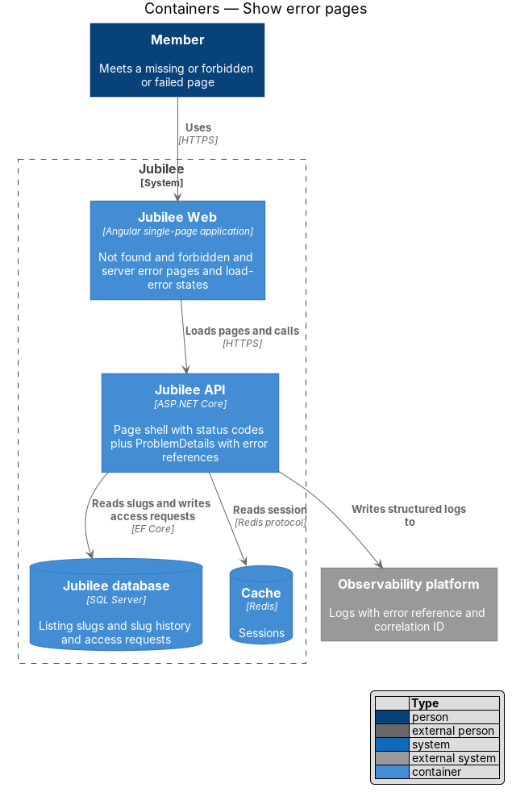
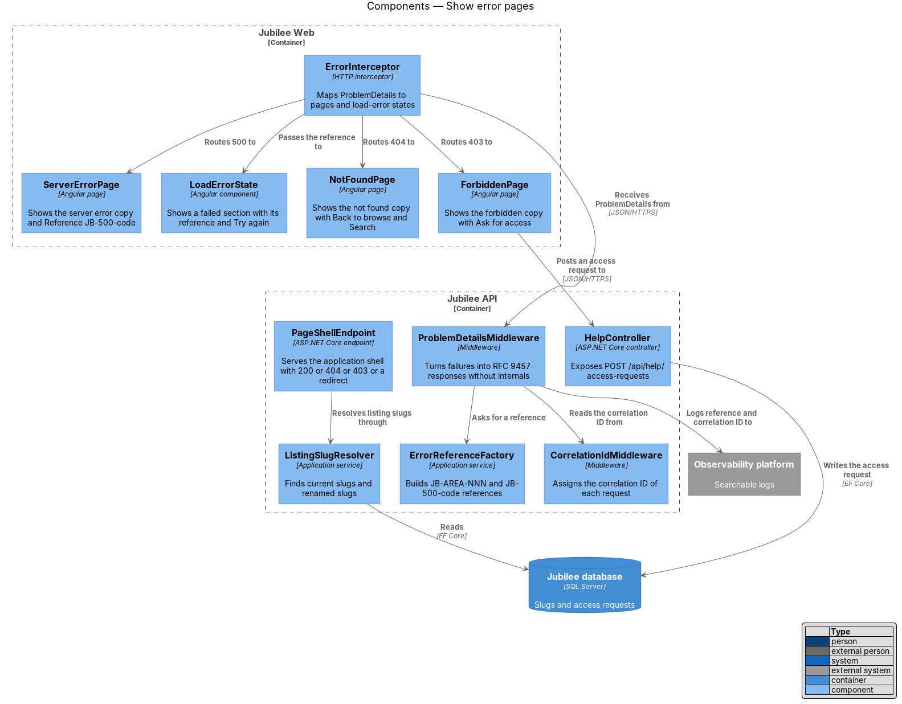
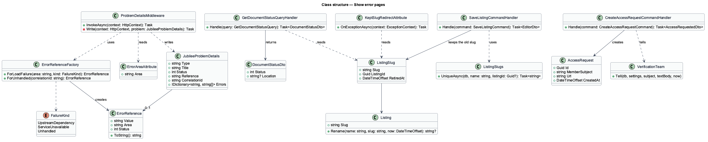
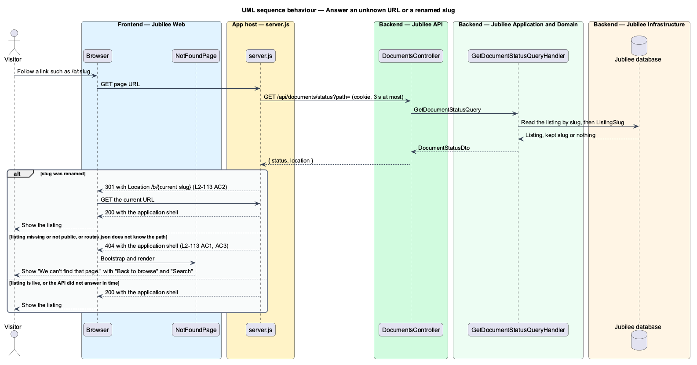
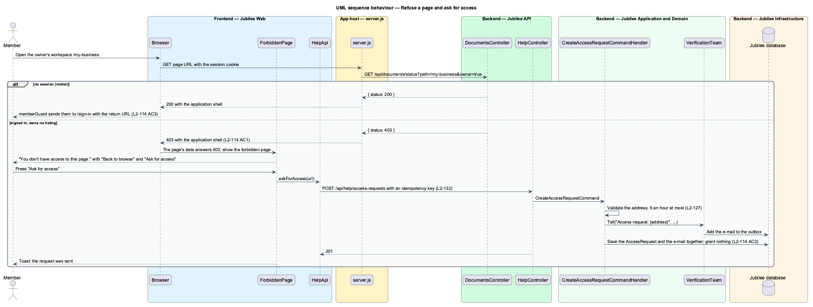
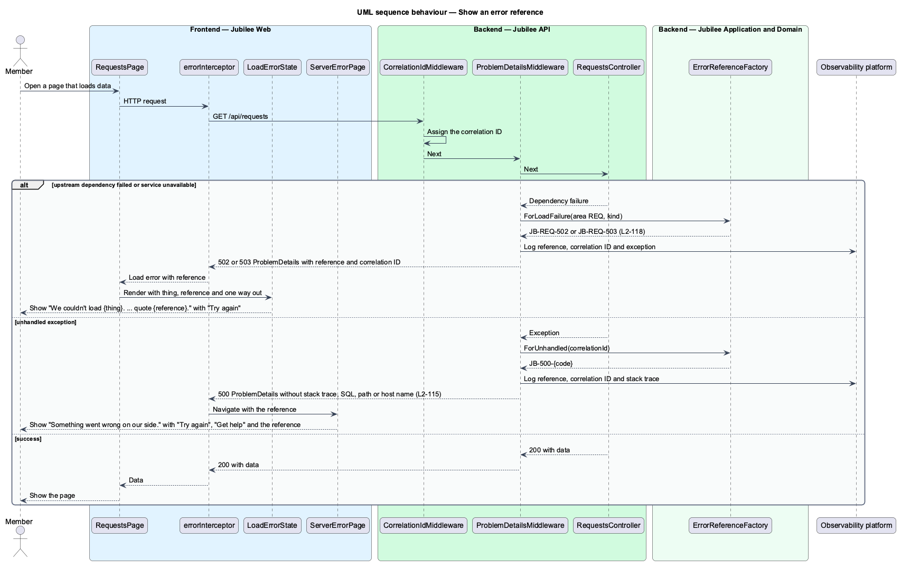

# Show error pages

## Overview

Every product meets missing pages, refused access and failures. Jubilee answers
each case with the correct HTTP status, a page written in plain language, a way
forward, and, for failures, a reference the person can quote to support. This
feature covers the not found page, the forbidden page, the server error page
and the error reference scheme used by every load-error state.

*Error reference* — short code shown to the user that support can match to the
failing request, in the form `JB-<AREA>-<NNN>`. `<AREA>` names the feature (for
example `REQ` for requests, `ADM` for admin). `<NNN>` is `502` when an upstream
dependency failed and `503` when the service was unavailable. An unhandled
server error uses the form `JB-500-{code}`. *Correlation ID* — identifier
assigned to each request and written to every log entry for that request.

`Jubilee Web` is a single-page application, so the status code of a page load
comes from the app's host (`eng/azure/server.js`), which returns the application
shell. The host decides between 200, 301, 403, 404, 500 and 503 before any
script runs: it matches the address against `routes.json` and asks the API
about the records the address names (ADR 0056). API calls made after the shell
has loaded receive RFC 9457 `ProblemDetails`, which `errorInterceptor` maps to
the same pages and to in-place load-error states.

## Description

The slice is cross-cutting: three pages and one shared component in
`Jubilee Web`, the app's host that answers page loads, and the endpoints and
middleware in `Jubilee API` that produce statuses and references.

- **`NotFoundPage`** — shows "We can't find that page. The link may be old, or
  the listing may have been removed. Search for the business by name, or start
  from browse." with "Back to browse" and "Search". It is the wildcard route and
  the target of every 404.
- **`ForbiddenPage`** — shows "You don't have access to this page. This area is
  for the owner of the listing or the Jubilee team." with "Back to
  browse" and "Ask for access".
- **`ServerErrorPage`** — shows "Something went wrong on our side. Your messages
  and requests are safe. Try again in a minute; if it keeps happening, tell us
  and quote the reference below." with "Try again", "Get help" and
  "Reference JB-500-{code}". A static copy of the page,
  `public/static/server-error.html`, covers a failure of the page load itself:
  the host serves it with 500 and writes the reference in (L2-115 AC3).
- **Static pages** — `tools/static-pages/build.mjs` builds
  `frontend/projects/jubilee/public/static/server-error.html` and
  `maintenance.html` from the mocks: the page's markup, the design-system tokens
  and components inlined, no script, Archivo from `/static/Archivo.woff2`. The
  reference and the back-by time sit between comment markers
  (`<!--reference-->…<!--/reference-->`, `<!--back-by-->…<!--/back-by-->`) the
  host fills. "Try again" is `href=""`: the same address again.
- **`LoadErrorState`** — shared component for a page or section that fails to
  load. It renders "We couldn't load {thing}. Nothing is lost. Check your
  connection and try again. If it keeps happening, tell us and quote
  {reference}." with "Try again" and one way out supplied by the host page.
- **`errorInterceptor`** — Angular HTTP interceptor. A failed `GET` with an
  unhandled error and a `JB-500-` reference opens `ServerErrorPage`; a `GET`
  answered `MAINTENANCE` opens `MaintenancePage`. Every other failure (404, 403,
  502, 503 with its reference) is left to the calling page, which shows
  `NotFoundPage`, `ForbiddenPage` or `LoadErrorState` (ADR 0031).
- **`memberGuard`** — sends a visitor who opens a protected route to `/sign-in`
  with a return URL; the forbidden page is reserved for signed-in members.
- **App host (`eng/azure/server.js`)** — answers a `GET` or `HEAD` of an
  address with no file extension. When its static root holds `routes.json` (the
  app's host), it asks `GET /api/documents/status?path=` with the caller's
  cookie and answers: the app with 200, 404 (also for an address `routes.json`
  does not match) or 403; a 301 to the current slug; the static maintenance page
  with 503 and `Retry-After`; the static server error page with 500. An API
  that does not answer within three seconds gives the app with 200. A
  link-preview fetcher gets the social preview only once the status is 200.
- **`routes.json`** — `frontend/projects/jubilee/public/routes.json`, the app's
  addresses as patterns (`/b/:slug`, `/admin/*`), with `owner: true` on the
  owner's workspace. It is kept with `app.routes.ts`.
- **`DocumentsController`** and **`GetDocumentStatusQueryHandler`** — expose
  `GET /api/documents/status?path=&owner=` (anonymous). The handler answers
  `{ status: 404 }` for `/b/{slug}` and every address under it when the listing
  is missing or not public to the caller, and for `/c/{category}` that is not
  one of the eleven; `{ status: 301, location }` for a kept slug, with the rest
  of the address kept; `{ status: 403 }` for an owner address asked by a
  signed-in member who owns no listing; `{ status: 200 }` otherwise. A visitor
  on a member's page is answered 200: `memberGuard` sends them to sign in.
- **`ListingSlug`** and **`KeptSlugRedirectAttribute`** — when an owner's save
  changes the business name, `SaveListingCommandHandler` gives the listing a new
  slug (`ListingSlugs.UniqueAsync`, which skips current and kept slugs) and keeps
  the old one as a `ListingSlug` row. The filter on `ListingsController.Get`,
  `ProductPagesController.Get` and the social preview turns a `NotFoundException`
  for a kept slug into a 301 to the same API address under the current slug.
  `BusinessPage` and `ProductPage` replace an address whose slug is not the
  listing's with the current one.
- **`CorrelationIdMiddleware`** — assigns the correlation ID and adds it to the
  logging scope and the response.
- **`ProblemDetailsMiddleware`** — catches failures and writes
  `JubileeProblemDetails` with `Reference` and `CorrelationId`. The body never
  contains a stack trace, SQL, a file path or an internal host name. It logs the
  reference, the correlation ID and the exception to the
  `Observability platform`, so a search by reference and time finds the request.
- **`ErrorReferenceFactory`** — builds references. `ForLoadFailure` combines the
  area declared by `ErrorAreaAttribute` on the controller with `502` or `503`.
  `ForUnhandled` returns `JB-500-{code}`; the mock shows a code of 4 characters
  (`7F3K`), and the code is four characters of a hash of the correlation ID, so one request
  always quotes one code (ADR 0031).
- **`HelpController`** and **`CreateAccessRequestCommandHandler`** — expose
  `POST /api/help/access-requests`. The handler stores an `AccessRequest` with
  the URL and the member's account and changes no role or permission, and tells
  the team through `JubileeTeam.Tell` ("Access request: {address}", with
  the address, the member's name and e-mail address and the time), saved with
  the request so it is sent once (ADR 0056).

## Requirements

The feature realizes the following level-2 (L2) requirements. Each L2
requirement refines a level-1 (L1) requirement, cited by identifier.

| L2 ID | Refines (L1) | Requirement |
|-------|--------------|-------------|
| `L2-113` | `L1-016` | The system shall respond 404 with the not found page for an unknown URL, a removed listing or a resource the user may not know exists, also to a page load, shall keep a listing's old slug when its name changes, and shall redirect an old listing slug to the current slug with 301. |
| `L2-114` | `L1-016` | The system shall respond 403 with the forbidden page to a signed-in member without permission for a page, shall create a help request with the URL and the member's account on "Ask for access" without granting anything and e-mail it to the verification team, and shall send a visitor to sign in with a return URL instead of the forbidden page. |
| `L2-115` | `L1-016` | The system shall respond 500 to an unhandled server error on a page load with the server error page, "Try again", "Get help" and "Reference JB-500-{code}", from a static copy when the app cannot be served, and the page shall contain no stack trace, SQL, file path or internal host name. |
| `L2-118` | `L1-016` | Every load-error state shall show a reference the user can quote to support: the area code of the feature with `502` when an upstream dependency failed and `503` when the service was unavailable. Support shall find the failing request's correlation ID and log entries by searching logs for the reference with the time. |
| `L2-133` | `L1-019` | The system shall check the caller's role and ownership of the specific object on every API endpoint before doing anything, and shall return 404 for another member's object requested by ID. |
| `L2-132` | `L1-018` | Each create request shall carry a client-generated idempotency key, and the server shall return the original result for a repeated key within 24 hours without creating a duplicate. |

## Diagrams

### System context

Visitors and members request pages from Jubilee. Jubilee sends structured logs
to the observability platform, where the on-call engineer searches by reference
and time.

### Containers

The app's host serves the page shell with its status, asking `Jubilee API`,
which returns `ProblemDetails` to `Jubilee Web`. It reads slugs from the `Jubilee database`, sessions from the
`Cache`, and writes logs to the observability platform.

### Components

`errorInterceptor` opens the server error and maintenance pages; the calling
page shows the others or `LoadErrorState`. The app's host asks
`DocumentsController` for a page load's status, and `ProblemDetailsMiddleware`
builds error bodies with `ErrorReferenceFactory`.

### Class structure

`ProblemDetailsMiddleware` writes `JubileeProblemDetails` carrying an
`ErrorReference` from `ErrorReferenceFactory`. `GetDocumentStatusQueryHandler`
and `KeptSlugRedirectAttribute` read `ListingSlug`, which
`SaveListingCommandHandler` writes when a name changes.

### Behaviour — answer an unknown URL or a renamed slug

The app's host answers 404 for an address `routes.json` does not know; the API
tells it 404 for a listing the caller may not see and 301 for a renamed slug.

### Behaviour — refuse a page and ask for access

A visitor is redirected to sign in; a signed-in member without permission
receives 403 and may create an access request that grants nothing.

### Behaviour — show an error reference

`ProblemDetailsMiddleware` logs the reference with the correlation ID and
returns it to the client, which shows it in `LoadErrorState` or on
`ServerErrorPage`.

