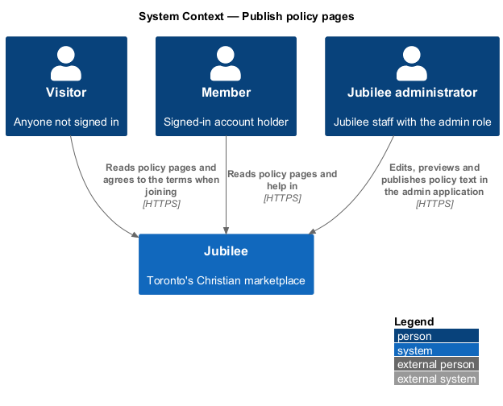
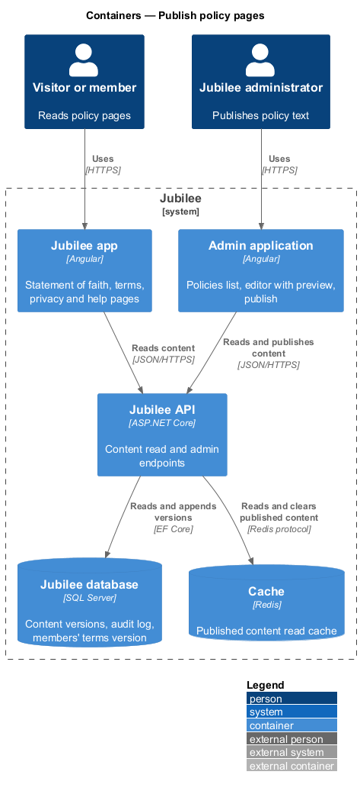
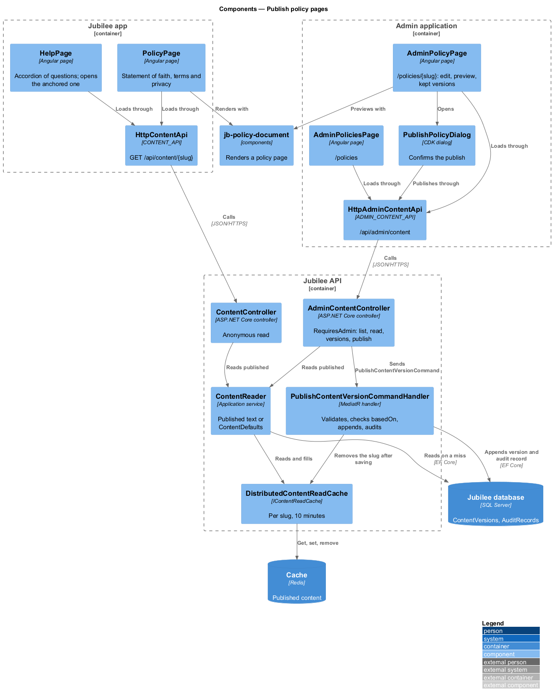
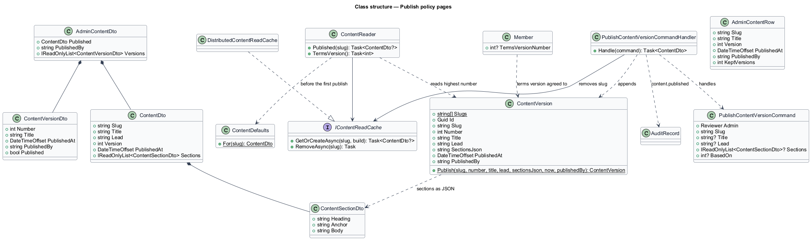
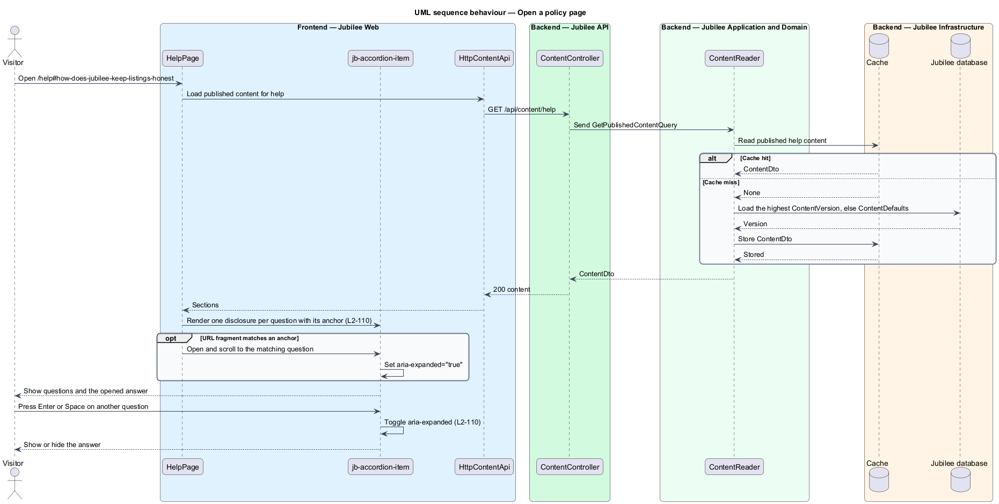
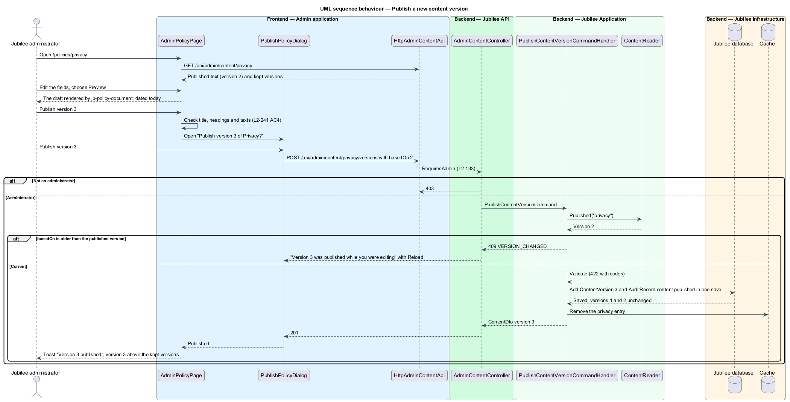
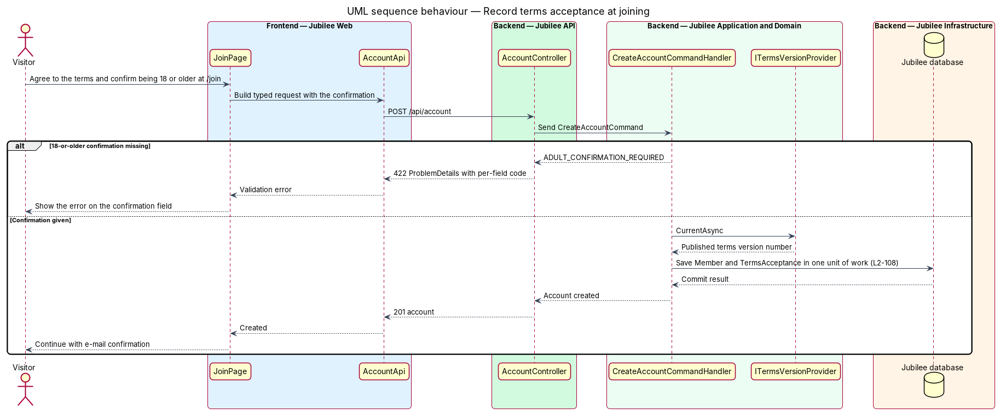

# Publish policy pages

## Overview

Jubilee is Toronto's Christian marketplace: a directory of
Christian-owned businesses. Trust in the directory rests on four public pages
that say what Jubilee stands for and how it works. This feature covers those
pages: the statement of faith at `/statement-of-faith`, the terms of use at
`/terms`, the privacy notice at `/privacy` and the help page at `/help`, and the
screens of the admin application where an administrator publishes their text.

A *policy page* is one of these four pages. Anyone can read them without an
account. Each page ends with "Last updated {date}", except Help, which ends with
a way to reach a person: "Still stuck? Write to us and a person answers within
one business day." with "E-mail help@jubilee.example".

The text of a policy page is *versioned content*: text stored as numbered,
immutable versions, of which the highest is published. An administrator changes
the text from the admin application without a code deployment, and every
earlier version is kept (ADR 0030, ADR 0067). The version number matters beyond
display: when a visitor agrees to the terms, Jubilee records which version of
the terms they agreed to; the agreement says "I am 18 or older and I agree to…".

The Help page presents each question as a *disclosure*, a native `
`
that shows or hides its answer, and gives each question an anchor, so that other
pages can link to one answer directly.

## Description

The feature is a vertical slice from the four pages of the app and the policies
screens of the admin application to the `ContentVersions` table.

### The app

- **`PolicyPage`** — Angular page for `/statement-of-faith`, `/terms` and
  `/privacy`; the route's `slug` says which. It reads the published version
  through `CONTENT_API` and renders it with `jb-policy-document`.
  - The statement of faith has the introduction ("Jubilee is open to everyone
    as a customer…"), "What we believe", "How we do business" with four
    commitments and "How listings stay honest" with a link to Help (ADR 0057).
  - The terms have "Your account" (18 or older, real name), "Listings",
    "Requests and payment" ("Jubilee does not take payment or hold funds; you
    pay the business directly.") and "Conduct".
  - The privacy notice has "What we keep", "Your choices" with links to
    notification settings and the account page, and "Privacy contact and your
    rights", which names the privacy contact and explains how to request access
    or correction, as PIPEDA requires. The contact is the placeholder
    `privacy@jubilee.example` until the owner publishes the real one (owner
    step, ADR 0067).
- **`HelpPage`** — Angular page at `/help`. It shows the questions "How does
  Jubilee keep listings honest?", "Does Jubilee take payment?", "Is it free?",
  "Who can see my messages?" and "How do I report a listing?" as
  `jb-accordion-item` disclosures, each with an element id equal to its anchor
  and `aria-expanded` on its summary, and opens and scrolls to the one the URL
  fragment names (`/help#how-does-jubilee-keep-listings-honest`). The first
  answers "Every owner agrees to Jubilee's statement of faith and to deal
  honestly with every customer when they list. If a listing isn't honest about
  its business, report it from the listing page: the Jubilee team reads every
  report and takes down listings that misrepresent a business." (ADR 0057).
- **`jb-policy-document`** (`PolicyDocument`, `components`) — renders a policy
  page: title, lead, each section's heading (with its anchor as id) and body
  blocks, and "Last updated {d MMMM y}" in Toronto time. The same component is
  the preview of the admin application's editor (ADR 0067).
- **`HttpContentApi`** (`CONTENT_API`) — `GET /api/content/{slug}`, where
  `slug` is `statement-of-faith`, `terms`, `privacy` or `help`. `parseBody`
  splits a body into paragraphs and "- " bullet lists, and keeps only
  `[text](/path)` links to Jubilee pages and `mailto:` links; it never renders
  markup.

### The admin application (L2-241)

- **`AdminPoliciesPage`** — `/policies`, for the `admin` role only. It lists the
  four pages with the published version, when and by whom ("Version 2 ·
  published 13 Nov 2026 by Daniel Osei", or "Version 1 · built in · 2 Nov
  2026"), each with "Edit". Loading, and the error "We couldn’t load the
  policies" with `JB-ADM-521` and "Try again".
- **`AdminPolicyPage`** — `/policies/{slug}`, the editor. The "Edit" card holds
  Title, Lead and each section's Heading and Text (with "Remove"), "Add a
  section" and "Publish version {n}"; beside it (below it on a phone) the
  "Preview" card renders the draft with `jb-policy-document`, dated today,
  under "Preview of version {n}. Not published yet.", and follows every change.
  Below the fields, "Kept versions" lists every version newest first.
  The draft is not stored (ADR 0067). A draft without a title, or a section
  without a heading or text, is refused in the fields before anything is sent.
  The error "We couldn’t load this policy" carries `JB-ADM-522`.
- **`PublishPolicyDialog`** — CDK dialog "Publish version {n} of {title}?" with
  "Members read it at once at {path}. Version {n − 1} is kept, and the publish is
  recorded in the audit log.", "Keep editing" (focused) and "Publish version
  {n}". It shows the busy state while publishing, "We couldn’t publish it" with
  "Try again" on failure, and on 409 `VERSION_CHANGED` "Version {n} was
  published while you were editing. Nothing was published. Reload to start from
  it." with "Reload". On success the editor shows the new version and the toast
  "Version {n} published" says "Members read it now."
- **`AdminBar`** shows "Policies" to a staff member with the `admin` role, and
  "Listings", "Reports" and "Featured" to one with the `moderator` role. A route
  with `role: 'admin'` shows "Nothing here for your role. Policies are for
  Jubilee administrators. Ask a Jubilee administrator to add the admin role to
  your staff account." to anyone else.
- **`HttpAdminContentApi`** (`ADMIN_CONTENT_API`) — the three admin endpoints
  below.

### The API

- **`ContentController`** — `GET /api/content/{slug}`, anonymous; an unknown
  slug is `404` `CONTENT_NOT_FOUND`; its reference is `JB-CONT-503`.
- **`AdminContentController`** — `[RequiresAdmin]` (a staff session with the
  `admin` role, `L2-133`, `L2-191`):
  - `GET /api/admin/content` → `AdminContentRow[]`: slug, title, version,
    published at, published by, kept versions (`JB-ADM-521`).
  - `GET /api/admin/content/{slug}` → `AdminContentDto`: the published text
    with its kept versions (`JB-ADM-522`).
  - `GET /api/admin/content/{slug}/versions` → `ContentVersionDto[]`, newest
    first.
  - `POST /api/admin/content/{slug}/versions` with `title`, `lead`, `sections`
    and `basedOn` → `201` and the published `ContentDto`. Unknown fields are
    `400`; a missing title or sections, an incomplete section or a body over
    20 000 characters is `422` (`TITLE_REQUIRED`, `SECTIONS_REQUIRED`,
    `SECTION_INCOMPLETE`, `SECTION_TOO_LONG`); a `basedOn` older than the
    published version is `409` `VERSION_CHANGED`.
- **`ContentReader`** — reads the published version of a page through
  `IContentReadCache`: the highest stored `ContentVersion` of the slug, or the
  built-in first version from `ContentDefaults` (the mocks' draft text, dated 2
  November 2026). `TermsVersion` gives the number recorded at joining.
- **`GetPublishedContentQueryHandler`**, **`ListAdminContentQueryHandler`**,
  **`GetAdminContentQueryHandler`** and **`ListContentVersionsQueryHandler`** —
  the reads.
- **`PublishContentVersionCommandHandler`** — validates the text, refuses a
  stale `basedOn`, appends `ContentVersion.Publish(slug, next number, …)`,
  writes `content.published` to the audit log in the same save, and then
  removes the page from the read cache. No command updates or deletes a
  version, so every earlier one is kept. A section keeps its anchor; a new one
  takes its anchor from its heading.
- **`IContentReadCache`** / **`DistributedContentReadCache`** — the published
  text per slug in `IDistributedCache` (Redis in production, memory otherwise)
  for at most 10 minutes. A store that is down never fails a read; the text
  comes from the database.
- **`ContentVersion`** — domain entity: slug, number, title, lead, sections as
  JSON (heading, anchor, body), published at and by.
- **`Member.TermsVersionNumber`** — written by `JoinWithEmailCommandHandler`
  and `AcceptAgreementCommandHandler` from `ContentReader.TermsVersion` when
  the agreement is accepted; without it joining fails with `422`
  `AGREEMENT_REQUIRED`.

## Requirements

The feature realizes the following level-2 (L2) requirements. Each L2
requirement refines a level-1 (L1) requirement, cited by identifier.

| L2 ID | Refines (L1) | Requirement |
|-------|--------------|-------------|
| `L2-107` | `L1-015` | The system shall show the statement of faith at `/statement-of-faith` with its introduction, "What we believe", "How we do business", "How listings stay honest" with a link to Help, and "Last updated {date}". The statement's text shall be managed as versioned content without a code deployment, and previous versions shall be kept. |
| `L2-108` | `L1-015` | The system shall show the terms of use at `/terms` with the sections "Your account", "Listings", "Requests and payment", "Conduct" and "Last updated {date}". A visitor who creates an account shall confirm being 18 or older as part of agreeing to the terms, and the terms version shall be recorded. |
| `L2-109` | `L1-015` | The system shall show the privacy notice at `/privacy` with "What we keep", "Your choices" and "Last updated {date}". The notice shall name the privacy contact and explain how to request access or correction, as PIPEDA requires. |
| `L2-110` | `L1-015` | The system shall show the help page at `/help` with its five questions and answers and the contact line with "E-mail help@jubilee.example". Each question shall be a disclosure with `aria-expanded` that opens by keyboard and has an anchor for direct links. |
| `L2-133` | `L1-019` | The server shall check the caller's role on every API endpoint before doing anything; only an admin shall publish a content version. |
| `L2-241` | `L1-015` | An administrator shall edit, preview and publish a version of a policy page from the admin application; a stale publish shall be refused; the publish shall be audited; members shall read the new version on their next request through a read cache the publish clears. |

## Diagrams

### System context

Visitors and members read the policy pages. A Jubilee administrator, a staff
member with the `admin` role, publishes new versions of the text from the admin
application.

### Containers

The app reads published content from the `Jubilee API`, which serves it from
the `Cache` and the `Jubilee database`; the admin application publishes it.

### Components

The app's pages and the admin editor's preview share `jb-policy-document`. In
the API, the anonymous read and the admin endpoints each go through their own
handler, and both reads use `ContentReader` and the read cache.

### Class structure

`ContentVersion` rows are immutable; the highest number of a slug is published.
`Member` records the terms version they agreed to.

### Behaviour — open a policy page

The page loads the published version, renders its sections and, on `/help`,
opens the disclosure that the URL fragment names.

### Behaviour — publish a new version

An administrator edits and previews the draft, then publishes it. The earlier
versions stay in the database, the publish is audited and the cached copy is
removed.

### Behaviour — record the terms version at joining

The join handler records the published terms version with the new member.

