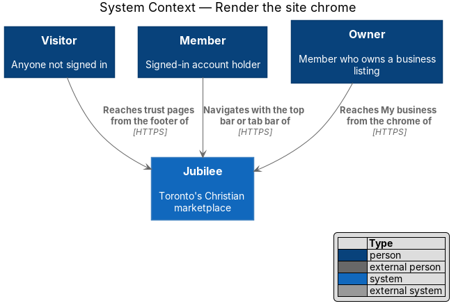
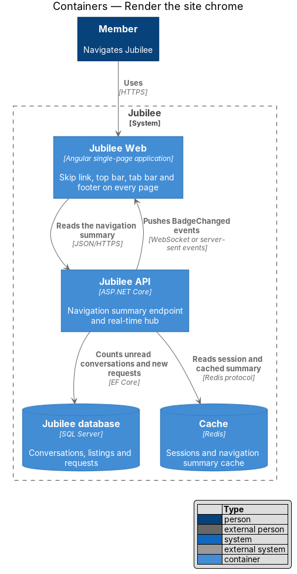
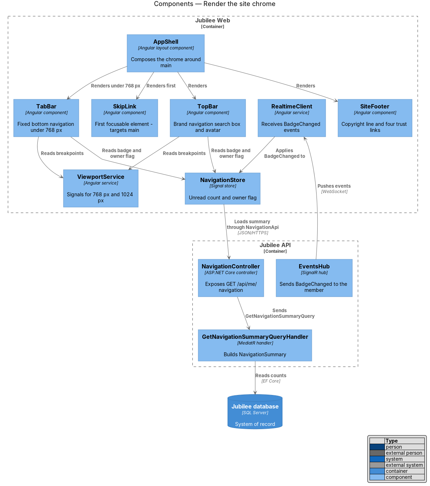
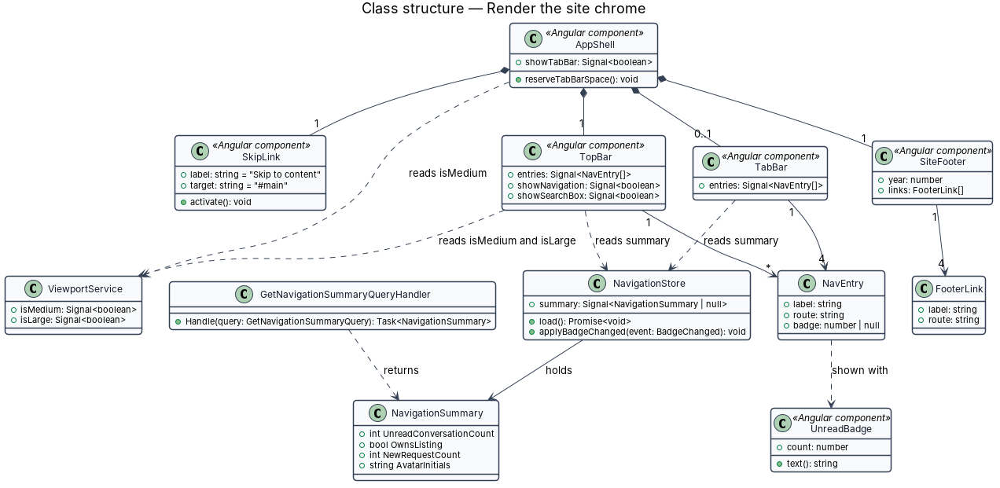
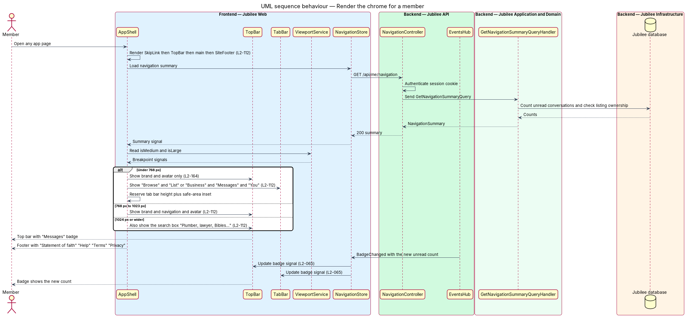
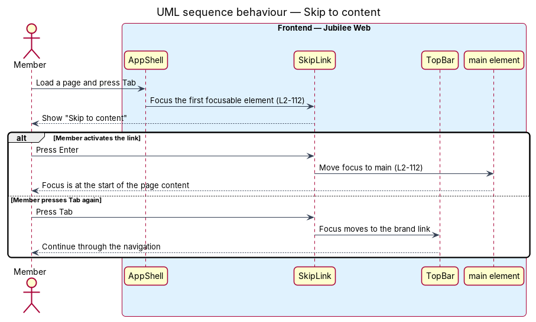

# Render the site chrome

## Overview

Jubilee is Toronto's Christian marketplace: a directory of verified
Christian-owned businesses. *Site chrome* — frame of navigation that surrounds
the content of every app page — consists of four parts: a skip link, a top bar, a
bottom tab bar on small screens, and a footer. This feature covers that frame.

The chrome is where the trust content is always within reach. The footer of
every app page reads "© {year} Jubilee · Toronto's Christian marketplace" and
links to "Statement of faith", "Help", "Terms" and "Privacy".

The navigation adapts to the viewport. At 768 px or wider, a member's top bar
carries the primary navigation; from 1024 px it also carries the search box.
Under 768 px, a fixed tab bar at the bottom of the screen carries the primary
navigation, and the page reserves space so that the bar never covers content.

Two entries depend on the member. The entry to the owner workspace reads "List
your business" (tab: "List") for a member without a listing and "My business"
(tab: "Business") for an owner. "Messages" carries a badge with the number of
unread conversations.

## Description

The feature is a vertical slice from the application shell in `Jubilee Web` to a
small navigation read model in the `Jubilee API`.

- **`AppShell`** — root Angular layout component. It renders, in document
  order, `SkipLink`, `TopBar`, the `main` element with the router outlet,
  `SiteFooter` and `TabBar`. The `main` element has `id="main"` and
  `tabindex="-1"` so that it can receive focus.
- **`SkipLink`** — link with the text "Skip to content" and the target `#main`.
  It is the first focusable element of every page, is visible when focused, and
  moves focus to `main` when activated.
- **`TopBar`** — Angular component for the top bar. For a member at 768 px or
  wider it shows the brand, "Browse", "Messages" with badge, "List your
  business" or "My business", and the avatar. From 1024 px it also shows
  `TopBarSearchBox`; below 1024 px a search link (label "Search") leads to
  `/search`. A member also gets the notifications button, with a dot while
  notifications are unread. Under 768 px the top bar shows only the brand, the
  search link and the notifications button (`L2-164`); the account is reached
  from "You" in the tab bar. For a visitor the top bar shows the brand (linked to
  `/welcome`), "Browse", "Sign in" and the button "Join free", and the tab bar
  shows "Browse", "Sign in" and "Join" (`L2-022`).
- **`TopBarSearchBox`** — search input with the placeholder "Plumber, lawyer,
  Bibles…". Submitting navigates to the search page; the search features own the
  query rules.
- **`TabBar`** — Angular component fixed to the bottom of the viewport for a
  member under 768 px. It shows "Browse", "List" or "Business", "Messages" with
  badge, and "You". Its bottom padding is `env(safe-area-inset-bottom)`, which
  places it above the device safe area. `AppShell` adds bottom padding of the
  tab bar height plus the same inset to the page while the tab bar is shown.
- **`SiteFooter`** — Angular component. It renders "© {year} Jubilee · Toronto's
  Christian marketplace", with the year from the device clock, and router links
  to `/statement-of-faith`, `/help`, `/terms` and `/privacy`.
  The footer is the last thing on the page at every page length: the page is a
  column at least as tall as the viewport and `main` takes the height the
  content leaves, so a short page puts the footer at the bottom of the viewport
  (directly above the tab bar under 768 px) and no space shows below it.
- **`UnreadBadge`** — shared component for a count. It shows "99+" above 99 and
  announces "{n} unread" to screen readers.
- **`ViewportService`** — Angular service that exposes two signals from
  `matchMedia`: `isMedium` (`min-width: 768px`) and `isLarge`
  (`min-width: 1024px`). `TopBar`, `TabBar` and `AppShell` read these signals;
  no component reads the window width directly.
- **`NavigationStore`** — signal store with the `NavigationSummary` of the
  signed-in member. It loads on sign-in through `NavigationApi` and applies
  `BadgeChanged` events from `RealtimeClient`, so a badge follows a change made
  on another device within 5 seconds while the page is open.
- **`NavigationController`** — ASP.NET Core controller for
  `GET /api/me/navigation`. It requires a signed-in session and reads only the
  caller's own data.
- **`GetNavigationSummaryQuery`** and **`GetNavigationSummaryQueryHandler`** —
  return `NavigationSummary`: `UnreadConversationCount`, `OwnsListing`,
  `NewRequestCount` and the avatar initials. Until the messaging, request and
  onboarding features exist the counts are `0` and `OwnsListing` is false; the
  handler is not cached, and a cache is added with the first real count.
- **`EventsHub`** — SignalR hub in `Jubilee.Api`. It sends `BadgeChanged` to the
  member's connections when the messaging or request features write the
  matching outbox message.

The chrome holds no business rules of its own. Its obligations are structural:
the same four footer links on every app page, the right navigation for each
viewport, and a skip link first in the focus order.

## Requirements

The feature realizes the following level-2 (L2) requirements. Each L2
requirement refines a level-1 (L1) requirement, cited by identifier.

| L2 ID | Refines (L1) | Requirement |
|-------|--------------|-------------|
| `L2-112` | `L1-015` | Every app page shall show the footer "© {year} Jubilee · Toronto's Christian marketplace" with links "Statement of faith", "Help", "Terms" and "Privacy", and a "Skip to content" link as the first focusable element that moves focus to `main`. A member shall see the top bar navigation at 768 px or wider, with the search box from 1024 px, and a fixed tab bar above the device safe area under 768 px, with page space reserved for it. The footer shall sit at the bottom of the viewport when the content is shorter than it, with no space below the footer at any page length. |
| `L2-164` | `L1-023` | Under 768 px a member page shall show the bottom tab bar and a top bar with only the brand, the search link and the notifications button; from 768 px to 1023 px the tab bar shall be hidden and the top bar shall show the primary navigation; from 1024 px the top bar shall also show the search box. |
| `L2-065` | `L1-010` | "Messages" in the top bar and tab bar shall carry a count badge with the number of unread conversations, announced as "{n} unread", shown as "99+" above 99 and updated within 5 seconds while the page is open. |

## Diagrams

### System context

Visitors, members and owners all see the chrome; it is the same frame around
every Jubilee page.

### Containers

`Jubilee Web` renders the chrome and reads the navigation summary from the
`Jubilee API`, which pushes badge changes over the real-time connection.

### Components

`AppShell` composes the four chrome components. `ViewportService` and
`NavigationStore` supply the two inputs that vary the chrome: the viewport and
the member's navigation summary.

### Class structure

`AppShell` owns `SkipLink`, `TopBar`, `TabBar` and `SiteFooter`. `TopBar` and
`TabBar` build their entries from `NavigationSummary` and the `ViewportService`
signals.

### Behaviour — render the chrome for a member

The shell loads the navigation summary once, then chooses the top bar content
and the tab bar from the viewport signals; a `BadgeChanged` event updates the
badge in place.

### Behaviour — skip to content

The first Tab press on any page reaches "Skip to content"; activating it moves
focus past the navigation to `main`.

