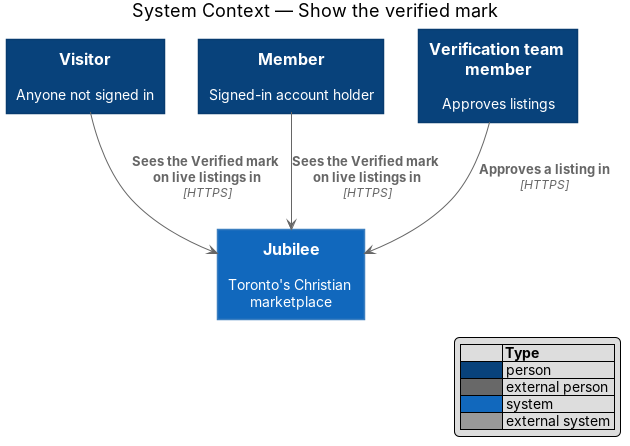
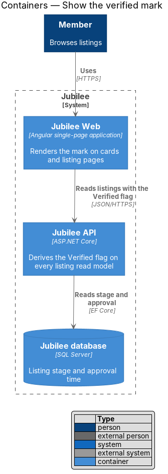
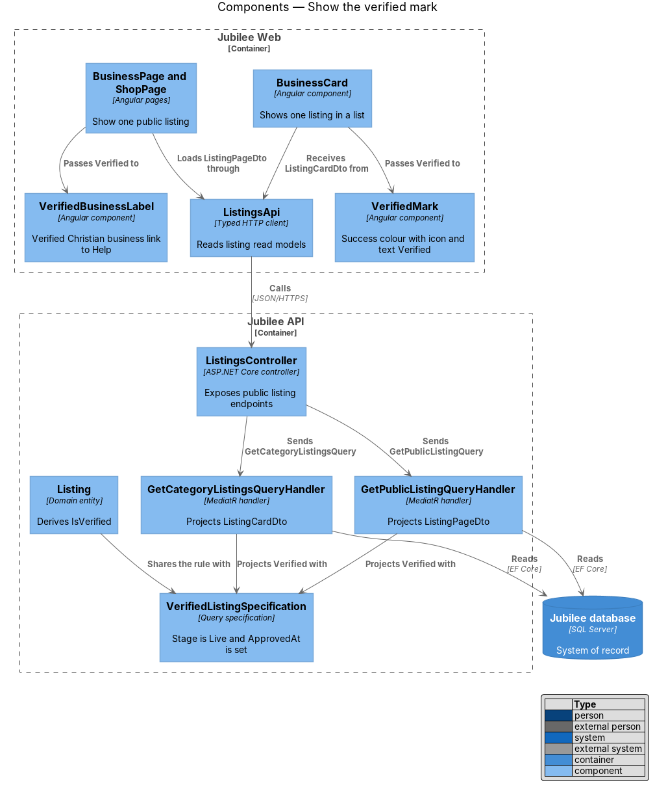
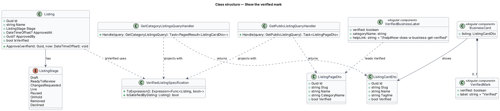
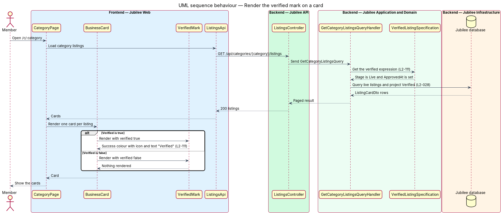
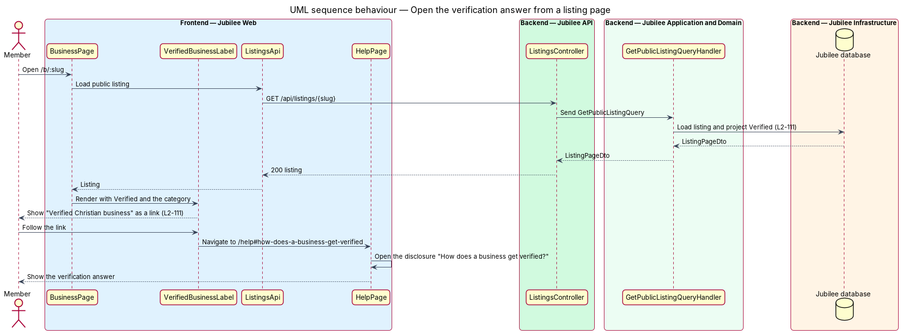

# Show the verified mark

## Overview

Jubilee is Toronto's Christian marketplace: a directory of verified
Christian-owned businesses. Before a listing is public, the owner submits it and the
verification team reviews and approves it. The *verified mark* — icon and the text "Verified" shown with a
listing — tells a member that this happened.

The mark is a promise, so the design derives it from one fact on the server and
renders it through one component. A listing carries the mark only when the
verification team approved it and it is currently live. A draft, a listing that
waits on review, a listing with requested changes and a
paused listing never carry it.

The mark does not rely on colour alone. It combines the success colour, an icon
and the word "Verified", so that members who cannot distinguish the colour still
read it. On a listing page the longer label "Verified Christian business" links
to the Help answer that explains verification.

## Description

The feature is a thin vertical slice: one derived value in the domain, one field
on every listing read model, and two presentation components.

- **`Listing.IsVerified`** — derived domain property. It is true only when
  `Stage` is `Live` and `ApprovedAt` has a value. No column stores it, so no
  write path can set it apart from the stage.
- **`Listing.Approve`** — domain method called by the approval handler of the
  verification features. It sets `ApprovedAt`, `ApprovedBy` and the `Live`
  stage. It is the only code that sets `ApprovedAt`.
- **`VerifiedListingSpecification`** — query specification
  (`Stage == Live && ApprovedAt != null`) that EF Core translates to SQL. The
  listing projections use it, so the domain property and the database filter
  share one definition.
- **`ListingCardDto.Verified`** and **`ListingPageDto.Verified`** — boolean
  field on each read model that carries a listing to `Jubilee Web`: business
  cards in browse, category, search, featured, related and saved lists, and the
  business and shop pages. Projections fill it from
  `VerifiedListingSpecification`.
- **`GetCategoryListingsQueryHandler`** and **`GetPublicListingQueryHandler`** —
  representative query handlers that apply the projection. Public lists already
  return only live listings (`L2-028`); the owner and verification team preview
  of a listing that is not live returns `Verified = false`.
- **Write models without the field** — no command or request type has a
  `verified`, `stage` or `approvedAt` property. A request body that names one is
  rejected with `400` and nothing changes (`L2-133`).
- **`VerifiedMark`** — Angular presentation component. It renders the check
  icon with `aria-hidden="true"` and the visible text "Verified", coloured with
  the design system's success tokens. It renders nothing when its `verified`
  input is false.
- **`VerifiedBusinessLabel`** — Angular component for listing pages. It renders
  the icon and "Verified Christian business" as a link to
  `/help#how-does-a-business-get-verified`, followed by the category.
- **`BusinessCard`**, **`BusinessPage`** and **`ShopPage`** — hosts. The card
  passes `ListingCardDto.Verified` to `VerifiedMark`; the pages pass
  `ListingPageDto.Verified` to `VerifiedBusinessLabel`. The owner workspace
  header ("Verified · live since {Month YYYY}") reads the same flag.
- **`ListingPreviewCard`** — preview card used before a listing is live. It
  shows "Pending verification" in place of the mark.
- **`VerifiedMarkTests`** — automated tests. Domain tests assert
  `IsVerified` for every `ListingStage`; a component test asserts that the mark
  contains an icon and the text "Verified"; an API test asserts that a body with
  `verified` is rejected.

## Requirements

The feature realizes the following level-2 (L2) requirements. Each L2
requirement refines a level-1 (L1) requirement, cited by identifier.

| L2 ID | Refines (L1) | Requirement |
|-------|--------------|-------------|
| `L2-111` | `L1-015` | A listing approved by the verification team and currently live shall carry the "Verified" mark wherever it is shown, and a listing in any other stage shall never carry it. The mark shall use the success colour with an icon and the text "Verified", never colour alone, and the label "Verified Christian business" on a listing page shall link to the Help answer on verification. |
| `L2-028` | `L1-003` | Browse, category, search, featured and related lists shall show only listings that are verified and not paused, deleted or under a moderation hold. |
| `L2-133` | `L1-019` | The server shall reject with 400 an update request that includes fields the caller is not allowed to set, such as `verified`, and shall change nothing. |

## Diagrams

### System context

Visitors and members see the mark. A `Verification team member` creates the
fact behind it by approving a listing.

### Containers

`Jubilee Web` renders the mark from a flag that the `Jubilee API` derives from
the listing's stage and approval in the `Jubilee database`.

### Components

The hosts pass the flag to `VerifiedMark` or `VerifiedBusinessLabel`. In the
API, the query handlers project the flag through
`VerifiedListingSpecification`.

### Class structure

`Listing` derives `IsVerified` from `Stage` and `ApprovedAt`. The read models
carry `Verified`, and the two components render it.

### Behaviour — render the verified mark on a card

A category list query projects `Verified` for each listing, and each
`BusinessCard` renders the mark from that flag only.

### Behaviour — open the verification answer from a listing page

The label on the listing page links to the Help page, which opens the answer to
"How does a business get verified?".

