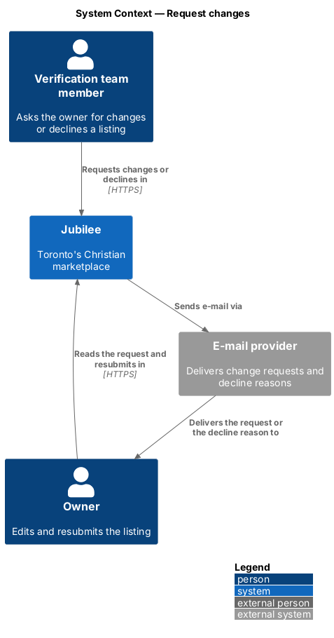
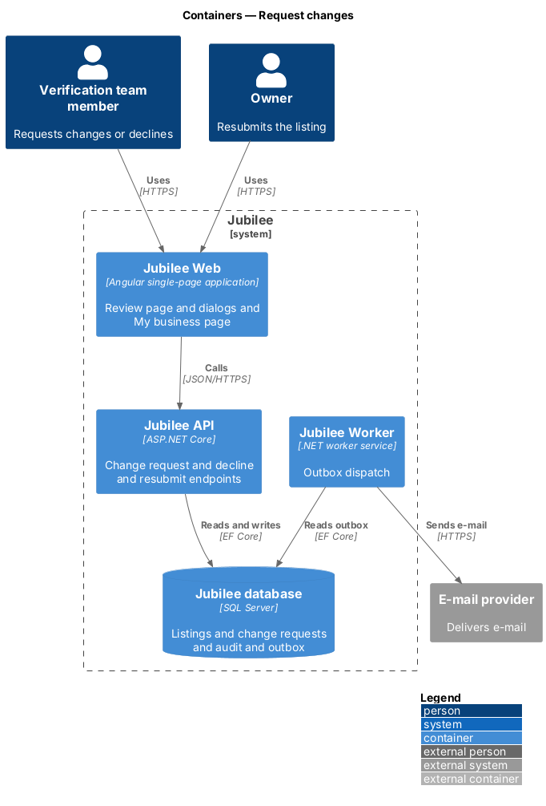
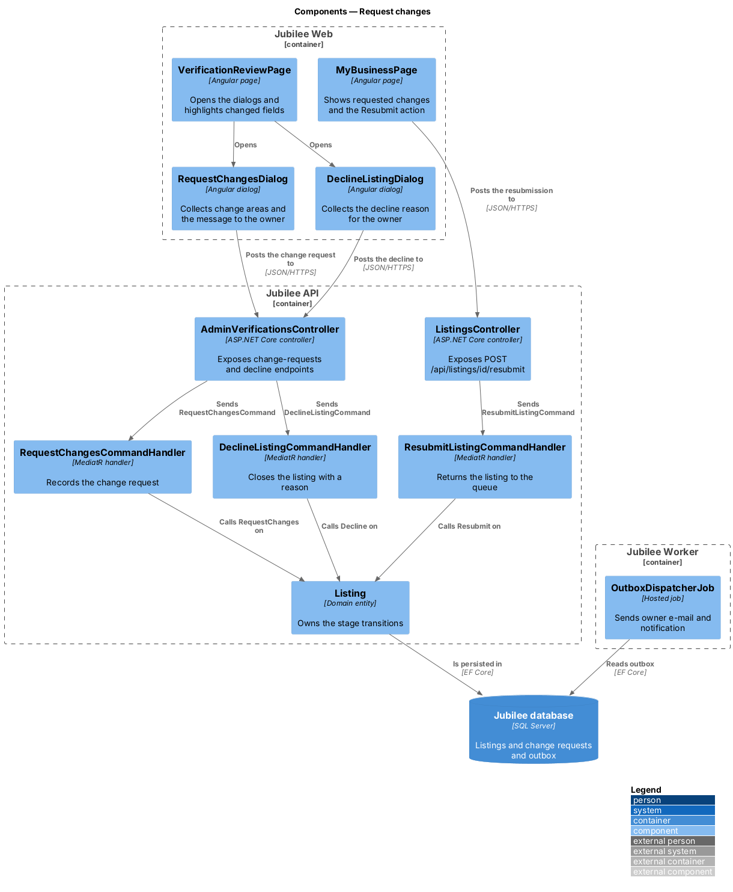
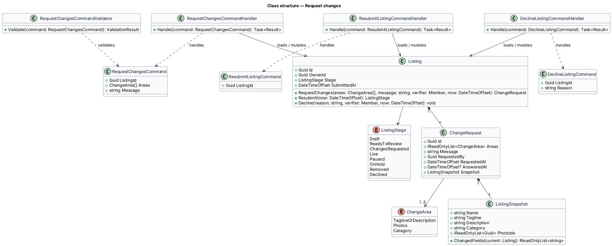
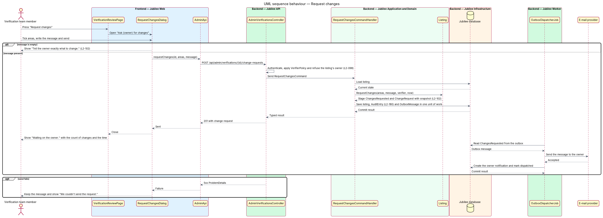
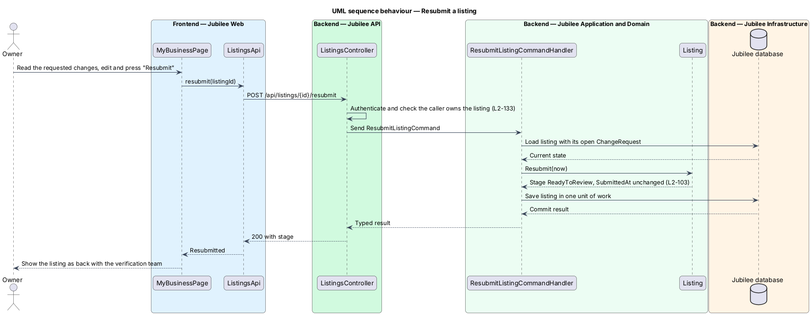
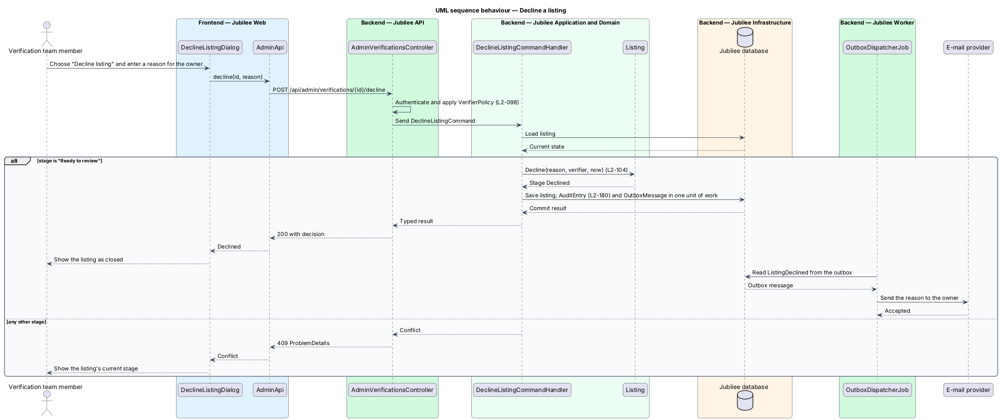

# Request changes

## Overview

A verifier who reviews a submitted listing has three decisions: approve, request
changes, or decline. This feature covers the second and third, and the owner's
answer to a change request. Approval belongs to the `review-and-approve-listing`
feature.

*Change request* — message from a verifier to an owner naming what to change
before the listing can be published. A change request names one or more *change
areas*: "Tagline or description", "Photos" or "Category".
The listing stays unpublished in the stage "Changes requested" until the owner
edits it and presses "Resubmit". *Resubmission* returns the listing to the
queue under its original submitted date, so a corrected listing does not lose
its place.

*Decline* — closing decision available when a listing is in "Ready to review".
The verifier uses it when the listing cannot be verified. The owner receives the
reason by e-mail and may submit again.

## Description

The feature spans the admin review page, the owner's My business page, three
commands and one `Jubilee Worker` job.

- **`RequestChangesDialog`** — dialog titled "Ask {owner} for changes". It
  states "The listing stays unpublished and comes back to the queue when she
  resubmits.", offers the checkboxes under "What needs to change?" and the
  required field "Message to {owner}" with the hint "Sent by e-mail and shown
  on her My business page." An empty message shows "Tell the owner exactly what
  to change." A failed send keeps the text and shows "We couldn't send the
  request. Nothing was sent and your message is kept. Try again."
- **`VerificationReviewPage`** — after a successful request it shows "Waiting on
  the owner. You asked {owner} for {n} changes today at {time}. The listing
  returns to the queue when she resubmits." For a resubmitted listing it
  highlights each field named by `ListingSnapshot.ChangedFields`.
- **`DeclineListingDialog`** — dialog behind the action "Decline listing". It
  collects the reason for the owner and says "{Owner} is e-mailed your reason.
  Use this when the listing cannot be verified." Its mock is
  `dialogs/decline-listing`; the title reads "Decline {business}?" and the
  field "Reason for {first name}" (ADR 0020).
- **`MyBusinessPage`** — owner page. It shows the requested changes and the
  verifier's message, and offers "Resubmit" while the stage is "Changes
  requested".
- **`AdminVerificationsController`** — exposes
  `POST /api/admin/verifications/{id}/change-requests` and
  `POST /api/admin/verifications/{id}/decline` under `RequiresVerifier`, the staff policy (`security/authorize-staff-requests`), and
  refuses a verifier who owns the listing with HTTP 403.
- **`ListingsController`** — exposes `POST /api/listings/{id}/resubmit`. A
  caller who does not own the listing receives HTTP 403.
- **`RequestChangesCommand`** and **`RequestChangesCommandValidator`** — carry
  `ListingId`, `Areas` and `Message`. The validator returns HTTP 422 with the
  field code for an empty `Message`. The maximum message length is
  2000 characters (ADR 0020).
- **`RequestChangesCommandHandler`** — calls `Listing.RequestChanges`, which
  sets the stage to `ChangesRequested` and creates a `ChangeRequest` holding a
  `ListingSnapshot`. The handler appends the `AuditEntry` and writes a
  `ChangesRequested` `OutboxMessage` in the same unit of work.
- **`ChangeRequest`** — entity with the areas, message, verifier, request time
  and snapshot.
- **`ListingSnapshot`** — value object copied from the listing when changes are
  requested. `ChangedFields(current)` compares it with the resubmitted listing
  and returns the names of the fields that differ.
- **`ResubmitListingCommandHandler`** — calls `Listing.Resubmit`. The listing
  always moves to `ReadyToReview`. `SubmittedAt` is not changed.
- **`DeclineListingCommandHandler`** — calls `Listing.Decline`, which accepts
  only the stage `ReadyToReview` and sets `Declined`. The handler appends the
  `AuditEntry`, and writes a `ListingDeclined` `OutboxMessage` that carries the
  reason. Any other stage yields HTTP 409.
- **Submitting again after a decline** — the owner of a declined listing may
  submit again; the new submission enters the queue at "Ready to review".
- **`OutboxDispatcherJob`** — sends the change request or the decline reason to
  the owner through `IEmailSender` and creates the owner's `Notification`.

## Requirements

The feature realizes the following level-2 (L2) requirements. Each L2
requirement refines a level-1 (L1) requirement, cited by identifier.

| L2 ID | Refines (L1) | Requirement |
|-------|--------------|-------------|
| `L2-102` | `L1-014` | The system shall let a verifier ask the owner for changes through a dialog with change areas and a required message, shall move the listing to "Changes requested", and shall e-mail the owner and show the requested changes on My business. The change areas shall be "Tagline or description", "Photos" and "Category". |
| `L2-103` | `L1-014` | The system shall return a resubmitted listing to "Ready to review", shall keep its original submitted date for queue order, and shall highlight on the review screen the fields changed since the request. |
| `L2-104` | `L1-014` | The system shall let a verifier decline a listing in "Ready to review" with a reason for the owner, shall close the listing and e-mail the reason, and shall allow the owner to submit again. |
| `L2-098` | `L1-014` | A verifier who owns a listing shall not approve or request changes on it, and every admin API shall return HTTP 403 to a member without the `verifier` role. |
| `L2-180` | `L1-025` | The system shall store an append-only audit record with actor, action, target, time, before and after values, and reason for each verification decision. |

## Diagrams

### System context

The verifier and the owner both act through Jubilee. The e-mail provider carries
the change request or decline reason to the owner.

### Containers

`Jubilee API` records each decision in the `Jubilee database`. `Jubilee Worker`
dispatches the e-mail.

### Components

Two dialogs post to `AdminVerificationsController` and `MyBusinessPage` posts to
`ListingsController`. Each of the three handlers calls one transition on
`Listing`.

### Class structure

`Listing` composes `ChangeRequest` records, each with one `ListingSnapshot`.
Three handlers load and mutate the listing through its `RequestChanges`,
`Resubmit` and `Decline` methods.

### Behaviour — request changes

The dialog validates the message, the handler moves the listing to "Changes
requested" with an audit entry, and `OutboxDispatcherJob` tells the owner.

### Behaviour — resubmit a listing

`Listing.Resubmit` returns the listing to "Ready to review" and keeps
`SubmittedAt`.

### Behaviour — decline a listing

The handler declines only from "Ready to review". `OutboxDispatcherJob` then
e-mails the reason to the owner.

