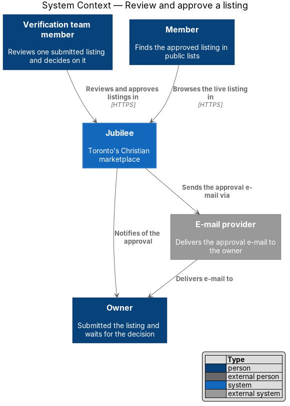
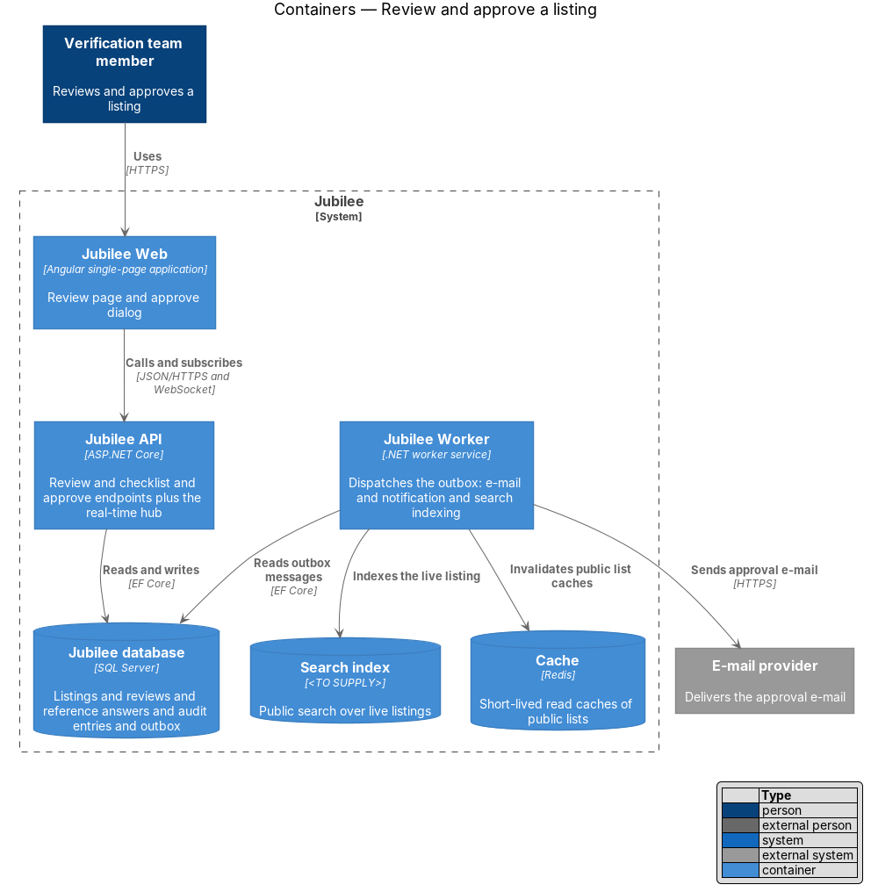
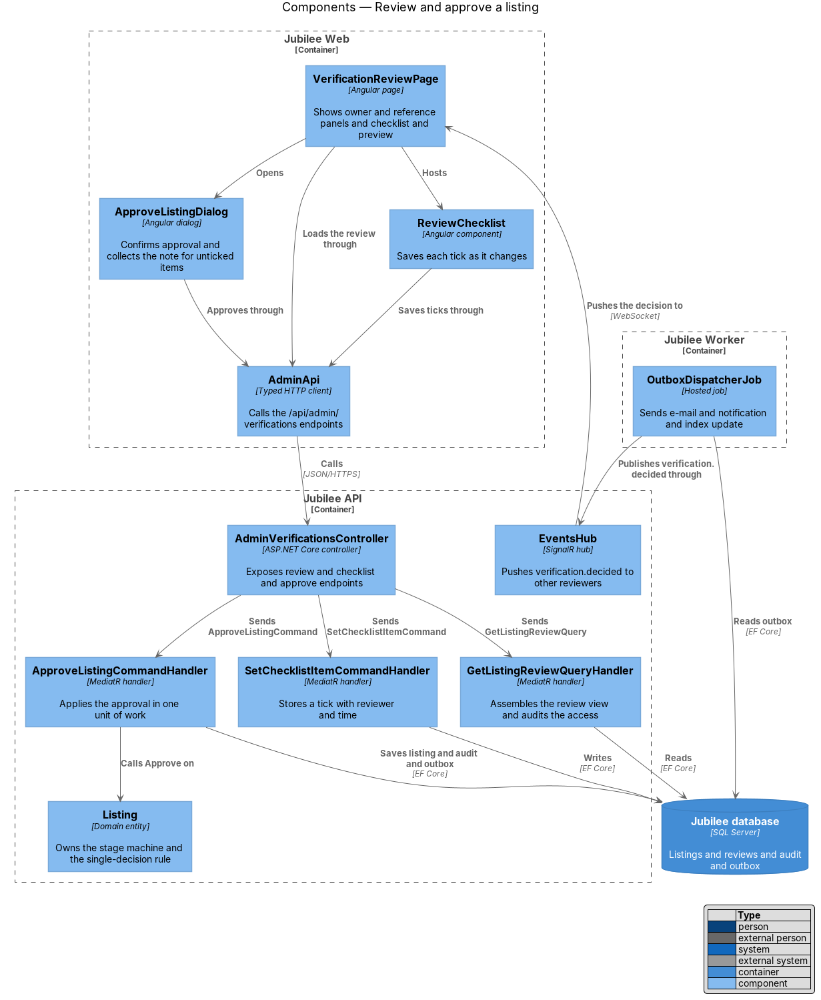
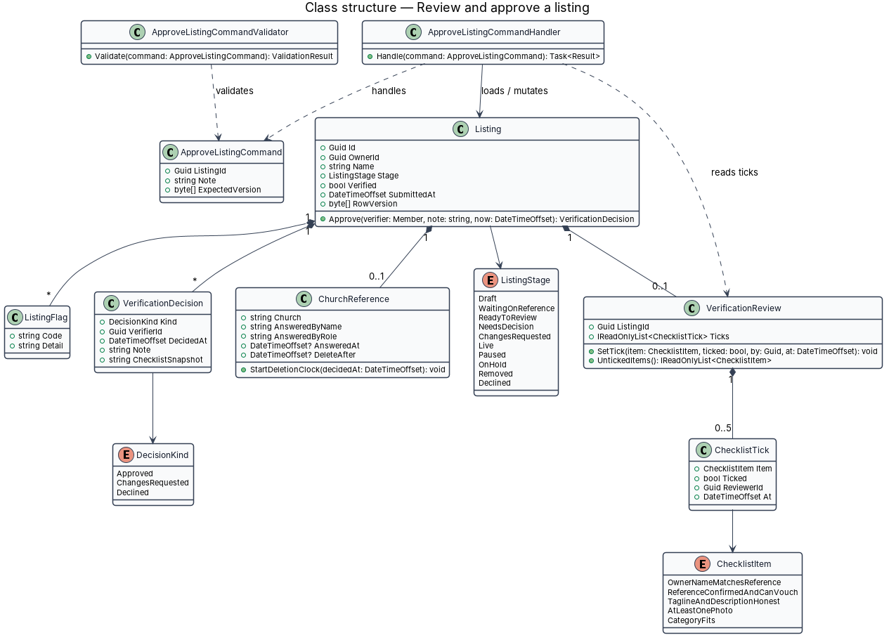
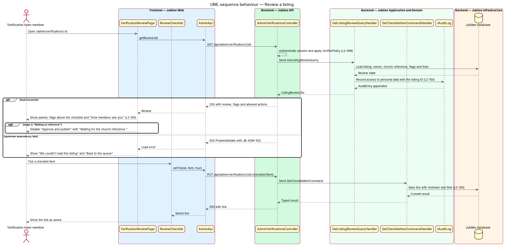
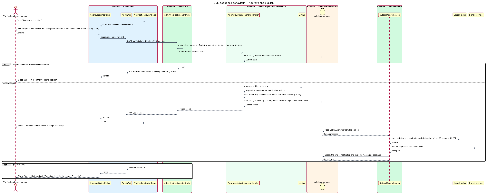

# Review and approve a listing

## Overview

A submitted listing becomes public only after a member of the verification team
approves it. This feature covers the review page at `/admin/verifications/:id`
and the "Approve and publish" decision. The other two decisions, requesting
changes and declining, belong to the `request-changes` feature.

The review page gathers what a verifier reads before deciding: the listing's
name and stage, the Owner panel, the Church reference panel, any flags raised at
submission, a five-item checklist, and the preview "How members see you". A
*church reference answer* is the reply a pastor or elder gave about the owner;
it is private to verifiers and is deleted 90 days after a decision. A *flag* is
a mark placed on a listing at submission, for example a tagline that contains a
phone number (`L2-072`) or a reference e-mail named on more than 5 listings in
30 days (`L2-074`).

Approval moves the listing to live and verified, publishes it in public lists
within 60 seconds, e-mails and notifies the owner, and writes the decision to
the audit log. A listing accepts one decision at a time: when two verifiers open
the same listing, the second decision is refused with HTTP 409.

## Description

The feature is a vertical slice from the review page to the database, with
`Jubilee Worker` carrying the side effects of approval.

- **`VerificationReviewPage`** — Angular page at `/admin/verifications/:id`. It
  shows the name, the line "{category} · submitted {when} · {stage}", the
  actions "Request changes" and "Approve and publish", the Owner panel (name,
  e-mail with confirmation status, member since, other listings), the Church
  reference panel (church, answered by name and role and time, answer, note)
  and the preview "How members see you". A failed load shows "We couldn't load
  this listing" with `JB-ADM-502` and "Back to the queue".
- **`ChurchReferencePanel`** — component inside the page. It always states
  "Private. Never shown to the owner or the public; deleted 90 days after a
  decision."
- **`ReviewChecklist`** — component listing the five items "Owner's name matches
  the reference", "Reference confirmed and can vouch", "Tagline and description
  are honest and clear", "At least one photo of the products or work" and
  "Category fits what they offer". It saves each tick as it changes and shows
  flags above the items.
- **`ApproveListingDialog`** — dialog titled "Approve and publish {business}?"
  with the text "It goes live in {category} straight away with the Verified
  mark, and {owner} is e-mailed." and the buttons "Not yet" and "Approve and
  publish". When a checklist item is unticked, the dialog lists the unticked
  items and requires a note. On failure it shows "We couldn't publish it. The
  listing is still in the queue. Try again."
- **`AdminVerificationsController`** — exposes
  `GET /api/admin/verifications/{id}`,
  `PUT /api/admin/verifications/{id}/checklist/{item}` and
  `POST /api/admin/verifications/{id}/approve` under `VerifierPolicy`. It
  refuses the approve command with HTTP 403 when the caller owns the listing.
- **`GetListingReviewQueryHandler`** — assembles `ListingReviewDto` from the
  listing, owner, church reference, flags and ticks. It appends an `AuditEntry`
  for the access to personal data with the listing ID as the reason.
- **`VerificationReview`** and **`ChecklistTick`** — store the checklist state
  of a listing. Each tick records the `ChecklistItem`, the reviewer and the
  time.
- **`ApproveListingCommand`** and **`ApproveListingCommandValidator`** — carry
  `ListingId`, `Note` and `ExpectedVersion`. The validator requires `Note` when
  `VerificationReview.UntickedItems()` is not empty. The maximum note length is
  `<TO SUPPLY>`.
- **`ApproveListingCommandHandler`** — loads the listing, calls
  `Listing.Approve`, sets `ChurchReference.DeleteAfter` to the decision time
  plus 90 days, appends the `AuditEntry` with verifier, time and checklist
  state, and writes a `ListingApproved` `OutboxMessage`, all in one unit of
  work.
- **`Listing.Approve`** — domain method. It accepts the stages "Ready to review"
  and "Needs a decision", sets `Stage` to `Live` and `Verified` to true, and
  records a `VerificationDecision`. A listing in "Waiting on reference" or one
  that already carries a decision for the current submission is refused; the
  handler maps the refusal and a stale `RowVersion` to HTTP 409.
- **`OutboxDispatcherJob`** — hosted job in `Jubilee Worker`. For
  `ListingApproved` it updates the `Search index`, invalidates the cached
  public lists, sends the approval e-mail through `IEmailSender`, and creates
  the owner's `Notification`. Indexing and invalidation complete within
  60 seconds of the decision.
- **`EventsHub`** — pushes `verification.decided` to verifiers who have the same
  listing open. `VerificationReviewPage` then shows the decision and disables
  both actions.

## Requirements

The feature realizes the following level-2 (L2) requirements. Each L2
requirement refines a level-1 (L1) requirement, cited by identifier.

| L2 ID | Refines (L1) | Requirement |
|-------|--------------|-------------|
| `L2-100` | `L1-014` | The system shall show one listing to review at `/admin/verifications/:id` with the Owner panel, the private Church reference panel, submission flags, a checklist whose ticks are saved with the reviewer and time, and the preview "How members see you". The system shall disable approval while the listing is "Waiting on reference" and shall refuse a second decision on the same listing with HTTP 409. |
| `L2-101` | `L1-014` | The system shall confirm approval in a dialog, shall require a note when a checklist item is unticked, and on confirmation shall make the listing live and verified, show it in public lists within 60 seconds, and e-mail and notify the owner. The decision shall be written to the audit log with the verifier, time and checklist state, and the 90-day deletion clock for the reference answer shall start. |
| `L2-098` | `L1-014` | A verifier who owns a listing shall not approve or request changes on it, and every admin API shall return HTTP 403 to a member without the `verifier` role. |
| `L2-146` | `L1-020` | A reference's answer, name, role and note shall be visible only to verifiers through the review screen, and shall be permanently deleted 90 days after a verification decision. |
| `L2-150` | `L1-020` | The system shall record in the audit log each staff view of a member's personal data, with the reason (report ID or listing ID). |
| `L2-180` | `L1-025` | The system shall store an append-only audit record with actor, action, target, time, before and after values, and reason for each verification decision. |

## Diagrams

### System context

The verification team member reviews and approves in Jubilee. Jubilee notifies
the owner in the product and through the e-mail provider, and members then find
the listing in public lists.

### Containers

`Jubilee API` commits the decision to the `Jubilee database`. `Jubilee Worker`
reads the outbox and updates the `Search index`, the `Cache` and the e-mail
provider.

### Components

`VerificationReviewPage` hosts `ReviewChecklist` and opens
`ApproveListingDialog`. The controller sends one query and two commands; the
approval handler mutates `Listing`, and `OutboxDispatcherJob` publishes the
decision through `EventsHub`.

### Class structure

`Listing` composes its `VerificationReview`, `ChurchReference`, `ListingFlag`
and `VerificationDecision` records. `ApproveListingCommandHandler` loads the
listing and reads the ticks to snapshot the checklist.

### Behaviour — review a listing

The query handler audits the access before the page shows the panels. Each tick
is saved with its reviewer and time.

### Behaviour — approve and publish

The handler refuses a second decision with HTTP 409, otherwise commits the
approval, audit entry and outbox message together. `OutboxDispatcherJob` then
publishes the listing and tells the owner.

