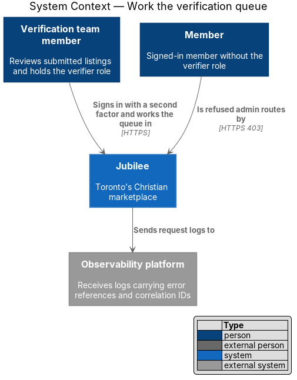
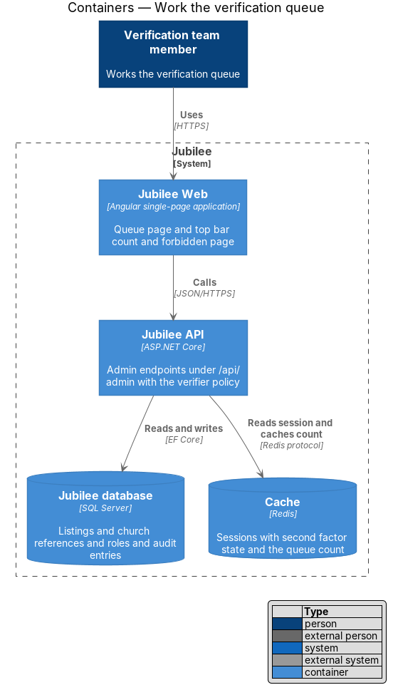
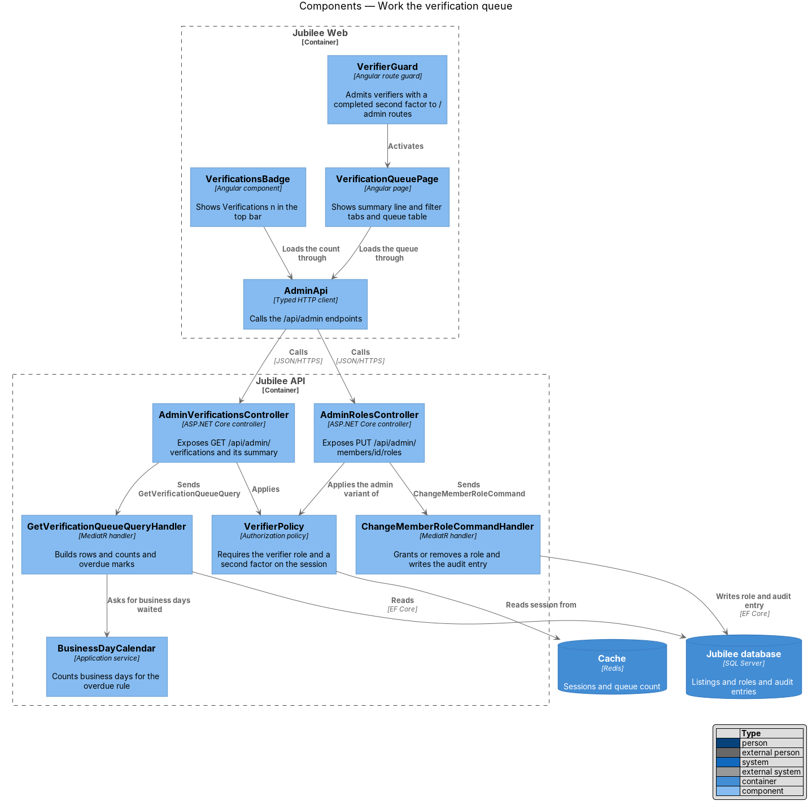
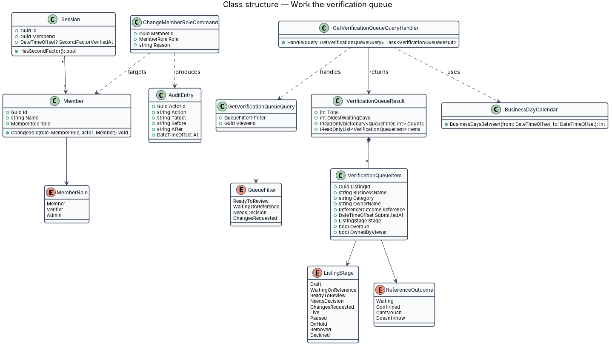
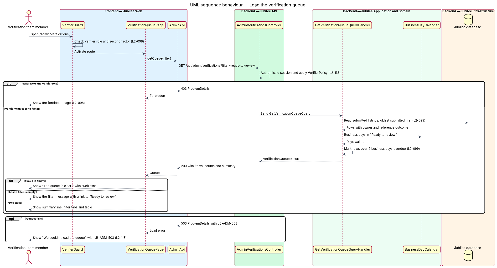
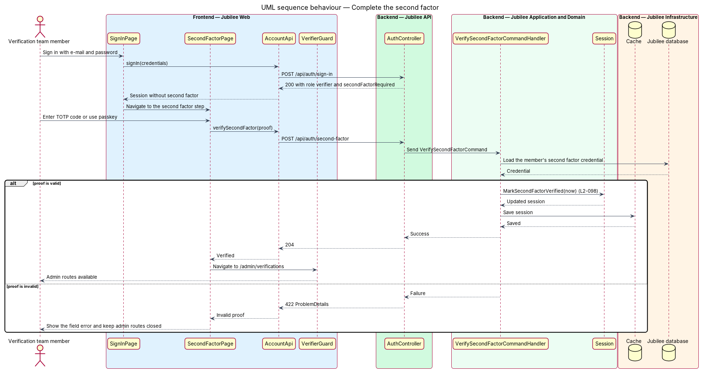
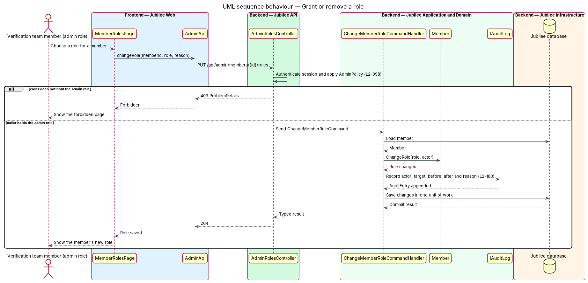

# Work the verification queue

## Overview

Jubilee publishes a business only after the verification team has reviewed it. A
*verifier* is a member who holds the `verifier` role; an *admin* is a member who
holds the `admin` role and grants or removes roles. This feature covers the
entry to the admin area: who may reach `/admin/*`, the second factor a verifier
completes after sign-in, the "Verifications {n}" count in the top bar, and the
queue page at `/admin/verifications`.

The *verification queue* is the list of submitted listings that have not yet
been approved or declined. Each listing in the queue holds one of four stages:
"Ready to review", "Waiting on reference", "Needs a decision" or "Changes
requested". The queue orders listings oldest submitted first and marks a listing
*overdue* when it has been "Ready to review" for more than 2 business days.

The slice is read-mostly. Decisions on a single listing belong to the review
features (`review-and-approve-listing`, `request-changes`); this slice supplies
the access rules those features rely on, including the rule that a verifier who
owns a listing shall not decide on it.

## Description

The feature runs from the Angular admin shell to the Jubilee database.

- **`VerifierGuard`** — Angular route guard on every `/admin/*` route. It admits
  a session that holds the `verifier` role and a completed second factor, sends
  a verifier without a second factor to `SecondFactorPage`, and shows
  `ForbiddenPage` to any other signed-in member.
- **`SecondFactorPage`** — Angular page that collects a TOTP code or a passkey
  assertion after sign-in. Its route is `<TO SUPPLY>`. It calls
  `POST /api/auth/second-factor` through `AccountApi`.
- **`VerificationQueuePage`** — Angular page at `/admin/verifications`. It shows
  the summary line (for example "4 listings · 2 ready to review · oldest waiting
  4 days"), the filter tabs "Ready to review", "Waiting on reference", "Needs a
  decision" and "Changes requested" with their counts, and a table with the
  columns Business, Category, Owner, Church reference, Submitted and Stage.
- **Queue states** — `VerificationQueuePage` renders five states. An empty queue
  shows "The queue is clear. Every submitted listing has been reviewed. New
  submissions appear here as soon as the owner sends them." with "Refresh". An
  empty filter shows a message for that filter (for example "No listings are
  waiting on changes. Owners have answered every change request.") with a link
  to "Ready to review". A failed load shows "We couldn't load the queue" with
  the reference `JB-ADM-503`.
- **`VerificationsBadge`** — top bar component shown to verifiers. It renders
  "Verifications {n}", where `n` is the number of listings in "Ready to review".
  It reads `GET /api/admin/verifications/summary`.
- **`AdminApi`** — typed Angular HTTP client for `/api/admin`.
- **`AdminVerificationsController`** — ASP.NET Core controller. It exposes
  `GET /api/admin/verifications?filter={filter}` and
  `GET /api/admin/verifications/summary`, applies `VerifierPolicy`, and sends
  the queries through MediatR.
- **`VerifierPolicy`** — authorization policy on every admin endpoint. It
  requires the `verifier` role and a `Session` whose `SecondFactorVerifiedAt` is
  set. Any other caller receives HTTP 403 as `ProblemDetails`; the check runs on
  the server and does not rely on the guard.
- **`GetVerificationQueueQueryHandler`** — MediatR handler. It reads listings in
  the four queue stages ordered by `SubmittedAt` ascending, counts each filter,
  computes the age of the oldest listing in days, and maps the church reference
  to `Confirmed`, `Waiting`, `CantVouch` or `DoesntKnow`.
- **`BusinessDayCalendar`** — application service that counts business days
  between two instants. The handler marks a row `Overdue` when a listing has
  held "Ready to review" for more than 2 business days. The holiday list and
  time zone are `<TO SUPPLY>`.
- **`VerificationQueueItem`** — read model for one row. `OwnedByViewer` is true
  when the signed-in verifier owns the listing; the review endpoints refuse
  approve and request-changes commands from that verifier with HTTP 403.
- **`VerifySecondFactorCommandHandler`** — MediatR handler that checks the TOTP
  code or passkey assertion against the member's `SecondFactorCredential` and
  sets `Session.SecondFactorVerifiedAt`. Enrolment of the credential is
  `<TO SUPPLY>`.
- **`AdminRolesController`** and **`ChangeMemberRoleCommandHandler`** — expose
  `PUT /api/admin/members/{id}/roles` under `AdminPolicy`. The handler calls
  `Member.ChangeRole` and appends an `AuditEntry` with actor, target, before and
  after values and reason in the same unit of work. The page that hosts this
  action, `MemberRolesPage`, has no mock; its route is `<TO SUPPLY>`.

## Requirements

The feature realizes the following level-2 (L2) requirements. Each L2
requirement refines a level-1 (L1) requirement, cited by identifier.

| L2 ID | Refines (L1) | Requirement |
|-------|--------------|-------------|
| `L2-098` | `L1-014` | The system shall return HTTP 403 and the forbidden page to a member without the `verifier` role on `/admin/*` and every admin API, shall require a verifier to complete a second factor (TOTP or passkey) before any admin route is available, and shall show "Verifications {n}" in the verifier's top bar. Only an `admin` role holder shall grant or remove roles, each change shall be written to the audit log, and a verifier who owns a listing shall not approve or request changes on it. |
| `L2-099` | `L1-014` | The system shall list submitted listings at `/admin/verifications`, ordered oldest submitted first, with a summary line, four filter tabs with counts, and the columns Business, Category, Owner, Church reference, Submitted and Stage. The page shall mark a listing overdue after more than 2 business days in "Ready to review" and shall show dedicated empty, empty-filter and load-error (`JB-ADM-503`) states. |
| `L2-133` | `L1-019` | The system shall check the caller's role and ownership of the specific object on every API endpoint before doing anything, without relying on the client hiding a control. |
| `L2-180` | `L1-025` | The system shall store an append-only audit record with actor, action, target, time, before and after values, and reason for each sensitive action, including role changes. |
| `L2-118` | `L1-016` | The system shall show a quotable error reference on every load-error state, with `503` when the service was unavailable. |

## Diagrams

### System context

The verification team member reaches the queue through Jubilee after a second
factor; a member without the role is refused. Request logs carrying the error
reference go to the observability platform.

### Containers

`Jubilee Web` calls the admin endpoints of `Jubilee API`, which reads listings
and roles from the `Jubilee database` and session state from the `Cache`.

### Components

`VerifierGuard` activates `VerificationQueuePage`, which loads data through
`AdminApi`. In `Jubilee API`, both controllers apply the policy before a handler
runs; `GetVerificationQueueQueryHandler` uses `BusinessDayCalendar` for the
overdue rule.

### Class structure

`GetVerificationQueueQueryHandler` returns a `VerificationQueueResult` that
composes `VerificationQueueItem` rows. `Session` carries the second factor state
and `ChangeMemberRoleCommand` produces an `AuditEntry`.

### Behaviour — load the verification queue

The controller applies `VerifierPolicy` before the handler reads the queue. The
page then renders the populated, empty, empty-filter or load-error state.

### Behaviour — complete the second factor

A verifier's session opens admin routes only after
`VerifySecondFactorCommandHandler` marks the second factor on the `Session`.

### Behaviour — grant or remove a role

`AdminRolesController` admits only an `admin` role holder. The handler changes
the role and appends the audit entry in one unit of work.

